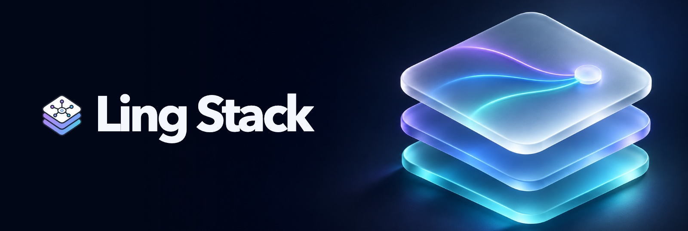
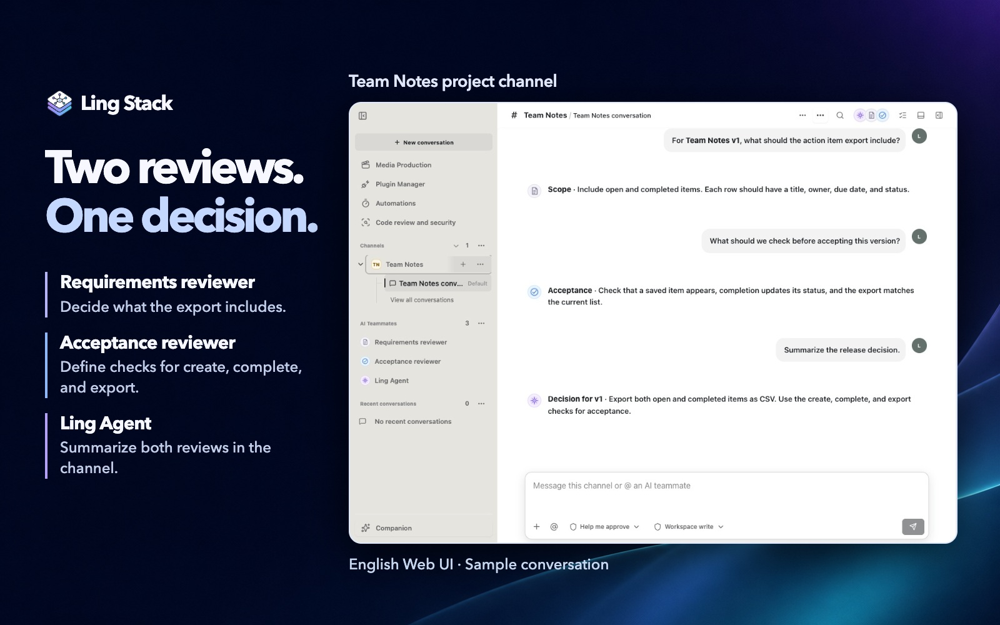
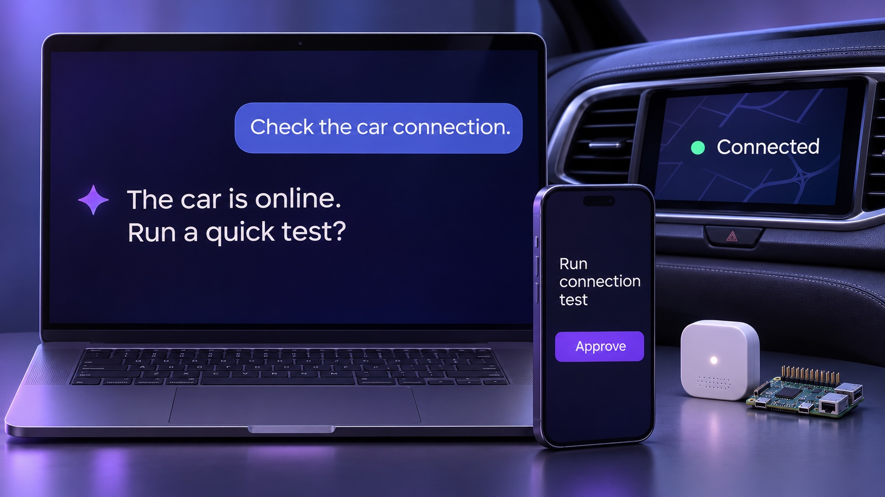

<div align="center">
  <h1></h1>
  <p><strong>Many models. One project.</strong></p>
  <p>Give AI teammates their own models and keep conversations, tool approvals, and results in one local workspace.</p>
  <p>
    <a href="docs/community/first-project-review.md"><strong>Try a project review</strong></a> ·
    <a href="#quick-start-from-source">Run from source</a> ·
    <a href="#cross-device-roadmap">Device roadmap</a> ·
    <a href="CONTRIBUTING.md">Contribute</a>
  </p>
  <p>Source-first alpha · <a href="LICENSE">MIT License</a></p>
  <p>
    English · <a href="README.zh-CN.md">简体中文</a> ·
    <a href="README.ja-JP.md">日本語</a> · <a href="README.ko-KR.md">한국어</a> ·
    <a href="README.de-DE.md">Deutsch</a> · <a href="README.fr-FR.md">Français</a> ·
    <a href="README.es-ES.md">Español</a> · <a href="README.pt-BR.md">Português (Brasil)</a>
  </p>
</div>

## Start With A Project Review

The [Team Notes sample](examples/project-review/README.md) is a brief for a small
app that tracks and exports meeting action items. Review it in one project channel.

1. Ask the **requirements reviewer** which items and fields the export should include.
2. Ask the **acceptance reviewer** how to verify that creating, completing, and exporting items works.
3. Ask **Ling Agent** to summarize the decision and checks in the same channel.



*English Web UI with sample messages based on the public Team Notes brief.* [Open the original screenshot](docs/assets/ling-project-review-channel-fixture.jpg).

Follow the [project review guide](docs/community/first-project-review.md) for a
discussion-only trial using your own model configuration and API key. Provider charges apply.

## Cross-Device Roadmap

The roadmap brings device work into a Ling conversation. A PC, phone, or edge
host can coordinate the task, with execution and verification handled by the
host that has an authorized connection to the device.



*Head unit connection test concept. Request a connection check on a PC, then approve the test on a paired phone.*

- On a **PC**, build and test a project or diagnose a supported system.
- On **mobile**, follow and approve tasks from a paired PC or connect directly to supported peripherals.
- In a **smart home**, check device status and diagnose issues through Home Assistant.
- For a compatible **Android head unit**, install and validate apps while the vehicle is parked.
- At a **hardware bench**, capture and decode protocol data and verify the device response.

**Design stage.** See the [cross-device design](docs/design/ling-device-fabric.md)
and the [implementation and device acceptance plan](docs/design/ling-device-support-platform-implementation-plan.md).

## Meet Yui

Yui is a character concept for Ling Stack's intelligent companion.
[View the character design template](docs/design/assets/yui-character-design-template.png).

<a href="docs/assets/ling-stack-companion-banner.jpg"></a>

## Who Is It For?

Ling Stack is for developers and people who work with several AI models or teammates
and want to keep their work in one place. It connects OpenAI, Anthropic, Volcengine Ark,
DeepSeek-compatible endpoints, MiniMax, GLM, and OpenAI-compatible relays through a
shared Model Workbench.

Workspace state, conversation history, and run evidence are stored locally. Requests
and their context go to the model or tool providers you choose. The interface offers
55 language and region options; interface language and AI response language can be
configured separately. README translations cover the eight languages linked above,
not every interface locale. Other documentation may still be in English or Chinese.

## Three Ways To Use It

- **Chat with a model.** Configure a model in [Model Workbench](docs/getting-started.md#connect-your-first-model)
  and keep your messages, attachments, and replies in one conversation.
- **Work with AI teammates.** Assign models and tools in a [project channel](docs/getting-started.md#start-a-project-channel).
  Review their messages, tool activity, approvals, and artifacts alongside the final report.
- **Create images or video.** Configure a provider with the relevant capability
  and keep scenes, generation jobs, and outputs together in [Media Production](docs/getting-started.md#try-media-production).

Begin with a simple conversation, then add teammates or tools when the work needs them.
Skills provide instructions; tool access and permission remain explicit. Coding-agent
work uses the Pi runtime adapter, and available execution tools depend on platform setup
and workspace policy.

## Quick Start From Source

Use Git, **Node.js 22.22.1 or newer**, **Corepack with pnpm 10**, and
**Rust 1.89 or newer with Cargo** ([rustup](https://rustup.rs/)).

### 1. Install and build the local Web stack

```bash
git clone https://github.com/ling-stack-org/ling-stack.git
cd ling-stack
corepack enable
corepack pnpm install --frozen-lockfile
corepack pnpm --workspace-concurrency=1 --filter '@ling-stack/cli...' -r build
```

The filtered build includes the CLI, daemon, Web app, and their workspace dependencies.
Desktop and Mobile builds have separate setup requirements.

### 2. Start the daemon

Keep this command running in the first terminal, from the repository root:

```bash
corepack pnpm ling daemon start --foreground
```

The default daemon address is `http://127.0.0.1:17891`. Keep it on loopback.

### 3. Open the Web UI

In a second terminal, from the same repository root:

```bash
corepack pnpm ling ui --foreground --open
```

Open `http://127.0.0.1:5173` if the browser does not open automatically. Keep both
terminals running while you use the workspace.

### 4. Connect a model and try a conversation

Open **Settings → Model Workbench**, add a chat-capable model with your own API key,
and run **Check**. The first verified chat model becomes the workspace default. Start
a new conversation and ask a small question, then inspect the response and its details.

See [Getting started](docs/getting-started.md) for a walkthrough of the first model,
conversation, and project channel.

<details>
<summary>Build notes and diagnostics</summary>

The Web and daemon build compiles a native image sanitizer. CI uses Rust `1.97.1`
and Node `22.22.1`. The repository pins pnpm `10.0.0`.

On a fresh checkout, `pnpm install` may report that the `ling-stack-daemon` bin
is missing before the daemon is built. Continue with the build and use
`corepack pnpm ling` to invoke the source CLI. Node 22's experimental SQLite warning is informational.

Check that `curl http://127.0.0.1:17891/health` returns JSON with `"ok": true`.
After configuring and checking a chat model, run:

```bash
corepack pnpm ling doctor
```

Doctor reports model readiness as well as local service health. A fresh workspace with
no chat model reports a provider failure even when the daemon and Web UI are running.

See [Troubleshooting](docs/troubleshooting.md) for setup errors.

</details>

## Support And Limits

The Web UI, local daemon, and CLI are the source-first alpha entry points. Desktop
builds are development previews. Stable signed installers and production support are pending.

<details>
<summary>Platform and integration status</summary>

| Surface or integration | Current scope |
| --- | --- |
| Web, daemon, and CLI | Source alpha; the default getting-started path |
| Electron Desktop | Development shell; platform setup and clean-machine acceptance remain separate gates |
| Chrome extension and Browser Host | Local development integration; Chrome Web Store publication pending |
| MCP and Plugin Manager | Explicit tool assignment, activation, and approval boundaries |
| Office and Computer Use native features | Platform-dependent development; consult the maintained implementation and release gates |
| Image and video generation | Provider- and capability-dependent; selected live adapters still have open gates |
| Mobile | Experimental work outside the current product acceptance scope |

Platform execution, accessibility, signing, and installer acceptance remain open for
selected native features. The [Implementation Status](docs/design/implementation-status.md)
index records what is implemented and what still needs acceptance. A source build or
focused test result does not establish installer readiness.

</details>

For questions and reproducible bugs, read [Support](SUPPORT.md) and use the
[GitHub Issue forms](https://github.com/ling-stack-org/ling-stack/issues/new/choose).
Maintenance is best effort. Report vulnerabilities through [Security](SECURITY.md).

### Desktop development

Desktop has additional requirements: Xcode Command Line Tools with Swift and `codesign`
on macOS, or the .NET 8 SDK on Windows for the Office driver. The current Desktop
distribution targets are macOS arm64 and Windows x64. Electron also needs its platform
binary; see [Desktop troubleshooting](docs/troubleshooting.md#desktop-development).

```bash
corepack pnpm --filter @ling-stack/desktop dev
```

For platform tools, build commands, and manual checks, follow the
[Mac and Windows development-package guide](docs/release/development-packages.md).
Read [Desktop release and acceptance](docs/release/desktop.md) before packaging for
distribution. Public source publication and signed binary releases are separate steps.

## Data And Permissions

Default workspace state is under `.ling-stack/`, including `ling-stack.sqlite`,
`sessions/`, `artifacts/`, and `logs/`. Provider keys entered in Model Workbench are
saved in local workspace storage. Environment and supported keychain references are
also available; see [Configuration and data](docs/getting-started.md#configuration-and-data).

Keep keys, databases, session logs, and private outputs out of Git and public reports.
Workspace permissions govern file access, shell commands, external mutations, and paid
generation. Review approval requests before accepting them. For storage migration, use
the [CLI storage flows](docs/design/workspace-state-storage.md).

## Explore Or Contribute

If this workflow is useful to you, star the repository to follow its progress. Tell us
what you tried, where the first task got stuck, and whether the result helped through
the [Issue forms](https://github.com/ling-stack-org/ling-stack/issues/new/choose).

- [README translation guidelines](CONTRIBUTING.md#readme-translations): help keep the language versions aligned.
- [First project review](docs/community/first-project-review.md): a small collaboration trial.
- [Community launch kit](docs/community/launch-kit.md): introduction drafts and first-user feedback plan.

The Web app (`apps/web`), Desktop shell (`apps/desktop`), and CLI (`packages/cli`) share
the daemon (`packages/daemon`). Core domain logic, contracts, provider adapters, and
runner integrations live under `packages/`.

- [Contributing](CONTRIBUTING.md): setup, focused checks, and pull request expectations.
- [Architecture](docs/architecture.md) and [Daemon API](docs/daemon-api.md): system boundaries.
- [Work summary](docs/features/work-summary.md) (Chinese): shared session, change, commit, and pull request summaries.
- [Design index](docs/design/README.md) and [Implementation Status](docs/design/implementation-status.md): maintained contracts and acceptance gates.
- [Provider adapters](docs/provider-adapters.md) and [Pi integration](docs/pi-coding-agent-integration.md): model and runtime integration.
- [Release policy](docs/release/README.md), [Changelog](CHANGELOG.md), and [Third-party notices](THIRD_PARTY_NOTICES.md): publication and licensing.

Ling Stack is available under the [MIT License](LICENSE). Community participation
follows the [Code of Conduct](CODE_OF_CONDUCT.md).
