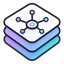
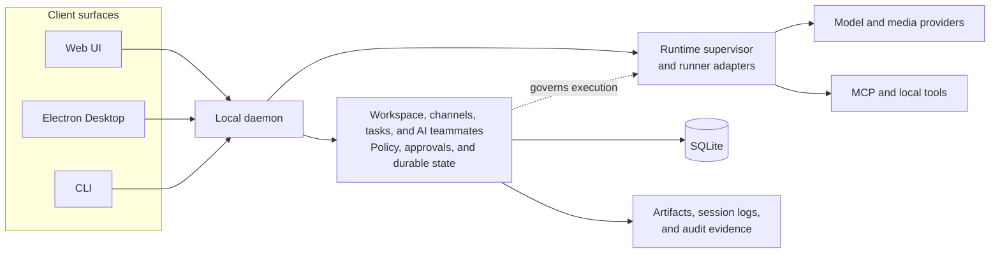

<div align="center">
  
  <h1>Ling Stack</h1>
  <p><strong>A local-first workspace for AI teammates, models, tools, approvals, and auditable work.</strong></p>
  <p>
    <a href="docs/product-design.md">Product</a> ·
    <a href="docs/architecture.md">Architecture</a> ·
    <a href="docs/design/README.md">Design docs</a> ·
    <a href="CHANGELOG.md">Changelog</a> ·
    <a href="CONTRIBUTING.md">Contributing</a> ·
    <a href="SECURITY.md">Security</a> ·
    <a href="LICENSE">MIT License</a>
  </p>
</div>

> [!WARNING]
> Ling Stack is a source-first alpha. The Web app, CLI, local daemon, and Electron
> desktop shell are under active development. Stable signed installers and a supported
> production release are not available yet.

Ling Stack brings conversations, channels, AI teammates, model configuration, skills,
tools, media generation, approvals, artifacts, and runtime history into one local
workspace. It is designed for work that needs more structure and accountability than a
standalone chat window.

## Why Ling Stack

AI work is often split across a chat client, coding-agent CLI, model relay, media tool,
task tracker, and an informal review process. That fragmentation makes it difficult to
answer basic operational questions:

- Which model and tools were used?
- What did the agent read, change, or generate?
- Which actions required human approval?
- Where are the resulting files and evidence?
- Can an interrupted run be inspected or resumed safely?

Ling Stack makes those boundaries explicit. A workspace owns the context and policy;
maintained runtimes execute scoped work; humans remain in control of risky side effects.

## What You Can Do

- **Work with AI teammates:** use normal conversations, private teammate chats, and
  channel collaboration with explicit model and tool configuration.
- **Connect different model providers:** configure OpenAI, Anthropic, Volcengine Ark,
  DeepSeek-compatible endpoints, MiniMax, GLM, and OpenAI-compatible relays through the
  Model Workbench.
- **Run auditable agent work:** execute tasks through the Pi coding-agent adapter while
  preserving events, approvals, artifacts, and session history.
- **Inspect structured channel transcripts:** view tool calls and results, approvals,
  handoffs, artifacts, operations, and final results as typed content layers while
  operator-only and agent-private items stay out of the channel transcript.
- **Control authority:** apply workspace permission presets and require confirmation for
  file writes, shell commands, paid media generation, and other governed actions.
- **Manage reusable skills:** import, edit, bind, and review skills without treating a
  skill as implicit execution permission.
- **Produce media:** create image and video jobs through capability-checked model adapters
  and the scene-based Media Production workspace.
- **Connect tools:** register MCP servers and assign their tools to AI teammates
  explicitly.
- **Coordinate external work:** import and inspect GitHub or Linear work locally, with
  external mutations separated behind explicit approval and execution steps.
- **Use one local control plane:** access the same daemon-backed product from the Web UI,
  CLI, or Electron desktop shell.

## Product Principles

- **Local first:** workspace state, audit records, and generated artifacts stay local by
  default.
- **Capability driven:** model and tool availability is based on verified capabilities,
  not optimistic labels.
- **Explicit authority:** a configured skill or provider does not silently grant tools,
  filesystem access, network access, or external mutation rights.
- **Auditable by design:** runs produce durable events and artifacts that can be inspected
  after execution.
- **One product model:** Web, Desktop, and CLI share daemon contracts and state machines
  instead of implementing separate behavior.
- **Multilingual:** Chinese and English product surfaces are maintained together.

## Architecture



The daemon is the local authority for workspace state, approvals, runs, and recovery.
The UI does not bypass it to call tools or provider adapters directly. Pi owns the first
maintained coding-agent runtime; Ling Stack owns the surrounding product, policy, and
evidence model.

| Area | Path | Responsibility |
| --- | --- | --- |
| Web application | `apps/web` | Shared local workspace UI |
| Desktop application | `apps/desktop` | Electron lifecycle, native integration, and shared Web surface |
| CLI | `packages/cli` | Local lifecycle, diagnostics, and workspace commands |
| Daemon | `packages/daemon` | HTTP/SSE API, orchestration, persistence, and recovery |
| Core | `packages/core` | Workspace domain, policy, approvals, and state machines |
| Contracts | `packages/contracts` | Shared public and internal API contracts |
| API client | `packages/api-client` | Typed daemon client |
| Providers | `packages/providers` | Chat, search, image, and video adapters |
| Runner | `packages/runner-pi` | Pi coding-agent integration |
| UI packages | `packages/ui-react`, `packages/conversation-ui-*` | Shared React components and conversation primitives |
| Plugin SDK | `packages/plugin-sdk` | Internal plugin contracts and validation |

See [Architecture](docs/architecture.md) and the
[design documentation index](docs/design/README.md) for ownership details.

## Project Status

The repository currently contains working foundations for:

- local channels, conversations, tasks, AI teammates, and model bindings;
- provider setup, readiness checks, and workspace defaults;
- streamed coding-agent runs with SQLite state, JSONL events, approvals, and artifacts;
- skills, teammate bindings, AI-generated skill review, and skill revision;
- image/video media jobs and a scene-based media production surface;
- MCP management, local tools, automations, and external-work orchestration;
- shared Web and Electron UI, theme persistence, and Computer Use PiP foundations.

Important open gates include signed desktop distribution, clean-machine platform
acceptance, remaining Computer Use platform verification, selected media-provider live
adapters, and several product surfaces that remain intentionally hidden pending review.
Mobile is not part of the current product acceptance scope.

The maintained list of incomplete work is in
[Implementation Status](docs/design/implementation-status.md). Do not infer current
status from old phase names or Git history.

## Quick Start From Source

### Requirements

- Git
- Node.js `22.15` or newer
- Corepack with pnpm `10`

The repository is a pnpm workspace and is not currently published as a stable npm or
desktop release.

### 1. Clone and install

```bash
git clone https://github.com/tianxiaochannel-oss88/ling-stack.git
cd ling-stack
corepack enable
corepack pnpm install
```

### 2. Build the workspace

```bash
corepack pnpm build
```

### 3. Start the daemon

In the first terminal:

```bash
corepack pnpm ling daemon start --foreground
```

The daemon listens on `http://127.0.0.1:17891` by default. Keep it bound to loopback
unless you have designed and reviewed a separate authenticated remote-access boundary.

### 4. Start the Web UI

In a second terminal:

```bash
corepack pnpm ling ui --foreground --open
```

Open `http://127.0.0.1:5173` if the browser does not open automatically.

### 5. Verify the local stack

```bash
curl http://127.0.0.1:17891/health
corepack pnpm ling doctor
```

Ling Stack can be explored before a provider is configured. To run model-backed work,
open **Model Workbench**, add a chat-capable model, save the API key to the supported
secret store or environment reference, and run its readiness check. The first verified
chat model becomes the workspace default; later default changes remain explicit.

### Desktop development

The Electron application builds the shared Web app and daemon before launch:

```bash
corepack pnpm --filter @ling-stack/desktop dev
```

Desktop packaging and signing have additional platform gates. Read
[Desktop release and acceptance](docs/release/desktop.md) before treating a local package
as distributable.

## Configuration And Data

Provider secrets should be supplied through supported secret references such as
`env:NAME` or the desktop/keychain flow. Do not commit API keys, tokens, local provider
configuration, or workspace state.

Common development variables are documented in [.env.example](.env.example). The
example file contains names and placeholders only; copy only the variables you actually
need into your local environment.

By default, runtime state is local to the workspace under `.ling-stack/`:

```text
.ling-stack/
  ling-stack.sqlite   SQLite workspace state
  sessions/           JSONL run events and evidence
  artifacts/          Generated and collected files
  logs/               Local runtime logs
```

An explicit user-data-directory mode is also available. State-location changes use the
CLI migration and registry-repair flows; do not move the database by hand. See
[Workspace State Storage](docs/design/workspace-state-storage.md).

## Model And Tool Boundaries

Provider support is capability based. Chat, tool calling, reasoning, web search, image
generation, image editing, and video generation are separate capabilities. A media-only
provider cannot be selected for a normal AI teammate conversation.

Coding sessions use `@earendil-works/pi-coding-agent` through
`@ling-stack/runner-pi`. Media jobs use dedicated adapters and do not pass through the
coding-agent runtime. MCP servers and local tools are governed separately from skills.

More detail:

- [Provider adapters](docs/provider-adapters.md)
- [Pi coding-agent integration](docs/pi-coding-agent-integration.md)
- [Approval policy](docs/design/approval-policy.md)
- [Plugin Manager](docs/design/plugin-manager.md)
- [Daemon API](docs/daemon-api.md)

## Development

Run the repository-wide checks with:

```bash
corepack pnpm typecheck
corepack pnpm test
corepack pnpm build
corepack pnpm check:docs
corepack pnpm check:licenses
corepack pnpm check:public
```

Package-specific scripts are available through pnpm filters. Some desktop and native
Computer Use checks require their target operating system, signing material, or dedicated
test fixtures and are not implied by the generic commands above.

Before opening a pull request, read [CONTRIBUTING.md](CONTRIBUTING.md). Keep changes scoped,
state which validations ran, and do not commit local workspace data or credentials.

## Documentation

- [Product design](docs/product-design.md)
- [Architecture](docs/architecture.md)
- [Design documentation index](docs/design/README.md)
- [Implementation status](docs/design/implementation-status.md)
- [Architecture Decision Records](docs/adr/README.md)
- [Daemon API](docs/daemon-api.md)
- [Desktop release and acceptance](docs/release/desktop.md)
- [Release policy](docs/release/README.md)
- [Documentation governance](docs/maintenance/document-cleanup-inventory.md)
- [Open-source readiness](docs/maintenance/open-source-readiness.md)
- [Changelog](CHANGELOG.md)
- [Third-party notices](THIRD_PARTY_NOTICES.md)
- [Security policy](SECURITY.md)
- [Contributing](CONTRIBUTING.md)
- [Community support](SUPPORT.md)

Design contracts describe durable product and architecture boundaries. Completed
implementation diaries and screenshot evidence belong in Git history or CI/release
artifacts rather than the main documentation tree.

## Security

- Keep the daemon on loopback by default.
- Never commit provider keys, external-service tokens, workspace databases, session logs,
  or generated artifacts.
- Treat skills as instructions, not authority grants.
- Keep destructive tools, external mutations, deployments, credential changes, and paid
  generation behind explicit policy and approval boundaries.
- Do not describe unsigned or locally built desktop packages as production releases.

Report vulnerabilities through the private process in [SECURITY.md](SECURITY.md). Do not
include sensitive vulnerability details in a public issue or pull request.

## License

Ling Stack is available under the [MIT License](LICENSE).
