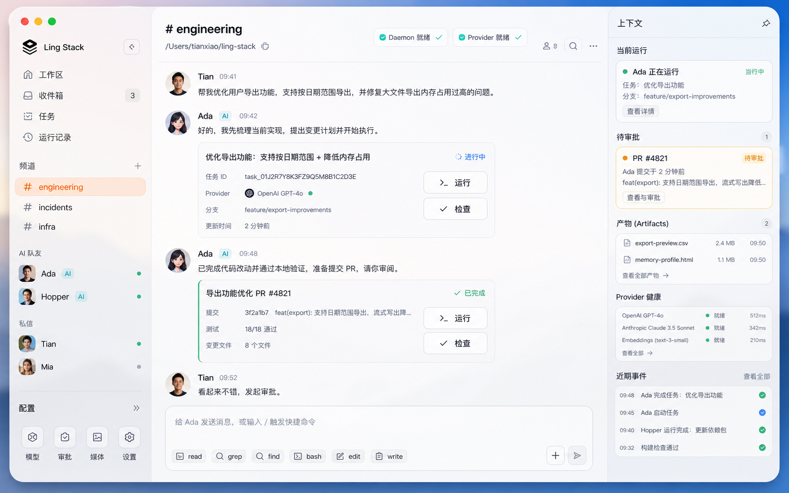
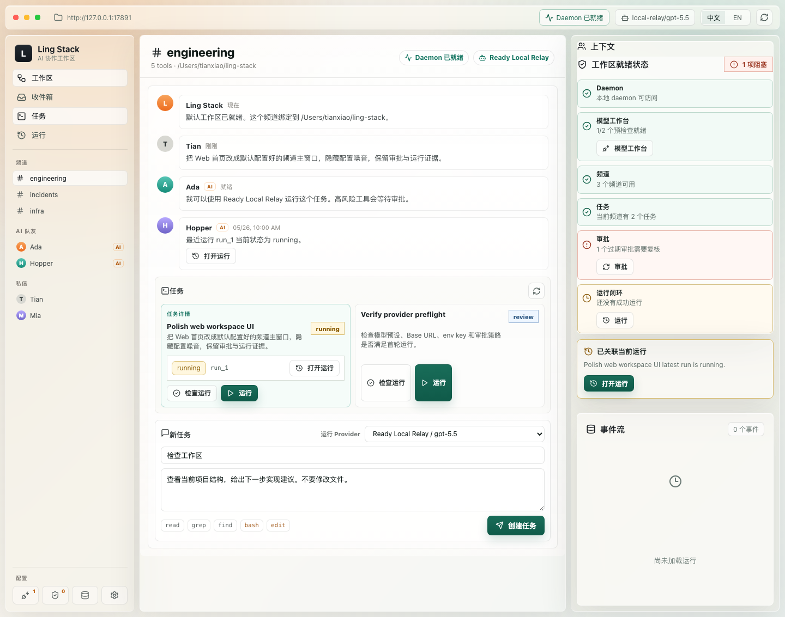
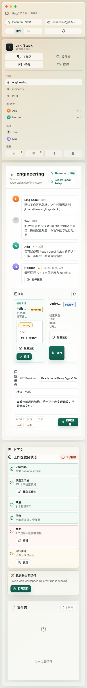

# Ling Stack

A multilingual, local-first AI teammate workspace for humans, agents, tools, approvals, and model providers.

Ling Stack connects channels, tasks, runtime sessions, provider routing, artifacts, and human approval gates in one auditable workspace. The current mainline is a local Model Workbench for GPT, Claude, domestic AI providers, OpenAI-compatible relays, and custom compatible endpoints that can be checked and used directly from workspace tasks.

> Local-first workspace. AI teammates. Channels and tasks. Pi coding-agent runtime. Provider adapters. Approval gates. Auditable sessions. Domestic AI providers first, GPT and Claude included.

## Documentation

- [Product design](docs/product-design.md)
- [Ling Framework](docs/design/ling-framework.md)
- [Ling Memory v1](docs/design/ling-memory-v1.md)
- [Memory Health and Multi-Agent Memory Fan-In](docs/design/memory-health-and-fanin.md)
- [Memory Health and Multi-Agent Memory Fan-In implementation plan](docs/design/memory-health-and-fanin-implementation-plan.md)
- [Architecture](docs/architecture.md)
- [v0.1 detailed design](docs/v0.1-detailed-design.md)
- [Architecture Decision Records](docs/adr/README.md)
- [Daemon API](docs/daemon-api.md)
- [CLI v0.1](docs/design/cli-v0.1.md)
- [Daemon lifecycle and doctor P0](docs/design/daemon-lifecycle-p0.md)
- [CLI run I/O and completion P1](docs/design/cli-run-io-completion-p1.md)
- [CLI run I/O and completion P1 implementation plan](docs/design/cli-run-io-completion-p1-implementation-plan.md)
- [MCP status boundaries P2](docs/design/mcp-status-boundaries-p2.md)
- [MCP status boundaries P2 implementation plan](docs/design/mcp-status-boundaries-p2-implementation-plan.md)
- [Provider adapters](docs/provider-adapters.md)
- [Seedream live smoke](docs/seedream-live-smoke.md)
- [External work live smoke](docs/external-work-live-smoke.md)
- [Provider presets](docs/design/provider-presets.md)
- [Approval policy](docs/design/approval-policy.md)
- [Codex-inspired settings and permission presets](docs/design/codex-inspired-settings-permission-presets.md)
- [Codex-inspired settings and permission presets implementation plan](docs/design/codex-inspired-settings-permission-presets-implementation-plan.md)
- [Core tools, runners, MCP tools, and plugin boundary](docs/design/core-tools-runtime-boundary.md)
- [Core tools runtime boundary implementation plan](docs/design/core-tools-runtime-boundary-implementation-plan.md)
- [Codex-inspired runtime tools](docs/design/codex-inspired-runtime-tools.md)
- [Codex-inspired runtime tools P0 apply-patch implementation](docs/design/codex-inspired-runtime-tools-p0-apply-patch-implementation.md)
- [Channel workspace](docs/design/channel-workspace.md)
- [AI teammates and skills](docs/design/ai-teammates-and-skills.md)
- [AI teammate private workspace](docs/design/ai-teammate-private-workspace.md)
- [Platform architecture](docs/design/platform-architecture.md)
- [External work orchestration](docs/design/external-work-orchestration.md)
- [External work roadmap](docs/design/external-work-roadmap.md)
- [External work Phase 2 implementation](docs/design/external-work-phase-2-implementation.md)
- [External work Phase 3 implementation](docs/design/external-work-phase-3-implementation.md)
- [External work Phase 4 implementation](docs/design/external-work-phase-4-implementation.md)
- [External work Phase 5 implementation](docs/design/external-work-phase-5-implementation.md)
- [External work Phase 6 implementation](docs/design/external-work-phase-6-implementation.md)
- [External work Phase 7 implementation](docs/design/external-work-phase-7-implementation.md)
- [External work status surface](docs/design/external-work-status-surface.md)
- [External work GA hardening](docs/design/external-work-ga-hardening.md)
- [GitHub automation](docs/design/github-automation.md)
- [Automations](docs/design/automations.md)
- [Automations implementation plan](docs/design/automations-implementation-plan.md)
- [Web modularization](docs/design/web-modularization.md)
- [Contracts / API Client](docs/design/contracts-api-client.md)
- [Internal Registry / Plugin SDK](docs/design/internal-registry-plugin-sdk.md)
- [Plugin Manager](docs/design/plugin-manager.md)
- [Plugin Manager implementation plan](docs/design/plugin-manager-implementation-plan.md)
- [Runner Registry](docs/design/runner-registry.md)
- [Multi-Agent Orchestrator](docs/design/multi-agent-orchestrator.md)
- [Codex-like Execution](docs/design/codex-like-execution.md)
- [Desktop Shell](docs/design/desktop-shell.md)
- [Secrets / Keychain](docs/design/secrets-keychain.md)
- [State machines and recovery](docs/design/state-machine-recovery.md)
- [Multi-channel concurrency](docs/design/multi-channel-concurrency.md)
- [Run interruption and continuation](docs/design/run-interruption-continuation.md)
- [Pi coding-agent integration](docs/pi-coding-agent-integration.md)

## UI Direction

The Web UI and the future desktop app should follow the same product direction: a client-style AI teammate workspace, not a marketing homepage or a configuration dashboard.

Concept direction:



Current Web homepage reference:



Mobile collapse reference:



Design intent:

- Open directly into a default configured workspace and selected channel.
- Keep the left sidebar focused on workspace, inbox, tasks, runs, channels, AI teammates, direct messages, and a compact configuration rail.
- Keep the center as the main work surface: channel activity, task cards, run actions, and a task composer.
- Make AI teammate creation a client-style wizard: choose default role or blank, bind model, fill profile, then choose channel and memory/file scope.
- Keep provider setup, approval policy, MCP tool servers, media jobs, and settings out of the homepage flow; expose them through configuration entry points and dedicated settings pages.
- Keep the right panel for context: readiness, first-run state, approvals, artifacts, provider health, and live events.
- Use a macOS-like, minimal, frosted-glass visual system with restrained gradients, readable operational density, and no decorative hero sections.

This direction is recorded as the reference for both `apps/web` and the future desktop client. The detailed Web design contract lives in [Web UI v0.1 Design](docs/design/web-ui-v0.1.md).

## Why This Exists

AI coding and agent tools are getting powerful, but most of them still live in separate boxes:

- One chat client for GPT or Claude.
- One local relay for domestic models.
- One coding-agent CLI for file edits.
- One media tool for image or video generation.
- One task tracker for real work.
- One human review process outside the agent runtime.

That split creates operational friction. The model may generate useful work, but the surrounding workflow is still manual: copy the prompt, choose the model, run the tool, inspect the diff, approve the risky action, save the artifact, and explain what happened later.

Ling Stack exists to make that workflow explicit and inspectable. The goal is not another chat window. The goal is a workspace where AI teammates can pick up scoped tasks, run through a maintained agent kernel, produce logs and artifacts, and hand risky actions back to humans for approval.

## The Core Idea

Separate the product layer from the agent kernel.

```text
workspace and channels
+ tasks and AI teammates
+ skills and teammate bindings
+ approval and audit policy
+ durable state machines and recovery
+ provider routing
+ maintained coding-agent kernel
+ streamed runtime events
+ artifacts and session records
```

Ling Stack owns the workspace. Pi owns the first coding-agent runtime.

### Responsibility Layers

| Layer | Purpose | Current path |
| --- | --- | --- |
| Workspace | Channels, tasks, teammates, approvals, artifacts | `packages/core` |
| Runner | Execute coding-agent tasks and stream events | `packages/runner-pi` |
| Daemon | Local API for CLI, web UI, and desktop shell | `packages/daemon` |
| Providers | Model and media capability adapters | `packages/providers` |
| UI | Local web and future desktop surfaces | `apps/web`, `apps/desktop` |

## Benefits

- **No duplicated agent kernel:** Ling Stack wraps `@earendil-works/pi-coding-agent` instead of rebuilding a coding-agent loop from scratch.
- **Provider flexibility:** GPT, Claude, DeepSeek / DPV4-compatible endpoints, MiniMax, GLM, Doubao, Jimeng, and OpenAI-compatible relays can sit behind one workspace policy.
- **Multilingual by design:** the product is not limited to Chinese users; the initial provider emphasis is domestic AI vendor support.
- **Auditable execution:** runner events are streamed as first-class workspace events instead of disappearing inside a terminal.
- **Durable recovery:** tasks, runs, approvals, media jobs, and future multi-teammate workflows should transition through explicit state machines so disconnects and retries do not corrupt work.
- **Composable skills:** AI teammates can use workflow templates inspired by gstack while execution remains governed by tools, provider capabilities, approval policy, and state machines.
- **Approval-ready workflow:** file writes, shell commands, external sends, deployments, and high-cost media jobs can route through human review.
- **Local-first adoption:** the first useful version can run as a CLI, local daemon, and local web UI before cloud/team sync exists.
- **Desktop later, not blocking:** macOS, Windows, and Linux apps can wrap the local daemon after the runtime is useful.

## Core Principles

- Do not build another generic chat client.
- Keep channels, tasks, approvals, artifacts, and audit logs as the core product surface.
- Treat skills as workflow templates, not direct execution permission.
- Treat model providers as capability adapters, not just chat endpoints.
- Use Pi for the coding-agent kernel and maintain only a thin adapter.
- Keep domestic AI vendors first-class without making the product China-only.
- Keep GPT, Claude, and OpenAI-compatible relay entry points first-class.
- Make risky side effects visible and approvable.
- Treat status transitions as durable state machine events, not transient UI state.
- Store enough runtime evidence to explain what happened after the fact.
- Keep the desktop shell downstream of the daemon API.

## Who Should Use This

Ling Stack is for:

- Developers who use multiple model providers and want one local AI workspace.
- Teams that need AI help with code, docs, support, operations, and media tasks.
- Users who need domestic AI providers alongside GPT and Claude.
- Agent power users already using Codex, Claude Code, Pi, MCP, local proxies, or OpenAI-compatible relays.
- Builders who want auditable AI work instead of opaque chat transcripts.

It is less useful for one-shot prompts, stateless bots, or users who only need a simple chat client.

## What This Is / Is Not

This project is:

- A local-first AI teammate workspace.
- A product layer around maintained agent runtimes.
- A provider and approval orchestration layer.
- A future CLI, web UI, and desktop app surface.
- A place to make AI work visible, reviewable, and repeatable.

This project is not:

- A replacement for Pi.
- A model provider.
- A pure chat UI.
- A vector database.
- A secret manager.
- A permission slip for agents to change files, deploy, or send messages without review.

## Quick Start

The project is still early, but the daemon can already stream Pi runner events.

### 1. Install dependencies

```bash
corepack pnpm install
```

### 2. Build and typecheck

```bash
corepack pnpm typecheck
corepack pnpm build
```

### 3. Start the daemon

```bash
node packages/daemon/dist/cli.js
```

Default endpoint:

```text
http://127.0.0.1:17891
```

### 4. Check health

```bash
curl http://127.0.0.1:17891/health
```

### 5. Create and check a provider preset

Provider presets persist non-secret provider configuration in the local workspace database. Secrets are referenced by name, not stored as raw keys.

Built-in templates are available from the daemon:

```bash
curl http://127.0.0.1:17891/provider-templates
```

Common development secret refs:

```bash
export OPENAI_API_KEY=sk-...
export ANTHROPIC_API_KEY=sk-ant-...
export LOCAL_RELAY_API_KEY=sk-local
export ARK_API_KEY=...
export DEEPSEEK_API_KEY=...
export MINIMAX_API_KEY=...
export ZHIPU_API_KEY=...
export JIMENG_API_KEY=...
export SEEDREAM_API_KEY=...
export SEEDANCE_API_KEY=...
```

Recommended CLI first loop:

```bash
node packages/cli/dist/index.js init --with-provider-templates
export LOCAL_RELAY_API_KEY=sk-local
node packages/cli/dist/index.js provider list
node packages/cli/dist/index.js provider update provider_... --enabled true --api-key-ref env:LOCAL_RELAY_API_KEY
node packages/cli/dist/index.js provider check-all
node packages/cli/dist/index.js doctor
```

The Web UI exposes the same flow in Model Workbench: choose GPT/Claude, domestic AI, OpenAI-compatible relay, or custom OpenAI-compatible access; save the preset; set the shown `env:NAME`; run Check; then use only preflight-ready chat providers in Workspace. Media providers remain visible but stay in Media Jobs and cannot run coding tasks.

Seedream `image_generate` can run through the live transport gate. Configure a media preset through the CLI:

```bash
node packages/cli/dist/index.js provider update provider_... \
  --base-url https://ark.cn-beijing.volces.com/api/v3 \
  --model doubao-seedream-5-0-260128 \
  --api-key-ref env:SEEDREAM_API_KEY \
  --compat-json '{"mediaVendorTransport":{"mode":"live"}}'
```

This validates `baseUrl` and `apiKeyRef`. A live-gated media job first creates a `media_cost` approval and moves to `waiting_for_approval`; after approval, Seedream `image_generate` can call the configured OpenAI-compatible `/images/generations` endpoint. Automated tests use mock HTTP; real smoke requires `SEEDREAM_API_KEY`. The adapter records request/response metadata and downloads returned HTTP(S) image URLs into local `.ling-stack/artifacts` image artifacts without forwarding the provider authorization header to the image URL. See [Seedream live smoke](docs/seedream-live-smoke.md) for the full approval, run, artifact, and Web verification path.

```bash
export LOCAL_RELAY_API_KEY=sk-local

curl http://127.0.0.1:17891/providers?cwd="$PWD" \
  -H 'content-type: application/json' \
  -d '{
    "kind": "openai-compatible",
    "displayName": "Local Relay",
    "providerId": "local-relay",
    "model": "gpt-5.5",
    "api": "openai-completions",
    "baseUrl": "http://127.0.0.1:8317/v1",
    "apiKeyRef": "env:LOCAL_RELAY_API_KEY",
    "capabilities": ["chat", "tool_call", "reasoning"],
    "input": ["text"],
    "enabled": true
  }'
```

The response includes a generated `provider.id`, for example `provider_...`.

### 6. Create a channel and task

```bash
node packages/cli/dist/index.js channel create --name Engineering --path "$PWD" --provider provider_...
node packages/cli/dist/index.js task create --channel channel_... --title "Inspect repo" --prompt "List files and summarize this repo."
```

### 7. Import, poll, or triage external work

GitHub external work orchestration is read-only for import, poll, reconcile, and CI
triage. Fixture import parses
`WORKFLOW.md`, normalizes a PR or issue payload, creates or reuses a Ling workflow and
step, and writes evidence artifacts. Manual poll uses GitHub read-only REST endpoints
to discover open PR/issue candidates, claim each subject, prepare isolated local
workspace state, and reconcile durable scheduler state. Manual CI triage reads failing
checks, workflow jobs, and bounded redacted logs for an existing PR external-work item,
then creates or reuses local triage records, evidence artifacts, and scoped fix tasks.
Import, poll, reconcile, background scheduler registration, and CI triage do not start
the runner or mutate GitHub. Phase 4.1 adds a separate explicit local CI fix run bridge
for an existing triage record; it still does not mutate GitHub. Phase 3 adds
approval-gated action records for GitHub comments and labels. Phase 5 adds strict
approval-gated GitHub PR review actions. Phase 6 adds explicit GitHub background
polling registration for one `cwd + channel + WORKFLOW.md`; it is not a webhook receiver
or hidden all-repository crawler. Propose/list/show/cancel stay local-only; `actions
execute` is the only command that can call the approved GitHub comment, label, or PR
review endpoint after stale-target revalidation. The Web Inbox now shows GitHub
external action approval cards
with the target snapshot, proposed payload, linked evidence artifacts, and a separate
Execute action button after approval; approving in Web does not execute the mutation.
The Web Workspace and task Inspector also show local GitHub CI triage records, failed
check metadata, reproduction hints, linked artifacts, and linked fix task/run ids
without starting a runner.

Phase 7 adds Linear as the second source adapter. Linear is read-only in this slice:
manual import and poll normalize `linear_issue` items, reuse the same workflow,
scheduler-state, workspace, hook, and artifact paths, and do not propose or execute
Linear mutations. Linear workflows use `source.kind: linear`, `source.projectSlug`, and
an optional `source.secretRef: env:LINEAR_TOKEN`.

Repository-local external-work configuration should be copied from
`WORKFLOW.example.md` to `WORKFLOW.md`. The root `WORKFLOW.md` is ignored because it may
contain local repository targets and machine-specific secret refs. Keep raw token values
out of both files: use `env:GITHUB_TOKEN`, `env:LINEAR_TOKEN`, or a `keychain:...`
secret reference.

For live poll/reconcile, prefer authenticated GitHub reads. The user-facing setup path
is Web Settings -> External Work: if `WORKFLOW.md` is missing or invalid, paste a GitHub
URL or enter `owner/repo`, then click `Create WORKFLOW.md` / `Repair WORKFLOW.md`; after
that, paste a GitHub token into `Save GitHub token`. The daemon writes only the local workflow file, stores
the token in macOS Keychain, and records only a `source.secretRef:
keychain:LING_STACK_GITHUB_..._TOKEN` reference in `WORKFLOW.md`. The token value is not
stored in browser state, SQLite, artifacts, or logs. Headless CLI/dev workflows can still
use `source.secretRef: env:GITHUB_TOKEN` and start or restart the daemon with
`GITHUB_TOKEN` in its environment, for example from `gh auth token`.

```bash
node packages/cli/dist/index.js external-work github import \
  --channel channel_... \
  --event-type pull_request.opened \
  --payload-file examples/external-work/github/pull-request-opened.json \
  --workflow-path WORKFLOW.md

node packages/cli/dist/index.js external-work github poll \
  --channel channel_... \
  --workflow-path WORKFLOW.md \
  --limit 50

node packages/cli/dist/index.js external-work github background start \
  --channel channel_... \
  --workflow-path WORKFLOW.md \
  --limit 50

node packages/cli/dist/index.js external-work github background list

node packages/cli/dist/index.js external-work github background stop external_work_background_...

node packages/cli/dist/index.js external-work linear import \
  --channel channel_... \
  --event-type issue.created \
  --payload-file issue.json \
  --workflow-path WORKFLOW.md

node packages/cli/dist/index.js external-work linear poll \
  --channel channel_... \
  --workflow-path WORKFLOW.md \
  --limit 50

node packages/cli/dist/index.js external-work list \
  --channel channel_... \
  --status ready

node packages/cli/dist/index.js external-work show external_work_...

node packages/cli/dist/index.js external-work github ci triage \
  --external-work external_work_... \
  --workflow-path WORKFLOW.md \
  --limit 5

node packages/cli/dist/index.js external-work github ci run \
  --triage external_work_ci_triage_... \
  --provider provider_...

node packages/cli/dist/index.js external-work actions propose-comment \
  --external-work external_work_... \
  --body-file comment.md \
  --approval standard

node packages/cli/dist/index.js external-work actions propose-review \
  --external-work external_work_... \
  --event REQUEST_CHANGES \
  --body-file review.md

node packages/cli/dist/index.js external-work actions list \
  --external-work external_work_... \
  --status waiting_for_approval

node packages/cli/dist/index.js external-work actions show external_work_action_...

# Either cancel a pending action locally:
node packages/cli/dist/index.js external-work actions cancel external_work_action_... \
  --reason "No longer needed"

# Or approve and execute it:
node packages/cli/dist/index.js approvals approve approval_... \
  --reason "Approved external action execution"

node packages/cli/dist/index.js external-work actions execute external_work_action_... \
  --workflow-path WORKFLOW.md

node packages/cli/dist/index.js external-work reconcile \
  --channel channel_... \
  --workflow-path WORKFLOW.md
```

Use `--json` for full import, poll, CI triage, list, show, action, and reconcile
responses. CI triage creates local fix tasks by default; add `--no-create-task` to keep
only the triage records and artifacts. `external-work github ci run` is the explicit
Phase 4.1 bridge from a triage record to a normal local runner stream; it does not
mutate GitHub. A copy-pasteable fixture smoke path lives in
[examples/external-work/github](examples/external-work/github/README.md). A real
repository smoke with an isolated daemon, live GitHub reads, local action proposal, Web
approval checks, and a separately gated mutation step lives in
[External work live smoke](docs/external-work-live-smoke.md).
The forward plan from the Phase 5 strict PR review action slice through Phase 7 and GA
hardening is tracked in [External work roadmap](docs/design/external-work-roadmap.md)
plus the Phase 5, Phase 6, Phase 7, and GA hardening implementation plans:
[Phase 5](docs/design/external-work-phase-5-implementation.md),
[Phase 6](docs/design/external-work-phase-6-implementation.md), and
[Phase 7](docs/design/external-work-phase-7-implementation.md). The next production
readiness slice is [External work GA hardening](docs/design/external-work-ga-hardening.md).
The setup entry point for "where do I connect this to a real repo" is the Web Settings
External Work panel. It reads local `WORKFLOW.md` status, source target, token readiness,
record counts, and background scheduler state without calling GitHub or Linear. If the
workflow is missing or invalid, Settings can create a minimal local `WORKFLOW.md` from a
GitHub repository or Linear project slug before the token field is enabled. It also
provides the explicit token setup/remove controls for Keychain-backed GitHub/Linear
tokens. The same read-only check is available from the CLI:

```bash
ling-stack external-work status --channel channel_... --workflow-path WORKFLOW.md
```

Design details are tracked in
[External work status surface](docs/design/external-work-status-surface.md).

### 8. Run a task through the Pi runner

`POST /runs` returns an SSE stream. See [Daemon API](docs/daemon-api.md) for full request examples.

```bash
curl -N http://127.0.0.1:17891/runs \
  -H 'content-type: application/json' \
  -d '{
    "cwd": "'$PWD'",
    "task": {
      "id": "task-1",
      "title": "Inspect the project",
      "prompt": "List the files and summarize the repo."
    },
    "providerPresetId": "provider_...",
    "tools": ["read", "grep", "find", "ls"],
    "thinkingLevel": "medium"
  }'
```

Inline provider JSON is still accepted for development, but product flows should prefer `providerPresetId` so raw API keys are not persisted in workspace records.

## Repository Layout

```text
apps/
  web/          Local workspace UI.
  desktop/      Future cross-platform desktop shell.

packages/
  core/         Workspace, tasks, approvals, sessions, and policy engine.
  cli/          Command-line interface.
  daemon/       Local HTTP/SSE API.
  providers/    Model and media provider adapters.
  runner-pi/    Pi coding-agent wrapper used as the first execution kernel.

docs/
  product-design.md
  architecture.md
  v0.1-detailed-design.md
  daemon-api.md
  design/cli-v0.1.md
  design/daemon-lifecycle-p0.md
  design/provider-presets.md
  design/approval-policy.md
  provider-adapters.md
  pi-coding-agent-integration.md

examples/
```

## Provider Targets

First-class provider targets:

- OpenAI GPT models.
- Anthropic Claude models.
- Doubao / Volcengine Ark.
- DeepSeek / DPV4-compatible endpoints.
- MiniMax.
- GLM / Zhipu.
- Jimeng / Seedream / Seedance for media jobs, kept separate from coding task providers.
- Generic OpenAI-compatible relay endpoints.

Provider support is capability-based. Ling Stack should not pretend every provider is only a chat model.

## Current Status

Implemented:

- Monorepo scaffold.
- `@ling-stack/runner-pi` wrapper around `@earendil-works/pi-coding-agent`.
- `@ling-stack/daemon` with `GET /health`.
- `POST /runs` streaming Pi runner events over SSE.
- SQLite-backed run session and event persistence.
- JSONL event audit logs under `.ling-stack/sessions`.
- `GET /runs`, `GET /runs/:id`, and `GET /runs/:id/events`.
- Artifact metadata storage plus `GET /runs/:id/artifacts`, `GET /artifacts/:id`, and `GET /artifacts/:id/content`.
- Best-effort `POST /runs/:id/cancel`.
- Workspace bootstrap plus persisted channel and task storage.
- Channel daemon APIs: `GET/POST /channels`, `GET/PATCH/DELETE /channels/:id`.
- Task daemon APIs: `GET/POST /tasks`, `GET/PATCH/DELETE /tasks/:id`.
- Task lifecycle updates from linked run sessions: `running`, `done`, `failed`, and `cancelled`.
- Provider preset storage and daemon APIs.
- Built-in provider templates for OpenAI, Claude, OpenAI-compatible relays, Doubao, DeepSeek/DPV4, MiniMax, GLM, Jimeng, Seedream, and Seedance.
- `POST /runs` with `providerPresetId`.
- Provider live checks for OpenAI-compatible chat, OpenAI Responses, and Anthropic Messages presets.
- Approval request storage and daemon APIs.
- Default read-only tool policy for product runs.
- Pi pre-tool approval gate for `bash`, `edit`, and `write`.
- Workspace approval policy storage, daemon API, Web settings UI, CLI policy commands, tool decisions, and write path scopes.
- Local web UI with channel/task workspace, channel detail editing, task detail editing, task run entry, event stream, persisted run detail/rerun, Model Workbench provider setup, approval list, and persisted English / Chinese UI language switching.
- Durable AI teammate storage and daemon APIs: seeded `gstack-default` teammates, custom teammate creation, channel memberships, skill bindings, memory-scope metadata, private direct threads/messages, task/activity read models, and soft disable.
- AI Teammates Web wizard and private workspace: per-teammate model selection, channel/memory/file scoping metadata, daemon-backed sidebar roster, private chat, tasks/activity/channels/skills/memory/settings tabs, and persisted pin/hide/status/settings controls.
- Model Workbench grouping for GPT/Claude, domestic AI, OpenAI-compatible relays, custom compatible access, and media providers, with coding-task readiness shown separately from media-only capabilities.
- Run Evidence panel with session files, summary preview, tool/approval counts, and artifact rows.
- Automatic artifact extraction from Pi tool outputs, generated text/log/Markdown/diff content, and generated file path metadata.
- Media job foundation with local metadata storage, `POST/GET /media-jobs`, static media provider checks, media adapter contract, provider-kind registry wiring, vendor request planning, disabled-by-default vendor transport seam, `media_cost` approval gate for live execution, Seedream `image_generate` live HTTP adapter, Seedream image URL byte artifacts, static execution adapter, local metadata artifacts, and Web Media Jobs panel. Seedream has a documented live smoke path; additional media vendors and billing stay behind the mainline Model Workbench work.
- CLI first-loop commands for init, channels, tasks, providers, runs, approvals, approval policy, daemon foreground start, and Web UI launch.
- Initial product, architecture, daemon, provider, and Pi integration docs.

Not implemented yet:

- Approval gates for external sends, deployments, and credential changes.
- Rich task detail views beyond the first edit form.
- Real media byte outputs beyond Seedream `image_generate` HTTP(S) image URL downloads.
- Live Jimeng/Seedance execution and Seedream operations beyond `image_generate`.
- Billing, cost estimation, and broader media workflow automation.
- OS keychain integration for secrets.
- Live media provider generation checks.
- Desktop packaging.

## License

MIT.
