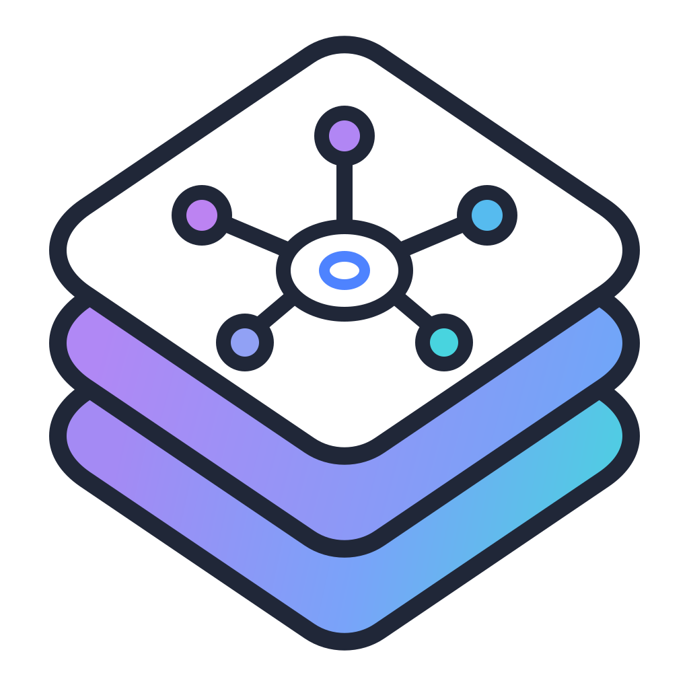
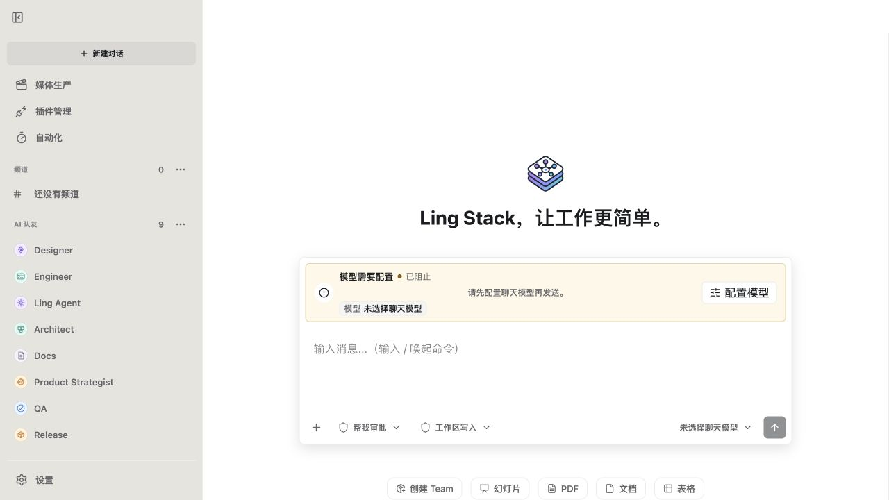

<div align="center">
  
  <h1>Ling Stack</h1>
  <p><strong>把不同模型的 AI 队友放进同一个本地项目，集中查看协作、工具审批和结果。</strong></p>
  <p>
    <a href="README.md">English</a> · 简体中文 ·
    <a href="README.ja-JP.md">日本語</a> · <a href="README.ko-KR.md">한국어</a> ·
    <a href="README.de-DE.md">Deutsch</a> · <a href="README.fr-FR.md">Français</a> ·
    <a href="README.es-ES.md">Español</a> · <a href="README.pt-BR.md">Português (Brasil)</a>
  </p>
</div>

> [!NOTE]
> **当前为 Source Alpha（源码优先的早期版本）。** 默认从源码启动 Web UI、本地 daemon 和 CLI。
> Desktop 可用于开发；稳定的签名安装包及受支持的生产版本尚未提供。

Ling Stack 面向需要使用多个 AI 模型、并希望把项目上下文与协作过程放在一起的开发者。
工作区状态、聊天历史和运行证据保存在本地；模型请求及上下文会发送给你选择的模型或工具服务。
**本地存储不代表离线推理。** 界面提供 55 个语言与地区选项，界面语言和 AI 回复语言可分别配置。
README 目前提供顶部所列的 8 种语言，不与客户端语言选项逐一对应；其他文档仍可能使用英文或中文。

## 先试一个项目评审任务

让两个队友分别检查同一份项目说明的需求边界与验收条件，再由 Ling Agent 汇总。
第一次只做讨论，不需要开放 shell 或文件修改权限。

按[第一次项目评审指南](docs/community/first-project-review.md)准备任务并检查结果。



上图是配置模型前的真实工作区截图，用于展示界面布局，不代表项目评审已完成。

## 三种适合开始的任务

| 场景 | 你做什么 | 集中保留什么 |
| --- | --- | --- |
| 整理项目材料 | 选择聊天模型，把需求、文档或问题整理成具体行动项 | 消息、模型选择、附件和结果 |
| 让 AI 队友分工评审 | 为队友配置模型，在项目频道中讨论同一份材料 | 成员回复、上下文和 Ling Agent 汇总 |
| 检查需要工具的交付 | 给出明确的目录、目标和权限，检查执行过程与产物 | 运行证据、生成文件和交付结果 |

先试简单对话，再按任务需要增加队友和工具。技能提供指令；角色或技能本身不会授予工具或文件权限。
Coding Agent 通过 Pi runtime adapter 执行，实际可用工具取决于平台配置和工作区策略。

## 从源码启动

需要 Git、**Node.js 22.22.1 或更新版本**，以及 **Corepack 和 pnpm 10**。
仓库固定使用 pnpm `10.0.0`；CI 的 Node 基线为 `22.22.1`。
Web/daemon 构建还需要 **Rust 1.89 或更新版本和 Cargo**，用于编译原生图片清理程序。
请通过 [rustup](https://rustup.rs/) 安装；CI 使用 Rust `1.97.1`。

### 1. 安装并构建

以下命令会在当前目录下创建 `ling-stack/`。后续命令均在该仓库根目录运行：

```bash
git clone https://github.com/ling-stack-org/ling-stack.git
cd ling-stack
corepack enable
corepack pnpm install --frozen-lockfile
corepack pnpm --workspace-concurrency=1 --filter '@ling-stack/cli...' -r build
```

构建包含 CLI、daemon、Web app 及其工作区依赖；Desktop 和 Mobile 需要单独配置。

### 2. 启动 daemon

在第一个终端中运行并保持进程开启：

```bash
corepack pnpm ling daemon start --foreground
```

默认地址为 `http://127.0.0.1:17891`，请保持监听本机回环地址。

### 3. 打开 Web UI

在第二个终端中进入同一仓库根目录，运行：

```bash
corepack pnpm ling ui --foreground --open
```

若浏览器没有自动打开，访问 `http://127.0.0.1:5173`。两个终端均需保持运行；停止时分别按 `Ctrl+C`。
在第三个终端检查本地服务：

```bash
curl http://127.0.0.1:17891/health
```

预期返回含 `"ok": true` 的 JSON。这只确认本地服务启动，模型调用还需要下一步配置。

### 4. 配置自己的模型并开始对话

打开 **Settings → Model Workbench**，添加支持聊天的模型，填写供应商支持的模型 ID、接口地址和自己的 API key，保存后运行 **Check**。
第一个检查通过的聊天模型会成为工作区默认模型。新建对话并发送一个小问题，等待最终回复，再查看详情和摘要。
供应商账号、额度和费用由你自行提供；模型检查也会联系供应商，并可能产生费用。

配置并检查模型后，在仓库根目录运行诊断：

```bash
corepack pnpm ling doctor
```

新工作区尚未配置聊天模型时，即使服务已启动，Doctor 也会报告 provider failure。按每项诊断结果处理问题。
随后可在 **Settings → Teammate Management** 配置队友，在 **Channels** 创建项目频道并选择项目目录。
完整步骤见[开始使用](docs/getting-started.md)；安装问题见[故障排查](docs/troubleshooting.md)。

## 支持范围与数据

- **Web、daemon、CLI：** 当前源码 Alpha 的默认试用入口。
- **Desktop：** 开发壳，macOS arm64 和 Windows x64 为当前分发目标；原生工具、签名及安装验收仍有独立门槛。见[开发包指南](docs/release/development-packages.md)和[Desktop 发布边界](docs/release/desktop.md)。
- **MCP 与插件：** 需要明确分配和启用工具，并遵守审批与权限边界。
- **图像、视频、Office、Computer Use、浏览器集成：** 可用性受供应商、平台和各项验收门槛影响；Mobile 为实验性工作。

[实现状态](docs/design/implementation-status.md)记录已实现内容与待验收事项。源码构建成功不等于安装包已就绪。

### Desktop 开发

macOS 需要包含 Swift 与 `codesign` 的 Xcode Command Line Tools；Windows 的 Office 驱动需要 .NET 8 SDK。
Electron 还需要对应平台的二进制文件，详见 [Desktop 故障排查](docs/troubleshooting.md#desktop-development)。

```bash
corepack pnpm --filter @ling-stack/desktop dev
```

分发前请按[开发包指南](docs/release/development-packages.md)和 [Desktop 发布验收](docs/release/desktop.md)完成平台检查。
公开源码和发布签名安装包是两个独立步骤。

### 数据与权限

默认数据位于所选工作区的 `.ling-stack/`：`ling-stack.sqlite` 保存配置与持久状态，`sessions/`、`artifacts/`、`logs/` 保存运行记录、产物和日志。
在 Model Workbench 输入的 API key 保存在本地工作区存储中；环境变量及受支持的钥匙串引用也可使用。
请勿把密钥、数据库、私有日志或产物提交到 Git。存储配置见[配置与数据](docs/getting-started.md#configuration-and-data)。
文件访问、shell 命令、外部修改与付费生成受工作区权限约束，允许前请核对审批请求。
迁移存储请使用 [CLI 存储流程](docs/design/workspace-state-storage.md)。

## 反馈、贡献与 Star

如果 Ling Stack 对你的工作有帮助，欢迎给仓库点一个 **Star**，方便关注后续更新。
更有价值的反馈是：你尝试了什么任务、在哪一步遇到问题、期待得到什么结果。
请通过 [GitHub Issue 表单](https://github.com/ling-stack-org/ling-stack/issues/new/choose)提交可复现的问题，先阅读[支持说明](SUPPORT.md)；维护采用尽力而为的方式。安全问题请走[安全报告入口](SECURITY.md)。

- [贡献指南](CONTRIBUTING.md)：开发环境、检查与 PR 要求。
- [README 翻译维护](CONTRIBUTING.md#readme-translations)：欢迎校对译文，并同步命令、功能范围与安全说明。
- [架构](docs/architecture.md)与[设计索引](docs/design/README.md)：模块边界、契约与验收状态。
- [供应商适配](docs/provider-adapters.md)与[Pi 集成](docs/pi-coding-agent-integration.md)：模型和运行时接入。
- [更新日志](CHANGELOG.md)、[发布政策](docs/release/README.md)与[第三方声明](THIRD_PARTY_NOTICES.md)。

Ling Stack 使用 [MIT 许可证](LICENSE)，社区参与遵守[行为准则](CODE_OF_CONDUCT.md)。
