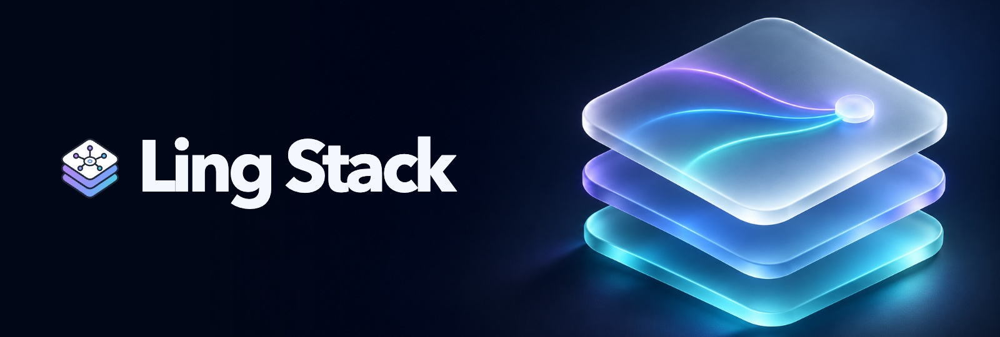
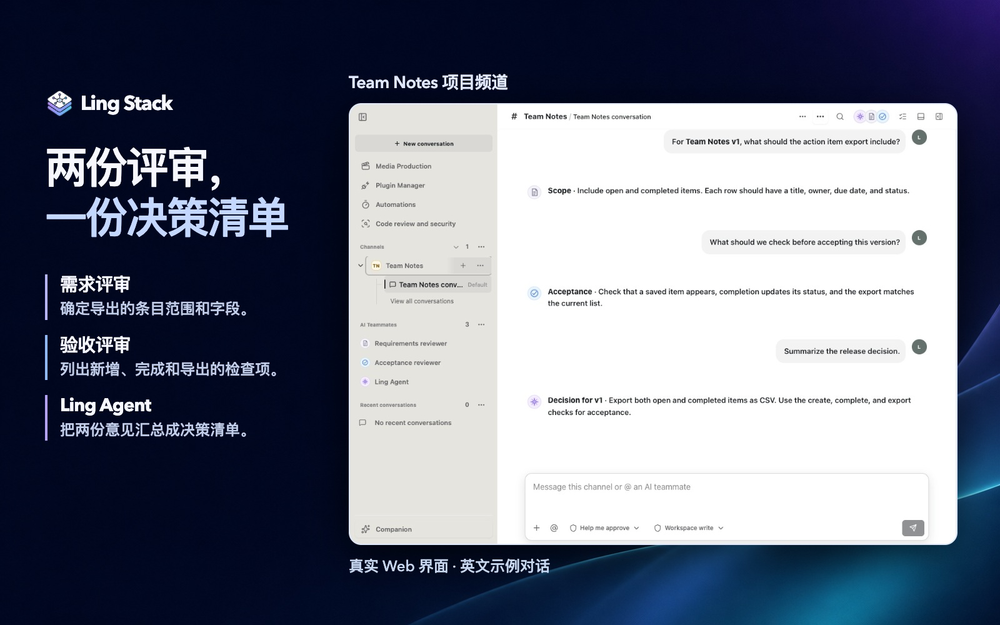

<div align="center">
  <h1></h1>
  <p><strong>不同模型，同一个项目。</strong></p>
  <p>为 AI 队友选择各自的模型，在同一个本地工作区查看对话、工具审批和结果。</p>
  <p>
    <a href="docs/community/first-project-review.md#中文快速说明"><strong>试一次项目评审</strong></a> ·
    <a href="#从源码启动">从源码启动</a> ·
    <a href="#跨设备路线图">设备路线图</a> ·
    <a href="CONTRIBUTING.md">参与贡献</a>
  </p>
  <p>源码 Alpha · <a href="LICENSE">MIT 许可证</a></p>
  <p>
    <a href="README.md">English</a> · 简体中文 ·
    <a href="README.ja-JP.md">日本語</a> · <a href="README.ko-KR.md">한국어</a> ·
    <a href="README.de-DE.md">Deutsch</a> · <a href="README.fr-FR.md">Français</a> ·
    <a href="README.es-ES.md">Español</a> · <a href="README.pt-BR.md">Português (Brasil)</a>
  </p>
</div>

## 先试一个项目评审任务

[Team Notes 公开样例](examples/project-review/README.md)是一份小型项目说明，目标是记录和导出会议待办。可以在同一个项目频道里评审它。

1. 请**需求评审队友**确定要导出的条目范围和字段。
2. 请**验收评审队友**列出新增、完成和导出的检查项。
3. 请 **Ling Agent** 在频道里把两份意见汇总成决策清单。



*英文 Web 界面，使用基于 Team Notes 的预置示例对话。* [查看原始截图](docs/assets/ling-project-review-channel-fixture.jpg)。

按[第一次项目评审指南](docs/community/first-project-review.md#中文快速说明)完成一次仅讨论的评审。
使用自己的模型配置和 API key，模型费用由供应商计收。

## 跨设备路线图

路线图计划把设备任务带进 Ling 的对话。PC、手机或边缘主机可以协调任务，由持有授权连接的主机执行操作和验证结果。


*车机联调概念图。在电脑上发起连接检查，再用配对的手机确认测试。*

- 在 **PC** 上构建和测试项目，或诊断受支持的系统。
- 用**手机**跟进和审批配对电脑上的任务，或直接连接受支持的外设。
- 在**智能家居**中通过 Home Assistant 查看设备状态、定位故障。
- 在停车状态下，为兼容的 **Android 车机**安装和验证应用。
- 在**硬件工作台**采集和解码协议数据，并验证设备响应。

**当前处于设计阶段。** [跨设备设计](docs/design/ling-device-fabric.md) · [实现与实机验收计划](docs/design/ling-device-support-platform-implementation-plan.md)

## 智能伙伴 Yui

Yui（雨光羽衣）是 Ling Stack 的智能伙伴角色概念。[查看角色设计模板](docs/design/assets/yui-character-design-template.png)。

<a href="docs/assets/ling-stack-companion-banner.jpg"></a>

## 适合谁

Ling Stack 面向需要使用多个 AI 模型、并希望把项目上下文与协作过程放在一起的开发者。
工作区状态、聊天历史和运行证据保存在本地；模型请求及上下文会发送给你选择的模型或工具服务。
**本地存储不代表离线推理。** 界面提供 55 个语言与地区选项，界面语言和 AI 回复语言可分别配置。
README 目前提供顶部所列的 8 种语言，不与客户端语言选项逐一对应；其他文档仍可能使用英文或中文。

## 三种适合开始的任务

- **用自己的模型对话。** 在 [Model Workbench](docs/getting-started.md#connect-your-first-model) 配置模型，在同一对话查看消息、附件和回复。
- **让 AI 队友在项目频道分工。** 为队友分配模型和工具，集中查看消息、工具活动、审批和产物。操作见[项目频道指南](docs/getting-started.md#start-a-project-channel)。
- **制作图片或视频。** 配置具备相应能力的供应商，在 [Media Production](docs/getting-started.md#try-media-production) 管理场景、生成任务和产物。

先试简单对话，再按任务需要增加队友和工具。技能提供指令；角色或技能本身不会授予工具或文件权限。
Coding Agent 通过 Pi runtime adapter 执行，实际可用工具取决于平台配置和工作区策略。

## 从源码启动

需要 Git、**Node.js 22.22.1 或更新版本**、**Corepack 和 pnpm 10**，以及 **Rust 1.89 或更新版本和 Cargo**（[rustup](https://rustup.rs/)）。

### 1. 安装并构建

以下命令会在当前目录下创建 `ling-stack/`。后续命令均在该仓库根目录运行：

```bash
git clone https://github.com/ling-stack-org/ling-stack.git
cd ling-stack
corepack enable
corepack pnpm install --frozen-lockfile
corepack pnpm --workspace-concurrency=1 --filter '@ling-stack/cli...' -r build
```

构建包含 CLI、daemon、Web app 及其工作区依赖；Desktop 和 Mobile 需要单独配置。

### 2. 启动 daemon

在第一个终端中运行并保持进程开启：

```bash
corepack pnpm ling daemon start --foreground
```

默认地址为 `http://127.0.0.1:17891`，请保持监听本机回环地址。

### 3. 打开 Web UI

在第二个终端中进入同一仓库根目录，运行：

```bash
corepack pnpm ling ui --foreground --open
```

若浏览器没有自动打开，访问 `http://127.0.0.1:5173`。两个终端均需保持运行；停止时分别按 `Ctrl+C`。

### 4. 配置自己的模型并开始对话

打开 **Settings → Model Workbench**，添加支持聊天的模型，填写供应商支持的模型 ID、接口地址和自己的 API key，保存后运行 **Check**。
第一个检查通过的聊天模型会成为工作区默认模型。新建对话并发送一个小问题，等待最终回复，再查看详情和摘要。
供应商账号、额度和费用由你自行提供；模型检查也会联系供应商，并可能产生费用。

随后可在 **Settings → Teammate Management** 配置队友，在 **Channels** 创建项目频道并选择项目目录。完整步骤见[开始使用](docs/getting-started.md)。

<details>
<summary>构建说明与诊断</summary>

Web 与 daemon 构建会编译原生图片清理程序。仓库固定使用 pnpm `10.0.0`，CI 使用 Node `22.22.1` 和 Rust `1.97.1`。

首次安装依赖时，daemon 尚未构建，`pnpm install` 可能报告 `ling-stack-daemon` 命令无法链接。完成构建后，使用 `corepack pnpm ling` 调用源码 CLI。

运行 `curl http://127.0.0.1:17891/health`，预期得到含 `"ok": true` 的 JSON。配置并检查聊天模型后，在仓库根目录运行诊断：

```bash
corepack pnpm ling doctor
```

新工作区尚未配置聊天模型时，即使服务已启动，Doctor 也会报告 provider failure。按每项诊断结果处理问题。
安装问题见[故障排查](docs/troubleshooting.md)。

</details>

## 支持范围与数据

当前从源码启动 Web UI、本地 daemon 和 CLI。Desktop 提供开发预览，稳定的签名安装包和生产版本仍待发布。

<details>
<summary>查看平台与集成支持情况</summary>

- **Web、daemon、CLI：** 当前源码 Alpha 的默认试用入口。
- **Desktop：** 开发壳，macOS arm64 和 Windows x64 为当前分发目标；原生工具、签名及安装验收仍有独立门槛。见[开发包指南](docs/release/development-packages.md)和[Desktop 发布边界](docs/release/desktop.md)。
- **MCP 与插件：** 需要明确分配和启用工具，并遵守审批与权限边界。
- **图像、视频、Office、Computer Use、浏览器集成：** 可用性受供应商、平台和各项验收门槛影响；Mobile 为实验性工作。

[实现状态](docs/design/implementation-status.md)记录已实现内容与待验收事项。源码构建成功不等于安装包已就绪。

</details>

### Desktop 开发

macOS 需要包含 Swift 与 `codesign` 的 Xcode Command Line Tools；Windows 的 Office 驱动需要 .NET 8 SDK。
Electron 还需要对应平台的二进制文件，详见 [Desktop 故障排查](docs/troubleshooting.md#desktop-development)。

```bash
corepack pnpm --filter @ling-stack/desktop dev
```

分发前请按[开发包指南](docs/release/development-packages.md)和 [Desktop 发布验收](docs/release/desktop.md)完成平台检查。
公开源码和发布签名安装包是两个独立步骤。

### 数据与权限

默认数据位于所选工作区的 `.ling-stack/`：`ling-stack.sqlite` 保存配置与持久状态，`sessions/`、`artifacts/`、`logs/` 保存运行记录、产物和日志。
在 Model Workbench 输入的 API key 保存在本地工作区存储中；环境变量及受支持的钥匙串引用也可使用。
请勿把密钥、数据库、私有日志或产物提交到 Git。存储配置见[配置与数据](docs/getting-started.md#configuration-and-data)。
文件访问、shell 命令、外部修改与付费生成受工作区权限约束，允许前请核对审批请求。
迁移存储请使用 [CLI 存储流程](docs/design/workspace-state-storage.md)。

## 反馈、贡献与 Star

如果 Ling Stack 对你的工作有帮助，欢迎给仓库点一个 **Star**，方便关注后续更新。
更有价值的反馈是：你尝试了什么任务、在哪一步遇到问题、期待得到什么结果。
请通过 [GitHub Issue 表单](https://github.com/ling-stack-org/ling-stack/issues/new/choose)提交可复现的问题，先阅读[支持说明](SUPPORT.md)；维护采用尽力而为的方式。安全问题请走[安全报告入口](SECURITY.md)。

- [贡献指南](CONTRIBUTING.md)：开发环境、检查与 PR 要求。
- [README 翻译维护](CONTRIBUTING.md#readme-translations)：欢迎校对译文，并同步命令、功能范围与安全说明。
- [架构](docs/architecture.md)与[设计索引](docs/design/README.md)：模块边界、契约与验收状态。
- [工作摘要](docs/features/work-summary.md)：会话、净变更、最近提交与 PR 的统一摘要及右侧审查入口。
- [供应商适配](docs/provider-adapters.md)与[Pi 集成](docs/pi-coding-agent-integration.md)：模型和运行时接入。
- [更新日志](CHANGELOG.md)、[发布政策](docs/release/README.md)与[第三方声明](THIRD_PARTY_NOTICES.md)。

Ling Stack 使用 [MIT 许可证](LICENSE)，社区参与遵守[行为准则](CODE_OF_CONDUCT.md)。
