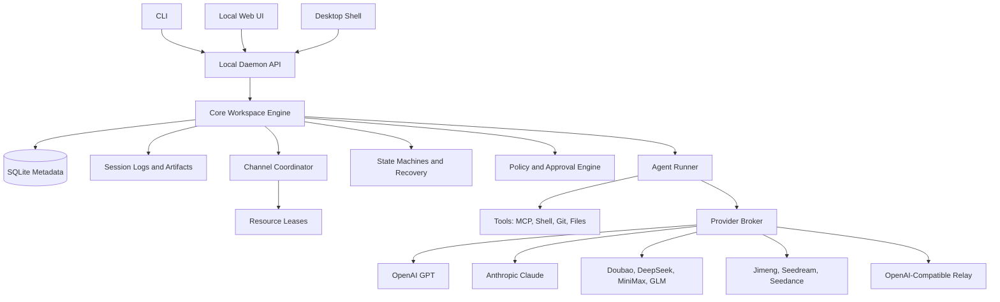

# Architecture

## Recommended Shape

Ling Stack should start as a local runtime with three front doors:

- CLI.
- Local web UI.
- Future desktop shell.

The desktop app should call the same local daemon API as the web UI. This keeps the product usable before packaging work is finished.



## Packages

### `packages/core`

Owns the durable domain model:

- Workspace.
- Channel.
- Task.
- AI teammate.
- Runtime session.
- Approval.
- Artifact.
- Policy.
- State machines for task, run, approval, media job, and workflow recovery.
- Channel runtime policy, state transition events, and resource lease types.

### `packages/providers`

Owns provider adapters and capability normalization.

Provider support must be capability-driven, not chat-only.

### `packages/runner-pi`

Owns the first execution kernel adapter.

Ling Stack should wrap `@earendil-works/pi-coding-agent` instead of forking it. Pi gives us a maintained coding-agent harness, provider routing, sessions, tool calling, and file/shell/git-oriented tools. Ling Stack keeps ownership of the product layer: channels, tasks, approvals, audit logs, provider policy, and future desktop/web surfaces.

The adapter boundary is:

- Ling Stack sends a task, cwd, model/provider config, and allowed tools.
- Pi runs the agent session.
- The adapter translates pi message/tool events into Ling Stack session events.
- Ling Stack stores approvals, audit records, and artifacts outside pi.

### `packages/daemon`

Local API server:

- HTTP for CRUD and commands.
- `POST /runs` with SSE for session streaming.
- `POST /tasks/:id/run` through channel runtime policy, resource leases, idempotency, and CAS task/run transitions.
- Read-only diagnostics for `GET /state-transitions` and `GET /runtime/leases`.
- Local auth token.
- Event bus between runner and UI.

### `packages/cli`

Command entrypoint:

- `init`
- `provider add`
- `provider check`
- `channel create`
- `teammate create`
- `task create`
- `run`
- `approvals list`
- `approvals approve`
- `ui`

### `apps/web`

Local UI:

- Workspace timeline.
- Channel view.
- Task board.
- Session log viewer.
- Approval cards.
- Provider settings.

### `apps/desktop`

Future wrapper:

- macOS, Windows, Linux distribution.
- Tray/background daemon control.
- Keychain integration.
- Local notifications.
- Auto-update.

## Storage

Use SQLite for metadata and files for bulky session artifacts.

Suggested local paths:

```text
.ling-stack/
  ling-stack.sqlite
  sessions/
  artifacts/
  logs/
  providers.json
```

API keys should begin in `.env` for development only. Desktop builds should move secrets to OS keychain.

## Security Model

Default policy:

- Read-only file access by default.
- Path-scoped writes.
- Approval required for external side effects.
- Provider API keys never written to logs.
- Session logs redact known secret patterns.
- Tool calls include command, cwd, exit code, timing, and output summary.

## State and Recovery Model

Status is durable domain state, not UI state. Tasks, runs, approvals, media jobs, and future multi-teammate workflows should move through explicit state machines with persisted transition events.

The daemon must assume local UI refreshes, SSE disconnects, provider timeouts, runner crashes, and daemon restarts can happen at any point. A disconnected browser must reconnect and read durable state. It must not imply cancellation. Explicit cancellation must go through the cancel API.

State updates should be compare-and-set operations so stale events cannot move an entity out of a newer state. For example, a cancelled run must not later become succeeded just because the runner reports completion after the cancel request.

The detailed contract lives in [State Machines and Recovery](design/state-machine-recovery.md).

Multi-channel concurrency does not mean one adapter or state machine per channel. External sources normalize into channel events, the daemon coordinator acquires resource leases, and core state machines decide legal transitions. The detailed contract lives in [Multi-Channel Concurrency](design/multi-channel-concurrency.md).

## Future Platform Architecture

The aggressive long-term direction is a platform kernel plus extension host:

```text
clients
-> shared API client
-> local daemon gateway
-> platform kernel
-> extension host
-> providers, runners, channels, skills, tools, memory, automation
```

The kernel owns state machines, approvals, resource leases, audit logs, policy, secrets access, and recovery. Extensions can add providers, runners, channel sources, tools, skill packs, memory providers, UI feature modules, and GitHub automation, but they must not bypass kernel transitions or write durable state directly.

The detailed contract lives in [Platform Architecture](design/platform-architecture.md).
The first accepted architecture decision is [ADR 0001: Platform Kernel and Extension Host](adr/0001-platform-kernel-and-extension-host.md).

External tracker work should enter through channel source adapters, scheduler claims,
resource leases, workflow steps, isolated workspaces, evidence artifacts, and
approval-gated external actions. The shared design lives in
[External Work Orchestration](design/external-work-orchestration.md).

GitHub automation should be implemented as the first external work adapter plus
approval-gated automation workflows, not as a separate state path. The detailed future
design lives in [GitHub Automation Design](design/github-automation.md).

## Next Architecture Plans

The next implementation slices are documented separately so the platform architecture does not become a catch-all backlog:

- [Web Modularization](design/web-modularization.md): split the large Web app surface into feature modules without changing behavior.
- [Contracts and API Client](design/contracts-api-client.md): extract shared daemon DTOs and one reusable client for Web, CLI, desktop, and future mobile/PWA.
- [Internal Registry and Plugin SDK](design/internal-registry-plugin-sdk.md): introduce internal extension registries before external plugin loading.
- [Desktop Shell](design/desktop-shell.md): package the Web UI and daemon behind a desktop shell without forking the product model.
- [Secrets and Keychain](design/secrets-keychain.md): keep `env:` and fail-closed `keychain:` refs behind one resolver while keeping raw secret values out of renderer, logs, and artifacts.

## Desktop Strategy

Do not start with a desktop-first implementation.

Recommended order:

1. CLI + daemon.
2. Local web UI.
3. Electron alpha if speed matters most.
4. Tauri evaluation if package size and native boundary become important.

Electron is faster for a TypeScript-heavy AI tool. Tauri is attractive later for smaller bundles and clearer native boundaries.
