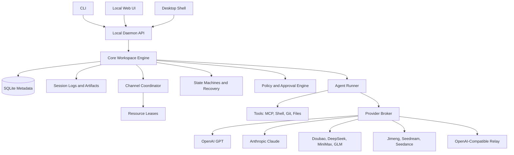

# Architecture

Status: current architecture overview
Owner: repository maintainers
Last verified: 2026-10-08 (Desktop source and release wording)
Document type: architecture contract
Code and test anchors: `apps/desktop/package.json`, `apps/desktop/README.md`, and the owning contracts below

## Current Shape

Ling Stack is a local runtime with three source-based entry points:

- CLI.
- Local Web UI.
- Electron Desktop shell.

The Desktop shell is implemented as a source alpha and uses the same local daemon API
and shared Web UI. This keeps the product usable before packaging work is finished.
Source implementation does not establish a supported signed release: signing,
clean-machine and platform acceptance remain governed by
[Desktop Release And Acceptance](release/desktop.md).



## Packages

### `packages/core`

Owns the durable domain model:

- Workspace.
- Channel.
- Task.
- AI teammate.
- Runtime session.
- Approval.
- Artifact.
- Policy.
- State machines for task, run, approval, media job, and workflow recovery.
- Channel runtime policy, state transition events, and resource lease types.

### `packages/providers`

Owns provider adapters and capability normalization.

Provider support must be capability-driven, not chat-only.

### `packages/runner-pi`

Owns the first execution kernel adapter.

Ling Stack should wrap `@earendil-works/pi-coding-agent` instead of forking it. Pi gives us a maintained coding-agent harness, provider routing, sessions, tool calling, and file/shell/git-oriented tools. Ling Stack keeps ownership of the product layer: channels, tasks, approvals, audit logs, provider policy, and the shared Desktop/Web surfaces.

The adapter boundary is:

- Ling Stack sends a task, cwd, model/provider config, and allowed tools.
- Pi runs the agent session.
- The adapter translates pi message/tool events into Ling Stack session events.
- Ling Stack stores approvals, audit records, and artifacts outside pi.

### `packages/daemon`

Local API server:

- HTTP for CRUD and commands.
- `POST /runs` with SSE for session streaming.
- `POST /tasks/:id/run` through channel runtime policy, resource leases, idempotency, and CAS task/run transitions.
- Read-only diagnostics for `GET /state-transitions` and `GET /runtime/leases`.
- Local auth token.
- Event bus between runner and UI.

### `packages/cli`

Command entrypoint:

- `init`
- `provider add`
- `provider check`
- `channel create`
- `teammate create`
- `task create`
- `run`
- `approvals list`
- `approvals approve`
- `ui`

### `apps/web`

Local UI:

- Workspace timeline.
- Channel view.
- Task board.
- Session log viewer.
- Approval cards.
- Provider settings.

### `apps/desktop`

Current Electron source alpha wrapper over the shared Web UI and daemon.

The shell owns daemon lifecycle and native integration boundaries, including menu/tray,
file selection, Keychain, notifications and update UX. Supported distribution and native
capabilities are platform-gated; macOS and Windows acceptance is tracked in
[Desktop Release And Acceptance](release/desktop.md). Read the
[Desktop package guide](../apps/desktop/README.md) for current implementation and open gates.

## Storage

Use SQLite for metadata and files for bulky session artifacts.

Ling uses a two-layer configuration model:

- user-level `~/.ling-stack/` for cross-workspace defaults, provider profile
  templates, plugin cache, recent workspaces, and local operator state;
- workspace-level `<workspace>/.ling-stack/` for durable workspace metadata,
  runtime settings, sessions, artifacts, approvals, and audit evidence.

The detailed contract lives in [Two-Layer Configuration](design/two-layer-configuration.md).

Current workspace paths:

```text
.ling-stack/
  ling-stack.sqlite
  sessions/
  artifacts/
  logs/
  config.json
  runtime-settings.json
```

API keys should use secret refs. `env:` is acceptable for development. Desktop builds
should prefer OS keychain refs. Raw secret values must not be stored in JSON config,
logs, artifacts, or run snapshots.

## Security Model

Default policy:

- Read-only file access by default.
- Path-scoped writes.
- Approval required for external side effects.
- Provider API keys never written to logs.
- Session logs redact known secret patterns.
- Tool calls include command, cwd, exit code, timing, and output summary.

## State and Recovery Model

Status is durable domain state, not UI state. Tasks, runs, approvals, media jobs, and future multi-teammate workflows should move through explicit state machines with persisted transition events.

The daemon must assume local UI refreshes, SSE disconnects, provider timeouts, runner crashes, and daemon restarts can happen at any point. A disconnected browser must reconnect and read durable state. It must not imply cancellation. Explicit cancellation must go through the cancel API.

State updates should be compare-and-set operations so stale events cannot move an entity out of a newer state. For example, a cancelled run must not later become succeeded just because the runner reports completion after the cancel request.

The detailed contract lives in [State Machines and Recovery](design/state-machine-recovery.md).

Multi-channel concurrency does not mean one adapter or state machine per channel. External sources normalize into channel events, the daemon coordinator acquires resource leases, and core state machines decide legal transitions. The detailed contract lives in [Multi-Channel Concurrency](design/multi-channel-concurrency.md).

Web, desktop, CLI, and future clients must share one daemon-owned runtime supervisor per
workspace. The supervisor owns active work units, runner attempts, heartbeats, leases,
semaphores, cancellation, retry, and startup recovery. The detailed target design lives
in [Runtime Supervisor](design/runtime-supervisor.md). The implementation-level control
plane contract lives in [Runtime Control Plane Detailed Design](design/runtime-control-plane-detailed-design.md).

Daemon process lifecycle is a separate local operator concern. `daemon start`, `status`,
`stop`, `restart`, `logs`, and doctor checks may observe or signal the process, but they
must not directly edit durable work-unit, run, approval, lease, or semaphore state. That
P0 boundary lives in [Daemon Lifecycle and Doctor P0](design/daemon-lifecycle-p0.md).

## Future Platform Architecture

The aggressive long-term direction is a platform kernel plus extension host:

```text
clients
-> shared API client
-> local daemon gateway
-> platform kernel
-> extension host
-> providers, runners, channels, skills, tools, memory, automation
```

The kernel owns state machines, approvals, resource leases, audit logs, policy, secrets access, and recovery. Extensions can add providers, runners, channel sources, tools, skill packs, memory providers, UI feature modules, and GitHub automation, but they must not bypass kernel transitions or write durable state directly.

The detailed contract lives in [Platform Architecture](design/platform-architecture.md).
The first accepted architecture decision is [ADR 0001: Platform Kernel and Extension Host](adr/0001-platform-kernel-and-extension-host.md).

External tracker work should enter through channel source adapters, scheduler claims,
resource leases, workflow steps, isolated workspaces, evidence artifacts, and
approval-gated external actions. The shared design lives in
[External Work Orchestration](design/external-work-orchestration.md).

GitHub automation should be implemented as the first external work adapter plus
approval-gated automation workflows, not as a separate state path. The detailed future
design lives in [GitHub Automation Design](design/github-automation.md).

## Next Architecture Plans

The next implementation slices are documented separately so the platform architecture does not become a catch-all backlog:

- [Web Modularization](design/web-modularization.md): split the large Web app surface into feature modules without changing behavior.
- [Contracts and API Client](design/contracts-api-client.md): extract shared daemon DTOs and one reusable client for Web, CLI, desktop, and future mobile/PWA.
- [Internal Registry and Plugin SDK](design/internal-registry-plugin-sdk.md): introduce internal extension registries before external plugin loading.
- [Runner Registry](design/runner-registry.md): introduce multi-runner resolution while keeping Pi as the default execution backend.
- [Runtime Control Plane Detailed Design](design/runtime-control-plane-detailed-design.md): pin the work-unit, attempt, heartbeat, approval, artifact, audit, and runner-registry contract that clients share.
- [Multi-Agent Orchestrator](design/multi-agent-orchestrator.md): compile workflow templates into durable multi-teammate workflow steps that execute through normal task/run state machines.
- [Codex-like Execution](design/codex-like-execution.md): complete approval action auditing, evidence replay, long-lived threads, and resume/redirect behavior.
- [OpenAI Agents SDK Runtime Patterns](design/openai-agents-sdk-runtime-patterns.md): borrow trace/span, approval/resume, handoff, tool namespace, and sandbox patterns without replacing Ling's daemon-owned runtime.
- [OpenAI Agents SDK Adapter Decision Record](design/openai-agents-sdk-adapter-decision-record.md): preserve the deferred medium-term adapter boundary while the short-term work hardens Ling-owned sandbox policy and runner hydration evidence.
- [Desktop Shell](design/desktop-shell.md): package the Web UI and daemon behind a desktop shell without forking the product model.
- [Two-Layer Configuration](design/two-layer-configuration.md): split user defaults from workspace execution state without introducing a third localStorage layer.
- [Secrets and Keychain](design/secrets-keychain.md): keep `env:` and fail-closed `keychain:` refs behind one resolver while keeping raw secret values out of renderer, logs, and artifacts.

## Desktop Strategy

The architecture began with CLI + daemon, followed by a local Web UI and then an Electron
alpha. That order keeps the daemon and product model independent of desktop packaging.
Electron is the selected current shell for the TypeScript-heavy application.

Tauri remains a deferred architecture option if package size or native boundaries justify
a separate review; it is not the current implementation plan. The Desktop shell must
continue to consume the shared daemon contracts and Web surface.
