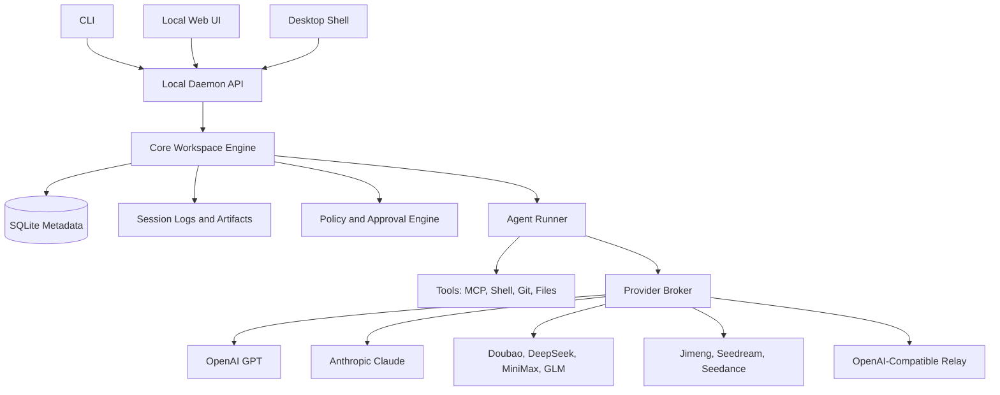

# Architecture

## Recommended Shape

Ling Stack should start as a local runtime with three front doors:

- CLI.
- Local web UI.
- Future desktop shell.

The desktop app should call the same local daemon API as the web UI. This keeps the product usable before packaging work is finished.



## Packages

### `packages/core`

Owns the durable domain model:

- Workspace.
- Channel.
- Task.
- AI teammate.
- Runtime session.
- Approval.
- Artifact.
- Policy.

### `packages/providers`

Owns provider adapters and capability normalization.

Provider support must be capability-driven, not chat-only.

### `packages/runner-pi`

Owns the first execution kernel adapter.

Ling Stack should wrap `earendil-works/pi` instead of forking it. Pi gives us a maintained coding-agent harness, provider routing, sessions, tool calling, and file/shell/git-oriented tools. Ling Stack keeps ownership of the product layer: channels, tasks, approvals, audit logs, provider policy, and future desktop/web surfaces.

The adapter boundary is:

- Ling Stack sends a task, cwd, model/provider config, and allowed tools.
- Pi runs the agent session.
- The adapter translates pi message/tool events into Ling Stack session events.
- Ling Stack stores approvals, audit records, and artifacts outside pi.

### `packages/daemon`

Local API server:

- HTTP for CRUD and commands.
- WebSocket or SSE for session streaming.
- Local auth token.
- Event bus between runner and UI.

### `packages/cli`

Command entrypoint:

- `init`
- `provider add`
- `provider check`
- `channel create`
- `teammate create`
- `task create`
- `run`
- `approvals list`
- `approvals approve`
- `ui`

### `apps/web`

Local UI:

- Workspace timeline.
- Channel view.
- Task board.
- Session log viewer.
- Approval cards.
- Provider settings.

### `apps/desktop`

Future wrapper:

- macOS, Windows, Linux distribution.
- Tray/background daemon control.
- Keychain integration.
- Local notifications.
- Auto-update.

## Storage

Use SQLite for metadata and files for bulky session artifacts.

Suggested local paths:

```text
.ling-stack/
  ling-stack.sqlite
  sessions/
  artifacts/
  logs/
  providers.json
```

API keys should begin in `.env` for development only. Desktop builds should move secrets to OS keychain.

## Security Model

Default policy:

- Read-only file access by default.
- Path-scoped writes.
- Approval required for external side effects.
- Provider API keys never written to logs.
- Session logs redact known secret patterns.
- Tool calls include command, cwd, exit code, timing, and output summary.

## Desktop Strategy

Do not start with a desktop-first implementation.

Recommended order:

1. CLI + daemon.
2. Local web UI.
3. Electron alpha if speed matters most.
4. Tauri evaluation if package size and native boundary become important.

Electron is faster for a TypeScript-heavy AI tool. Tauri is attractive later for smaller bundles and clearer native boundaries.
