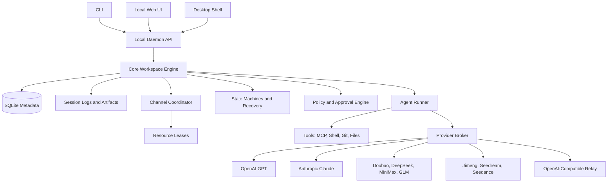

# Architecture

Status: current source architecture summary
Owner: repository maintainers
Last verified: 2026-11-02
Document type: architecture contract
Code and test anchors: `apps/desktop/package.json`, `apps/desktop/README.md`, and the owning contracts below

## Current Shape

Ling Stack is a local runtime with three source-based entry points:

- CLI.
- Local Web UI.
- Electron Desktop shell.

The desktop main window loads the same built Web UI and calls the same local daemon API.
The shell and macOS/Windows packaging scripts are implemented. Source implementation
does not establish a supported signed release: signing, clean-machine and platform
acceptance remain governed by [Desktop Release And Acceptance](release/desktop.md).
Mobile source exists behind a separate Remote Gateway boundary, but is outside current
product acceptance.



## Packages

### `packages/core`

Owns the durable domain model:

- Workspace.
- Channel.
- Task.
- AI teammate.
- Runtime session.
- Approval.
- Artifact.
- Policy.
- State machines for task, run, approval, media job, and workflow recovery.
- Channel runtime policy, state transition events, and resource lease types.

### `packages/contracts` and `packages/api-client`

Own shared daemon wire types, conversation message/item contracts, and the typed
`LingDaemonClient`. Web consumes these through compatibility facades; Desktop reuses
the built Web application. CLI still has its own request layer, so client migration is
not complete across every surface. The proposed shared block-level transcript and delta
stream remain separate work.

### `packages/plugin-sdk`

Owns typed extension metadata, manifest validation, and internal registries. The daemon
assembles built-in registrations and exposes safe diagnostics. This is not an open
third-party plugin API or a general sandboxed extension host.

### Shared UI Packages

`packages/ui-react`, `packages/conversation-ui-core`, and
`packages/conversation-ui-react` own shared UI primitives and conversation semantics.
Web feature modules remain under `apps/web/src/features`; Desktop does not copy them.

### `packages/providers`

Owns provider adapters and capability normalization.

Provider support must be capability-driven, not chat-only.

### `packages/runner-pi`

Owns the first execution kernel adapter.

Ling Stack wraps `@earendil-works/pi-coding-agent` instead of forking it. Pi supplies the
coding-agent harness, provider routing, sessions, tool calling, and file/shell/git-oriented
tools. Ling Stack owns channels, tasks, approvals, audit logs, provider policy, and the
Web/Desktop/CLI product surfaces. The daemon's `RunnerRegistry` resolves execution
backends; Pi is the default, while external runners require explicit readiness and
conformance gates.

The adapter boundary is:

- Ling Stack sends a task, cwd, model/provider config, and allowed tools.
- Pi runs the agent session.
- The adapter translates pi message/tool events into Ling Stack session events.
- Ling Stack stores approvals, audit records, and artifacts outside pi.

### `packages/daemon`

Local API server:

- HTTP for CRUD and commands.
- `POST /runs` with SSE for session streaming.
- `POST /tasks/:id/run` through channel runtime policy, resource leases, idempotency, and CAS task/run transitions.
- Read-only diagnostics for `GET /state-transitions` and `GET /runtime/leases`.
- Local auth token.
- Event bus between runner and UI.

### `packages/cli`

Command entrypoints include:

- `init`
- `provider add`
- `provider check`
- `channel create`
- `task create`
- `task run`
- `run`
- `approvals list`
- `approvals approve`
- `approvals deny`
- `daemon start`, `status`, `stop`, `restart`, and `logs`
- `doctor`
- `automations`
- `external-work`
- `ui`

### `apps/web`

Local UI:

- Workspace timeline.
- Channel view.
- Task board.
- Session log viewer.
- Approval cards.
- Provider settings.

### `apps/desktop`

Implemented Electron alpha:

- Shared built Web main window with an isolated preload boundary.
- Local daemon startup, reuse, owned-process shutdown, and recovery.
- Daemon-backed system workspace-directory picker and theme persistence.
- User-activated local file previews and native file actions.
- Computer Use picture-in-picture foundations.
- macOS and Windows packaging scripts.

Tray/menu bar, local notifications, auto-update, full keychain UX, signed distribution,
and remaining platform acceptance are still follow-up work. The owning contract is
[Desktop Shell](design/desktop-shell.md). Read
[Desktop Release And Acceptance](release/desktop.md) and the
[Desktop package guide](../apps/desktop/README.md) for current implementation and open gates.

## Storage

Use SQLite for metadata and files for bulky session artifacts.

Ling uses a two-layer configuration model:

- user-level `~/.ling-stack/` for cross-workspace defaults, provider profile
  templates, plugin cache, recent workspaces, and local operator state;
- workspace-level `<workspace>/.ling-stack/` for durable workspace metadata,
  runtime settings, sessions, artifacts, approvals, and audit evidence.

The detailed contract lives in [Two-Layer Configuration](design/two-layer-configuration.md).

Current workspace paths:

```text
.ling-stack/
  ling-stack.sqlite
  sessions/
  artifacts/
  logs/
  config.json
  runtime-settings.json
```

API keys should use secret refs. `env:` is acceptable for development. Desktop builds
should prefer OS keychain refs. Raw secret values must not be stored in JSON config,
logs, artifacts, or run snapshots.

## Security Model

Default policy:

- Read-only file access by default.
- Path-scoped writes.
- Approval required for external side effects.
- Provider API keys never written to logs.
- Session logs redact known secret patterns.
- Tool calls include command, cwd, exit code, timing, and output summary.

## State and Recovery Model

Status is durable domain state, not UI state. Tasks, runs, approvals, media jobs, and
multi-teammate workflows use explicit state machines with persisted transition events.

The daemon must assume local UI refreshes, SSE disconnects, provider timeouts, runner crashes, and daemon restarts can happen at any point. A disconnected browser must reconnect and read durable state. It must not imply cancellation. Explicit cancellation must go through the cancel API.

State updates should be compare-and-set operations so stale events cannot move an entity out of a newer state. For example, a cancelled run must not later become succeeded just because the runner reports completion after the cancel request.

The detailed contract lives in [State Machines and Recovery](design/state-machine-recovery.md).

Multi-channel concurrency does not mean one adapter or state machine per channel. External sources normalize into channel events, the daemon coordinator acquires resource leases, and core state machines decide legal transitions. The detailed contract lives in [Multi-Channel Concurrency](design/multi-channel-concurrency.md).

Web, desktop, and CLI share the daemon-owned runtime supervisor for each workspace.
Work units, runner attempts, heartbeats, leases, semaphores, cancellation, retry, and
startup reconciliation are implemented in daemon runtime modules and core storage.
Further recovery hardening and acceptance gates remain tracked in
[Runtime Supervisor](design/runtime-supervisor.md). The implementation-level control
plane contract lives in [Runtime Control Plane Detailed Design](design/runtime-control-plane-detailed-design.md).

Daemon process lifecycle is a separate local operator concern. `daemon start`, `status`,
`stop`, `restart`, `logs`, and doctor checks may observe or signal the process, but they
must not directly edit durable work-unit, run, approval, lease, or semaphore state. That
P0 boundary lives in [Daemon Lifecycle and Doctor P0](design/daemon-lifecycle-p0.md).

## Platform Architecture and Remaining Direction

Shared contracts, the local API client, internal extension registries, runner resolution,
and daemon-owned workflows are implemented. The long-term direction remains a platform
kernel plus extension host:

```text
clients
-> shared API client
-> local daemon gateway
-> platform kernel
-> extension host
-> providers, runners, channels, skills, tools, memory, automation
```

Core and daemon modules currently own the kernel responsibilities: state machines,
approvals, resource leases, audit logs, policy, secrets access, and recovery. Internal
registries and the Plugin Manager provide capability metadata and managed lifecycle
surfaces. Separate `kernel`, `extension-host`, and `workflow-engine` packages and an open
third-party SDK remain target boundaries, not existing packages. Extensions must not
bypass kernel transitions or write durable state directly.

The detailed contract lives in [Platform Architecture](design/platform-architecture.md).
The first accepted architecture decision is [ADR 0001: Platform Kernel and Extension Host](adr/0001-platform-kernel-and-extension-host.md).

External tracker work should enter through channel source adapters, scheduler claims,
resource leases, workflow steps, isolated workspaces, evidence artifacts, and
approval-gated external actions. The shared design lives in
[External Work Orchestration](design/external-work-orchestration.md).

GitHub external-work intake, workflow integration, evidence artifacts, and approval-gated
action paths exist. They use the shared external-work model, not a separate state path.
The capability boundaries and remaining work live in
[GitHub Automation Design](design/github-automation.md).

## Architecture Status

These documents own implemented boundaries and their remaining work; they are not all
unstarted plans. [Implementation Status](design/implementation-status.md) tracks material
delivery and acceptance gates.

- [Web Modularization](design/web-modularization.md): feature, helper, and CSS extraction is implemented; further AppShell and API-facade boundaries have their own follow-up contracts.
- [Contracts and API Client](design/contracts-api-client.md): shared DTOs, conversation message/item types, and Web client integration are implemented; CLI migration and the proposed block-level transcript/stream contract remain separate work. Mobile uses the constrained remote client, not the broad local client.
- [Internal Registry and Plugin SDK](design/internal-registry-plugin-sdk.md): typed internal registries and safe diagnostics are implemented; third-party APIs and sandboxed loading remain deferred.
- [Runner Registry](design/runner-registry.md): runner resolution, audit metadata, workspace policy, and conformance harnesses are implemented. External runner activation remains gated.
- [Runtime Control Plane Detailed Design](design/runtime-control-plane-detailed-design.md): the implemented control-plane objects and APIs share this contract; its roadmap tracks remaining slices.
- [Multi-Agent Orchestrator](design/multi-agent-orchestrator.md): durable template compilation, workflow steps, orchestration, and evidence-aware completion exist; delivery and resilience gates are tracked separately.
- [Codex-like Execution](design/codex-like-execution.md): action auditing, thread/evidence read models, and continuation foundations exist; the contract distinguishes these from remaining hardening.
- [OpenAI Agents SDK Runtime Patterns](design/openai-agents-sdk-runtime-patterns.md): borrow trace/span, approval/resume, handoff, tool namespace, and sandbox patterns without replacing Ling's daemon-owned runtime.
- [OpenAI Agents SDK Adapter Decision Record](design/openai-agents-sdk-adapter-decision-record.md): preserve the deferred medium-term adapter boundary while the short-term work hardens Ling-owned sandbox policy and runner hydration evidence.
- [Desktop Shell](design/desktop-shell.md): the Electron alpha shares Web and daemon state; signing, release acceptance, and later OS integration remain open.
- [Two-Layer Configuration](design/two-layer-configuration.md): user/workspace separation and runtime inheritance are implemented at the documented slice boundary; provider-profile and keychain cleanup remain.
- [Secrets and Keychain](design/secrets-keychain.md): shared secret resolution and scoped keychain write/delete paths exist; the contract retains remaining migration and full Desktop UX gaps.

## Desktop Strategy

The architecture began with CLI + daemon, followed by a local Web UI and then an Electron
alpha. That order keeps the daemon and product model independent of desktop packaging.
Electron is the selected current shell for the TypeScript-heavy application.

Tauri remains a deferred architecture option if package size or native boundaries justify
a separate review; it is not the current implementation plan. The Desktop shell must
continue to consume the shared daemon contracts and Web surface.
