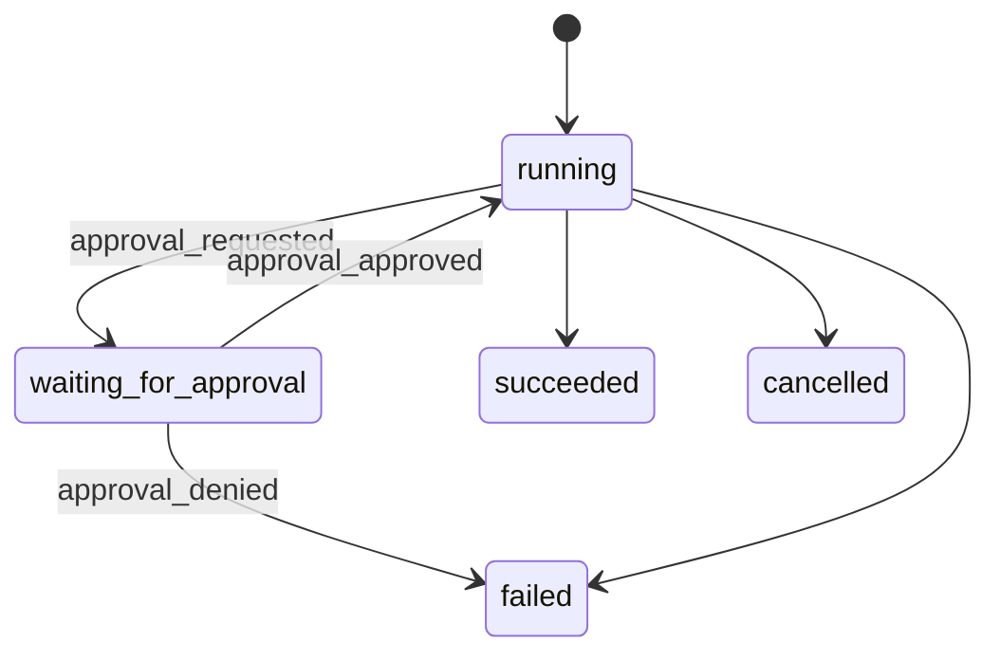

# Approval Policy Design

## Status

Partially implemented for Milestone 5: Pi Controlled Tool Wrapper.

Current implementation includes workspace-level configurable policy storage, `GET/PATCH /approval-policy`, Web Settings controls, CLI policy commands, tool decisions (`allow`, `ask`, `deny`), write path scopes, and Pi pre-tool interception for `bash`, `edit`, and `write`.

This design follows session persistence and provider presets. It defines how Ling Stack should represent, persist, display, and enforce human approval gates for risky actions.

## Goal

Risky actions must stop before they happen.

Minimum outcome:

```text
run requests a risky action
-> policy classifies risk
-> approval request is persisted
-> run enters waiting_for_approval
-> UI/CLI shows exact action details
-> user approves or denies
-> approved action resumes
-> denied action fails safely
-> all decisions are recorded as events
```

Ling Stack should not claim approval is complete until `write`, `edit`, `bash`, external sends, deploys, and paid media jobs can be intercepted before execution.

## Current Baseline

Implemented today:

- The Pi runner adapter can expose tool events after they happen.
- Daemon streams tool events over SSE.
- Session persistence design reserves approval event types.
- The product design says risky actions require approval.
- Approval request types and SQLite persistence exist.
- Daemon approval list/get/approve/deny APIs exist.
- Web UI has an Approvals page.
- Product runs default to read-only tools.
- Workspace approval policy controls tool decisions and allowed write paths.
- Pi `tool_call` extension hook is wired for `bash`, `edit`, and `write`.
- `bash`, `edit`, and `write` create approval requests before execution.
- Runs move to `waiting_for_approval` while the daemon waits for an approve/deny decision.
- Approved requests resume the Pi tool call; denied requests return a blocked tool result before the side effect.
- CLI can inspect, update, and reset workspace approval policy.

Not implemented yet:

- Approval expiry/cancellation UI.
- External sends, deploys, credential changes, and paid media approvals.

## Scope

This slice includes:

- Approval policy data model.
- Approval request data model.
- Risk classification rules.
- SQLite schema.
- Approval event contract.
- Daemon API shape.
- CLI and Web UI requirements.
- Pi integration options and v0.1 enforcement path.
- Test plan.

This slice does not include:

- Full Web UI implementation.
- Full CLI implementation.
- Provider preset implementation.
- Real deploy integrations.
- External email/chat sending integrations.
- Full desktop notification support.

## Non-Negotiable Rule

Evidence after execution is audit logging. It is not approval.

Approval means Ling Stack can block the side effect before it happens.

Until that is true for a tool, the safe v0.1 behavior is to disable that risky tool by default and allow only read-only tools in user-facing runs.

## Action Categories

```ts
type ApprovalActionType =
  | "write"
  | "edit"
  | "bash"
  | "git_commit"
  | "git_push"
  | "external_send"
  | "deploy"
  | "media_cost"
  | "credential_change"
  | "provider_change";
```

Default classification:

| Action | Default behavior | Reason |
| --- | --- | --- |
| `read` | allow | No direct side effect |
| `grep` | allow | No direct side effect |
| `find` | allow | No direct side effect |
| `ls` | allow | No direct side effect |
| `write` | approval required | Filesystem mutation |
| `edit` | approval required | Filesystem mutation |
| `bash` | approval required | Arbitrary side effects |
| `git_commit` | approval required | History mutation |
| `git_push` | approval required | External side effect |
| `external_send` | approval required | Sends data outside local workspace |
| `deploy` | approval required | Production or environment mutation |
| `media_cost` | approval required | Paid/high-cost provider action |
| `credential_change` | critical approval required | Secret and auth boundary |
| `provider_change` | medium approval or explicit user action | Affects model routing/cost |

## Risk Levels

```ts
type ApprovalRisk = "low" | "medium" | "high" | "critical";
```

Risk guidance:

| Risk | Meaning | Examples |
| --- | --- | --- |
| `low` | Reversible local change inside allowed scope | Create draft file under bound path |
| `medium` | Local mutation that may affect project behavior | Edit source file, run formatting command |
| `high` | Broad, destructive, external, or expensive action | `rm`, `git push`, paid media generation |
| `critical` | Credentials, production, history rewrite, irreversible side effects | secret edits, deploy, force push |

## Default v0.1 Policy

```ts
interface ApprovalPolicy {
  id: string;
  name: string;
  defaultMode: "read_only" | "approval_required" | "allowlist";
  allowedReadPaths: string[];
  allowedWritePaths: string[];
  allowedCommands: string[];
  blockedCommands: string[];
  requireApprovalFor: ApprovalActionType[];
  autoDenyFor: ApprovalActionType[];
  createdAt: string;
  updatedAt: string;
}
```

Recommended default:

```json
{
  "id": "policy_default",
  "name": "Default Local Safety Policy",
  "defaultMode": "read_only",
  "allowedReadPaths": ["<channel.boundPath>"],
  "allowedWritePaths": [],
  "allowedCommands": [],
  "blockedCommands": [
    "rm -rf",
    "git reset --hard",
    "git push --force",
    "sudo",
    "chmod -R",
    "chown -R"
  ],
  "requireApprovalFor": [
    "write",
    "edit",
    "bash",
    "git_commit",
    "git_push",
    "external_send",
    "deploy",
    "media_cost",
    "credential_change",
    "provider_change"
  ],
  "autoDenyFor": []
}
```

`blockedCommands` is a last-resort guard. It should not replace approval. It exists so obviously destructive patterns fail even if a future policy is accidentally too permissive.

## Approval Request Model

```ts
type ApprovalStatus =
  | "pending"
  | "approved"
  | "denied"
  | "expired"
  | "cancelled";

interface ApprovalRequest {
  id: string;
  runId: string;
  taskId: string;
  channelId?: string;
  toolCallId?: string;
  actionType: ApprovalActionType;
  risk: ApprovalRisk;
  title: string;
  description: string;
  payload: ApprovalPayload;
  status: ApprovalStatus;
  createdAt: string;
  expiresAt?: string;
  resolvedAt?: string;
  resolvedBy?: "local-user";
  decisionReason?: string;
}
```

Payload variants:

```ts
type ApprovalPayload =
  | FileWriteApprovalPayload
  | FileEditApprovalPayload
  | BashApprovalPayload
  | ExternalSendApprovalPayload
  | DeployApprovalPayload
  | MediaCostApprovalPayload
  | ProviderChangeApprovalPayload;
```

### File Write Payload

```ts
interface FileWriteApprovalPayload {
  type: "file_write";
  path: string;
  bytes: number;
  preview?: string;
}
```

### File Edit Payload

```ts
interface FileEditApprovalPayload {
  type: "file_edit";
  path: string;
  diffPreview: string;
}
```

### Bash Payload

```ts
interface BashApprovalPayload {
  type: "bash";
  cwd: string;
  command: string;
  riskFlags: string[];
}
```

### External Send Payload

```ts
interface ExternalSendApprovalPayload {
  type: "external_send";
  destination: string;
  subject?: string;
  preview: string;
}
```

### Deploy Payload

```ts
interface DeployApprovalPayload {
  type: "deploy";
  target: string;
  command?: string;
  environment?: string;
}
```

### Media Cost Payload

```ts
interface MediaCostApprovalPayload {
  type: "media_cost";
  providerPresetId: string;
  model: string;
  operation: "image_generate" | "image_edit" | "video_generate";
  estimatedCost?: number;
  promptPreview: string;
}
```

### Provider Change Payload

```ts
interface ProviderChangeApprovalPayload {
  type: "provider_change";
  providerPresetId: string;
  changedFields: string[];
}
```

## SQLite Schema

```sql
CREATE TABLE approval_policies (
  id TEXT PRIMARY KEY,
  name TEXT NOT NULL,
  default_mode TEXT NOT NULL,
  allowed_read_paths_json TEXT NOT NULL,
  allowed_write_paths_json TEXT NOT NULL,
  allowed_commands_json TEXT NOT NULL,
  blocked_commands_json TEXT NOT NULL,
  require_approval_for_json TEXT NOT NULL,
  auto_deny_for_json TEXT NOT NULL,
  created_at TEXT NOT NULL,
  updated_at TEXT NOT NULL
);

CREATE TABLE approval_requests (
  id TEXT PRIMARY KEY,
  run_id TEXT NOT NULL,
  task_id TEXT NOT NULL,
  channel_id TEXT,
  tool_call_id TEXT,
  action_type TEXT NOT NULL,
  risk TEXT NOT NULL,
  title TEXT NOT NULL,
  description TEXT NOT NULL,
  payload_json TEXT NOT NULL,
  status TEXT NOT NULL,
  created_at TEXT NOT NULL,
  expires_at TEXT,
  resolved_at TEXT,
  resolved_by TEXT,
  decision_reason TEXT,
  FOREIGN KEY(run_id) REFERENCES run_sessions(id) ON DELETE CASCADE
);

CREATE INDEX idx_approval_requests_status ON approval_requests(status);
CREATE INDEX idx_approval_requests_run ON approval_requests(run_id);
CREATE INDEX idx_approval_requests_task ON approval_requests(task_id);
CREATE INDEX idx_approval_requests_created_at ON approval_requests(created_at);
```

Policy records can be global in v0.1. Channel-level policy selection should be added when channel CRUD lands.

## Run Status Integration

Add `waiting_for_approval` to the durable run status model:

```ts
type RunStatus =
  | "queued"
  | "running"
  | "waiting_for_approval"
  | "succeeded"
  | "failed"
  | "cancelled";
```

State flow:



Task mapping:

| Run status | Task status |
| --- | --- |
| `waiting_for_approval` | `review` |
| `running` | `running` |
| `succeeded` | `done` |
| `failed` | `failed` |
| `cancelled` | `cancelled` |

## Event Contract

Approval events must be persisted and streamed with the same run event envelope used by session persistence.

### Approval Requested

```json
{
  "type": "approval_requested",
  "data": {
    "approvalId": "approval_...",
    "actionType": "bash",
    "risk": "high",
    "title": "Run shell command",
    "description": "The agent wants to run a shell command.",
    "payload": {
      "type": "bash",
      "cwd": "/path/to/project",
      "command": "git push",
      "riskFlags": ["external_side_effect", "git_remote"]
    }
  }
}
```

### Approval Approved

```json
{
  "type": "approval_approved",
  "data": {
    "approvalId": "approval_...",
    "resolvedBy": "local-user",
    "decisionReason": "Looks correct."
  }
}
```

### Approval Denied

```json
{
  "type": "approval_denied",
  "data": {
    "approvalId": "approval_...",
    "resolvedBy": "local-user",
    "decisionReason": "Do not push yet."
  }
}
```

Approval payloads must be redacted before persistence and UI delivery.

## API Design

### List Approvals

```http
GET /approvals
GET /approvals?status=pending
GET /approvals?runId=run_...
```

Response:

```json
{
  "approvals": [
    {
      "id": "approval_...",
      "runId": "run_...",
      "taskId": "task_...",
      "actionType": "bash",
      "risk": "high",
      "title": "Run shell command",
      "status": "pending",
      "createdAt": "2026-05-20T10:00:00.000Z"
    }
  ]
}
```

### Get Approval

```http
GET /approvals/:id
```

Returns full redacted payload.

### Approve

```http
POST /approvals/:id/approve
Content-Type: application/json
```

Request:

```json
{
  "reason": "Approved for this run."
}
```

Response:

```json
{
  "approval": {
    "id": "approval_...",
    "status": "approved"
  }
}
```

### Deny

```http
POST /approvals/:id/deny
Content-Type: application/json
```

Request:

```json
{
  "reason": "Too broad."
}
```

## Enforcement Strategy

### The Hard Part

Pi currently owns tool execution. Ling Stack receives tool events from Pi, but those events may arrive after the side effect has already happened.

Therefore, post-hoc event observation is not enough for approval.

### v0.1 Safe Path

v0.1 should use a staged path:

1. **Read-only default:** Web UI and normal CLI runs use only `read`, `grep`, `find`, and `ls`.
2. **Explicit risky tools:** `write`, `edit`, and `bash` may be selected, but only through the controlled Pi pre-tool approval wrapper.
3. **Controlled wrapper work:** keep all side effects behind approval requests before execution.
4. **No product bypass:** do not expose a normal direct-execution path for risky tools.

Default tools for product runs:

```json
["read", "grep", "find", "ls"]
```

Approval-gated tools:

```json
["write", "edit", "bash"]
```

The API should accept risky tools only when an explicit unsafe flag is present during development, or after approval wrappers exist.

### Controlled Tool Wrapper Direction

The target design is:

```text
Pi asks to run tool
-> Ling controlled tool receives request
-> policy classifies request
-> if allowed, execute
-> if approval needed, persist approval request and pause
-> user approves
-> tool resumes with approved payload
-> result returns to Pi
```

If Pi cannot support pausing tool execution directly, Ling Stack should explore:

- upstream contribution to Pi,
- custom Pi extension/tool registration,
- temporary fork only for minimal approval hook,
- separate runner path for non-coding media/external actions.

Forking remains the last option.

## Policy Evaluation

```ts
interface PolicyDecision {
  decision: "allow" | "require_approval" | "deny";
  risk: ApprovalRisk;
  actionType: ApprovalActionType;
  reason: string;
  riskFlags: string[];
}
```

Evaluation order:

1. Validate action payload.
2. Redact payload.
3. Check hard blocked patterns.
4. Check path scope.
5. Check command risk flags.
6. Check explicit allowlist.
7. Check `requireApprovalFor`.
8. Return decision.

## Path Scope Rules

Reads:

- Allowed inside channel `boundPath`.
- Denied outside `boundPath` unless explicitly configured.

Writes/edits:

- Approval required by default even inside `boundPath`.
- Denied outside `boundPath` unless policy explicitly allows it.
- Generated files under `.ling-stack/artifacts` may be allowed for the daemon itself.

Normalize paths before evaluation:

- Resolve symlinks where practical.
- Reject path traversal outside `boundPath`.
- Use absolute paths internally.

## Bash Risk Flags

Classify commands with risk flags before asking approval.

Suggested flags:

```text
destructive_delete
history_rewrite
external_network
git_remote
privilege_escalation
permission_change
credential_access
package_install
long_running
production_keyword
unknown_shell
```

Initial high-risk patterns:

```text
rm -rf
git reset --hard
git push --force
sudo
chmod -R
chown -R
curl ... | sh
wget ... | sh
```

Do not rely only on regex. Regex is a guardrail, not a shell security model.

## Media Cost Approval

Media jobs are not Pi coding tools and can be controlled directly by Ling Stack.

Approval required when:

- Provider capability is `image_generate`, `image_edit`, or `video_generate`.
- The job has a configured estimated cost.
- The provider is marked high-cost.
- The output may be sent externally.

Media approval payload should show:

- provider,
- model,
- operation,
- prompt preview,
- estimated cost if available,
- output visibility.

## Provider Change Approval

Changing provider presets can affect cost, privacy, and routing.

Default v0.1:

- Direct user edits through Provider Settings are allowed because the user is already acting intentionally.
- Agent-initiated provider changes require approval.
- Credential changes are critical and should not be performed by an agent in v0.1.

## CLI Requirements

Commands:

```text
ling-stack approvals list
ling-stack approvals show <id>
ling-stack approvals approve <id> --reason "..."
ling-stack approvals deny <id> --reason "..."
ling-stack policy show
ling-stack policy set --tool write=deny --write-path docs
ling-stack policy reset
```

Examples:

```bash
ling-stack approvals list --status pending
ling-stack approvals show approval_123
ling-stack approvals approve approval_123 --reason "Diff is scoped."
ling-stack approvals deny approval_123 --reason "Do not run git push."
ling-stack policy show
ling-stack policy set --tool bash=ask --tool write=deny
ling-stack policy set --write-path . --write-path docs
```

CLI output must include:

- action type,
- risk,
- command/path/destination,
- run id,
- task title if known.

## Web UI Requirements

Approval panel:

- Pending approvals are visible globally and inside the run viewer.
- Risk level is visually prominent.
- Payload preview is specific: command, file path, diff, destination, or media cost.
- Approve and deny actions require one click plus optional reason.
- Critical approvals should require a confirmation step.
- Resolved approvals remain visible in the run timeline.

The UI must not bury approvals inside raw logs.

## Module Plan

### `packages/core`

Add:

```text
packages/core/src/approval-types.ts
packages/core/src/approval-policy.ts
packages/core/src/command-risk.ts
packages/core/src/path-policy.ts
packages/core/src/storage/approval-store.ts
```

Responsibilities:

- approval request types,
- policy model,
- risk classification,
- path checks,
- command risk flags,
- approval persistence,
- decision mapping.

### `packages/daemon`

Add:

```text
GET /approvals
GET /approvals/:id
POST /approvals/:id/approve
POST /approvals/:id/deny
```

Update:

```text
POST /runs
```

to default product runs to read-only tools, with `bash`, `edit`, and `write` allowed only through the controlled Pi pre-tool approval wrapper.

### `packages/runner-pi`

Implemented:

- Pi `tool_call` extension registration.
- Pre-side-effect blocking for `bash`, `edit`, and `write`.
- Daemon callback for persisted approval request and decision wait.

Remaining work is policy configurability, richer risk rules, and more action categories.

## Error Codes

```text
approval_required
approval_not_found
approval_not_pending
approval_denied
approval_expired
policy_denied
unsupported_approval_action
```

## Test Plan

Unit tests:

- Policy allows read-only tools inside `boundPath`.
- Policy denies paths outside `boundPath`.
- Policy requires approval for `write`, `edit`, and `bash`.
- Command risk classifier flags destructive commands.
- Approval payload redaction removes secrets.
- Approval store creates, approves, denies, and lists requests.
- Non-pending approvals cannot be resolved twice.

Daemon tests:

- `GET /approvals?status=pending` returns pending approvals.
- `POST /approvals/:id/approve` emits `approval_approved`.
- `POST /approvals/:id/deny` emits `approval_denied`.
- Product `POST /runs` rejects risky tools before controlled wrappers exist.
- Developer unsafe flag allows old behavior only when explicitly enabled.

Integration tests after wrapper support:

- `write` request creates approval before file change.
- Denied `write` leaves file unchanged.
- Approved `write` changes file and records tool result.
- `bash` request creates approval before command execution.
- Denied `bash` does not run command.

Manual smoke after initial API:

```bash
corepack pnpm build
node packages/daemon/dist/cli.js
curl -sS 'http://127.0.0.1:17891/approvals?status=pending'
```

Manual smoke after controlled wrappers:

```bash
curl -N http://127.0.0.1:17891/runs \
  -H 'content-type: application/json' \
  -d '{
    "cwd": "'$PWD'",
    "task": {
      "id": "task-approval-smoke",
      "title": "Approval smoke",
      "prompt": "Create a small file named approval-smoke.txt."
    },
    "providerPresetId": "provider_local_relay",
    "tools": ["read", "write"],
    "thinkingLevel": "off"
  }'
```

Expected:

- run enters `waiting_for_approval`,
- approval appears in `/approvals`,
- file does not exist until approval is granted.

## Implementation Checklist

1. Add approval types.
2. Add approval policy model.
3. Add command risk classifier.
4. Add path scope checker.
5. Add approval schema migration.
6. Add approval store.
7. Add approval API routes.
8. Add approval events to run event stream.
9. Change product run defaults to read-only tools.
10. Add unsafe development flag for old risky-tool behavior if needed.
11. Investigate Pi controlled tool wrapper extension points.
12. Implement wrapper path for `write`.
13. Implement wrapper path for `edit`.
14. Implement wrapper path for `bash`.
15. Add CLI approval and policy commands.
16. Add Web UI approval panel.
17. Add unit tests.
18. Add daemon tests.
19. Add integration tests for denied side effects.
20. Run `corepack pnpm typecheck`.
21. Run `corepack pnpm build`.

## Open Decisions

### Pause/Resume Mechanism

Question: can Pi tool execution be paused while Ling Stack waits for approval?

Implemented path: Pi's `tool_call` extension point pauses before tool execution and can block with `{ block: true }`.

### Default Tool List

Question: should daemon continue accepting `bash`, `write`, and `edit` in `/runs`?

Recommendation: yes, but only through the approval-gated runner path. Direct execution without an approval handler must remain blocked.

### Approval Expiry

Question: should pending approvals expire?

Recommendation: yes, but not in the first implementation. Add `expiresAt` now and enforce it later.

### Auto-Approval

Question: should low-risk writes be auto-approved?

Recommendation: no for v0.1. Start conservative, then add scoped allowlists after the audit trail is proven.

### Critical Actions

Question: can agents ever perform credential changes or production deploys in v0.1?

Recommendation: no. They can prepare plans and diffs, but actual credential and production changes require direct human action.
