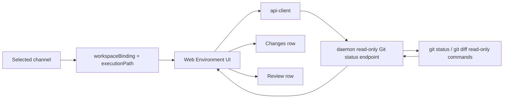

# Channel Workspace v1.28 Environment Git Status

## Status

Implemented on 2026-06-29.

This is the second Environment surface slice after
[Channel Workspace v1.27 Environment Surface](channel-workspace-v1.27-environment-surface.md).

Detailed implementation shape:

- [Channel Workspace v1.28 Environment Git Status Detailed Design](channel-workspace-v1.28-environment-git-status-detailed-design.md)
- [Channel Workspace v1.28 Environment Git Status Implementation Plan](channel-workspace-v1.28-environment-git-status-implementation-plan.md)

## Summary

v1.27 intentionally did not read real Git status. It could only show information already
projected into the Web client: channel workspace binding, right-dock Review items,
browser evidence, source summaries, and artifacts.

That boundary made the Environment surface safe, but it also created a semantic gap:

```text
Review queue has 2 items
Local working tree has code changes
Environment can only see the review queue
```

v1.28 closes that gap by adding a daemon-owned, read-only Git status source. The Web UI
must never infer local code changes from Review queue counts, artifact titles, or browser
state. It must read explicit Git status from the daemon.

## Product Decision

Implement a read-only workspace Git status source and split Environment rows:

```text
Changes   8 files   +120 -32
Review    2 items to inspect
```

The row names are intentionally separate:

- `Changes` means real repository working-tree or index changes.
- `Review` means Ling review queue items: approvals, failed runs, evidence gaps,
  runtime issues, protocol signals, or code review items.

If only Review queue items exist, the UI must show:

```text
Review
2 items to inspect
```

It must not show:

```text
Changes
2 items to inspect
```

If Git diff stats are unavailable, the UI may show changed file count without fake
`+0 -0` stats:

```text
Changes
8 files
```

This is the v1.28 second-version boundary. v1.27 made the Environment surface visible,
but it still could not prove whether the local repository had real code changes. v1.28
must make that answer explicit:

```text
Has real Git status data? yes/no
Is the selected channel workspace dirty? yes/no/unknown
How many changed files are there? N
How many Review queue items exist? M
```

The UI must never collapse those answers into one number. A dirty repository with no
Review items is still `Changes`. A Review queue with a clean repository is still
`Review`.

## Goals

- Show real local code change count for the selected channel workspace.
- Show additions and deletions when the daemon can compute them safely.
- Keep Review queue counts visible, but separate from Git changes.
- Make branch information come from the same Git status source when available.
- Preserve the v1.27 Environment page and floating popover behavior.
- Keep Git status read-only and non-mutating.

## Non-Goals

- No commit.
- No push.
- No checkout.
- No branch creation.
- No merge or rebase.
- No GitHub PR creation.
- No browser-side `git` calls.
- No Web `child_process`, shell, or filesystem probing.
- No approval bypass for future Git mutations.
- No attempt to resolve conflicts, stash, stage, or clean files.

Commit and push remain future work. v1.28 may keep the disabled v1.27 modal shell, but it
must not enable mutation buttons.

## Source Of Truth

The daemon is the only allowed source of real Git status.



The Web client may still use existing Review projections for Review counts, but it must
not use them as a proxy for real Git changes.

The route follows the existing channel workspace convention:

```text
GET /channels/:channelId/workspace/git-status?cwd=<workspaceCwd>
```

Do not add a parallel `/workspaces/:cwd/...` route style for this slice. Existing channel
workspace handlers identify the Ling workspace from the query `cwd` and resolve the
selected channel execution path inside the daemon.

## Terminology

| Term | Meaning |
| --- | --- |
| Git status source | Read-only daemon response describing the selected workspace's repository state. |
| Changes row | Environment row backed by daemon Git status. |
| Review row | Environment row backed by right-dock Review queue projections. |
| Changed file | A Git tracked, untracked, staged, unstaged, renamed, copied, deleted, or conflicted path. |
| Diff stats | Additions/deletions computed from Git diff numstat output. |
| Workspace unavailable | The selected channel has no valid execution path, or the path cannot be inspected. |
| Not a Git repository | The execution path is valid but not inside a Git work tree. |

## Data Contract Shape

The contract should be explicit and conservative:

```ts
export type WorkspaceGitStatusState =
  | "clean"
  | "dirty"
  | "not_git_repo"
  | "unavailable"
  | "error";

export interface WorkspaceGitStatusFile {
  readonly path: string;
  readonly originalPath?: string;
  readonly indexStatus: string;
  readonly worktreeStatus: string;
  readonly kind:
    | "modified"
    | "added"
    | "deleted"
    | "renamed"
    | "copied"
    | "untracked"
    | "conflicted"
    | "unknown";
  readonly staged: boolean;
  readonly unstaged: boolean;
  readonly untracked: boolean;
}

export interface WorkspaceGitStatus {
  readonly state: WorkspaceGitStatusState;
  readonly cwd: string;
  readonly repoRoot?: string;
  readonly branchName?: string;
  readonly upstream?: string;
  readonly headSha?: string;
  readonly changedFileCount: number;
  readonly stagedFileCount: number;
  readonly unstagedFileCount: number;
  readonly untrackedFileCount: number;
  readonly conflictedFileCount: number;
  readonly additions?: number;
  readonly deletions?: number;
  readonly files: readonly WorkspaceGitStatusFile[];
  readonly checkedAt: string;
  readonly unavailableReason?: string;
  readonly errorMessage?: string;
}
```

First implementation may cap `files` to a small number for UI preview, but counts must
reflect the complete parsed status.

The response must include `cwd` at the top level so Web can detect stale responses after a
channel or workspace switch:

```ts
export interface ChannelWorkspaceGitStatusResponse {
  readonly cwd: string;
  readonly channelId: string;
  readonly binding: ChannelWorkspaceBinding;
  readonly snapshot: ChannelWorkspaceSnapshot;
  readonly gitStatus: WorkspaceGitStatus;
}
```

## Daemon Read Commands

Allowed commands for v1.28:

```bash
git rev-parse --show-toplevel
git status --porcelain=v1 -b --untracked-files=all
git diff --numstat
git diff --cached --numstat
git rev-parse --short HEAD
```

Rules:

- Run commands only with `cwd` equal to the resolved channel execution path.
- Use timeout protection.
- Treat command failures as `not_git_repo`, `unavailable`, or `error`; do not surface raw
  stack traces.
- Do not run mutation commands.
- Do not stage, checkout, clean, stash, commit, push, pull, fetch, merge, or rebase.

## UI Rules

### Floating Popover

Order:

```text
Environment
  Changes
  Review
  Local
  Git branch
  Commit or push
Sources
Progress
```

Rules:

- `Changes` appears when `WorkspaceGitStatus.state === "dirty"` or any Git change count
  is non-zero.
- `Review` appears when right-dock Review queue count is non-zero.
- `Local` appears when selected channel workspace state exists.
- `Git branch` appears when Git status has `branchName`; otherwise use workspace binding
  branch only if it was already available and clearly marked as a binding value.
- `Commit or push` remains disabled in v1.28.
- Do not show `+0 -0`.
- If the Git status request is still loading, the popover may omit `Changes`; the full
  Environment page should show a compact loading or unavailable state.
- If the Git status transport fails, the UI must not show `No code changes`. Unknown is
  not clean.

### Full Environment Page

Sections:

1. Local environment
2. Changes
3. Review
4. Working branch
5. Commit or push
6. Browser
7. Sources
8. Output

The page may show compact empty states:

- `No code changes`
- `No review items`
- `Git status unavailable`
- `Not a Git repository`

Empty states belong in the full page. The floating popover should stay glanceable and
omit empty optional rows.

### Review Count Invariant

Review count comes from the right-dock Review queue only. It can include code review,
failed run, approval, evidence, runtime, and protocol items. It is not a Git changed-file
count.

Examples:

| State | Correct row | Incorrect row |
| --- | --- | --- |
| clean Git, 2 Review items | `Review 2 items to inspect` | `Changes 2 items to inspect` |
| dirty Git, 0 Review items | `Changes 8 files +120 -32` | `Review 8 files` |
| dirty Git, 2 Review items | `Changes 8 files`; `Review 2 items` | `Changes 10 items` |
| Git unavailable, 2 Review items | `Review 2 items`; full page says unavailable | `No code changes` |

## Error And Unavailable States

| State | UI behavior |
| --- | --- |
| `clean` | Full page shows `No code changes`; popover hides Changes row unless Review or other rows exist. |
| `dirty` | Show changed file count and diff stats when available. |
| `not_git_repo` | Full page shows `Not a Git repository`; popover may omit Changes. |
| `unavailable` | Full page shows a compact unavailable message; popover may omit Changes. |
| `error` | Full page shows `Git status failed`; include safe error text only. |

Network or daemon failures must not be interpreted as clean working tree.

## Security Boundary

This is still local execution. Even read-only Git status must respect workspace scope.

The daemon must:

- Resolve and normalize the requested path.
- Reject empty or unsafe paths.
- Keep inspection scoped to the selected workspace execution path.
- Avoid following user-supplied arbitrary commands.
- Return bounded output.
- Log failures without leaking secrets into the UI.

The Web client must:

- Never invoke Git directly.
- Never infer status from path names.
- Never enable commit/push based on status alone.

## Future Work

v1.29 or later may add approval-gated Git actions:

- commit
- commit and push
- push
- branch publish
- PR creation

Those actions need a separate mutation contract, approval policy integration, and undo /
rollback planning. They are intentionally outside v1.28.

## Acceptance Checklist

- [x] Web gets Git status through `api-client`, not direct Git or filesystem access.
- [x] Daemon endpoint runs only read-only Git commands.
- [x] `Changes` is shown only from `WorkspaceGitStatus`.
- [x] `Review` is shown only from Review queue projections.
- [x] `+0 -0` is never used as a fallback for missing diff stats.
- [x] Clean, dirty, review-only, not-git-repo, unavailable, and transport-error states are
  covered by mock/e2e tests.
- [x] Commit/push UI remains disabled and cannot mutate Git state.
