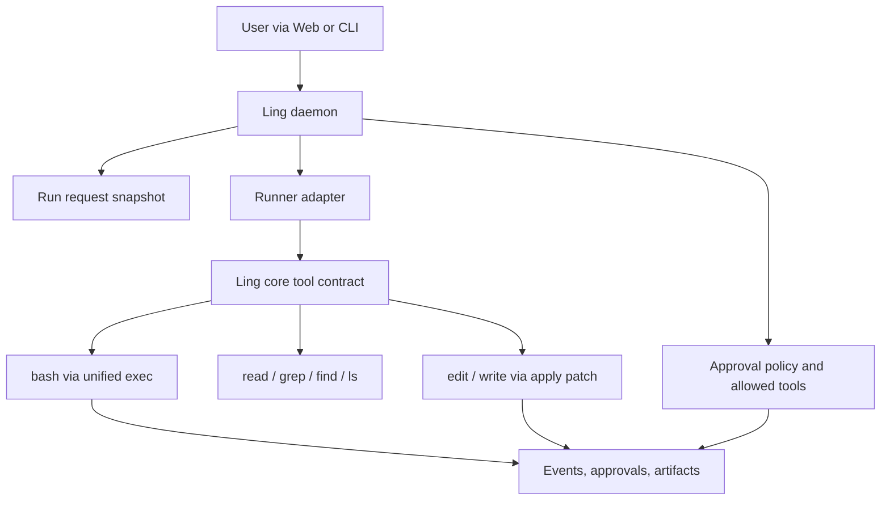

# Codex-Inspired Runtime Tools

## Status

P0, P1 unified exec, the first P2A slice, P2B.1 automatic shell snapshots, and the
P2B-F1/F2 read-only Web/doctor surfaces are implemented. P2B active/periodic snapshots,
PTY capture, manual capture, and durable snapshot indexing remain deferred.

Ling Stack should borrow selected runtime-tool engineering patterns from
`openai/codex` without replacing Ling's product contract for core tools, approvals,
daemon APIs, Web settings, channels, teammates, skills, and runner metadata.

Related docs:

- [Codex-Inspired Runtime Tools P0: Apply-Patch Implementation](codex-inspired-runtime-tools-p0-apply-patch-implementation.md)
- [Codex-Inspired Runtime Tools P1: Unified Exec For Bash Implementation](codex-inspired-runtime-tools-p1-unified-exec-implementation.md)
- [Codex-Inspired Runtime Tools P2: Permission Requests And Shell Snapshots](codex-inspired-runtime-tools-p2-permissions-shell-snapshots.md)
- [Codex-Inspired Runtime Tools P2A: Permission Requests Implementation](codex-inspired-runtime-tools-p2a-permission-requests-implementation.md)
- [Codex-Inspired Runtime Tools P2B: Shell Snapshots Implementation](codex-inspired-runtime-tools-p2b-shell-snapshots-implementation.md)
- [Codex-Inspired Runtime Tools P2B: Shell Snapshots Follow-Ups](codex-inspired-runtime-tools-p2b-shell-snapshots-follow-ups.md)
- [Core Tools, Runners, MCP Tools, and Plugin Boundary](core-tools-runtime-boundary.md)
- [Approval Policy](approval-policy.md)
- [CLI v0.1](cli-v0.1.md)
- [CLI Run I/O and Completion P1](cli-run-io-completion-p1.md)
- [Runner Registry](runner-registry.md)
- [Runner Adapters](runner-adapters.md)
- [Codex-Like Execution Experience](codex-like-execution.md)
- [OpenAI Agents SDK Runtime Patterns](openai-agents-sdk-runtime-patterns.md)

Upstream references used for this design:

- Codex feature registry:
  <https://github.com/openai/codex/blob/main/codex-rs/features/src/lib.rs>
- Codex base tool guidance:
  <https://github.com/openai/codex/blob/main/codex-rs/protocol/src/prompts/base_instructions/default.md>
- Codex apply-patch prompt:
  <https://github.com/openai/codex/blob/main/codex-rs/core/prompt_with_apply_patch_instructions.md>

## Problem

Ling has seven core run tools:

```ts
type RunTool = "read" | "grep" | "find" | "ls" | "bash" | "edit" | "write";
```

They are product-visible permissions and audit dimensions. They appear in approval
policy, channel allowed tools, teammate allowed tools, skill required tools, run request
snapshots, and runner supported-tool metadata.

Codex exposes a more terminal-first runtime shape. Public Codex sources show feature
gates for shell execution, unified exec, shell snapshots, exec permission approvals,
request-permissions, MCP/apps, and plugin-related capabilities. Codex guidance also
frames the agent as able to run terminal commands and apply patches, rather than as a
product surface with separate `read`, `grep`, `find`, `ls`, `bash`, `edit`, and `write`
configuration.

The risk is choosing the wrong level to copy:

- copying Codex wholesale would collapse Ling's product-specific permission surfaces;
- keeping Ling's current tools unchanged forever would miss useful engineering lessons
  around patch application, PTY execution, shell snapshots, and permission requests.

## Decision

Use a two-layer model:

| Layer | Owner | Meaning |
| --- | --- | --- |
| Ling core tool contract | Ling daemon/runtime | Product permissions, approval policy, allowed tools, audit, runner conformance |
| Codex-inspired execution mechanics | Runner/runtime implementation | Safer patch application, richer shell execution, snapshots, permission requests |

Ling keeps the seven core tools as the stable model-facing and product-facing contract.
Codex-inspired mechanics can implement those tools underneath that contract, but they do
not redefine which tools exist, where they are configured, or who authorizes them.

## Non-Goals

- No wholesale copy of Codex app-server, JSON-RPC transport, config model, or plugin
  system.
- No switch from embedded `@earendil-works/pi-coding-agent` to Pi CLI as the default
  runner.
- No conversion of `read`, `grep`, `find`, and `ls` into implicit shell-only behavior.
- No bypass around Ling approval policy, allowed write paths, MCP broker mediation, run
  snapshots, work-unit state, or durable audit.
- No Plugin Manager cards for plain built-in core tools.
- No hidden mid-run prompt injection into an active runner session.

## What To Borrow

### Apply-Patch Editing

Borrow the apply-patch model as the preferred implementation path for `edit` and safe
`write` operations.

Desired properties:

- structured patch grammar instead of ad hoc string rewrites;
- path resolution before mutation;
- allowed-write-path enforcement before mutation;
- conflict detection before mutation;
- preview artifact before approval when the action is risky;
- result artifact after execution;
- line-oriented error messages suitable for Web and CLI display.

Ling-owned boundary:

- `edit` and `write` remain Ling core tools;
- approval defaults stay `ask`;
- the daemon records the approval request, preview, result, and state transitions;
- runner backends may produce candidate patches, but Ling validates and applies them.

### Unified Exec

Borrow the unified exec shape for `bash`.

Desired properties:

- command, cwd, environment summary, and timeout are explicit;
- stdout, stderr, exit code, and duration are separated;
- long-running processes can stream progress;
- cancellation is reliable and audited;
- PTY mode is available when needed but not forced for every command;
- shell snapshots can preserve enough terminal state for diagnostics without becoming
  the durable source of truth.

Ling-owned boundary:

- `bash` remains the core tool;
- approval defaults stay `ask`;
- resource leases and workflow concurrency still come from Ling;
- command execution cannot mutate workspace state before approval is granted;
- output capture must respect redaction and artifact boundaries.

### Request Permissions

Borrow the concept of explicit permission requests, not the exact Codex product flow.

Desired properties:

- a runner can ask for a narrower permission expansion when it is blocked;
- requests are durable approval records, not transient terminal prompts;
- users can approve, deny, or leave them pending from Web or CLI;
- approvals can include scoped facts such as command, path, external target, or MCP tool.

Ling-owned boundary:

- permission requests flow through existing approval APIs;
- decisions are evaluated against workspace approval policy and skill approval profiles;
- the runner receives only the normalized decision and rationale needed to continue.

### Feature Gates

Borrow Codex's feature-gated rollout style.

Recommended Ling feature gates:

```ts
interface RuntimeToolFeatureFlags {
  readonly applyPatchEdits?: boolean;
  readonly unifiedExec?: boolean;
  readonly shellSnapshot?: boolean;
  readonly requestPermissions?: boolean;
}
```

Feature gates should be workspace/runtime configuration, not Plugin Manager entries.
They should be visible in diagnostics and tests, but default behavior must remain stable
until conformance passes.

## What Not To Borrow Yet

Do not borrow these until Ling has concrete pressure:

- Codex app-server transport as the default local runtime transport;
- Codex plugin marketplace or remote plugin sharing flows;
- Codex config-file semantics;
- terminal-first UI assumptions that weaken Web/daemon parity;
- shell-only search/read behavior that makes read-only actions harder to audit;
- runner-native resume as the primary durable resume mechanism.

Runner-native resume may become useful later, but Ling thread/run/work-unit state remains
the source of truth.

## Architecture



Important rule: the runner may propose or execute through a tool implementation, but the
daemon owns authorization, audit, and product semantics.

## Phased Plan

### P0: Apply-Patch Engine For Edit/Write

Detailed implementation plan:
[Codex-Inspired Runtime Tools P0: Apply-Patch Implementation](codex-inspired-runtime-tools-p0-apply-patch-implementation.md).

Add a Ling-owned patch engine that can:

- parse a strict patch format;
- preview affected files and hunks;
- reject path traversal and out-of-scope writes;
- apply patches atomically where practical;
- emit preview/result artifacts;
- integrate with existing `edit` and `write` approvals.

Acceptance:

- `edit` approvals can show a patch preview before mutation;
- denied approvals do not touch files;
- path-scoped write policy is enforced before patch application;
- tests cover clean apply, conflict, path escape, denied approval, and redaction.

### P1: Unified Exec For Bash

Introduce a normalized exec backend for `bash`.

Detailed implementation plan:
[Codex-Inspired Runtime Tools P1: Unified Exec For Bash Implementation](codex-inspired-runtime-tools-p1-unified-exec-implementation.md).

Acceptance:

- every command records cwd, argv/string form, start/end time, exit code, stdout/stderr
  summary, and redacted artifacts;
- cancellation terminates process trees reliably;
- long output is bounded and artifact-backed;
- approval gating happens before process start;
- tests cover timeout, cancellation, approval denial, nonzero exit, and redaction.

### P2: Permission Requests And Shell Snapshots

Detailed design:
[Codex-Inspired Runtime Tools P2: Permission Requests And Shell Snapshots](codex-inspired-runtime-tools-p2-permissions-shell-snapshots.md).

P2A implementation plan:
[Codex-Inspired Runtime Tools P2A: Permission Requests Implementation](codex-inspired-runtime-tools-p2a-permission-requests-implementation.md).

Add optional runtime features in two independently shippable tracks:

| Track | Name | Dependency | Purpose |
| --- | --- | --- | --- |
| P2A | Permission requests | Can build on existing approvals | Let blocked runners ask for scoped, run-local capability grants without mutating workspace policy |
| P2B | Shell snapshots | Builds on implemented P1 unified exec | Capture bounded, redacted diagnostics for approved shell commands |

P2A first slice is implemented through durable approval records and continuation-scoped
grant evidence.

P2B.1 implementation:
[Codex-Inspired Runtime Tools P2B: Shell Snapshots Implementation](codex-inspired-runtime-tools-p2b-shell-snapshots-implementation.md).

The first P2B slice stores automatic `exec_start` and `exec_end` shell snapshots as
redacted JSON/text run artifacts, exposes read-only daemon/API-client endpoints, and
adds CLI inspection commands. The first follow-up surfaces add Web run-history rendering
and doctor read-only diagnostics. Periodic/live snapshots, PTY capture, manual capture,
durable snapshot indexing, and recovery integration remain deferred or out of scope as
documented in the P2B design.

P2B follow-up split:
[Codex-Inspired Runtime Tools P2B: Shell Snapshots Follow-Ups](codex-inspired-runtime-tools-p2b-shell-snapshots-follow-ups.md).

Feature gates should remain runtime configuration and diagnostics, not Plugin Manager
entries. P2 must not introduce live prompt injection into active runner sessions.

Acceptance:

- permission requests are durable approvals visible in Web and CLI;
- a denied request is delivered back to the runner as a normal denial;
- approved expanded scopes are run-scoped or continuation-scoped, not workspace policy;
- shell snapshots are diagnostic artifacts, not durable state authority;
- snapshots do not leak raw secrets.

## CLI Implications

The CLI remains an operator surface:

- `ling-stack run` starts runs through the daemon;
- `ling-stack policy` edits approval policy;
- `ling-stack approvals` resolves pending approvals;
- `ling-stack daemon` controls process lifecycle.

The CLI should not grow subcommands such as `ling-stack read`, `ling-stack edit`, or
`ling-stack bash` as agent tools. Those tools belong to the runtime contract and are
invoked by the runner under daemon policy.

Codex-inspired CLI improvements still fit:

- JSONL-only `--json` run output;
- final-message stdout and progress stderr split;
- shell completion;
- check-row doctor output;
- clearer daemon lifecycle diagnostics.

## Web Implications

Web settings should continue to show:

- approval policy for core tools;
- runtime runner metadata and supported tools;
- MCP tools grouped by server;
- Plugin Manager for managed bundles and presets only.

If apply-patch and unified-exec previews become richer, the Web approval cards should
render those previews directly from artifacts rather than inventing client-only parsing.

## Testing

Minimum test coverage:

- core tests for patch parsing, path scope, and tool default approvals;
- daemon tests for approval gating before mutation/process start;
- runner conformance tests for edit/write/bash interception;
- CLI tests for approval list/show/approve/deny flows;
- Web tests for rendering patch and exec approval previews when artifacts exist.

Regression tests must prove that enabling Codex-inspired mechanics does not:

- add core tools to Plugin Manager;
- bypass approval policy;
- bypass allowed write paths;
- turn read-only tools into shell-only behavior;
- require a non-Pi runner.

## Open Questions

- Should the patch grammar exactly match Codex `apply_patch`, or should Ling accept a
  compatible subset first?
- Should unified exec be implemented inside `runner-pi`, inside daemon runtime, or as a
  shared package used by runners?
- Should shell snapshots also have an in-memory runtime diagnostics view, or are
  artifact-backed read models enough after P1 unified exec?
- Which feature gates should be user defaults under `~/.ling-stack/config.json`, and
  which should be workspace execution policy under `.ling-stack/runtime-settings.json`?
  See [Two-Layer Configuration](two-layer-configuration.md).

## Summary

Borrow Codex's runtime mechanics where they improve safety and operability. Do not copy
Codex's terminal-first product boundary into Ling.

Ling's stable contract remains:

```text
core tools -> approval policy -> runner conformance -> durable daemon audit
```

Codex-inspired mechanics should make that contract stronger, not replace it.
