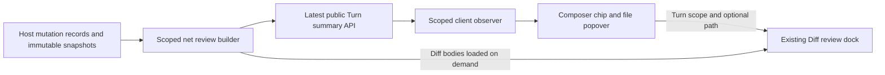

# Conversation Change Summary

Status: implemented; source and local browser validation complete
Owner: Web conversation and daemon workspace review
Last verified: 2026-11-17
Canonical replacement: none
Code and test anchors: `packages/daemon/src/features/runs/thread-workspace-change-summary.ts`,
`apps/web/src/shared/conversation/change-summary/`,
`packages/daemon/test/thread-workspace-change-summary.test.ts`,
`apps/web/e2e/conversation-change-summary.spec.ts`

## Product contract

The composer shows a compact, centered change summary above its input frame. It summarizes
the latest canonical Turn in the selected conversation, across that Turn's linked Runs.
The chip reads `Editing N files +A -D` while the Turn is active and `Edited N files +A -D`
after completion. Normal conversation, channel conversation and teammate private chat use
the same component. A new Turn replaces the prior summary; an empty latest Turn hides it.

Hovering or focusing the file-list control opens an interactive popover above the chip.
The popover has a bounded scrolling list, full workspace-relative paths, file kind and
per-file line counts. Long paths truncate visually while retaining their accessible name.
The main summary opens the existing scoped review dock. Each file opens that review at its
path. A separate list button supports touch, keyboard and Escape without requiring hover.
The summary occupies its own composer slot, outside goal, approval and input controls.

Unknown or incomplete changes show an explicit incomplete state and omit aggregate line
counts. An unavailable file does not acquire invented counts. The feature describes only
recorded edits: arbitrary shell or external-editor changes without mutation provenance are
outside this scope. Workspace-wide Git status remains a separate review scope.

## Data ownership

`GET /threads/:threadId/workspace-change-summary?cwd=...` selects the thread's latest Turn
in creation order, then uses `buildWorkspaceChangeReview` inside one store read snapshot.
Private workflow execution content follows the existing public-thread disclosure boundary.
The response includes the thread identity, latest Turn id/status and an optional review
summary. Its files omit diff bodies. No request performs recovery preflight, patch actions,
current disk observation or Git status. Missing threads return 404; threads without a
public latest Turn return an empty summary.

The review builder owns path normalization, before/after snapshot integrity, scope checks,
net diff calculation, redaction, size limits and revision. Statistics come from the review,
never the recovery operation totals. A repeated edit is composed from the first before
snapshot to the last after snapshot; a restored path has no net row. Missing provenance,
broken chains or bounded-out content retain the review's partial/unavailable state.

The typed API client and Web wrapper expose this contract. Opening review passes the Turn
scope and optional path. The existing recovery endpoint loads diff hunks on demand. The
composer summary does not inject an initial review that could constrain later files to an
older disclosure set. Historical transcript review retains its existing disclosure limits.

## Refresh and lifecycle

The client keys observations by daemon endpoint, workspace cwd and thread id. Scope changes
immediately hide old data, and responses from previous observations are ignored. Sending
a new message suppresses the prior chip until the submit transition has been reconciled.
The hook reuses control-plane invalidations and coalesces bursts. Active Turns also refresh
on a bounded timer; only one request is in flight, with a trailing refresh for invalidations
that arrive during it. Idle observations refresh on invalidation and visibility resumption.

Hidden windows and paused daemon observations suspend reads. Resuming refreshes immediately.
Request errors clear stale data; a later invalidation or active timer can recover. Popover
state resets when its scope changes or the summary becomes empty. Review opens from a live
summary use its revision to refresh a matching live review, without changing historical
transcript review behavior.

## Reference and implementation boundaries

The supplied Codex Desktop 2026-10-28 archive contains these static reference points under
`rea-workspace/cgdesk/`:

| Source | Verified reference |
| --- | --- |
| `app-initial-feb30b196d11.js`, line 1798; `main-0FVbxCQU.js`, line 523 | `turn/diff/updated` replaces the matching Turn's `diff` through `updateTurnState` |
| `app-initial-feb30b196d11.js`, line 2574 | Turn projection produces a `turn-diff` with `unifiedDiff`, patch batches and cwd |
| `app-initial-feb30b196d11.js`, line 1 | Lazy-module references name `diff-summary-f7ac0660791a.js` and `diff-preview-tooltip-292dda043529.js` |

The two referenced UI modules are absent from this archive, so it does not provide a
complete reusable composer-summary component. The supplied screenshots establish the
centered chip and upward file-list interaction. These references concern that dated build,
not every installed Codex version. Ling implements the behavior with its own contracts,
immutable review builder and shared overlays; bundled Codex code is not imported. The
separate file-list button makes pointer, touch and keyboard access explicit.

## Validation

Behavior tests cover latest-Turn selection, scope isolation, net edits and reversions,
partial evidence, and omission of diff bodies. Client tests cover request coalescing,
late responses, submission and observation gates. Browser acceptance covers the three
conversation surfaces, live updates, empty/latest-Turn reset, keyboard and pointer file
selection, review path navigation, long lists, narrow width, localization and console errors.
Owning package typechecks, Web build, lint, i18n and documentation checks must pass.

Local Chromium acceptance uses the mock-daemon harness at desktop and narrow widths,
in English/light and Chinese/dark configurations. It exercises the rendered components
and HTTP request boundaries without sending a real provider request. Daemon behavior
tests separately exercise SQLite, Host patch provenance and the read-only HTTP route.

Source implementation and local browser acceptance are separate from installed Desktop,
real-provider execution, CI, merge and production deployment.
