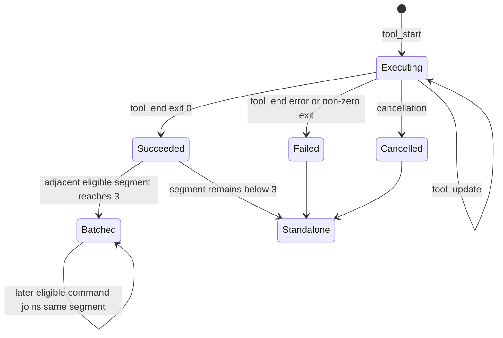

# Conversation Command Execution Batching Detailed Design

Status: subordinate projection rule; canonical contract in
[Conversation Typed Transcript — Detailed Design](conversation-typed-transcript-detailed-design.md)
Date: 2026-09-01
Last verified: 2026-09-01
Scope: persisted command evidence, live command output projection, deterministic command
batching, shared conversation view models, Web rendering, refresh behavior, and tests

Related docs:

- [Conversation Surface Contract](./conversation-surface-contract.md)
- [Conversation Shared Capabilities Detailed Design](conversation-shared-capabilities-detailed-design.md)
- [Thread-First Work History V2 Detailed Design](thread-first-work-history-v2-detailed-design.md)
- [Ling Agent Terminal Report Protocol](ling-agent-terminal-report-protocol.md)

v3.7 note: command batching remains a pure projection consumed by the shared
`ConversationTimeline` fact renderer. `ConversationWorkCell` is a migration input only;
batching never owns completion, fan-in, or a second visible action row.

实现时必须把既有 operation rows 转换为 canonical `commandExecution` items，再由唯一
registry 渲染 `commandBatch`。新代码不得向 `ConversationWorkCell.tsx` 添加 batch、排序、
状态文案或完成判断；历史提到的旧类型只用于说明 adapter 的输入形状。

该投影只消费 `TimelineSnapshot` 中的 atomic items；daemon 的原始记录属于
`TimelineSourceSnapshot`，不能直接进入 batching 或 React。这样 live evidence、分页
coverage 和 UI disclosure 不会被混成同一个快照。

## 1. Purpose

Ling already renders each meaningful tool action as an auditable operation row. That is
the correct atomic model, but a long sequence of successful shell commands creates too
much visual weight after the commands finish. The target experience follows the useful
part of Codex's command presentation:

```text
atomic command actions
  -> latest active command remains visible with live output
  -> adjacent completed low-risk commands become one expandable batch
  -> every command and its evidence remains recoverable
```

This design does not introduce a second workflow model. `LingTurn`, `RunSession`, run
events, approvals, artifacts, and `ExecutionAction` remain authoritative. Command
batching is a deterministic shared conversation projection.

## 2. Upstream Reference Boundary

References checked on 2026-07-13:

- [OpenAI App Server: Items](https://learn.chatgpt.com/docs/app-server#items)
- [OpenAI App Server: Item Deltas](https://learn.chatgpt.com/docs/app-server#item-deltas)
- [OpenAI Codex Open Source](https://learn.chatgpt.com/docs/open-source)
- [Codex TUI command lifecycle](https://github.com/openai/codex/blob/main/codex-rs/tui/src/chatwidget/command_lifecycle.rs)
- [Codex TUI exec cell model](https://github.com/openai/codex/blob/main/codex-rs/tui/src/exec_cell/model.rs)
- [Codex TUI exec cell renderer](https://github.com/openai/codex/blob/main/codex-rs/tui/src/exec_cell/render.rs)

The reusable upstream conclusions are:

1. A command execution remains an atomic item with its own lifecycle.
2. Incremental output arrives as item deltas rather than replacement chat messages.
3. A stable call identity prevents unrelated commands from being merged accidentally.
4. Completed command history may be visually compacted without destroying the items.
5. The latest active command should remain independently understandable.

The exact desktop-client rule behind copy such as `Ran N commands` is not open source.
Ling therefore defines its own deterministic grouping contract instead of attempting to
reverse-engineer undocumented UI heuristics. The open-source Codex TUI currently groups
some adjacent exploration commands; it is evidence for client-side projection, not a
drop-in algorithm for Ling.

## 3. Pre-Implementation State And Gaps

### 3.1 Baseline Runtime Evidence

The daemon already persists:

- `tool_start` with tool name and arguments;
- `tool_update` with `UnifiedExecOutputChunk` in `partialResult`;
- `tool_end` with the final runner result;
- stdout, stderr, and result artifacts for unified command execution.

`UnifiedExecResult` already contains `exitCode`, `durationMs`, command, cwd, bounded
stdout/stderr previews, truncation state, and artifact references.

### 3.2 Missing Read Model Data

`deriveToolActionsForRun()` currently reads `tool_start` and `tool_end` only. It ignores
`tool_update`, and `ExecutionAction` does not expose command output, exit code, duration,
or an action revision. The Web projection therefore cannot render a truthful live command
tail or a useful completed child row.

### 3.3 Missing Shared Projection

The canonical typed union and `typed-transcript-batching.ts` now provide the shared command
batch shape. The remaining gap is caller migration: legacy operation-row adapters still need
to feed the canonical projector before the Timeline. Adding another batch implementation in
`ConversationWorkCell.tsx` would duplicate policy and diverge across channel, ordinary
conversation, and teammate-private surfaces.

### 3.4 Refresh Gap

Channel execution actions refresh when the visible run key changes. Appending
`tool_update` events rebuilds thread metadata but does not update the `RunSession.updatedAt`
field used by that key. Control-plane run invalidation also calls
`refreshChannelActivity()`, which currently refreshes artifacts but not execution
actions. A page can therefore hold a stale executing command until another run-level
change occurs.

## 4. Product Contract

### 4.1 Atomic Command Row

One tool call remains one atomic command action. It owns:

- stable `actionId` and `toolCallId`;
- command text and cwd;
- status;
- start, update, and completion revision;
- exit code and duration when terminal;
- bounded redacted output evidence;
- full-output artifact references when available.

### 4.2 Batch Header

A completed batch renders one compact header:

```text
Ran 4 commands · 28s
```

The elapsed suffix is omitted when the batch cannot compute a reliable duration. The
header never claims success if any child is non-successful because non-successful
commands are not batch eligible.

### 4.3 Expanded Batch

Expanding a batch reveals all child commands in order. Child rows are borderless and do
not add chat bubbles or nested cards. Each row may show:

```text
pnpm typecheck          exit 0 · 4.1s
```

Selecting a child row expands only that command's bounded output. Expanding or collapsing
a child must not change the batch or work-cell disclosure state.

### 4.4 Active Command

The latest executing command is never included in a completed batch. It renders as a
standalone row with its output detail open by default. The main feed shows a bounded
rolling tail rather than the full process log.

The v3.7 implementation keeps the bounded output in normal document flow and does not
introduce a nested output viewport or force page scrolling. A second vertical scroll owner
is out of scope for this contract: if a future tail-following viewport is ever proposed, it
requires a new design decision and must preserve the single `ConversationTimeline` scroll
owner. Completed output remains available from the associated log artifact.

### 4.5 Accessibility

- Batch and child disclosures are native buttons with `aria-expanded`.
- The batch accessible name includes the command count and terminal state.
- The shared `ConversationTimeline` status live region announces state changes. Raw command
  chunks are not announced independently, and the historical WorkCell must not become a
  second live-region or action owner.
- Exit code and failure state are represented in text, not color alone.
- Keyboard focus follows the same contrast behavior as pointer hover.
- `prefers-reduced-motion` disables row insertion and disclosure transition animation.

## 5. Eligibility And Grouping Boundaries

### 5.1 Eligible Action

The first implementation batches an action only when all conditions are true:

```ts
function isCommandBatchEligible(action: ExecutionAction): boolean {
  return action.commandEvidence !== undefined &&
    action.actionType === "bash" &&
    action.risk === "low" &&
    action.status === "succeeded" &&
    action.commandEvidence.exitCode === 0;
}
```

Command-backed verification actions may render with the `verify` operation icon while
remaining `actionType: "bash"`; icon semantics do not affect eligibility.

For completed non-approval tool actions, a plain `bash` command with no classified risk
flags projects as `risk: "low"`. Consequential action types and commands with risk flags
retain their medium, high, or critical classification and remain standalone.

### 5.2 Hard Boundaries

A batch ends before or after any of these boundaries:

- different `runId`;
- different participant or agent span;
- different workflow step or work unit when present;
- narrative/note row;
- read, search, edit, approval, handoff, browser, or artifact row;
- failed, cancelled, timed-out, or non-zero-exit command;
- medium, high, or critical risk;
- `git_commit`, `git_push`, `deploy`, `external_send`, `credential_change`,
  `provider_change`, or runtime permission action;
- retry, resume, repair, or second-wave work represented by another run;
- missing stable `toolCallId` or command evidence.

Consequential operations remain individually visible even when they succeed. A generic
count must never hide the fact that Ling committed, pushed, deployed, changed
credentials, or affected an external system.

### 5.3 Minimum Size

The minimum batch size is three. One or two adjacent commands remain individual rows.
This avoids replacing a short, readable sequence with an extra disclosure control.

### 5.4 Stable Identity

The batch display identity is derived from its semantic scope, attempt, and first child,
not from the current last child. It is a reversible projection key, not a new
`ExecutionAction`:

```text
commandBatch:{participantId}:{runId}:{attemptId}:{firstActionId}
```

Appending another eligible completed command therefore updates the same batch instead of
creating a new disclosure identity. The batch revision key includes ordered child ids,
statuses, and evidence revisions so rendering updates without losing user-controlled
expanded state. `actionIds`/`childActionIds` retain the real child action identities; the
display `actionId` must never be consumed by TerminalReport, fan-in, retry or approval.

## 6. Runtime Contract

### 6.1 ExecutionAction Extension

Add an optional command evidence object to both public contract copies while preserving
backward compatibility:

```ts
interface ExecutionActionCommandOutputChunk {
  readonly eventSeq: number;
  readonly stream: "stdout" | "stderr";
  readonly text: string;
  readonly byteCount: number;
  readonly redacted: boolean;
  readonly ts: string;
}

interface ExecutionActionCommandEvidence {
  readonly command: string;
  readonly cwd?: string;
  readonly startedAt?: string;
  readonly completedAt?: string;
  readonly durationMs?: number;
  readonly exitCode?: number;
  readonly signal?: string;
  readonly timedOut?: boolean;
  readonly cancelled?: boolean;
  readonly latestEventSeq: number;
  readonly outputTail: readonly ExecutionActionCommandOutputChunk[];
  readonly outputByteCount: number;
  readonly outputLineCount?: number;
  readonly outputTruncated: boolean;
  readonly stdoutArtifactId?: string;
  readonly stderrArtifactId?: string;
  readonly resultArtifactId?: string;
}

interface ExecutionAction {
  // Existing fields remain unchanged.
  readonly commandEvidence?: ExecutionActionCommandEvidence;
  readonly updatedAt?: string;
}
```

`command` is redacted before it enters the contract. `outputTail` contains only redacted
plain text. Full stdout/stderr does not belong in `ExecutionAction`.

### 6.2 Projection From Run Events

For each `toolCallId`, the daemon folds events in ascending run-event sequence:

```text
tool_start
  -> create executing action and read command/cwd

tool_update
  -> validate UnifiedExecOutputChunk
  -> append redacted text to bounded rolling tail
  -> update latestEventSeq and updatedAt

tool_end
  -> assign terminal status
  -> parse UnifiedExecResult when present
  -> assign exitCode, duration, final previews, and artifact ids
```

The run event envelope sequence is the ordering authority. The chunk's stream-local
`sequence` is diagnostic metadata and must not be used to merge stdout and stderr.

Malformed or unknown update payloads are ignored for command output but do not remove the
atomic action. The action still falls back to the current title, summary, target refs,
and terminal status.

Run-event reads page until exhaustion. The projector must not treat the store's 1,000-event
page size as a run-history limit, because verbose commands can place their final update and
`tool_end` on a later page.

### 6.3 Output Bounds

The action read model keeps at most:

- 8 KiB of UTF-8 output text;
- 40 logical lines;
- 64 chunk descriptors.

When any bound is exceeded, discard oldest complete text first and set
`outputTruncated: true`. The UI initially shows at most 12 lines from that tail. Full
output remains in stdout/stderr artifacts.

ANSI control sequences are stripped before display. Existing secret redaction remains
mandatory. The renderer treats all output as text and never as HTML.

### 6.4 Final Result Authority

When `UnifiedExecResult` is available in `tool_end`, it is authoritative for terminal
status, exit code, duration, cwd, command, truncation metadata, and artifact ids. Event
timestamps are the fallback for older runners. The projector must not infer exit code or
duration from prose such as `Command exited 0 in 123ms`.

## 7. Shared Conversation View Model

The command batch is one variant of the canonical typed transcript union. The command
projection does not define a second `ConversationWorkCellItem` union:

```ts
type ConversationTimelineCommandBatchItem = ConversationTimelineOperationItemBase & {
  readonly kind: "commandBatch";
  readonly actionIds: readonly string[];
  readonly childActionIds: readonly string[];
  readonly childItemIds: readonly string[];
  readonly batch: {
    readonly commandCount: number;
    readonly durationMs?: number;
    readonly defaultExpanded: boolean;
    readonly commands: readonly ConversationTimelineCommandExecutionItem[];
  };
};
```

The existing operation-row adapter is converted to canonical atomic items before it reaches
the Timeline. During the cutover, an adapter may read legacy rows, but the shared
`ConversationTimeline` invokes the pure batching projection exactly once. Surface adapters
must not implement their own grouping or expose a second `operationItems` source.

## 8. Deterministic Projection Algorithm

The pure shared projection receives transcript-ordered operation candidates with their
participant scope:

```ts
function projectCommandBatches(
  candidates: readonly ConversationOperationCandidate[],
): readonly ConversationTimelineItem[];
```

Algorithm:

1. Iterate in stable transcript order.
2. Keep a pending eligible command segment.
3. Append only when the candidate has the same run, participant, work-unit/workflow-step
   scope, and no hard boundary occurred.
4. Flush the segment before every non-eligible candidate.
5. Emit a batch when the segment length is at least three.
6. Otherwise emit the original command rows unchanged.
7. Never include an executing action in a completed segment.
8. Preserve the original candidate order exactly.

Pseudocode:

```ts
for (const candidate of candidates) {
  if (eligible(candidate) && sameScope(candidate, pending[0])) {
    pending.push(candidate);
    continue;
  }
  flushPending();
  if (eligible(candidate)) {
    pending.push(candidate);
  } else {
    output.push(asOperationItem(candidate));
  }
}
flushPending();
```

There are no title, translated-copy, command-prefix, or elapsed-time heuristics in the
grouping decision.

## 9. Live Refresh And Recovery

### 9.1 First Implementation Transport

The first implementation keeps one authoritative read model rather than adding an
ephemeral browser-side action store:

1. Runtime streams that expose `RunEventEnvelope` schedule a throttled persisted detail
   refresh after `tool_start`, `tool_update`, and `tool_end`.
2. Ordinary conversation refreshes its selected conversation detail at most once per
   250 ms while streamed tool evidence changes.
3. Channel and teammate-private surfaces poll only their visible active linked runs every
   750 ms because those surfaces do not receive the same raw run-event stream.
4. Polling stops when the linked run is terminal or the surface leaves the active view;
   timer ticks remain installed while hidden, but network requests pause until the
   document is visible again.
5. Refocus, reconnect, manual refresh, and control-plane run invalidation trigger an
   immediate persisted refresh.
6. The response `revision` and each action's `latestEventSeq` provide stable evidence
   identities for clients and tests. Channel refreshes additionally use the existing load
   guard so an older request cannot overwrite a newer snapshot.

This keeps replay and refresh behavior identical because every surface reads the same
daemon projection. It also avoids a second merge state machine in the browser.

### 9.2 Required Refresh Fix

`refreshChannelActivity()` must include `refreshChannelExecutionActions()`. The active
poller must not rely on `RunSession.updatedAt`, because tool events do not currently
advance that field.

The execution-action response revision is derived from the latest relevant run event
sequence. It is available for diagnostics and future client-side request deduplication;
the first Web implementation relies on load guards and bounded active polling instead.

### 9.3 Ordering And Race Handling

- Ignore a refreshed action whose event sequence is older than the currently rendered
  action.
- Do not regress a terminal action back to executing when refresh requests complete out
  of order.
- Ordinary conversation keeps streamed message text when a persisted evidence refresh
  returns an older transcript snapshot, coalesces refresh demand while one request is in
  flight, and waits for that request before the terminal authoritative refresh.
- Keep terminal persisted evidence when a delayed active refresh arrives.
- When a run is cancelled, preserve the latest output tail and render the command
  standalone.
- A page reload reconstructs the same action from persisted events and produces the same
  batch identity.

## 10. Component And Module Boundaries

| Module | Responsibility |
| --- | --- |
| `packages/contracts/src/execution-actions.ts` | public command evidence contract |
| `packages/core/src/run-types.ts` | core mirror until contracts are converged |
| `packages/daemon/src/features/runs/execution-actions.ts` | event folding and bounded evidence projection |
| `packages/daemon/src/features/runs/action-classifier.ts` | low-risk projection for plain executed bash actions; consequential classifications stay unchanged |
| `packages/conversation-ui-core/src/typed-transcript-batching.ts` | pure eligibility, boundaries, stable ids, and batching algorithm |
| `packages/conversation-ui-core/src/canonical-transcript-projector.ts` | action-to-canonical-item projection and scope/attempt assignment |
| `apps/web/src/shared/conversation/timeline/renderer-registry.tsx` + `apps/web/src/shared/conversation/blocks/ConversationCommandBatch.tsx` | batch and child disclosures through the shared registry |
| `apps/web/src/shared/conversation/timeline/ConversationTimeline.tsx` | item-stream composition and the sole scroll owner |
| `apps/web/src/domains/conversations/use-conversation-domain.ts` | ordinary-conversation throttled persisted refresh and race-safe transcript merge |
| `apps/web/src/domains/workspace/use-workspace-domain.ts` | channel execution-action snapshots with load guards |
| `apps/web/src/features/teammates/TeammateWorkspace.tsx` | visible linked-run polling for teammate private chat |
| `apps/web/src/app/use-control-plane-invalidation.ts` | control-plane persisted refresh trigger |

Do not add batching logic directly to `ConversationWorkCell.tsx`. That file is a historical
adapter during v3.7 cutover; the batch component and pure algorithm belong to focused modules
and are consumed by the single Timeline registry.

## 11. Surface Behavior

| Surface | Command batches | Avatar behavior | Participant boundary |
| --- | --- | --- | --- |
| Ordinary conversation | yes | no conversation avatars | one primary run scope |
| Teammate private chat | yes | teammate avatar remains | selected teammate only |
| Channel single-agent work | yes | current channel identity rules | one agent span |
| Channel multi-agent work | yes | agent span avatars remain | never cross agent spans |
| Topic/reply surface with tools disabled | no actions to batch | existing reply policy | not applicable |

`TerminalReport.participants` remains hidden in ordinary and private conversation. That
policy is independent of command batching.

## 12. State Transitions



The `Batched` state exists only in the view projection. Runtime actions remain
`succeeded`.

## 13. Cutover And Compatibility Boundary

Ling is still in development and v3.7 is a direct renderer cutover. We do not keep a
runtime legacy renderer or an API compatibility branch merely to preserve the old visual
model:

- After the new contract lands, `commandExecution` requires validated command evidence;
  an old row without evidence is projected as `diagnostic(missing_lineage)`/blocked, not
  rendered through the old WorkCell.
- The adapter may read legacy persisted event shapes, but it must either normalize them to
  the canonical envelope or fail closed. It must never invent command, exit code, or
  source refs.
- `operationRows` is a migration input only. New call sites consume canonical atomic
  items and the single `typed-transcript-batching` projection.
- Existing disclosure keys are retained only when they identify the same canonical item or
  stable batch id; no compatibility alias may create a second row.
- A touched batch preserves its expanded/collapsed state when later eligible commands
  extend the same stable batch and change its revision key.
- No SQLite migration is required because command evidence is derived from persisted run
  events and artifacts. Approval policy, command execution, sandboxing, and retention are
  unchanged.

## 14. Test Matrix

### 14.1 Daemon And Contract Tests

- start-only command produces an executing action;
- ordered stdout/stderr updates produce a bounded rolling tail;
- malformed update payload is ignored without losing the action;
- unified result maps exit code, duration, cwd, command, and artifacts;
- non-zero exit remains failed and standalone;
- redacted and truncated flags survive projection;
- more than 8 KiB, 40 lines, or 64 chunks evicts oldest evidence deterministically;
- legacy non-unified runner produces a compatible action without invented fields.

### 14.2 Pure Batching Tests

- one and two eligible commands remain standalone;
- three eligible adjacent commands form one batch;
- appending a fourth command preserves batch id;
- active latest command remains outside the completed batch;
- missing run or tool-call identity keeps a command standalone;
- note, edit, approval, failure, retry, agent, run, work-unit, and workflow-step boundaries
  split batches;
- Git commit, push, deploy, credential, provider, external-send, and medium-risk commands
  never batch;
- input order is preserved;
- projection is identical after reload from persisted events.

### 14.3 Component Tests

- completed batch defaults collapsed;
- batch header toggles only its child list;
- child toggles only its own output;
- active command defaults expanded;
- an executing standalone command collapses when it becomes terminal unless it joins a
  completed batch;
- active output stays in document flow and does not force page scroll;
- hover/focus contrast and chevron visibility match existing operation rows;
- reduced-motion mode removes insertion/disclosure animation;
- accessible labels include count, status, and exit code.

### 14.4 End-To-End Tests

- ordinary conversation scopes actions to the linked run and renders one completed batch;
- teammate private chat executes tools and receives the same batch UI with teammate
  avatar rules intact;
- multi-agent channel keeps separate command batches per agent;
- execute turns project one `terminalReport` result row inside the shared Timeline; participant
  policy, artifact refs and workspace review are disclosure details of that row or its trusted
  viewer, never a second terminal summary;
- no raw JSON, provider metadata, secret text, or internal ids appear in the main feed.

## 15. Implementation Target And Evidence Gate

The target implementation is:

- the command evidence read model folds bounded live updates and final unified-exec results
  into typed execution actions;
- one pure shared projection creates deterministic command batches across channel, normal
  conversation, and teammate-private surfaces;
- active command output refreshes without reordering committed evidence; completed low-risk
  bursts can collapse while individual commands remain recoverable;
- product, package, and packaged macOS tests cover executable cases, accessibility, i18n,
  refresh, reconnect, and restart.

This document does not claim those paths are shipped. The implementation is complete only
when the test matrix and packaged evidence tuple in the v3.7 implementation plan are
present; run-by-run counts belong to Git/CI artifacts, not this design doc.


## 16. Non-Goals

- Do not merge persisted command events.
- Do not summarize commands with an LLM.
- Do not infer grouping from translated titles or command prefixes.
- Do not batch edits, searches/MCP calls, approvals, failures, or consequential actions in
  the command projection; read-family batching is specified separately as
  `explorationBatch`.
- Do not expose unlimited stdout/stderr in the conversation.
- Do not add another outer card, chat bubble, or work-cell disclosure layer.
- Do not change TerminalReport generation or participant policy.
- Do not replace Work History or full run diagnostics.

## 17. Unresolved Decisions Verdict

There are no blocking product or architecture decisions for implementation planning.

The following values are deliberately fixed for the first slice and may be tuned from
real-case evidence without changing the contract:

- minimum batch size: 3 commands;
- active polling fallback: 750 ms while a visible linked run is active;
- action output bounds: 8 KiB, 40 lines, 64 chunks;
- initially visible active output: 12 lines;
- first-slice eligibility: successful exit-0, low-risk `bash` actions only.
