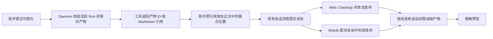

# 会话内可视化设计

状态：Pi 发布、SQLite 会话历史、Web／Desktop 正文交互和配对 Mobile 阅读均已接入。验证范围见[实施计划](conversation-inline-visualizations-implementation-plan.md#验证记录)。

## 用户体验

用户让 Ling 做一份可点击的界面示意、图表或小工具时，助手可以把它放在回复的任意段落之间。正文里直接展示「当前会话 / 项目概览」的切换以及「查看变更」的折叠效果。示例原型用「示例数据」标注数据性质。「查看变更」只展开原型内的示意内容。

Web 和 Desktop 使用同一消息渲染组件。宽展示使用当前消息正文的可用宽度，较大的可视化可以展开到独立阅读面板。作者可以用响应式布局适配窄窗口。关闭 Web／Desktop 展开视图后，焦点回到原位置。手机在同一位置显示标题和「打开可视化」，打开后按需读取摘要与内容。客户端将当前主题传给预览。

```text
普通助手回复
  这两个视图可以共用现有的工作摘要入口。

  ┌─ 界面示意 · 示例数据 ───────────── 展开 ┐
  │  [当前会话]  [项目概览]                  │
  │  当前会话 · ling-stack                   │
  │  ▸ 查看变更                              │
  └─────────────────────────────────────────┘

  两个视图分别服务于会话操作和项目浏览。
```

| 内容 | 正文 | 展开 |
| --- | --- | --- |
| 原生 HTML 控件、CSS、静态图表 | 可直接操作单选切换、折叠等控件 | 同一份内容，按可用宽度重新排版 |
| 脚本图表、计算器、模拟器 | 显示静态首屏和简短说明 | Web／Desktop 用户点「运行交互」后执行该份文档的脚本，可随时停止。Mobile 展示静态首屏和电脑端操作提示 |
| 产物不可读、客户端不支持或连接中断 | 保留正文和引用位置，显示对应提示，有恢复路径时可重试 | 手机重连并重新校验会话权限后再取内容 |

Pi 可以为 PC 上由用户发起的普通对话、队友私聊及频道回复生成可视化。Codex app-server 和其他执行引擎尚未接入发布工具。配对手机可读取 PC 已提交且当前有权访问的可视化，频道读取覆盖当前 Remote Gateway 投影的默认会话。手机远程发起的文字回复沿用当前的零工具执行权限。

## 现有基础与实现选择

- Ling 的 `html_interactive` 已能在文件预览中默认禁用脚本，并对指定文档启用交互。复用 [HTML 预览组件](../../apps/web/src/shared/conversation/preview/ArtifactPreview.tsx) 与 [隔离文档构造](../../packages/contracts/src/artifacts.ts) 的权限模型。
- [消息正文解析](../../packages/conversation-ui-core/src/message-body.ts) 和 [共享消息渲染](../../apps/web/src/shared/conversation/timeline/ConversationTimelineMessageRenderer.tsx) 已覆盖代码、Mermaid 和公式。可视化加入这一层，符合 [会话 Surface 契约](conversation-surface-contract.md)。普通会话的[内联视频](../../apps/web/src/features/workspace/NormalConversationFeed.tsx)已有产物正文消费路径，可参照其加载与视图状态。
- [普通会话正文提交](../../packages/core/src/storage/sqlite/normal-run-narration-publication.ts) 会从耐久 Run 事件生成正式消息，并检查正文与同一份已提交 narration 的一致性。作者在回答中使用短引用，提交路径继续原样保存正文。
- [Mobile Remote Access](mobile-remote-access.md) 只同步受限投影，消息体有 32 KiB 限制，单帧上限 256 KiB。客户端在同一配对会话读取产物正文，历史快照只携带短引用。

另一种做法是把 HTML 当 Markdown 代码块发送，在每个客户端直接渲染。这样省下一次读取，却会把大段文档带入流式消息、快照、复制和模型历史，还很难区分「介绍一个 HTML 写法」和「发布一个产物」。也可以给图表、页签和折叠控件定义统一 JSON 格式，在所有端原生渲染。它适合固定控件集，对自定义示意、计算器和图表会持续增加跨端组件。选用 **自包含 HTML 产物 + 正文引用 + 隔离预览**，先复用通用预览，再按用量考虑专用组件。

## 生成、提交与读取



### 作者接口

助手在支持的会话 Run 内调用 `conversation_visualization_create`。接入复用[会话媒体工具](../../packages/daemon/src/features/media/conversation-tool-handler.ts)的 Run 内注册与授权模式。Daemon 从调用上下文取得工作区、实际线程、轮次、Run、Attempt 和参与者。工具只在 runner 支持且执行策略允许时注册，在权限撤销、Attempt 停止或回复权转移后停止写入。权限只覆盖向当前回复发布产物，参数无法选择文件路径、URL、目标会话或受众。

```ts
type CreateConversationVisualization = {
  title: string;
  summary: string;
  html: string;
  layout?: "standard" | "wide";
  interaction?: "native" | "script";
  preferredHeight?: number;
};

type CreatedConversationVisualization = {
  artifactId: string;
  markdown: string;
};
```

标题和摘要是纯文本。初始上限为标题 240 UTF-8 字节、摘要 768 字节、HTML 128 KiB UTF-8、每个 Run 4 个产物。优先使用和正文同语言的摘要，描述图表结论或示意目的。`interaction` 默认 `native`，影响客户端是否提供运行脚本的入口。`preferredHeight` 对 Web / Desktop 可选，限定 160–480 CSS px，默认 360。超限、格式不合法与持久化失败返回可区分的错误，助手可以缩减内容重试，也可以继续用文字说明。HTML 在保存时做严格 UTF-8 与范围校验，并沿用现有自包含 HTML 资源检查。资源检查与运行时隔离各自独立。作者应提供有效的首屏内容，图形要有可读摘要，常用操作优先用语义化 HTML 控件。

返回的 Markdown 形态如下。复制到助手正文的独立段落即可定位。

```markdown
[界面示意](#ling-visualization-v1-viz_268e8119548048369a4328011c8fe398)
```

- 在 `conversation-ui-core` 的 Markdown AST 上识别顶层、单链接的专用段落，排除引用、列表、代码块和普通链接。提供一个共享的引用读取函数，供 Daemon 授权读取和客户端解析使用。解析默认关闭此能力，只有提供真实助手消息上下文的调用者才启用，用户与系统消息只显示链接标签。旧客户端同样显示标签。
- 只有已提交、可见的助手正文才拥有可加载的引用。流式阶段可显示标签，但不读产物、不执行脚本。提交后客户端按正文顺序渲染，同一正文里同一 ID 只挂载一次。工具结果没有进入正文时，聊天里没有额外结果块。
- 正式消息保存 Markdown 短引用，复制和导出沿用各客户端的 Markdown 或普通文本路径。引用、转发及分叉继承的上下文仍受原会话的读取权限约束。需要在另一条会话发布时，应为该会话生成自己的产物。

### 耐久存储与所有权

工作区 SQLite 的 `conversation_visualizations` 表以产物 ID 为主键，保存 HTML BLOB、SHA-256、标题、摘要、展示参数以及 Run、工作区、真实线程、轮次和消息 ID。独立的会话预览服务按需读取内容。普通 Run 产物、文件预览和附件列表使用各自的数据路径。

- 在同一 SQLite 写事务内校验执行所有权并写入产物。Host 从 `runId + toolCallId` 派生稳定 ID。相同请求的重放返回同一 ID，同一个调用身份携带不同的规范化输入时返回冲突。事务提交后给助手引用。Pi 发布到 Run 工具事件的参数只包含标题和字节数。
- 以已提交消息作为发布证据。读取同时校验工作区及可见性、真实线程及轮次、已提交助手消息拥有的 Run、正文里前四个去重引用与产物所有者。客户端使用相同的引用上限，额外引用仍显示标签。频道 topic/branch 解析真实子线程，队友私聊和嵌套 Agent 只按实际拥有该回复的参与者和 Run 绑定。仅匹配 `cwd` 或产物 ID 不构成授权。
- 重新生成的回复拥有新的 Run 及产物 ID。提交、替换或归档后的可读性取决于实际消息版本和会话权限。未被引用的产物随拥有它的 Run 保留，Run、真实线程、轮次或工作区记录删除时由 SQLite 外键级联清理。
- 崩溃后的恢复复用现有耐久消息提交。产物已存在、回复尚未提交时，重放可以继续引用同一内容；正文在而内容损坏时，显示「可视化不可用」，不影响同一条回复的文字。内容版本不可覆盖。校验和失败按产物不可用诊断。

### 读取与跨设备兼容

Web / Desktop 由受身份验证的 Daemon 客户端按 `workspace + threadId + messageId + messageRevision + artifactId` 请求预览。移动端通过现有 Gateway 发只读命令 `conversation.visualization.read`，参数为配对工作区、`conversationId`、`messageId`、`messageRevision` 和 `artifactId`。版本不一致时刷新消息后再读取。由 Gateway 现有可见性策略解析真实会话和消息，再调用同一授权读取服务。命令结果通过当前认证会话内的 `command.completed` 返回并关联请求，与快照、增量和恢复游标分开。首次加载、重试及重新连接都重新校验权限。

- Gateway 在已有 `/v1/auth/challenge` 支持显式查询参数 `feature=conversation.visualization.v1`。只有请求了且 Host 支持时，challenge 才含 `negotiatedFeatures: ["conversation.visualization.v1"]`。网关签名和设备 proof 的签名输入都纳入这个字段，从网关留存的 challenge 和客户端校验过的 challenge 分别取值。Gateway 从已认证的 challenge 向 WebSocket 会话传递能力，按会话启用命令。省略该字段时沿用原签名输入与响应形态；新手机连接旧 PC 时识别出未协商，旧手机连接新 PC 时继续使用现有协议。配对信息与连接地址沿用现有绑定。
- HTML 通过请求级结果传输，按 UTF-8 数据编码成无填充的 base64url，带长度和 SHA-256。128 KiB 原始数据编码后约 171 KiB，服务器校验整个序列化帧满足 256 KiB 上限。客户端验大小和摘要后再渲染。手机在卡片展开时请求内容，消息和离线快照只记录引用。当前开启的预览在内存中保有 HTML。连接中断、工作区解绑、离开消息或应用进入后台时关闭预览。
- [授权会话门面](../../packages/daemon/src/features/remote-access/conversation-facade.ts)、[远程协议类型](../../packages/contracts/src/remote-access.ts) 和 [远程客户端](../../packages/remote-client/src/client.ts) 负责各自的作用域、校验与兼容。跨网络走现有配对传输，HTML 不使用独立的临时外链，手机不接入通用 Daemon 端口。

## 预览边界与性能

- Web / Desktop 复用现有 iframe 与 CSP 构造。内联一律禁用脚本。Web 和 Desktop 的脚本交互在展开视图启用，授权对应当前设备、该产物和精确内容摘要，关闭、改版、切换会话或撤销时失效。现有资源 CSP 可以约束资源与导航，不能作为 Chromium 所有网络路径的隔离保证。因此脚本按钮沿用已有的明确确认，正文的默认渲染不依赖脚本。
- iOS／Android 使用专用、无 JS 调用桥的 WebView 加载同一份受限预览文档。两端始终禁用脚本并拦截外部导航。iOS 使用非持久化数据存储及 WebKit 资源拦截规则。Android 禁用文件访问、Content Provider 访问和网络资源加载。
- 用户内容不注入 Ling 主页面 DOM，预览不携带 token、工作区路径或设备密钥，不暴露工具、文件或网络代理接口。不接收作者页面发来的 Host 消息来调整尺寸或触发动作。内联按有界高度容纳，较长内容通过「展开」使用独立滚动区。客户端只提供主题令牌和本地样式。
- Web／Desktop 在消息接近可视区域时获取文档。同一工作区、消息修订和产物 ID 的进行中请求会合并。组件卸载时释放 iframe、忽略后续异步响应。展开时只挂载一个预览。正文滚动锚点沿用共享 Timeline 的延迟内容测量。手机只为打开的可视化创建 WebView。
- 用类型校验、写权限、读权限、渲染策略四个独立边界承接不同错误。界面区分连接断开、加载失败、缺失或无权访问、客户端版本不支持；缺失和无权访问使用相同对外响应。诊断只记录状态码、作用域内 ID、耗时和大小。

## 验收标准

| 验收 | 必须证明的行为 |
| --- | --- |
| 生成与回放 | 助手工具生成真实产物，两段文字之间准确显示；失败可继续回复；重复调用和提交重放没有重复产物，普通消息同步、工具回执和 Run 公共事件只带引用或元数据；刷新或重启 PC 后能读回 |
| 现有边界 | 未提交、假引用、用户消息、引用块、代码块及超出作用域的请求都不会加载 HTML；重试后的新回复显示新产物；私聊和频道分支不可互读 |
| 交互与隔离 | 默认禁脚本时页签可切换、差异可展开；允许相应文档后脚本计算器可用；关闭再打开重新确认；验证资源、导航、存储、Host API 和权限撤销边界 |
| 窗口与滚动 | 浅色与深色、窄窗口、键盘、触摸、展开后焦点恢复；历史中多个可视化不会提前读取所有内容，回到锚点时布局稳定 |
| 移动与兼容 | 真机分别验证 iOS、Android，各用 Wi-Fi 和另一个网络经已有配对路径打开同一回复；重启 PC、连接中断、配对撤销及新旧客户端混用均按设计降级 |
| 回归与覆盖 | Markdown、文件预览、Mermaid、视频正常；新增 TypeScript 用例被所属 runner 发现并被类型检查及相应 CI 阶段覆盖 |

优先复用 [现有 HTML 预览端到端用例](../../apps/web/e2e/gen-ui-interactive-artifact.spec.ts) 和 [HTML 预览隔离用例](../../packages/contracts/test/interactive-html-isolation.test.ts)。实现时新增能证明工具准入、所有权、协议兼容、正文位置与真机交互的测试，按《贡献指南》的 [验证要求](../../CONTRIBUTING.md#validation) 运行受影响包与客户端验证。
