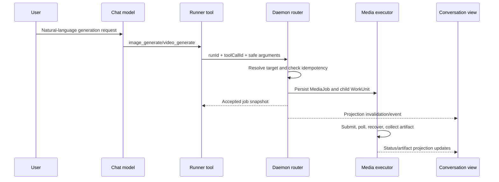

# Conversation Media Generation Tools

Status: active product and architecture contract
Date: 2026-08-13
Owner: Runner tools, media generation routing, Media Job projection, and conversation surfaces

Related docs:

- [Implementation Plan](conversation-media-generation-tools-implementation-plan.md)
- [Conversation Surface Contract](conversation-surface-contract.md)
- [Provider Generation Runtime Resolver](provider-generation-runtime.md)
- [Model Workbench](ui2.0升级/modules/09-Model-Workbench.md)
- [Media Jobs And Production](ui2.0升级/modules/12-媒体生产.md)

## Problem

Ling 已经能在媒体任务与媒体生产页面通过 Provider Preset 或 ComfyUI Workflow
生成图片和视频，但普通对话、频道和队友私聊没有受控的原生生成工具。聊天模型只能把
“帮我生成图片”理解成文字请求，或者错误地建议用户自己打开媒体页面。

这个能力不能依赖固定关键词，也不能把供应商地址、密钥或 raw 配置暴露给聊天模型。
当工作区存在多个图片或视频目标时，更不能使用“最早配置的模型”这类不可解释规则。

## Goals

- 用户可用自然语言表达生成意图，不要求说出固定命令或“调用媒体模型”。
- 聊天模型通过原生 `image_generate` 和 `video_generate` 工具进行语义调用。
- 图片与视频分别拥有工作区默认生成目标。
- Provider Preset 与 ComfyUI Workflow 都能成为生成目标。
- 普通对话、频道和队友私聊共享同一工具、路由、后台任务和结果投影。
- 长任务在后台运行；会话先显示稳定任务状态，成功后显示真实 artifact。
- 付费任务创建具备幂等性，重放工具事件不得重复向供应商提交。

## Non-goals

- 不增加关键词匹配、正则意图识别或独立 LLM 分类器。
- 不让聊天模型读取 API Key、Base URL、Provider raw health 或 ComfyUI graph。
- 不让聊天模型自由挑选没有被用户配置、检查和启用的供应商。
- 不新增媒体任务、审批或产物业务表。
- 不把媒体 artifact 再复制成 Run artifact。
- 不在本轮支持图片编辑、时间线编辑、拼接、字幕、配音或视频后处理。
- 不改变 Media Production 的场景审批与批量运行语义。
- 不给 Observer、总结、审计或其他非用户可见运行注入付费生成工具。
- 不把移动端作为本轮验收范围。

## Vocabulary

| Term | Meaning |
| --- | --- |
| Generation target | 用户可识别、可运行的图片或视频后端 |
| Target reference | 工作区设置中保存的稳定引用；Provider 指向 Preset，Workflow 指向 Definition |
| Resolved target | 一次工具调用锁定后的 `MediaExecutionSource` 与显示快照 |
| Conversation media | 父 Run 发起、由 MediaJob 执行并投影回会话的生成任务 |
| Explicit target | 用户在当前消息中明确指定，并由模型写入工具参数的目标名称或 id |

## First-party Runner Tools

Runner 只注册两个第一方工具：

```text
image_generate({ prompt, target?, aspectRatio?, count? })
video_generate({ prompt, target?, aspectRatio?, durationSeconds? })
```

规则：

1. 工具描述列出当前运行真正可用的目标显示名及受支持能力。
2. 模型根据用户自然语言和工具描述决定是否调用，不使用 Ling 侧关键词表。
3. `target` 是可选的当前调用偏好，不是 Provider 配置，也不能携带 URL 或密钥。
4. 用户明确说出目标时，模型应原样传入最接近的唯一目标名称或稳定 id。
5. 用户没有指定目标时，模型省略 `target`，由 daemon 按权威路由决策。
6. 工具结果只返回任务 id、产品化状态、目标显示名和可重试提示，不返回 raw Provider 响应。
7. 工具完成表示 MediaJob 已持久化并进入后台执行，不等待长视频生成结束。

目标能力描述与运行时校验使用同一权威清单：未声明 ratio/duration/count 能力表示不支持该参数，
声明能力但没有有限选项表示接受目标自己的自由值，声明有限选项则只能使用列出的值。用户要求的比例、
时长或数量不能被 Provider/Workflow 静默忽略；目标无法兑现时返回 `generation_input_invalid`，不创建任务。

`image_generate` 和 `video_generate` 是 daemon-handled 第一方工具，不进入 MCP，也不复用
文件写入审批。MediaJob 已声明 `approvalGate: media_cost` 时，现有 executor 的等待、批准、拒绝与过期
语义继续生效；本轮不为会话或媒体生产入口新增、移除或自动启用费用审批策略。

## Conditional Registration

只有以下条件全部满足时才向用户可见 Run 注册对应工具：

- RunRequest 明确由 `local-user` 创建，且本次 WorkUnit owner 是 `conversation_run`、
  `channel_ai_reply` 或 `teammate_direct_reply`；不能只因复用了一个用户 turn 就获得工具；
- 工作区至少存在一个对应类型的可运行目标；
- 当前 Runner 支持 Ling 第一方扩展工具；
- 运行不是 Observer、总结、后台学习、自动审计或系统维护运行。

没有可运行图片目标时不注册 `image_generate`；没有可运行视频目标时不注册
`video_generate`。能力未知时失败关闭，不向模型展示一个必然失败的工具。

## Generation Target Model

工作区设置保存两个互不影响的默认值：

```ts
interface WorkspaceMediaGenerationDefaults {
  readonly image?: MediaGenerationTargetRef;
  readonly video?: MediaGenerationTargetRef;
}

type MediaGenerationTargetRef =
  | { readonly kind: "provider"; readonly providerPresetId: string }
  | { readonly kind: "workflow"; readonly workflowDefinitionId: string };
```

- Provider 引用 Preset，因为 Preset 是模型工作台中的稳定用户配置对象。
- Workflow 引用 Definition，而不是 Version；每次运行解析并锁定当前 active version，历史
  MediaJob 继续保存不可变的 `workflowVersionId`。
- 删除、停用或归档目标前必须检查默认引用。失效引用不被静默迁移到其他目标。
- 客户端新增或切换默认时，daemon 必须校验目标存在、类型匹配且当前可运行；客户端不能直接写入
  任意 Provider/Workflow id。已有默认后来失效时允许原引用保留，以便用户逐项修复或清除。
- 图片和视频默认可以分别指向不同目标；一个同时支持两类能力的目标也可以同时成为两个默认。
- 更换默认只影响后续未明确指定目标的工具调用，不重写已有 MediaJob。

## Runnable Target Inventory

daemon 构建唯一权威清单：

### Provider target

- Preset 已启用；
- 声明对应 generation capability；
- `Provider Generation Runtime Resolver` 返回 `canRun=true`；
- 最近一次模型检查通过；未检查或最近检查失败的目标仍可用于修复展示，但不能注册为会话生成工具；
- Provider/Model 的用户可见名称可唯一解析。

### Workflow target

- Definition 状态为 `ready`，且存在 `currentVersionId`；
- 当前 Version 校验通过；
- 对应 Connection 已启用且状态为 `ready`；
- Version output rules 至少包含目标类型；
- 必填输入除 prompt 外必须有 default value，或本次工具参数能够提供该语义值。

目标清单包含稳定 id、显示名、来源类型、支持 operation 和有限输入元数据，不包含连接地址、
密钥、graph、checksum 或 raw health。

## Target Resolution Ladder

每次工具调用严格按以下顺序解析：

1. **当前消息明确指定。** `target` 必须唯一匹配一个当前可运行且能力相符的目标。
2. **工作区类型默认。** 没有显式目标时使用图片或视频对应默认值。
3. **唯一可运行目标。** 没有默认且只有一个可运行目标时直接使用。
4. **需要用户选择。** 没有默认且有多个目标时，工具返回结构化
   `target_selection_required`，模型用目标显示名向用户询问。
5. **没有可运行目标。** 返回 `generation_target_unavailable` 和产品化修复路径。

不得使用创建时间、列表顺序、Provider id 字典序或聊天模型猜测来打破平局。

显式指定只覆盖当前工具调用，不改变工作区默认。若指定名称歧义、目标停用、检查失败或能力不匹配，
当前调用失败并说明原因；不得悄悄改用默认或另一个模型。

## Tool Call And Media Job Lifecycle



- 幂等键为 `media_tool:${runId}:${toolCallId}`。
- 同一幂等键重放时返回已存在 MediaJob，不创建第二个付费任务。
- 同一 daemon 内对同一 MediaJob 的并发 dispatch 必须复用一个 in-flight execution promise；后台 timer、
  手动运行与重复回调不能同时跨过 submit 边界。跨进程仍由 workspace runtime authority 保证只有一个 daemon。
- Provider 接受付费任务后，poll/recovery 始终绑定原目标；不得跨模型重试。
- 工具调用创建的 MediaJob 立即进入现有后台 executor。
- 父 Run 可以在媒体任务仍运行时完成文字回复；MediaJob 生命周期独立恢复。
- 停止父 Run 只取消尚未创建的工具调用。已被供应商接受的 MediaJob 使用现有媒体取消能力，
  不能假装被取消。
- daemon 重启只自动恢复状态为 `queued` 或 `running` 的 MediaJob。`failed`、`cancelled` 和
  `succeeded` 任务不得被后台恢复复活；只有用户显式执行既有“重试任务”动作、任务尚无外部
  operation handle，且既有 executor 恢复/取消边界允许时，终态任务才可重新排队。带外部 handle 的
  终态任务只能收口原 operation，不能重新 submit。外部 operation 已被接受后，其 handle 必须作为
  durable 幂等凭据保留并停止 poll；不得为了清理运行时绑定而删除 handle，导致后续显式重试重新提交。
  此时重复调用既有 `POST /media-jobs/:id/run` 以 HTTP 200 返回持久化失败快照，兼容原媒体生产客户端，
  但不得新增 attempt、恢复 poll 或再次调用供应商。
- 重启前已启动的 child WorkUnit 必须在恢复时把旧 attempt 标记为 `lost`，再通过既有
  `stale -> retry -> queued` 转换复用同一个 WorkUnit 并创建新 attempt。无论任务是在提交前还是
  Provider/Workflow 已返回可恢复 handle 后中断，都不得创建第二个 child WorkUnit；已持久化的外部
  operation handle 必须重新绑定新 attempt 后继续 poll。

## Durable Ownership And Projection

持久化所有权保持单一：

- `RunSession` 是用户可见会话回复的父运行；
- `MediaJob` 是生成任务和其 artifact 的权威 owner；
- `media_job` WorkUnit 同时保存 `linkedRunId`、`linkedMessageId` 和
  `linkedMediaJobId`，表达父子关系；
- `RunArtifact.mediaJobId` 保持原有归属，不额外写入 `runId`；
- Conversation API 由这些权威记录构建共享只读投影。

```ts
interface ConversationGeneratedMedia {
  readonly mediaJobId: string;
  readonly runId: string;
  readonly messageId?: string;
  readonly operation: "image_generate" | "video_generate";
  readonly target: {
    readonly kind: "provider" | "workflow";
    readonly id: string;
    readonly displayName: string;
  };
  readonly prompt: string;
  readonly status: MediaJobStatus;
  readonly artifacts: readonly RunArtifact[];
  readonly failureCode?:
    | "generation_target_unavailable"
    | "generation_configuration_required"
    | "generation_content_policy_blocked"
    | "generation_authorization_required"
    | "generation_timed_out"
    | "generation_result_unavailable"
    | "generation_failed";
  readonly createdAt: string;
  readonly updatedAt: string;
}
```

API 不依赖 Web 根据运行事件猜测关联关系。普通对话、频道与私聊 adapter 只把共享投影附着到对应
assistant turn/message，不分别查询和拼装 MediaJob。

会话投影只根据 child WorkUnit 的稳定错误码生成 `failureCode`。Provider/ComfyUI 原始错误、URL、
HTTP 响应、节点信息和 graph 只保留在受控媒体任务诊断面，不得直接复制为会话 `errorMessage`。
产品文案必须准确区分目标未配置、凭据失败、内容策略拒绝、超时和“上游已响应但没有返回目标媒体数据”。
后者使用 `generation_result_unavailable`，不得回退成 `generation_configuration_required`。会话可显示经过
脱敏、可执行的上游失败类别和下一步，但不得显示 raw response body、request id、密钥或 Provider URL。
child WorkUnit 被 executor 接管后必须与 MediaJob 同步进入 succeeded、failed 或 cancelled 终态，不能在
MediaJob 已终止时继续显示 running。
通用 RuntimeSupervisor 不得根据父 Run 的终态替 media child WorkUnit 判定成功或失败。父 Run 完成只表示
本轮对话结束；MediaJob 和其 child WorkUnit 必须继续由媒体执行状态机独立收口。

## Background Events

Control Plane 使用现有 domain，不新增 `media` domain：

- 子 WorkUnit 创建和状态变化继续发布 `work_units`；
- Media artifact 创建继续发布 `artifacts`；
- MediaJob 状态变化额外发布产品事件到既有 `work_units` owner 投影，事件数据只含 id、状态和关联 id；
- Web 以 `linkedRunId` 或当前 thread owner 判断是否刷新会话投影。AppShell 的同一条 Control Plane
  订阅同时使当前普通对话、当前频道消息页和当前队友私聊快照失效；不得为媒体块新增独立 SSE 或 polling。

后台事件只用于失效与及时刷新；Conversation API 仍是重连、刷新和应用重启后的权威快照。

## Conversation Surface Contract

三种会话使用一个 `ConversationGeneratedMediaBlock`：

- queued/running：稳定占位、目标显示名和“生成中”，使用共享 `Spinner` 的持续旋转动画，不展示 raw
  轮询信息，也不得用无动画的静态 loading 图标造成卡死错觉；
- succeeded：只显示真实图片或视频预览；与 assistant 正文左边缘对齐，不重复显示“图片已生成”、
  生成目标和 artifact 内部标题。打开和下载作为媒体右上角悬浮操作层，默认隐藏，媒体 hover 或
  操作获得键盘 focus 时显示，不得在预览下方占据额外高度；
- 只有与 operation 匹配的 `image` 或 `video` artifact 进入媒体预览；日志、JSON 和其他辅助 artifact
  继续留在媒体任务详情，不得伪装成图片；
- failed/cancelled：根据有限 `failureCode` 持续显示本地化原因和可执行修复路径；
- 多个工具调用按创建顺序附着在同一 assistant turn 下；
- 普通对话、频道和私聊的卡片、排版、加载和错误状态完全一致；
- 频道只保留既有 speaker/mention 差异，不增加单独媒体生成 UI；
- 结果更新不得插入一条伪造 assistant 文本消息，也不得暴露模型思考过程。

普通频道回复的 `channel_ai_reply` 是会话回答，不是独立已执行任务。即使该 Run 调用了媒体工具或产生
了 execution evidence，也不得再生成 Terminal Report 或“任务已完成”消息；媒体任务状态完全由共享
媒体块表达。该资格规则必须同时用于实时调度、直接处理、daemon 启动恢复、Terminal Report API 和频道
消息投影。升级前已持久化的错误报告保留在数据库供审计，但在报告 API 与频道消息列表中隐藏，不删除
用户数据。合法 workflow、显式任务和真正 executed-work report 继续按 Terminal Report 合同展示。

聊天模型可以在工具被接受后回复“已开始生成”，但产品 UI 不依赖这句话表达任务状态。

如果成功的父 Run 已经持久化至少一个可投影的会话媒体任务，媒体块本身就是该轮的可显示结果。
此时即使聊天模型在工具调用后没有再输出正文，assistant 消息也必须保持成功并静默留空；不得合成
“已开始生成”、`AI reply completed without text` 或“模型没有返回可显示内容”。只有成功 Run 同时
没有可显示正文、没有媒体投影时，才沿用 `empty_response` 的消息级失败语义。普通对话、频道首次
回复、频道排队续跑和队友私聊必须执行同一规则。

频道讨论继续禁止工作区工具、MCP 和其他副作用，但这条限制不得覆盖 daemon 注入的
`image_generate` / `video_generate`。当且仅当本次 Run 实际注册了对应第一方工具且用户请求生成
媒体时，频道模型可以调用；目标选择、审批、幂等与后台执行仍由既有生成路由负责。

## Default Selection UI

- 模型工作台在筛选与模型列表上方常显一条无卡片外框的用途配置栏，不显示多余的“默认用途”标题：
  `聊天模型 [下拉] | 生图目标 [下拉] | 生视频目标 [下拉]`。标签与紧凑下拉保持同一行；三个控件直接显示当前目标，不藏在更多菜单或 tooltip 中；
  用户无需打开下拉框即可知道当前默认或自动选择规则。
- 自定义兼容入口批量导入的模型在目标 inventory、Runner 工具、会话快照和用途下拉中都使用具体模型名，
  不把入口名称重复拼到每个选项；非自定义 Provider 使用其用户可见名称，ComfyUI 保留来源前缀。
- 聊天只列出可运行聊天模型；图片和视频同时列出可运行 generation Provider 与 active
  ComfyUI Workflow，并以模型/ComfyUI 来源图标和文字区分。
- 模型表格中的单一星形按钮不再承担多种默认语义。默认用途统一在配置栏修改；模型行继续常显
  检查、编辑和更多操作。
- generation Provider 的列表主状态、顶部摘要与“就绪”筛选必须复用默认目标的可运行口径：Provider
  generation runtime 可用且最新检查通过。仅启用、密钥存在或基础配置完整不能显示“就绪”；同一模型
  不得在列表显示“就绪”而在生图/生视频目标中显示“需处理”。未检查时的修复提示必须指向“检查”，
  不得错误解释为“不可聊天”。
- 未保存显式媒体默认且只有一个可运行目标时显示“自动选择（目标名）”；多个目标时显示
  “使用时询问（N 个可用）”；没有目标时显示“未配置”。
- 默认值失效但目标记录仍存在时保留目标名并显示“需处理”；引用已经悬空时显示“原默认目标不可用 ·
  需处理”。当前设置只保存稳定引用，不伪造无法从权威数据恢复的历史名称，也不自动选择其他目标。
- 聊天默认模型与媒体默认目标是三个独立概念，UI 文案不得都简称为“默认模型”。
- 每个会话生成结果低调显示实际使用目标，例如“由 Seedream 4.0 生成”，使单次显式覆盖和
  自动选择都可验证。

## Security And Cost Boundaries

- Tool schema、prompt 和结果进入现有 redaction 路径。
- 不保存或回传 Provider raw response、ComfyUI graph、连接 URL 或密钥。
- prompt 和用户提供的 generation input 作为 MediaJob 输入审计保存；平台安全策略与用户自建
  ComfyUI 内容责任边界保持不变。
- Standalone 会话生成沿用现有 MediaJob 执行边界；不绕过 Provider readiness、网络策略、
  artifact 下载检查或 MediaJob 已声明的费用审批 gate。
- 付费任务一旦被目标接受，不得因为聊天重试、SSE 重连或 Runner 重放而重复创建。
- 图片比例、尺寸和张数必须来自 Core 中模型级、已验证的执行能力映射。仅按模型族或上游
  `supportedParameters` 推断不足以形成运行承诺；无法证明的可选参数必须从 Tool schema 隐藏。
- DALL-E 3 只能请求一张图片，不能暴露 `count`；不同 OpenAI Images 模型的比例必须映射到各自实际
  `size`，不得把一套固定尺寸应用到整个图片模型族。ComfyUI 继续以当前 active workflow 输入定义为准。

## Failure Contract

| Code | Meaning | Required behavior |
| --- | --- | --- |
| `generation_target_unavailable` | 没有可运行目标 | 不调用供应商，提示去模型工作台或工作流库配置 |
| `target_selection_required` | 多个目标且无默认 | 返回候选显示名，让模型向用户询问 |
| `generation_target_ambiguous` | 显式名称匹配多个目标 | 不猜测，不回退 |
| `generation_target_not_found` | 显式目标不存在 | 不回退，列出可用目标 |
| `generation_target_not_runnable` | 目标停用、失效或能力不符 | 不回退，给出修复路径 |
| `generation_content_policy_blocked` | 供应商内容安全策略拒绝本次请求 | 提示调整描述后重试，不误报为模型配置问题，不展示 raw response |
| `generation_input_invalid` | prompt 或受控输入不合法 | 不创建 MediaJob |
| `media_job_execution_failed` | 后台执行失败 | 保留任务与错误投影，可从媒体任务查看 |

## Open-source Design References

- [OpenAI Codex tool system](https://github.com/openai/codex/tree/41ece455/codex-rs/core/src/tools)
  supports model-selected native tools with typed calls and tool lifecycle events.
- [OpenClaw media/provider routing](https://github.com/openclaw/openclaw/tree/df72781e/src)
  demonstrates conditional capability registration and explicit provider/default resolution.
- [Hermes Agent tool runtime](https://github.com/NousResearch/hermes-agent/tree/c0106e50/hermes_cli)
  keeps user-configured model/provider authority outside free-form agent choice.

These references inform the shape, but Ling's existing RunSession, WorkUnit, MediaJob,
approval, artifact and recovery authorities remain the implementation source of truth.

## Hard Stops

- 不得增加关键词路由或独立意图分类器。
- 不得把“最早配置”作为多目标默认。
- 不得让聊天模型选择或构造密钥、URL、Provider payload 或 ComfyUI graph。
- 不得绕过 generation runtime resolver、Workflow readiness 或现有 Media executor。
- 不得复制 MediaJob artifact 为第二份 Run artifact。
- 不得为三个会话分别实现工具状态机或媒体卡片。
- 不得让 Observer、总结或后台系统 Run 创建付费媒体任务。
- 若必须改变审批 enforcement、Provider 状态机、MediaJob schema 或供应商恢复语义，停止并重新设计。

## Acceptance

- 用户说“帮我生成一张日落图片”即可触发工具，无固定短语要求。
- 用户明确指定唯一目标时本次使用该目标，默认值不改变。
- 多目标无默认时询问选择，不选择最早配置项。
- 图片和视频默认分别生效；聊天默认模型不受影响。
- Provider 和 ready ComfyUI Workflow 都能创建标准 MediaJob。
- Runner 工具重放不会重复创建或提交付费任务。
- 刷新、SSE 重连和应用重启后，会话仍能恢复生成中、成功或失败投影。
- 普通对话、频道和队友私聊显示同一媒体块和状态文案。
- queued/running 的共享 Spinner 实际持续旋转，不以静态 loading 图标表示运行中。
- 普通 `channel_ai_reply` 在实时路径和启动恢复后都不会追加重复的 Terminal Report；升级前的错误报告
  保留在存储中但不再投影到会话或报告 API。
- 上游成功响应但缺少图片或视频数据时显示脱敏的上游空结果提示，不误报模型未配置。
- 密钥、URL、raw response、reasoning 和 ComfyUI graph 不进入会话或 Runner 事件。
