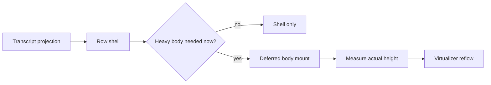

# Conversation Performance Deferral And Virtualization

Status: detailed design
Date: 2026-06-25
Scope: channel conversation feed, teammate private chat, large code/diff/image/raw
rendering, and virtualized transcript measurement

Related docs:

- [Conversation Operation Bubble And Performance Store](conversation-operation-bubble-and-performance-store.md)
- [Conversation UI Framework Copy Canon Implementation Plan](conversation-ui-framework-copy-implementation-plan.md)
- [Ling Agent Operation Cell UI](ling-agent-operation-cell-ui.md)
- [Conversation UI Framework Temporary Implementation Checklist](conversation-ui-framework-implementation-checklist.md)

## Purpose

The conversation surface must stay readable when a single operation produces a large
code block, a multi-file diff, a heavy image preview, or a raw log payload. The shell
has to stay immediate. The heavy body can wait, but it must remain reachable from the
same row.

This slice defines that contract. It does not change daemon truth, storage shape, or
right-drawer ownership.

## Why This Slice Exists

- One large diff should not freeze the entire feed.
- Large code should not pay syntax-highlight cost until the user can actually read it.
- Images should not decode full-size until visible or explicitly opened.
- Raw output should not appear as an unbounded transcript stream.
- Virtualization should keep anchors stable while rows expand and deferred bodies mount.

## What This Slice Owns

- shell-first render policy for heavy conversation rows
- deferral rules for code, diff, image, compare, and raw/debug bodies
- height measurement and reflow behavior for the transcript virtualizer
- stable anchors for active rows, expansion, and preview return focus
- cross-surface reuse for channel and teammate private chat

## What This Slice Does Not Own

- daemon/core projection
- transcript semantics or packet approval state
- persistence tables
- right-drawer evidence ownership
- assistant-style branch selection semantics

## Rendering Model

The shell renders first. The heavy body mounts only when a row is visible enough,
expanded, or explicitly opened.

## Shell First Contract

Every heavy row must show these things immediately:

- status and ownership
- operation label or summary
- expansion affordance when a fuller body exists
- copy/open/download affordances when relevant
- provenance for the produced artifact, diff, or preview

The shell may be compact. It may be collapsed. It may be folded after completion.
It may not become unreachable.

Rules:

- running, waiting-for-approval, blocked, and failed rows stay open enough to inspect;
- terminal rows may collapse after the result is visible;
- a truncated preview must always expose an explicit expand or open-full action;
- a bare `...` is not a valid end state if the full body is no longer reachable;
- the same row owns the full content even when the shell only shows a summary.

## Deferred Content Classes

| Content class | Shell must show | Deferred body trigger | Full access path |
| --- | --- | --- | --- |
| Large code block | language, line count, copy action, and visible summary | visible row or explicit expand; syntax highlight stays deferred over 300 lines or 24 KB | inline expand or raw artifact |
| Large diff | file count, path summary, additions/deletions, copy action | visible row or explicit expand; hunk bodies mount later | inline expand or explicit diff detail |
| Image preview | thumbnail, label, aspect-ratio box | visible preview or explicit open | lightbox preview |
| Image compare | current image shell plus compare entry point | preview open or compare metadata present | compare viewer inside lightbox |
| Raw/debug payload | one-line summary, source label, size/ref metadata | never eager-render | explicit raw/debug detail |
| Command output | bounded head/tail summary | output exceeds inline cap | expand or raw/debug detail |

Notes:

- Large code stays plain monospace while streaming. Highlighting can wait.
- Large diffs should summarize files first. If the diff is too large for a useful inline
  hunk view, the shell must still expose per-file expansion.
- Raw/debug payloads are never the default transcript body.
- Image compare controls should not mount for every image by default.

## First Implementation Thresholds

These thresholds align with the current conversation design and should stay stable
across channel and teammate private chat.

| Case | Threshold |
| --- | --- |
| transcript virtualization candidate | 200 rendered blocks or 100 turns |
| syntax highlight async/deferred | code block over 300 lines or 24 KB |
| successful command output | 5 lines or 800 chars |
| failed command output | 12 lines or 1600 chars, prioritizing the error tail |
| install logs | hidden unless failed or explicitly requested |
| watch/server logs | latest 5 meaningful lines while active |
| binary/huge output | no inline body |
| large diff | more than 6 files or a hunk body that would exceed one screenful |
| image lazy load | all images outside the viewport |
| raw/debug payload preview | never eager-rendered |

These are not aesthetic preferences. They are the guardrails that keep the feed usable.

Implementation note: the web conversation surface now applies these thresholds in
`CodeBlock`, `DiffCodeBlock`, `DiffViewer`, `ImageCompareViewer`, and
`ConversationVirtualFeed`. Large code and large diff rows mount a shell first, then
notify the virtualizer when the deferred body becomes ready so row measurement can
settle after expansion or image load.

## Virtualization Contract

The transcript virtualizer should reason about the row shell first and the heavy body
second.

Rules:

- keep the active row mounted when possible, even if older completed rows are windowed;
- preserve anchors by stable block id and revision, not by array index;
- preserve visible scroll position when an off-screen row expands above the viewport;
- remeasure after a deferred body mounts, after an image loads, and after a diff or
  code body switches from summary to full view;
- keep previews and expansion state local to the owning conversation surface.

The performance implementation adds these view-store responsibilities:

- measured heights by virtual item key
- readiness flags for deferred body mount
- cached estimate by block type and status

This document treats those responsibilities as part of the contract even before the code
lands.

## Interaction Rules

- Collapsed shells copy the visible summary, not hidden raw body content.
- Full copy must remain an explicit action when content is truncated.
- Expanding a heavy row does not move the user into a drawer.
- Preview open and focus return belong to the owning row.
- Search hits should be able to force body mount for the matching row.

## Layout Rules

- Keep the shell compact and stable.
- Do not wrap heavy content inside nested card chrome.
- Keep code, diff, and preview widths constrained to the transcript column.
- Preserve aspect ratio for image shells and image previews.
- Use local loading indicators inside the row, not global placeholders that hide the feed.

## Motion Rules

- Motion may show activity.
- Motion may not hide status, block expansion, or shift row height unexpectedly.
- `prefers-reduced-motion: reduce` disables non-essential shimmer and sweep effects.

## Verification Matrix

| Case | Expected result |
| --- | --- |
| long code block | shell appears immediately; highlight waits; full body expands inline |
| large diff | file summary appears first; hunk bodies mount later |
| image preview | thumbnail renders with stable dimensions; full image waits for open |
| image compare | controls mount only when preview opens |
| raw/debug payload | no eager transcript dump |
| long transcript | active rows stay stable under virtualization |
| row expansion above viewport | scroll anchor remains intact |
| collapsed terminal row | shell remains reopenable and full content stays reachable |

## Open Decisions

No product decision blocks this slice. The thresholds above are the first implementation
defaults. Later tuning must update this document so behavior does not drift from the
design.
