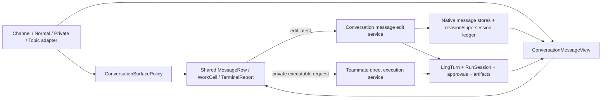
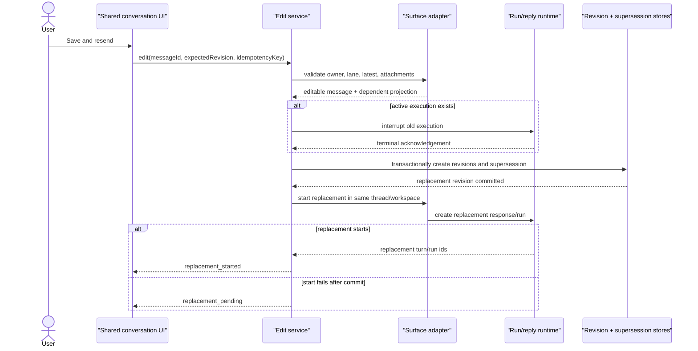
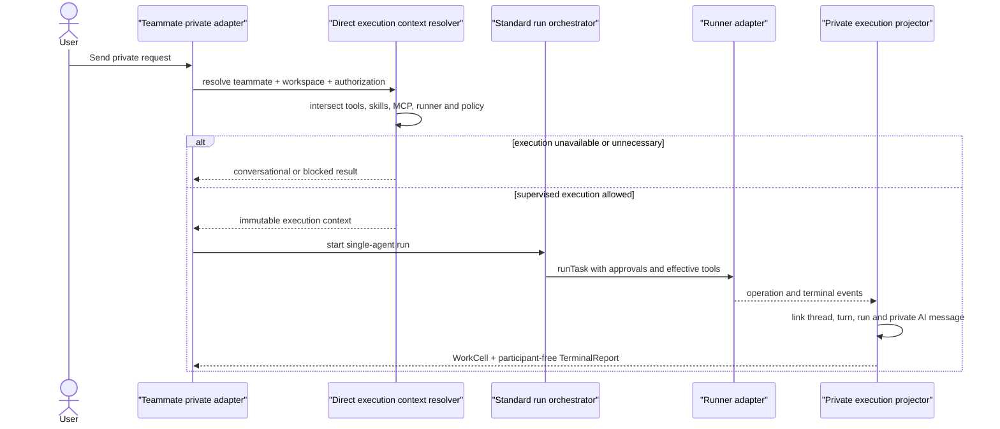

# Conversation Shared Capabilities Detailed Design

Status: implemented
Date: 2026-07-13
Scope: shared conversation components, rich content parsing/rendering, Mermaid, latest
user message editing, teammate-private execution, transcript supersession, and tests

Related docs:

- [Conversation Shared Capabilities](conversation-shared-capabilities.md)
- [Conversation Surface Contract](conversation-surface-contract.md)
- [Conversation Composer Unification](conversation-composer-unification.md)
- [AI Teammate Private Workspace](ai-teammate-private-workspace.md)
- [Thread-First Work History V2 Detailed Design](thread-first-work-history-v2-detailed-design.md)
- [Run Interruption And Continuation](run-interruption-continuation.md)
- [Ling Agent TerminalReport Protocol](ling-agent-terminal-report-protocol.md)

## 1. Design Goals

1. Complete one shared conversation presentation system without merging channel,
   normal-conversation, and private-chat runtime ownership.
2. Add rich content through a structured parser and dedicated renderers rather than
   brittle string replacement.
3. Make private chat a real single-agent execution surface under explicit tools,
   workspace, provider, skill, MCP, and approval policy.
4. Implement latest-message editing as turn supersession and replacement, not destructive
   evidence mutation.
5. Preserve a clean default transcript while keeping prior revisions and work evidence
   auditable.
6. Land the work in independently testable slices.

## 2. Architecture Boundary

The feature spans five modules:

```text
conversation-ui-core
  -> pure surface policy, content block types, message action policy, edit state types

conversation-ui-react
  -> shared message/body/action/composer/rendering components

Web adapters
  -> map channel, normal, topic, and private state into shared view models

Daemon application services
  -> rich-content-independent edit orchestration and private execution dispatch

Core stores
  -> message revisions, supersession links, turn/run state, audit records
```

Hard dependency rules:

- shared React components do not import daemon routes or workspace stores;
- content renderers receive normalized blocks and callbacks, not API clients;
- edit orchestration does not live in React hooks;
- native message stores remain the authority for current visible message data;
- revision and supersession records remain the authority for edit history;
- `LingTurn`, `RunSession`, approvals, artifacts, and `TerminalReport` remain the authority
  for execution evidence.

### 2.1 End-To-End Ownership



The shared UI owns presentation only. Native surface adapters remain responsible for
message identity and lane ownership. The edit service coordinates revisions and
supersession. The direct execution service resolves effective authority and delegates to
the standard runtime. Neither application service may synthesize UI state from assistant
copy.

## 3. Shared Surface View Model

Extend the shared policy contract rather than branching components by route.

```ts
type ConversationSurfaceKind =
  | "normal_conversation"
  | "channel_root"
  | "channel_branch"
  | "topic_reply"
  | "teammate_direct"
  | "run_thread";

interface ConversationSurfacePolicy {
  readonly surface: ConversationSurfaceKind;
  readonly showUserAvatar: boolean;
  readonly showAgentAvatar: boolean;
  readonly allowMultiTeammateActivity: boolean;
  readonly allowTeammateMentions: boolean;
  readonly allowTopicReply: boolean;
  readonly allowThreadFork: boolean;
  readonly allowLatestUserMessageEdit: boolean;
  readonly allowToolExecution: boolean;
  readonly showTerminalReportParticipants: boolean;
  readonly evidenceMode: "none" | "compact" | "rich";
  readonly workCellMode: "none" | "compact" | "rich";
  readonly rawDetailMode: "hidden" | "developer" | "rich";
}
```

Policy defaults:

| Field | Channel | Normal | Private | Topic |
| --- | --- | --- | --- | --- |
| `showUserAvatar` | true | false | true | true |
| `showAgentAvatar` | true | false | true | true |
| `allowMultiTeammateActivity` | true | false | false | false |
| `allowTeammateMentions` | true | false | false | explicit reply mention only |
| `allowTopicReply` | true | false | false | nested only |
| `allowThreadFork` | true | true | false in first slice | false |
| `allowLatestUserMessageEdit` | true | true | true | true |
| `allowToolExecution` | true | true | true | false by default |
| `showTerminalReportParticipants` | true | false | false | false |

The view adapter computes `editable` and concrete action rows. `MessageRow` does not scan
the feed to decide whether a message is latest.

```ts
interface ConversationMessageView {
  readonly id: string;
  readonly surface: ConversationSurfaceKind;
  readonly ownerId: string;
  readonly role: "user" | "assistant" | "teammate" | "coordinator" | "system";
  readonly body: string;
  readonly revision: number;
  readonly editedAt?: string;
  readonly editable: boolean;
  readonly editBlockedReason?: string;
  readonly threadId?: string;
  readonly turnId?: string;
  readonly runId?: string;
  readonly capabilities: readonly ConversationCapabilityView[];
  readonly actions: readonly ConversationActionView[];
}
```

## 4. Rich Content Pipeline

### 4.1 Current Boundary

The current custom parser recognizes paragraphs, lists, inline code, strong text, links,
local file references, and fenced code. `MessageBodyRenderer` dispatches fenced code to
`CodeBlock` or `DiffCodeBlock`.

This is sufficient for the first Mermaid slice but not for correct GFM tables, nested
quotes, task lists, or math. Do not add a growing collection of line-oriented regexes.

### 4.2 Target Parser

Use a Markdown AST pipeline:

```text
source text
  -> remark-parse
  -> remark-gfm
  -> remark-math
  -> Ling reference/mention transform
  -> normalized ConversationContentBlock[]
  -> shared React renderers
```

Recommended dependencies:

- `unified`
- `remark-parse`
- `remark-gfm`
- `remark-math`
- `katex`
- `mermaid`

Do not enable `rehype-raw`. Ling renders an allowlisted AST through owned React
components. Existing local-file and mention behavior moves into a transform over text and
link nodes.

### 4.3 Normalized Content Blocks

```ts
type ConversationContentBlock =
  | { readonly kind: "paragraph"; readonly children: readonly InlineContent[] }
  | { readonly kind: "heading"; readonly depth: 1 | 2 | 3 | 4 | 5 | 6; readonly children: readonly InlineContent[] }
  | { readonly kind: "quote"; readonly blocks: readonly ConversationContentBlock[] }
  | { readonly kind: "list"; readonly ordered: boolean; readonly start?: number; readonly items: readonly ContentListItem[] }
  | { readonly kind: "table"; readonly align: readonly ("left" | "center" | "right" | null)[]; readonly rows: readonly ContentTableRow[] }
  | { readonly kind: "thematic_break" }
  | { readonly kind: "code"; readonly code: string; readonly language?: string; readonly complete: boolean }
  | { readonly kind: "diff"; readonly diff: string; readonly language?: string; readonly complete: boolean }
  | { readonly kind: "mermaid"; readonly source: string; readonly complete: boolean }
  | { readonly kind: "math"; readonly source: string; readonly display: boolean; readonly complete: boolean };
```

`complete` is explicit. The existing parser currently treats an unclosed fence as a code
block without exposing completeness. Streaming-safe rendering requires that distinction.

### 4.4 Streaming Rules

```text
stable completed block
  -> render rich block

last incomplete paragraph/list
  -> render text incrementally

unclosed code/diff fence
  -> render plain code without deferred highlighting

unclosed Mermaid/math block
  -> render source placeholder; do not invoke renderer
```

When the closing fence or delimiter arrives, the same block key upgrades in place. The
feed must receive `notifyConversationDeferredContentReady()` after layout-affecting rich
content becomes ready so latest-position tracking remains correct.

### 4.5 Mermaid Renderer

Component boundary:

```ts
interface MermaidBlockProps {
  readonly source: string;
  readonly complete: boolean;
  readonly theme: "light" | "dark";
  readonly maxSourceCharacters?: number;
  readonly onDeferredContentReady?: () => void;
}
```

Lifecycle:

1. If incomplete, render the source fallback.
2. Use `IntersectionObserver` to avoid rendering offscreen diagrams eagerly.
3. Dynamically import Mermaid only when the first diagram becomes eligible.
4. Parse and render with a unique deterministic DOM id derived from block identity, not
   raw source.
5. Render the returned SVG into a controlled container.
6. Notify the feed after SVG layout completes.
7. On error, render the source block with a quiet parse-failure label.

Security configuration:

- `startOnLoad: false`;
- prefer `securityLevel: "sandbox"` for untrusted conversation content;
- if product constraints require `strict`, disable HTML labels and sanitize links;
- do not enable arbitrary click callbacks;
- block non-HTTP(S) external links;
- cap source length, node count when observable, SVG dimensions, and render duration;
- remove generated nodes on cleanup and ignore stale async results.

Performance limits for the first slice:

| Limit | Initial value |
| --- | --- |
| Source characters | 40,000 |
| Concurrent active renders | 2 |
| Render timeout | 5 seconds |
| Inline viewport height | 560px maximum before internal scrolling |
| Expanded viewport | dialog/overlay constrained to current window |

The exact node-count API depends on Mermaid parser support. Source size and timeout are
mandatory even if node count is deferred.

UI:

- no nested chat bubble;
- subtle diagram boundary only;
- copy and expand controls appear on hover/focus;
- expanded view is keyboard dismissible and preserves source-copy access;
- panning/zooming is optional after the first safe renderer lands;
- moving the pointer outside both trigger and expanded overlay closes only transient
  hover previews, not an explicitly opened dialog.

### 4.6 Math Renderer

- Use KaTeX with `trust: false` and strict error handling.
- Inline math participates in normal line flow.
- Display math uses horizontal scrolling when required.
- Invalid math falls back to source text.
- KaTeX CSS loads once with the rich-content bundle.

### 4.7 Tables And Long Content

- Tables use a semantic `<table>` and a horizontally scrollable wrapper.
- Required content wraps where possible; no ellipsis for cell text by default.
- Task-list checkboxes are read-only unless a future structured action owns mutation.
- Heading ids are deterministic within one message and may support local navigation.
- Long quote/list nesting is capped to avoid pathological layout depth.

## 5. Latest User Message Edit Protocol

### 5.1 Product Invariant

The action edits the latest local-user message in the active surface lane. It does not
edit arbitrary history and does not mutate an assistant answer while leaving its source
prompt unchanged.

```text
same surface owner
  + same active branch/topic/private thread
  + local-user author
  + latest local-user message
  + editable surface policy
  = editable
```

### 5.2 User Flow

```text
hover/focus latest user message
  -> click Edit
  -> message body becomes inline shared composer
  -> edit text / mentions / allowed attachments
  -> Cancel or Save and resend
  -> if active run: request interrupt and wait for terminal acknowledgement
  -> persist new revision
  -> supersede old default transcript turn
  -> start replacement response/run in same thread and workspace
```

The editor uses the shared tokenized input, not a page-local textarea. It restores the
current message body and supported references. It does not silently import outputs from
the old assistant response into the prompt.

### 5.3 Edit State Machine

```ts
type ConversationMessageEditStatus =
  | "idle"
  | "editing"
  | "validating"
  | "interrupting"
  | "persisting_revision"
  | "starting_replacement"
  | "completed"
  | "failed";
```

State transitions:

```text
idle -> editing
editing -> idle                         cancel
editing -> validating                   save
validating -> failed                    stale/not-latest/invalid scope
validating -> interrupting              active response/run exists
validating -> persisting_revision       no active response/run
interrupting -> persisting_revision     runtime terminal acknowledgement
interrupting -> failed                  interrupt timeout/failure
persisting_revision -> starting_replacement
starting_replacement -> completed
starting_replacement -> failed          revision remains durable; retry is idempotent
completed -> idle
failed -> editing | idle
```

### 5.4 API Contract

Use one application-level endpoint with surface adapters:

```http
POST /conversation-message-edits?cwd=<workspace>
Content-Type: application/json
```

```ts
interface EditConversationMessageRequest {
  readonly surface: ConversationSurfaceKind;
  readonly ownerId: string;
  readonly messageId: string;
  readonly expectedRevision: number;
  readonly body: string;
  readonly mentions?: readonly ChannelMention[];
  readonly attachmentIds?: readonly string[];
  readonly linkPreviewIds?: readonly string[];
  readonly fileRefs?: readonly ChannelMessageFileRef[];
  readonly providerPresetId?: string;
  readonly authorizationSnapshotId?: string;
  readonly idempotencyKey: string;
}

interface EditConversationMessageResponse {
  readonly message: ConversationMessageRevisionView;
  readonly supersededTurnId?: string;
  readonly replacementTurnId?: string;
  readonly interruptedRunIds: readonly string[];
  readonly supersededResponseMessageIds: readonly string[];
  readonly preservedWorkspaceChanges: true;
  readonly status: "replacement_started" | "replacement_pending";
}
```

Stable failures:

- `message_not_found`
- `message_not_owned_by_user`
- `message_not_latest`
- `message_revision_conflict`
- `surface_owner_mismatch`
- `surface_read_only`
- `edit_interrupt_failed`
- `edit_replacement_start_failed`
- `attachment_scope_mismatch`

### 5.4.1 Transaction And Replacement Sequence



The revision transaction is the durable commit point. Runtime interruption must finish
before that transaction. Replacement start happens after commit so daemon recovery can
detect and retry a committed revision without creating another revision. The
`idempotencyKey` identifies this logical edit across client retries.

### 5.5 Surface Adapter

```ts
interface ConversationMessageEditAdapter {
  readonly surface: ConversationSurfaceKind;
  loadMessage(ownerId: string, messageId: string): EditableConversationMessage | undefined;
  findLatestLocalUserMessage(ownerId: string): EditableConversationMessage | undefined;
  listDependentResponses(message: EditableConversationMessage): readonly DependentConversationRow[];
  resolveActiveExecution(message: EditableConversationMessage): ActiveConversationExecution | undefined;
  persistRevision(input: PersistConversationRevisionInput): ConversationMessageRevision;
  supersedeProjection(input: SupersedeConversationProjectionInput): void;
  startReplacement(input: StartConversationReplacementInput): Promise<ConversationReplacementResult>;
}
```

Adapters:

- normal conversation adapter;
- channel root/branch adapter;
- topic reply adapter;
- teammate-direct adapter.

The shared service owns validation, interruption ordering, revision idempotency, and
audit events. Adapters own native store lookups and replacement dispatch.

### 5.6 Revision Storage

Use a generic revision ledger while keeping native message tables as the current visible
record.

```ts
interface ConversationMessageRevision {
  readonly id: string;
  readonly workspaceId: string;
  readonly surface: ConversationSurfaceKind;
  readonly ownerId: string;
  readonly messageId: string;
  readonly revision: number;
  readonly body: string;
  readonly mentions: readonly ChannelMention[];
  readonly attachmentIds: readonly string[];
  readonly linkPreviewIds: readonly string[];
  readonly fileRefs: readonly ChannelMessageFileRef[];
  readonly supersedesRevisionId?: string;
  readonly sourceTurnId?: string;
  readonly sourceRunId?: string;
  readonly createdBy: "local-user";
  readonly createdAt: string;
}
```

Suggested table:

```sql
CREATE TABLE conversation_message_revisions (
  id TEXT PRIMARY KEY,
  workspace_id TEXT NOT NULL,
  surface_kind TEXT NOT NULL,
  owner_id TEXT NOT NULL,
  message_id TEXT NOT NULL,
  revision INTEGER NOT NULL,
  body TEXT NOT NULL,
  mentions_json TEXT NOT NULL,
  attachment_ids_json TEXT NOT NULL,
  link_preview_ids_json TEXT NOT NULL,
  file_refs_json TEXT NOT NULL,
  supersedes_revision_id TEXT,
  source_turn_id TEXT,
  source_run_id TEXT,
  created_by TEXT NOT NULL,
  created_at TEXT NOT NULL,
  UNIQUE(workspace_id, surface_kind, message_id, revision)
);

CREATE INDEX conversation_message_revisions_owner_idx
  ON conversation_message_revisions(workspace_id, surface_kind, owner_id, created_at);
```

On first edit, persist revision 1 from the original native message and revision 2 from
the replacement in one transaction. Update the native message to revision 2 content and
`updated_at`. Future reads expose `revision` and `editedAt` from the revision ledger.

### 5.7 Supersession Record

Do not delete old assistant messages, operation cells, approvals, artifacts, or terminal
reports. Persist a projection-level supersession record:

```ts
interface ConversationTurnSupersession {
  readonly id: string;
  readonly workspaceId: string;
  readonly surface: ConversationSurfaceKind;
  readonly ownerId: string;
  readonly messageId: string;
  readonly supersededTurnId?: string;
  readonly supersededRunIds: readonly string[];
  readonly supersededResponseMessageIds: readonly string[];
  readonly replacementRevisionId: string;
  readonly replacementTurnId?: string;
  readonly reason: "latest_user_message_edited";
  readonly createdAt: string;
}
```

If a durable `LingTurn` exists, transition it to `superseded`. If the exchange was plain
chat without a durable work turn, the supersession ledger still hides the dependent AI
message rows in the default transcript.

Projector rule:

```text
default transcript
  -> current native user-message revision
  -> exclude response/operation/final rows named by active supersession records
  -> include replacement turn projection

audit transcript
  -> include all revisions and superseded rows with lineage labels
```

### 5.8 Runtime And Side Effects

Workspace state is intentionally retained.

- Do not run `git checkout`, reverse patches, package uninstall, database rollback, or
  shell compensation automatically.
- If an active run exists, interrupt it before starting the replacement.
- Pending approvals owned by the old run become cancelled/superseded and cannot be
  approved afterward.
- Queued guidance owned by the old run becomes cancelled/superseded and is not replayed.
- Existing artifacts and TerminalReports remain audit evidence but disappear from the
  default current projection.
- The replacement turn receives the same workspace binding and a fresh authorization
  snapshot captured at resend time.

The UI determines whether to show the workspace-retention notice from structured old-turn
evidence: edit/write operations, mutating shell classification, or other durable side
effect markers. It does not scan command text heuristically in the browser.

### 5.9 Context Rebuild

The replacement model context is:

```text
thread context through the turn before the superseded turn
  + current workspace state
  + current instructions / skills / memory policy
  + edited user message revision
```

It excludes:

- old prompt revision from model-visible current history;
- old assistant answer;
- old tool output and terminal summary;
- old queued guidance;
- memory candidates generated only from the superseded turn.

The old evidence remains available to audit tooling but is not silently injected into the
replacement prompt.

### 5.10 UI Contract

- Edit icon appears only on hover/focus of the latest editable user message.
- The icon uses the shared action color and tooltip behavior.
- Clicking Edit replaces only that message body with an inline composer; surrounding
  rows do not collapse.
- Save label is `Save and resend`; cancel is secondary.
- `Esc` cancels when no nested picker is open.
- `Cmd/Ctrl+Enter` saves and resends; plain Enter follows the shared composer behavior.
- While interrupting/persisting/starting, the editor is locked and shows one compact
  status line.
- After success, the row displays the revised body and quiet `Edited` metadata.
- Default transcript does not show a separate rollback system message.

## 6. Teammate Private Execution

### 6.1 Former Defect

Before this implementation, the direct-reply path resolved the runner and provider with
`tools: []` and called the runner with `tools: []`. That made private chat discussion-only
even when the selected teammate had allowed tools, skills, MCP bindings, a direct
workspace, and an approval policy.

This is a runtime-boundary defect, not a reason to create a separate private task UI.

### 6.2 Effective Execution Resolution

```ts
interface TeammateDirectExecutionContext {
  readonly teammateId: string;
  readonly threadId: string;
  readonly workspaceCwd: string;
  readonly executionCwd: string;
  readonly providerPresetId: string;
  readonly runnerId: string;
  readonly tools: readonly RunTool[];
  readonly effectiveSkillIds: readonly string[];
  readonly mcpServerIds: readonly string[];
  readonly permissionSnapshot: RunPermissionSnapshot;
  readonly approvalProfile: SkillApprovalProfile;
}
```

Resolution order:

1. Load selected teammate and require active status.
2. Resolve direct-thread workspace binding and validate the execution path.
3. Resolve provider/model from teammate configuration.
4. Resolve runner with the effective tool list, not an empty list.
5. Intersect teammate `allowedTools`, skill-required tools, runner capabilities,
   workspace policy, and composer authorization snapshot.
6. Resolve enabled/effective skills; blocked skills remain prompt metadata only and do
   not grant tools.
7. Resolve teammate-authorized MCP servers.
8. Capture an immutable run permission snapshot.
9. Start a normal supervised work unit/run linked to the private AI message.

### 6.2.1 Private Execution Sequence



Private execution must reuse the standard run orchestrator's approval, permission,
runner, tool-event, artifact, and terminal-state behavior. A private-specific shortcut
that only passes a non-empty tool array to `runTask()` is insufficient because it would
leave approvals, durable `RunSession` state, recovery, and `linkedRunId` projection
inconsistent.

### 6.3 Discussion Versus Execution Intent

Private chat may answer without tools or execute with tools. The first implementation
uses the same intent selection boundary as normal conversation:

- explicit `/run` or an executable command requests execution;
- explicit `only discuss`, `do not modify`, or read-only intent remains conversational;
- otherwise the coordinator/model may propose tool use only within effective policy;
- asking a question does not imply `tools: []`; the runner may still read/search when
  useful and permitted;
- write-capable execution remains approval-governed.

Do not use fixed Chinese/English keyword lists as the sole safety authority. Explicit
commands and policy are deterministic inputs; model intent selection is advisory and
bounded by tools and approvals.

### 6.4 Private Projection

- private user and teammate messages use shared `MessageRow`;
- linked runs project into compact `ConversationWorkCell`;
- operation rows use the same Read/Edit/Shell/Search/Check components as channel;
- private approvals render through the shared approval row;
- `TerminalReport` renders outcome, changes, verification, artifacts, risks, and
  references;
- `TerminalReport.participants` is not rendered;
- no other teammate avatar or channel evidence appears;
- private evidence is not promoted into channel context without an explicit promotion
  operation.

## 7. Message Action Policy

Extend `MessageActionKind` with an edit action rather than page-local buttons.

```ts
type MessageActionKind =
  | "copy"
  | "feedback"
  | "topic_reply"
  | "fork"
  | "edit_latest"
  | "open_reference"
  | "open_artifact";
```

Filtering inputs:

- surface policy;
- actor role;
- local ownership;
- latest-message identity;
- active edit state;
- archive/read-only state;
- availability of a real target.

The action bar remains the final visual layer of a message/turn. Rich content, work cells,
evidence, teammate activity, and final summaries remain above it.

## 8. TerminalReport Projection Policy

The semantic report continues to store `participants` for audit even when the surface
hides them.

```ts
interface TerminalReportProjectionPolicy {
  readonly showParticipants: boolean;
  readonly showReferences: boolean;
  readonly artifactMode: "inline" | "compact" | "detail";
}
```

Defaults:

- channel root/branch: `showParticipants: true`;
- normal conversation: `showParticipants: false`;
- teammate private chat: `showParticipants: false`;
- run/thread detail: contextual; show when the owning work is multi-agent.

Do not delete participant data from the report. This is a presentation policy, not a
lossy synthesis rule.

## 9. Failure And Recovery

### Rich Content

- parser failure: render escaped source text;
- Mermaid/KaTeX load failure: render source fallback and allow copy;
- render timeout: cancel stale work and show fallback;
- theme change race: ignore stale result by render generation id;
- oversized content: skip rich rendering and show bounded source block.

### Message Edit

- stale revision: keep editor open and offer reload current text;
- interrupt timeout: do not persist the replacement revision;
- revision persisted but replacement start failed: show retry action using the same
  idempotency key; do not create another revision;
- attachment scope mismatch: block before superseding anything;
- page refresh during edit: unsaved draft may restore from local view state, but durable
  history remains unchanged;
- daemon restart after revision commit: recovery finds a revision with no replacement
  turn and exposes a retryable `replacement_pending` state.

### Private Execution

- provider unavailable: create a blocked private AI row, no fake work cell;
- tool intersection empty: answer conversationally or explain the blocked capability;
- workspace missing: block execution and keep the message visible;
- approval denied/expired: close the work cell and report the terminal state;
- runner disconnect: preserve run evidence and allow normal retry/continue behavior.

## 10. Observability

Emit structured events:

- `conversation_message_edit_requested`
- `conversation_message_edit_interrupt_started`
- `conversation_message_revision_created`
- `conversation_turn_superseded`
- `conversation_message_edit_replacement_started`
- `conversation_message_edit_failed`
- `conversation_rich_block_render_failed`
- `teammate_direct_execution_resolved`
- `teammate_direct_execution_blocked`

Do not log private message bodies, Mermaid source, secrets, raw attachments, or command
output in telemetry. Log ids, kinds, statuses, durations, and bounded error codes.

## 11. Test Contract

### Unit

- surface policy matrices;
- latest editable message selection;
- action filtering;
- AST normalization for headings, tables, task lists, quotes, code, diff, Mermaid, math,
  file references, and mentions;
- incomplete-fence streaming behavior;
- Mermaid limits and stale-render cancellation;
- revision conflict and idempotency;
- supersession projector filtering;
- TerminalReport participant projection;
- private effective-tool intersection.

### Daemon/Core

- edit latest plain conversation message and regenerate;
- edit latest channel message in the same root/branch;
- edit latest private message with the selected teammate;
- reject historical/non-owned messages;
- interrupt an active run before replacement;
- preserve edited files across replacement;
- cancel old pending approvals and queued guidance;
- retain superseded evidence in audit reads;
- recover replacement-pending edits after restart;
- execute private Read/Edit/Shell/Check with effective policy;
- reject tools outside teammate/workspace authorization.

### Web E2E

- edit icon appears only on the latest user message and only on hover/focus;
- inline editor preserves width and does not collapse the turn below it;
- edited metadata appears after resend;
- superseded assistant/work rows disappear from default projection;
- workspace-retention notice appears only when structured side-effect evidence exists;
- Mermaid renders, expands, copies source, survives theme change, and falls back on
  invalid input;
- table/math/quote/task-list fixtures render on channel, normal, and private surfaces;
- private execution shows actual operation rows and a participant-free TerminalReport;
- channel still shows actual participant avatars in TerminalReport.

### Performance

- no Mermaid/KaTeX bundle in the initial route chunk when no rich block exists;
- offscreen diagrams do not render eagerly;
- long transcripts remain virtualized and keep latest-position behavior;
- repeated theme changes do not leak SVG containers or observers;
- rich content does not shift the composer or change conversation width.

## 12. Migration And Compatibility

- Existing messages without revision rows read as revision 1.
- Create revision 1 lazily on first edit; no eager backfill is required.
- Existing transcripts without supersession rows render unchanged.
- Old clients ignore edit metadata and continue showing the current native message body.
- Existing `TerminalReport` payloads retain participants; new projection policy only
  changes visibility.
- Existing branch, topic reply, and guidance APIs are unchanged.
- Private execution can be feature-flagged during rollout while the current discussion
  reply path remains the fallback.

## 13. Security Review Checklist

- no raw HTML renderer;
- no untrusted Mermaid callbacks;
- no JavaScript URLs;
- no cross-workspace attachment reuse;
- no edit of another user's message;
- no edit across channel branch/topic/private ownership boundaries;
- no approval reuse after supersession;
- no old queued guidance replay;
- no tools granted by persona, skill prose, or model request;
- no private evidence promoted into channel context by projection;
- no automatic shell/file rollback hidden behind message editing.

## 14. Decision Status

No unresolved implementation-blocking decision remains.

Explicit defaults:

- edit retains current workspace state;
- edit stays in the same thread/branch/private thread;
- old work is superseded and hidden by default, not deleted;
- normal/private TerminalReports hide Participants;
- private chat is execution-capable;
- Mermaid and math are lazy, safe renderers;
- arbitrary HTML and historical-message editing remain out of scope.
