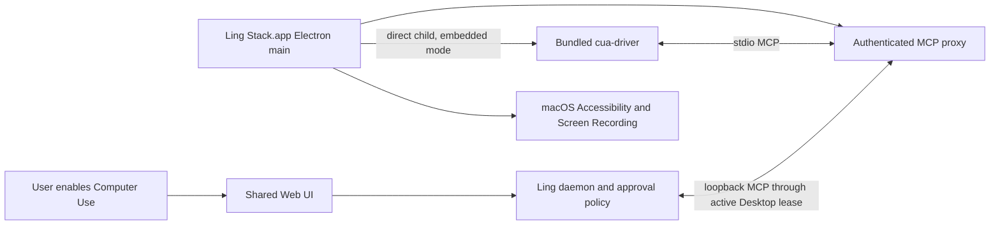

# Bundled Embedded Cua Driver

## Status

Approved design direction for the internal macOS Desktop alpha. Implementation has not
landed yet.

Decision date: 2026-07-17.

The first internal pin is upstream `cua-driver-rs-v0.8.3`. That release is a prerelease,
so it is allowed for internal alpha validation only. Public release remains blocked until
either a stable upstream release passes the same acceptance matrix or the release owner
records an explicit prerelease exception.

Related documents:

- [Bundled Embedded Cua Driver Detailed Design](cua-driver-bundled-embedded-detailed-design.md)
- [Cua Driver Guided Installation](cua-driver-guided-installation.md)
- [Desktop Shell](desktop-shell.md)
- [Desktop Computer Use Picture-in-Picture](desktop-computer-use-picture-in-picture.md)
- [Plugin Manager](plugin-manager.md)
- [Desktop Release Acceptance](../release/desktop.md)
- [Upstream v0.8.3 Embedding Contract](https://github.com/trycua/cua/blob/cua-driver-rs-v0.8.3/libs/cua-driver/rust/Skills/cua-driver/EMBEDDING.md)
- [Upstream v0.8.3 Release](https://github.com/trycua/cua/releases/tag/cua-driver-rs-v0.8.3)
- [Upstream MIT License](https://github.com/trycua/cua/blob/cua-driver-rs-v0.8.3/LICENSE.md)

## Summary

Packaged Ling Desktop on macOS should carry one reviewed Cua Driver build and run it in
the upstream-supported embedded mode. The initial package is upstream `0.8.3` plus one
locked Ling state-isolation patch, shown as `0.8.3 (Ling build 1)`. The Electron main
process owns the child process, macOS attributes Accessibility and Screen Recording
access to `Ling Stack.app`, and the daemon reaches the child through an authenticated
Desktop-owned MCP bridge.

This replaces the previous macOS Desktop default of finding a separately installed
`CuaDriver.app` or `cua-driver` on `PATH`. Users should not have to download, install, or
upgrade a second application before Computer Use works.

The existing external installation flow remains available for:

- source and development builds without packaged provider assets;
- standalone daemon, Web, and CLI use without Ling Desktop;
- an explicit developer override used to test another reviewed driver build.

Windows is not part of this decision. Its current separately installed provider,
allowlist, signing, NSIS, and VM acceptance rules remain unchanged.

## Problem

The current integration bundles only a Ling plugin shell. At runtime it resolves an
external executable from an explicit path, `PATH`, Homebrew locations, or
`/Applications/CuaDriver.app`.

That boundary has three product failures:

1. **Version drift:** the plugin shell version does not prove which native provider will
   execute. Two users on the same Ling build can run different driver behavior.
2. **Installation friction:** a normal user must download another component, understand
   its install location, and distinguish installation state from macOS privacy grants.
3. **Permission fragmentation:** standalone Cua Driver owns a separate TCC identity, so
   the user can see both Ling and Cua Driver in Privacy & Security and may need to grant
   both.

The 2026-07-17 integration audit demonstrated the first failure: a previously installed
Swift `CuaDriver.app` remained at `0.2.0` while the reviewed Rust provider had advanced
to `0.8.3`.

## Decision

Use the official Cua Driver embedded contract introduced in the Rust provider:

```text
CUA_DRIVER_EMBEDDED=1
CUA_DRIVER_HOST_BUNDLE_ID=com.lingstack.desktop
cua-driver mcp
```

The provider must be spawned directly by the Electron main process. It must not be
launched through `open`, `NSWorkspace`, a separately installed `CuaDriver.app`, or the
reusable Ling daemon.



The split is intentional:

- Desktop owns the native artifact, process responsibility chain, permission UX, and
  process cleanup.
- The daemon continues to own plugin enablement, tool discovery, teammate bindings,
  approval policy, calls, audit records, and run snapshots.
- Cua Driver continues to own native AX, capture, input, and agent-cursor behavior.

The bridge does not grant authority. It only transports MCP messages between the daemon
and the Desktop-owned child. Every tool call still passes through the existing daemon
policy and approval path.

## Scope And Platform Matrix

| Runtime shape | Default provider source | User installation | Permission identity |
| --- | --- | --- | --- |
| Packaged macOS Desktop | Bundled embedded `0.8.3 (Ling build 1)` | None | `Ling Stack.app` |
| macOS source/dev Desktop | Bundled dev asset when present; explicit external fallback otherwise | Sometimes | Host app for embedded; external identity for fallback |
| Standalone daemon/Web/CLI on macOS | Explicit external provider | Required | External provider or caller |
| Windows | Existing separately installed reviewed provider | Required under current design | Existing Windows provider model |
| Linux | Out of scope | Out of scope | Out of scope |

Packaged macOS Desktop must never silently fall back from a missing, corrupt, or
incompatible bundled provider to an arbitrary executable on `PATH`. Silent fallback
would reintroduce the compatibility and supply-chain problem this design closes.

## User Experience

### First use

1. Ling Desktop already contains the reviewed provider.
2. The user explicitly enables Computer Use or starts a flow that requires it.
3. Ling explains why Accessibility and Screen Recording are required.
4. macOS permission prompts name Ling Stack, not Cua Driver.
5. After the grants change, Desktop restarts the embedded child and rechecks live capture
   plus Accessibility state.
6. The daemon exposes the synchronized tools only after health and policy checks pass.

Ling must not request these permissions on every application start. A bundled binary is
availability, not consent.

The product records requested enablement separately from effective readiness. If the user
chooses Enable but macOS permissions are still missing, Ling remembers that intent while
keeping provider tools unavailable. After the user grants access and Desktop restarts the
child, activation resumes without a second Enable click.

### Plugin Manager states

Packaged macOS Desktop uses provider states rather than installation states:

| State | User-facing meaning | Primary action |
| --- | --- | --- |
| `included` | Cua Driver is included with this Ling version | Enable |
| `permission_required` | Ling needs macOS privacy grants | Review permissions |
| `ready` | Provider and permissions are ready | Disable |
| `incompatible` | Packaged version or protocol is not accepted | Update or reinstall Ling |
| `corrupt` | Packaged artifact failed integrity/signature checks | Reinstall Ling |
| `desktop_unavailable` | The current surface is not connected to a capable Desktop host | Open Ling Desktop |
| `external_override` | A developer explicitly selected another executable | Review override / restore bundled |

The external installation drawer remains valid only for standalone/dev fallback. It must
not be the default repair action for a damaged packaged Desktop provider.

## Distribution And Version Policy

The initial internal alpha provider is fixed to:

| Field | Value |
| --- | --- |
| Version | `0.8.3` |
| Ling distribution | `ling.1`, displayed as `0.8.3 (Ling build 1)` |
| Upstream tag | `cua-driver-rs-v0.8.3` |
| Tag commit | `0612c26b2c7b8556f6de7f6b4f3927ecac914e4f` |
| Upstream Git tree | `831819eaf2b79c4d81c2b68773cd5920772e91e9` |
| Cargo.lock SHA-256 | `098b0527c35def4fdd1d08e5dd3d1b0d5f5dda9a04b1888ec1bf15b52311c51b` |
| Reference binary asset | `cua-driver-rs-0.8.3-darwin-universal-binary.tar.gz` |
| Reference asset SHA-256 | `a2a29f3ccbd45989819df639d60fa68ac6f28b844f74d7d2b0a1495e4359c6a1` |
| Ling patch | `ling-embedded-state-home-v1`, exact digest required by the provider lock |
| License | MIT, Copyright Cua AI, Inc. |
| Release channel | Internal alpha prerelease |

The upstream binary asset is reference evidence, not the packaged executable. Upstream
`0.8.3` reads user-global Cua configuration, so Ling builds from the exact tag and
`Cargo.lock` with one embedded-only `CUA_DRIVER_STATE_HOME` patch. The release pipeline
must lock that patch and the complete toolchain, then verify the final post-sign helper
seal, architectures, packaged version, exact entitlements, and strict signature/notary
result.

Rules:

- Acquire source and reference evidence, apply the locked patch, and build the provider
  during the controlled build/release workflow, never on a user's machine at runtime.
- Package the executable outside `app.asar` in a versioned provider directory.
- Include the upstream MIT license in the shipped third-party notices.
- Do not invoke or expose Cua Driver's independent updater in the Ling-managed path.
- Advance the provider only through a dedicated reviewed Ling change that updates the
  lock and reruns the provider acceptance matrix.
- Treat the Ling Desktop release as the V1 rollback unit. Rolling back the driver means
  reinstalling the previous accepted Ling build, not switching an unreviewed runtime
  symlink.

## Embedded State Isolation

The bundled provider must not inherit or mutate a separately installed Cua Driver's
`$HOME/.cua-driver/config.json`. Values such as `capture_scope=desktop` and
`max_image_dimension` change privacy and screenshot behavior, so they are part of the
compatibility unit.

Ling build `1` introduces an embedded-only `CUA_DRIVER_STATE_HOME` source patch. Desktop
points it at a versioned directory under Electron `userData`; upgrades and rollbacks keep
separate state roots. The real `HOME` is preserved because Cua Driver still needs the
user's actual applications, browser data, and explicitly selected files. External mode
keeps upstream standalone path semantics, and Ling does not import existing external
configuration automatically.

## Permission Model

Embedded mode keeps the provider inside the host application's macOS responsibility
chain. The expected Privacy & Security entries therefore belong to
`com.lingstack.desktop`.

The Electron main process must:

- request or surface Accessibility access as the host;
- trigger and inspect Screen Recording access as the host;
- spawn `cua-driver` directly with embedded mode enabled;
- restart the child after a grant is added, removed, or changed because TCC answers are
  cached per process;
- require `check_permissions.source.attribution` to report `host` as a runtime sanity
  check.

The reported `host_bundle_id` is advisory metadata, not proof. Signed clean-host
acceptance must still verify the real TCC attribution chain and confirm that only Ling
needs the two grants.

Keeping the same Ling bundle identifier and Developer ID across updates is part of the
compatibility contract. A signing identity change can orphan existing TCC rows and force
the user to grant access again.

## Lifecycle

The embedded provider follows the Desktop application process, not the visibility of the
main window:

- hiding or closing a window does not stop an enabled provider while Ling remains
  running;
- the first authenticated daemon MCP connection lazily starts the child;
- disabling the plugin drains active calls, closes the bridge session, and stops the
  child;
- quitting Desktop terminates the child and expires the daemon lease;
- a Desktop or child crash makes the capability unavailable and never triggers automatic
  external fallback;
- a daemon restart or unexpected MCP session loss stops the old child, rotates the lease
  generation, and publishes one fresh session before tools return;
- a new Desktop instance publishes a new bridge generation before tools become ready.

## Compatibility And Migration

The product-visible plugin id remains `trusted-local:cua-driver` for the first migration
slice even though packaged macOS now prefers an embedded distribution. Renaming the id
would create unnecessary SQLite, API, saved-binding, and UI migration risk.

The fixed logical MCP server id remains `mcp_cua_driver`. Its runtime source is selected
by an explicit distribution mode:

```text
bundled_embedded
external_local
```

Migration rules:

- packaged macOS Desktop selects `bundled_embedded` by default;
- an existing saved external command is retained for audit but is not silently preferred
  over the bundled provider;
- external selection requires an explicit developer override and is visibly labeled;
- disabling or removing the override returns to the packaged provider;
- historical `bundled:cua-driver` shell records remain hidden compatibility data and do
  not create a second product row.

## Security And Privacy Boundaries

- The provider bridge binds only to loopback and requires a per-Desktop-instance secret.
- Endpoint, token, screenshots, AX trees, typed text, and window titles must not be stored
  in ordinary plugin health or product logs.
- The bridge accepts protocol traffic only. Renderers cannot call it directly.
- The daemon remains the only path from agent tool selection to provider execution.
- Read-only Cua Driver tools may retain existing allow defaults; capture, application
  launch, input, configuration mutation, recording, and replay remain approval-gated.
- A bundled provider is not automatically enabled, assigned to teammates, or granted
  macOS permissions.
- The Ling-managed embedded path never invokes or exposes updater/install operations,
  performs background provider downloads, or falls back to unreviewed `PATH` entries.
  Upstream `0.8.3` still contains a standalone CLI updater; direct generic-shell execution
  is outside this provider-integration boundary.

## Alternatives Considered

### Keep the external-only model

Rejected as the packaged macOS default because it preserves version drift, second-app
installation, and fragmented permissions. It remains the fallback for non-Desktop and
development use.

### Bundle and launch `CuaDriver.app`

Rejected. LaunchServices would make Cua Driver its own responsible process, preserving a
second permission identity and defeating the one-grant embedded flow.

### Let the daemon spawn `cua-driver --embedded`

Rejected. Ling may reuse a daemon that was started outside Desktop. The upstream
embedding contract explicitly requires the GUI host that owns the grants to spawn the
child, or to bridge to a child spawned by that host.

### Link the Rust implementation directly into Electron

Deferred. A library integration could remove the process bridge, but it creates a larger
Rust/Node ABI, build, crash-isolation, and upstream-sync surface. The official stdio MCP
embedding path is already sufficient.

### Independently update the embedded component

Deferred. It would need its own signed component manifest, download policy, atomic
activation, rollback, and release evidence. V1 keeps one compatibility unit: Ling
Desktop plus its reviewed provider.

## Non-Goals

- No Windows provider, allowlist, installer, or acceptance changes.
- No Ling-managed runtime download or execution of the public Cua installer.
- No generic native component marketplace or updater.
- No separately launched or separately permissioned `CuaDriver.app` in the packaged
  embedded path.
- No direct renderer-to-provider IPC.
- No bypass around daemon approvals, teammate bindings, run snapshots, or audit.
- No automatic plugin enablement or automatic TCC grant.
- No public-release approval for prerelease `0.8.3` from this design alone.

## Acceptance Criteria

- A packaged macOS build works on a clean machine without a separately installed
  `cua-driver` or `CuaDriver.app`.
- A wrong version earlier on `PATH` does not affect packaged Desktop behavior.
- The packaged child reports upstream `0.8.3`, Ling distribution `ling.1`, embedded mode,
  and host attribution.
- The final post-sign provider seal matches the helper bytes, both architecture CDHashes,
  Ling Team ID, designated requirement, hardened runtime, and exact required entitlements.
- Bundled config read/write and restart touch only the versioned Ling state root; an
  existing external `~/.cua-driver` remains byte-identical.
- macOS prompts and Settings rows identify Ling Stack only.
- Missing, denied, granted, revoked, and post-grant restart states are visible and
  recoverable without reinstalling Cua Driver.
- The daemon can be Desktop-owned or compatibly reused and still reaches the same
  Desktop-owned provider child.
- Restarting the daemon while Desktop remains alive rotates the provider generation and
  completes one new initialize without reusing the old stdio session.
- Disabling the plugin or quitting Desktop stops the child and invalidates its bridge
  lease without stopping unrelated daemon work.
- All Cua Driver tool calls retain the existing approval and audit semantics.
- arm64 and x64 Desktop artifacts contain the locked provider, MIT notice, and release
  identity evidence and pass strict code-signing/notarization checks.
- Every claimed macOS 13, 14, 15, and 26 architecture cell passes signed installed-app
  AX, capture, background input, cursor, restart, and cleanup acceptance. The provider's
  SkyLight SPI dependency is disclosed and no support is inferred from `minos` alone.
- The external installation flow remains usable for standalone/dev mode and is never
  shown as the normal packaged macOS path.

## Unresolved Decisions

There is no unresolved architecture decision for the internal alpha. The selected pin is
`0.8.3`, the provider is Desktop-owned, updates are tied to Ling releases, and external
resolution is an explicit fallback.

Public distribution remains a release decision: require a stable upstream provider or a
recorded prerelease exception backed by the signed clean-host acceptance matrix.
