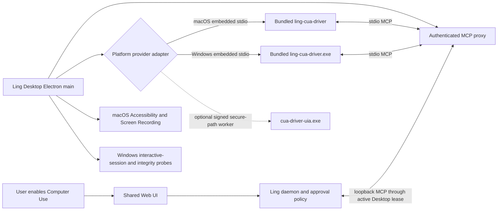

# Bundled Embedded Cua Driver

## Status

### Computer Control product surface (2026-07-30)

This update supersedes the earlier decision that the canonical Cua Driver row is the
normal packaged-Desktop entry point. The runtime identities do not change, but the product
surface does:

- `trusted-local:cua-driver` remains the canonical plugin id used by activation, health,
  approvals, teammate bindings and audit;
- `mcp_cua_driver` remains the logical MCP server id used by tool discovery and execution;
- when `distribution="bundled_embedded"`, neither identity is shown in the ordinary Plugin
  Manager or MCP tool-server settings;
- packaged macOS and Windows Desktop expose one user-facing entry instead:
  **Settings > Device > Computer Control**;
- `external_local` remains a development and standalone compatibility mode and continues
  to use the existing Plugin Manager and MCP surfaces.

The hiding rule is presentation-only. The daemon Catalog, activation routes, MCP tools,
approval records, teammate bindings and audit data remain complete. Deleting or filtering
the underlying records would make the new settings page a second source of truth and would
break existing execution policy.

```text
Settings > Device > Computer Control
  -> canonical trusted-local:cua-driver projection
  -> requested/effective activation transaction
  -> Desktop-owned readiness, lease and child lifetime
  -> hidden mcp_cua_driver execution resource
  -> existing approvals, teammate bindings and audit
```

#### Public Codex reference and boundary

This product split follows the public Codex architecture at fixed commit
[`88ec932e`](https://github.com/openai/codex/commit/88ec932e96e4d18c5701664e726b1c8b18454af1):

- Computer Use is a first-class stable feature rather than a generic MCP preference
  ([feature definition](https://github.com/openai/codex/blob/88ec932e96e4d18c5701664e726b1c8b18454af1/codex-rs/features/src/lib.rs#L1220-L1225));
- Codex internally carries `computer-use@openai-bundled`
  ([bundled discovery](https://github.com/openai/codex/blob/88ec932e96e4d18c5701664e726b1c8b18454af1/codex-rs/core-plugins/src/discoverable.rs#L17-L48));
- the public TUI removes the `openai-bundled` marketplace from the ordinary plugin list
  ([filter and test](https://github.com/openai/codex/blob/88ec932e96e4d18c5701664e726b1c8b18454af1/codex-rs/tui/src/app/background_requests.rs#L994-L1000));
- locked-computer use is governed by a separate policy and is not implied by plugin
  installation
  ([requirements contract](https://github.com/openai/codex/blob/88ec932e96e4d18c5701664e726b1c8b18454af1/codex-rs/config/src/config_requirements.rs#L745-L754)).

The Codex Desktop Settings implementation shown in product screenshots is not in that
public repository. Ling may use the product hierarchy and visual reference, but must not
claim that the Desktop component itself is open source or copy a private API contract.

#### Product visibility

| Runtime condition | Computer Control settings | Plugin Manager | MCP settings |
| --- | --- | --- | --- |
| Packaged Desktop, `bundled_embedded` | Show | Hide canonical Cua row | Hide `mcp_cua_driver` server and its tools |
| Bundled projection loading or failed to load | Keep entry visible; show loading/error and Retry | Keep hidden once packaged capability is authoritative | Keep hidden once packaged capability is authoritative |
| macOS permission missing | Show repair state | Hide | Hide |
| Windows session/readiness unavailable | Show repair state | Hide | Hide |
| User disabled Computer Control | Show as Off | Hide | Hide |
| `external_local` development/standalone mode or explicit developer override | Hide the new entry | Keep existing row and install flow | Keep existing server/tool flow |
| Pure Web, Linux or Desktop without a packaged capability | Hide; deep links fall back to Settings home | Hide bundled internal row; other entries unchanged | Hide bundled internal server/tools; other entries unchanged |

Desktop exposes only a static `packagedBundledCapable` hint and supported platform to the
renderer. The App shell resolves one surface mode from that hint and the canonical setup
projection:

```text
setup external_local                       -> legacy_external
setup bundled + packaged Desktop capability -> computer_control
setup bundled + no Desktop capability       -> hidden_bundled
setup loading/error + packaged hint         -> computer_control loading/error
no setup + no packaged hint                 -> none
```

`computer_control` shows the new page and hides generic rows; `legacy_external` shows only
the legacy rows; `hidden_bundled` shows neither surface; `none` adds nothing. The
projection wins once available, so an explicit developer override atomically switches back
to the legacy entry and cannot produce two management surfaces. A pure Web client that can
observe a bundled daemon projection receives `hidden_bundled`: it does not expose an
unusable Computer Control page or leak the internal provider into generic management.
During loading/error, the packaged hint prevents a one-frame flash of the internal
Plugin/MCP rows. Dynamic enabled, health, permission and readiness state still comes only
from the daemon projection; the hint never claims that the provider is ready.

#### Page structure

The page has five sections:

1. **Computer Control**: requested-state switch, current state, concise recovery action and
   Retry. The switch is checked from `requestedEnabled`, never `effectiveEnabled`.
2. **System readiness**: macOS Accessibility and Screen Recording, or Windows interactive
   session, WGC, D3D11, UIA and declared integrity coverage. Unknown values are shown as
   unknown; the Web UI must not infer platform truth.
3. **Control preview**: the existing PiP auto-show preference moves from Interface
   Preferences. It controls only preview presentation and never enables or disables native
   control.
4. **Privacy**: control while the screen is locked remains fixed Off for the bundled V1
   release. A governed, task-scoped follow-up is defined in
   [Governed Locked Computer Control](locked-computer-control-policy.md) and stays disabled
   until a platform passes its identity, audit, feasibility and security release gates.
   Per-application allowlists are not shown until Ling has an enforceable application
   boundary.
5. **Advanced**: provider display version, Ling build revision, platform, integrity result,
   last check and known Windows limitations. Last check comes from provider health, not the
   time the Catalog response was assembled. Integrity remains Unknown until Desktop's
   authenticated verification result reaches the canonical projection; it is never inferred
   from state or version. The page does not expose install commands, MCP URL, binary path,
   uninstall or an independent updater.

#### Show, hide, disable and close semantics

| User or OS action | Settings page | Requested intent | Effective tools | Provider process |
| --- | --- | --- | --- | --- |
| Leave or close Settings | Hidden with the rest of Settings | Unchanged | Unchanged | Unchanged |
| Hide or close the Ling window while the app remains alive | Unavailable with the window | Unchanged | Unchanged while the interactive session remains valid | Continues under Desktop lifetime |
| Turn the Computer Control switch Off | Remains visible and shows Off | Cleared | Hidden atomically | Drained and stopped |
| Quit Ling Desktop | Closed | Persisted | Hidden when the lease expires/revokes | Stopped with Desktop |
| Lock, suspend, disconnect or switch the interactive session | May be hidden by the OS | Retained | Hidden immediately | Current generation is revoked and stopped |
| Unlock or return to the interactive session | Shows recovery/Ready after refresh | Retained | Restored only after a fresh generation passes readiness | Fresh generation only |

Closing a page or window is therefore never treated as consent to stop an active Computer
Use capability. Only the explicit Off switch clears requested intent. Conversely, PiP
Hide/Close affects only the preview window and never changes Computer Control activation.

### Product-build simplification (2026-07-24)

This update supersedes the earlier audit-grade source-build promotion and Windows evidence
requirements for the internal alpha milestone. Ling keeps a pinned, source-built provider,
but the normal product build is now the authority for internal packaging:

- Cargo and upstream archives retain `cua-driver` / `cua-driver.exe` as provenance names;
- the first Ling-owned distribution copy is renamed to `ling-cua-driver` on macOS and
  `ling-cua-driver.exe` on Windows before final hashing, sealing, signing and packaging;
- packaged runtime resolves only that absolute in-app path and never consults `PATH`,
  Homebrew, `/Applications/CuaDriver.app` or a separately installed Windows provider;
- the source lock retains the upstream commit, Cargo lock, patches 1-4, toolchain versions,
  final SHA-256, License/NOTICE and the existing supervisor/readiness/lifetime contracts;
- A/B reproducibility, promotion proposals/receipts, fixture retention, the Windows matrix
  finalizer and production SmartScreen/WDAC/notary evidence are deferred and are not repeated
  product-build gates. Each platform still needs one reviewed native lock record containing
  its exact pre-sign SHA-256, manifest/tool digest and platform metadata before that platform
  can package; macOS has this record and Windows does not yet;
- macOS arm64 is built and accepted locally first. Windows x64 remains an implementation
  target, while final real-machine acceptance is owned by the Windows team;
- a coexistence smoke is required on both platforms: Ling must start only its private
  provider and must not modify, stop or uninstall a user-managed upstream provider.

The older promotion/evidence material below records prior hardening work. Where it conflicts
with this section, this section is authoritative for the internal product build.

Approved cross-platform design direction for the internal Desktop alpha. Implementation
is in progress. Cross-platform contracts and feature gates, signing feasibility,
activation fencing, the shared Desktop supervisor and the deterministic source-build
pipeline have landed. Process-wide Desktop runtime composition now owns cached typed
handshake authority, tuple rotation and ordered shutdown behind closed gates. The
process-wide platform owner now loads a strict build-carried trust policy from one fixed
resources path, selects exactly one Darwin/Win32 adapter, reuses it across authority
rotation and disposes its observers after the coordinator stops. Transient monitor startup
failure remains unavailable and can recover by replacing the fail-closed coordinator on the
same authority. The gate-off Darwin native
adapter covers Mach-O/code-sign identity, direct-child lifecycle, host-owned TCC readiness
and retrying permission-change monitoring. The landed
Slice 3 daemon-composition sub-slice adds the shared lease-generation broker, fail-closed
startup reset before route binding, first-publish/replacement reconciliation, inert renewal,
and revoke/expiry fencing. Canonical plugin enable/check/disable routes use the atomic
requested/effective activation service; generic MCP mutation routes cannot bypass that
transaction; runner cancellation and server/tool plus activation-revision post-result checks
fence late results. Generic MCP server/tool authority uses persisted monotonic revisions
rather than wall-clock timestamps, and bundled activation adds its requested revision plus
activation epoch, so same-millisecond disable/re-enable ABA is also rejected. Canonical Computer Use run/private-preview
eligibility follows the lease runtime without a package-cache record; and the Catalog
projects requested versus effective state only while exact host-platform authority and a
current Desktop lease remain live. The bundled activation filters
`check_for_update` and `install_ffmpeg`, rejects every unreviewed future tool, and derives
approval levels from Ling's reviewed `0.8.3` policy instead of trusting provider hints.
Explicit revoke reports a durable projection failure as retryable HTTP 503; expiry and new
handshake retirement keep one bounded-backoff projection retry active while the missing
lease hides stale capabilities. The new composition is inert while its
gate is off, leaving the external path unchanged. Desktop now publishes a separate
authenticated, generation/sequence-fenced non-ready availability report. It can remove
authority and durably project `permission_required`, `interactive_session_required` or
`platform_unavailable`, but it cannot claim `ready`; ready still requires a live lease and
the daemon activation CAS. The gate-off Win32 standard adapter covers policy-pinned
identity, state-root protection, direct-child lifecycle and readiness recovery. Opt-in
pre-sign package staging and the Darwin/Win32 native no-replace atomic publisher core are
implemented. The normal macOS/Windows package commands now pass through a governed wrapper:
provider-disabled builds preserve the existing Electron Builder configuration, while an
explicit package authority stages only verified source-build output, generates the fixed
runtime trust policy and one-platform capability document, and wires the signing/seal/
final-verification hooks. Signing context is isolated per packager output and architecture.
The authority is the `lingCuaDriverPackageAuthority` field in packaged `package.json` inside
signed `app.asar`; Electron ASAR integrity binds that intent to the host executable. The
governed config enables `asar`, `enableEmbeddedAsarIntegrityValidation` and
`onlyLoadAppFromAsar` for external-only packages too, so an omitted provider is itself a
signed package decision rather than a loose-file default. Once signed intent says the
provider is present, missing, malformed or digest-mismatched loose capability/policy files
disable runtime but remain bundled-authoritative; packaged Desktop must not silently select
`PATH`, Homebrew or `/Applications/CuaDriver.app`.
The source-build promotion boundary is now implemented as a review-only proposal generator.
It independently reruns the committed verifier for native candidates A and B, rereads the
attestation, manifest, promotion inputs and every stable artifact through bounded snapshots,
requires identical stable digest maps, and emits only a proposed `provider-lock.json` plus
`source-build-promotion-receipt.json`. It never edits checked-in resources, copies native
binaries, changes the non-promoting `source-build-inputs.json`, or claims a signing verdict.
Before either verifier runs it captures the native identity of the canonical output parent.
Publication later requires that same identity under the shared parent lease, writes into a
private identity-checked sibling, and uses the native no-replace atomic publisher; a
symlink, junction, reparse or directory replacement during candidate execution fails closed.
The receipt remains `MANUAL_REVIEW_REQUIRED` because candidate payloads do not themselves
prove independent runner/build-invocation provenance. Each native build job uploads its A/B
evidence first; a dependent same-platform job downloads that immutable artifact, reruns the
fixed verifier and uploads a separate proposal artifact. This closes the CI serialization
boundary without treating the proposal job as independent build provenance.
The V2 bundled setup projection already supplies the state required by the Computer Control
page. Its earlier canonical Plugin Manager renderer is now a compatibility implementation,
not the final packaged-Desktop surface. Bundled mode hides that row and consumes the same
projection in Settings; gate-off and `external_local` responses continue through the legacy
missing/detected/connected/ready UI unchanged.
Production staging authority is fixed to the committed lock/resource root and real
source-build verifier; trust overrides exist only inside the test factory. The native helper
preflights before payload creation,
then production staging and explicit cleanup each hold one cross-process parent lease while
Node runs their ordered output-parent workflow. The holder is also the synchronous native
RPC actor: the process that owns the platform lock performs every native inspect, security,
verification, publish and removal operation, and production exposes no standalone native
mutator that could survive past lease ownership. This strong lifetime guarantee covers
native mutation only; JavaScript `mkdir`, copy and write steps remain in Node, and their
crash residue is recovered by the next lease's unconditional bounded scan/quota. macOS
opens the exact no-link parent directory and applies `flock` directly to that open directory
vnode without creating a `.ling` lock file or a control entry that needs quota exclusion;
Windows derives a
`Global\\LingCuaStage-*` mutex from the parent `FILE_ID`, applies an exact protected
current-user/SYSTEM/Administrators DACL. A Windows waiter already blocked when an owner dies
records `WAIT_ABANDONED`; later acquisition may legitimately omit it because the mutex is
not a persistent crash journal. Clean idle EOF or explicit release drains work and unlocks
normally. Caller death during an RPC leaves the holder locked through that bounded operation
before EOF closes the session; holder death stops the in-process native mutation and the OS
then releases the lock. RPC invalidation kills the holder and waits for actual process exit
before discarding its capability. Payload/quarantine residue remains for unconditional
bounded inspection by the next lease.

Before and after the no-replace publish commit, the helper reopens the canonical parent
path without links and requires it to still identify the held vnode/`FILE_ID`. A replacement
before commit fails without mutation; a replacement detected after rename is ambiguous and
is never reported as committed. The new path is untouched, while any completed rename stays
under the displaced held parent for diagnosis.

After `mkdir`, staging reads the exact native parent/root identities, binds
`secure-private` to both expected identities, and applies/reverifies macOS current-EUID mode
`0700` or the Windows protected current-user/SYSTEM/Administrators DACL. Package staging
binds the child snapshot digest but
does not execute the candidate; version evidence must match the attestation, promotion input
and committed lock. The outer verifier and standalone source-build version probe run inside
an owned process tree: Unix uses validated process-group fencing and Windows uses the native
`KILL_ON_JOB_CLOSE` Job Object path. Darwin invokes the compiled publisher through its held
vnode after a fail-closed preflight probe; standalone calls recheck it afterward and held
RPC sessions recheck it when the lease closes. The payload-free helper build root is
retained for OS temp reclamation rather than deleted by path. Failed pre-commit trees are
retained with bounded count/entries/bytes. After identity capture, their receipts authorize
the identity-bound explicit cleanup API/CLI; an early lease loss may retain only the path.
If a hard exit prevents a receipt or an incomplete receipt lacks identity, the lease-bound
read-only listing API/CLI returns exact native identities and bounded inventory for
subsequent explicit cleanup; it does not harden or delete during discovery. Final removal
is native, handle-relative and
performs a complete bounded deep-tree
preflight before deletion; safe rollback restores a failed quarantine, while an ambiguous
retryable quarantine remains quota-counted. Cleanup can reapply identity-bound private
security when staging failed before hardening; if hardening still fails, only the exact
current-user-owned, no-reparse, empty root may be removed through native
`remove-unsecured-empty`. Cleanup refuses a replaced or non-empty unsafe residue. The real
final-target fixture invokes macOS `--mac dmg zip` and verifies exactly `outer-dmg` plus
`outer-zip`; its Windows form invokes `--win nsis` and verifies exactly `outer-nsis`.
`.blockmap` sidecars are excluded from verified roles. The macOS run proves generated
authority files, the provider and post-seal byte stability inside the final artifacts. The
committed lock still enables no platform
and carries no native binary, so promoted native payloads, release signing, a real
provider-bearing `Ling Stack Setup.exe`, packaged product-state E2E, Windows hosted-runner validation
and real-machine acceptance remain. Both macOS and
Windows artifact jobs now run the full daemon and Pi runner suites rather than a drifting
Computer Use file allowlist, but hosted evidence still must complete. In particular,
this slice has no successful Windows hosted native-helper compile, `Global` parent-mutex/
private-DACL/`WAIT_ABANDONED`, or owned-process runtime execution evidence.

The Windows release-evidence implementation now uses candidate manifest v4, release policy
v3, review/build attestation v2, internal verification v1 and release verification v2.
`produce-windows-acceptance-handoff.mjs` freezes a candidate from clean source and exact
artifact bytes, then atomically emits the policy-bound index, cloned harness repository and
one immutable manifest per required cell. The Full runner accepts only that manifest,
validates pinned Node/PowerShell/Git minimums, installs and verifies the private
provider/seal/catalog tuple plus every vendor-native hash/signature observation, and can end
only at `MANUAL_REVIEW_REQUIRED`. Producer paths fail closed on parent-symlink escape, copied
inventory bytes are rehashed, the standard evidence-kind set is exact, and even failure cleanup
cannot execute an uninstaller whose candidate hash drifted. The matrix
finalizer and profile-aware detached verifiers cap internal evidence at
`INTERNAL_TEST_PASS + releaseReady=false`; production is a separate tuple and candidate.
Hosted PowerShell/runtime execution and Windows-team VM sign-off remain open evidence, not
an architecture or schema gap.

Both Darwin and Win32 packaged-provider production gates remain off. Packaged Desktop
therefore still uses the external provider path until its platform-specific runtime and
signed package satisfy the completion gates in the implementation plan.

This is not `bundled_embedded` completion: an external installation such as
`/Applications/CuaDriver.app` must not be removed while the active `external_local` path
still resolves through it.

The Windows production Publisher and signing service are release inputs, not prerequisites
for implementing the bundled provider. Internal implementation closes with a real
Authenticode-signed `test_signed_internal` candidate and a non-promotable
`INTERNAL_TEST_PASS`; public release still requires a separately produced
`production_signed` candidate.

Decision date: 2026-07-17.

Delivery matrix decision update: 2026-07-23.

- macOS ships Apple Silicon `arm64` only. Intel Mac and a universal application/provider
  binary are out of scope.
- Windows ships `x64` only. Windows ARM64 is out of scope; Windows implementation remains
  in Ling scope, while real-machine acceptance is owned by the Windows team.
- Linux is unsupported and must continue to fail closed.
- The private development repository does not enable application auto-update. The package
  layout nevertheless keeps the macOS ZIP and Windows blockmap/update-metadata contract so
  a future public repository can use GitHub Releases without changing installer identity.
- User-facing release files are `Ling-Stack-<version>-macos-arm64.dmg`,
  `Ling-Stack-<version>-windows-x64-setup.exe`, and `checksums.txt`. The macOS ZIP,
  `latest-mac.yml`, Windows blockmap, and `latest.yml` are updater assets rather than a
  second user-facing platform matrix.

The first internal pin is upstream `cua-driver-rs-v0.8.3`. That release is a prerelease,
so it is allowed for internal alpha validation only. Public release remains blocked until
either a stable upstream release passes the same acceptance matrix or the release owner
records an explicit prerelease exception.

Related documents:

- [Bundled Embedded Cua Driver Detailed Design](cua-driver-bundled-embedded-detailed-design.md)
- [Bundled Embedded Cua Driver Implementation Plan](cua-driver-bundled-embedded-implementation-plan.md)
- [Cua Driver Guided Installation](cua-driver-guided-installation.md)
- [Desktop Shell](desktop-shell.md)
- [Desktop Computer Use Picture-in-Picture](desktop-computer-use-picture-in-picture.md)
- [Plugin Manager](plugin-manager.md)
- [Desktop Release Acceptance](../release/desktop.md)
- [Upstream v0.8.3 Embedding Contract](https://github.com/trycua/cua/blob/cua-driver-rs-v0.8.3/libs/cua-driver/rust/Skills/cua-driver/EMBEDDING.md)
- [Upstream v0.8.3 Release](https://github.com/trycua/cua/releases/tag/cua-driver-rs-v0.8.3)
- [Upstream MIT License](https://github.com/trycua/cua/blob/cua-driver-rs-v0.8.3/LICENSE.md)

## Summary

Packaged Ling Desktop on macOS and Windows should carry one reviewed Cua Driver build and
run it as a Desktop-owned provider. The initial package is upstream `0.8.3` plus one
locked Ling managed-embedding patch series, shown as `0.8.3 (Ling build 1)`. The Electron main
process owns the provider lifecycle, and the daemon reaches it through an authenticated
Desktop-owned MCP bridge.

On macOS, Desktop uses the upstream embedded stdio contract so Accessibility and Screen
Recording are attributed to `Ling Stack.app`. On Windows, Desktop uses the same embedded
stdio mode for the shipped main `ling-cua-driver.exe`, verifies that it is running in the same
interactive user session, and fails closed in Session 0 or on a non-interactive desktop.
The initial Windows user package contains only the main `ling-cua-driver.exe`. The upstream
`cua-driver-uia.exe` output is retained as a source-build/audit artifact, not copied into
the per-user package. It becomes a separately signed secure-path capability only if the
future UIAccess slice defines its installer, launch, routing, and shutdown contract.

This replaces the packaged Desktop default of finding a separately installed
`CuaDriver.app`, `cua-driver.exe`, or `cua-driver` on `PATH`. Users should not have to
download, install, or upgrade a second provider before standard Computer Use works.

On Windows, `Ling Stack Setup.exe` remains the only installer. It carries the versioned
`ling-cua-driver.exe` as a private Ling application resource and extracts it beneath Ling's
installed `resources/providers/.../payload/` tree. Cua Driver is not registered as a
second product, added to `PATH`, exposed through a Start-menu entry, installed as a
Windows service, or given an independent uninstaller or updater.

The existing external installation flow remains available for:

- source and development builds without packaged provider assets;
- standalone daemon, Web, and CLI use without Ling Desktop on either platform;
- an explicit developer override used to test another reviewed driver build.

## Problem

The current integration bundles only a Ling plugin shell. At runtime it resolves an
external executable from an explicit path, `PATH`, Homebrew locations, or
`/Applications/CuaDriver.app`.

That boundary has three product failures:

1. **Version drift:** the plugin shell version does not prove which native provider will
   execute. Two users on the same Ling build can run different driver behavior.
2. **Installation friction:** a normal user must download another component, understand
   its install location, and distinguish installation state from platform readiness.
3. **Platform fragmentation:** macOS can show two TCC identities, while Windows can run a
   provider from the wrong interactive session or an incompatible integrity level.

The 2026-07-17 integration audit demonstrated the first failure: a previously installed
Swift `CuaDriver.app` remained at `0.2.0` while the reviewed Rust provider had advanced
to `0.8.3`.

## Decision

Use the official Cua Driver embedded contract introduced in the Rust provider:

```text
CUA_DRIVER_EMBEDDED=1
CUA_DRIVER_HOST_BUNDLE_ID=com.lingstack.desktop
ling-cua-driver mcp --embedded --host-bundle-id com.lingstack.desktop
```

The executable token above is the Ling distribution name; the upstream source/build output
remains `cua-driver` / `cua-driver.exe`. The exact argv is locked on both platforms. The
matching environment values are also set explicitly and must agree with the flags; changing
either form requires a provider-lock update and compatibility rerun.

The provider must be spawned directly by the Electron main process. It must not be
launched through `open`, `NSWorkspace`, a separately installed `CuaDriver.app`, or the
reusable Ling daemon.

Windows signs and installs that private helper as part of the Ling artifact tuple. The
presence of a PE in a CI temporary directory is not bundled delivery: the final Setup
payload, installed private path, runtime-resolved absolute path, and cleanup on Ling
uninstall must all bind to the same candidate.



The split is intentional:

- Desktop owns the native artifacts, platform process/session boundary, readiness UX,
  and process cleanup.
- The daemon continues to own plugin enablement, tool discovery, teammate bindings,
  approval policy, calls, audit records, and run snapshots.
- Cua Driver continues to own native AX, capture, input, and agent-cursor behavior.

The bridge does not grant authority. It only transports MCP messages between the daemon
and the Desktop-owned child. Every tool call still passes through the existing daemon
policy and approval path.

## Scope And Platform Matrix

| Runtime shape | Default provider source | User installation | Permission identity |
| --- | --- | --- | --- |
| Packaged macOS Desktop | Bundled embedded `0.8.3 (Ling build 1)` | None | `Ling Stack.app` |
| macOS source/dev Desktop | Bundled dev asset when present; explicit external fallback otherwise | Sometimes | Host app for embedded; external identity for fallback |
| Standalone daemon/Web/CLI on macOS | Explicit external provider | Required | External provider or caller |
| Packaged Windows Desktop | Bundled embedded `0.8.3 (Ling build 1)` x64 main provider | None for standard Medium-IL targets | Same interactive user session as Ling Desktop |
| Windows source/dev Desktop | Bundled dev asset when present; explicit external fallback otherwise | Sometimes | Host session for embedded; external provider for fallback |
| Standalone daemon/Web/CLI on Windows | Explicit external provider | Required | External provider session/integrity model |
| Linux | Out of scope | Out of scope | Out of scope |

Packaged Desktop must never silently fall back from a missing, corrupt, incompatible, or
wrong-session bundled provider to an arbitrary executable on `PATH`. Silent fallback
would reintroduce the compatibility and supply-chain problem this design closes.

The initial Windows per-user package remains `asInvoker` and therefore supports the
ordinary interactive Medium-IL desktop lane. Elevated windows and UWP pixel/SendInput
automation require a valid UIAccess helper launched through ShellExecute from a secure
location. The initial bundled LocalAppData target does not satisfy that contract, so V1 exposes
an explicit `standard` integrity-coverage state instead of claiming full UIAccess parity.

## User Experience

### First use

1. Ling Desktop already contains the reviewed provider.
2. The user opens **Settings > Device > Computer Control** and explicitly turns it on, or
   an authorized flow links to that page when the capability is Off. Turning it on records
   intent only and never opens an OS permission prompt.
3. On macOS, Ling explains why Accessibility and Screen Recording are required and the
   user separately clicks **Grant access**.
4. Only that explicit Grant access action may trigger macOS permission prompts. They name
   Ling Stack, not Cua Driver.
5. On Windows, Ling verifies an interactive session, unlocked input desktop, WGC/UIA
   readiness, and the active integrity-coverage level; it does not show a permission
   prompt that Windows does not have.
6. After a macOS grant changes, Desktop restarts the embedded child and rechecks live
   capture plus Accessibility state.
7. The daemon exposes the synchronized tools only after health and policy checks pass.

On macOS, Ling must not request these permissions on every application start. A bundled
binary is availability, not consent.

The product records requested enablement separately from effective readiness. If the user
chooses Enable but macOS permissions are still missing, Ling remembers that intent while
keeping provider tools unavailable. After the user grants access and Desktop restarts the
child, activation resumes without a second Enable click.

### Computer Control settings states

Packaged Desktop uses provider states rather than installation states:

| State | User-facing meaning | Primary action |
| --- | --- | --- |
| `included` | Computer Control is included with this Ling version and is Off or waiting to start | Turn on / Retry |
| `permission_required` | Ling needs macOS privacy grants | Grant access / Open System Settings |
| `interactive_session_required` | Ling is not attached to an unlocked interactive desktop | Unlock or return to the user desktop / Retry |
| `platform_unavailable` | Windows standard UIA or WGC/D3D readiness probe failed | Restart/update Ling or Windows; inspect support bundle |
| `ready` | Computer Control is On and platform readiness checks pass | Turn off / Recheck |
| `incompatible` | Packaged version or protocol is not accepted | Update or reinstall Ling |
| `corrupt` | Packaged artifact failed integrity/signature checks | Reinstall Ling |
| `desktop_unavailable` | The current surface is not connected to a capable Desktop host | Open Ling Desktop |
| `external override` | Development mode selected another executable | Use the legacy Plugin Manager entry |

Windows standard-tier readiness still reports `providerState=ready`. The setup detail
adds `integrityCoverage="standard"` and structured limitations
`["elevated_pixel_input", "uwp_send_input"]`; these are capability details/badges, not a
second non-ready provider state.

The external installation drawer remains valid only for standalone/dev fallback. It must
not be the default repair action for a damaged packaged Desktop provider on either OS.

The switch remains visually On during `permission_required`,
`interactive_session_required`, `platform_unavailable` and `desktop_unavailable` when
`requestedEnabled=true`. These are waiting or repair states, not evidence that the user's
intent was lost. Temporary request busy/error UI may overlay the state, but it must never
replace the daemon projection with a second local state machine.

## Distribution And Version Policy

The initial internal alpha provider is fixed to:

| Field | Value |
| --- | --- |
| Version | `0.8.3` |
| Ling distribution | `ling.1`, displayed as `0.8.3 (Ling build 1)` |
| Upstream tag | `cua-driver-rs-v0.8.3` |
| Tag commit | `0612c26b2c7b8556f6de7f6b4f3927ecac914e4f` |
| Upstream Git tree | `831819eaf2b79c4d81c2b68773cd5920772e91e9` |
| Cargo.lock SHA-256 | `098b0527c35def4fdd1d08e5dd3d1b0d5f5dda9a04b1888ec1bf15b52311c51b` |
| macOS reference asset | `cua-driver-rs-0.8.3-darwin-universal-binary.tar.gz` |
| macOS reference SHA-256 | `a2a29f3ccbd45989819df639d60fa68ac6f28b844f74d7d2b0a1495e4359c6a1` |
| Windows reference asset | `cua-driver-rs-0.8.3-windows-x86_64.zip` |
| Windows reference size / SHA-256 | `10,585,087` / `6acdc84b98629fcd0be2368cc16565c18d5f21d9dedd4e10fdb6f58547fce9d0` |
| Windows reference binaries | `cua-driver.exe` `3cc33572…8cee`; `cua-driver-uia.exe` `1b35a27d…ca1c` |
| Ling patch series | `ling-managed-embedded-v1`, including isolated state, managed readiness, and structured Windows capability errors; exact digest required by the provider lock |
| License | MIT, Copyright Cua AI, Inc. |
| Release channel | Internal alpha prerelease |

### Windows signing and promotion tiers

`bundled_embedded` answers where the provider is installed and who owns its lifecycle.
`signingTier` answers which trust and promotion rules apply. They are orthogonal: a
test-signed helper inside `Ling Stack Setup.exe` is a genuinely bundled implementation,
even though it is not a public-release artifact.

| `signingTier` | `distributionChannel` | Use | Bundled status | Highest verdict |
| --- | --- | --- | --- | --- |
| `unsigned_dev` | `development` | Local/pre-sign engineering only | May be physically in a dev package, but is not a trusted acceptance candidate | No promotion verdict |
| `test_signed_internal` | `internal` | Automated Windows CI and isolated internal Windows QA | Fully bundled and installed by Ling | `INTERNAL_TEST_PASS`; `releaseReady=false` |
| `production_signed` | `production` | Public-release evaluation | Fully bundled and installed by Ling | May enter `MANUAL_REVIEW_REQUIRED`; only complete production gates may yield `RELEASE_PASS` and `releaseReady=true` |

The `standard` / future `uiaccess` capability tiers are separate from this signing table.
No capability tier can raise a candidate's signing or promotion tier.

The candidate records `signingTier` and `distributionChannel`, but they are not trusted
self-assertions. An independent verifier derives the effective tier from the exact
tier-governed tuple—installer, installed Ling main PE, trusted uninstaller, private
`cua-driver.exe`, and signed-tier catalog—and the channel policy. Internal/production
tuples fail closed on mixed/double signatures, a test root in production, an unsigned
governed member, or any unexpected member in the private provider payload. A
development tuple is valid only when every expected governed PE is derived as
`unsigned_dev`, the catalog is absent, and the compile-time dev gate is active. Electron
vendor DLLs outside the private provider payload retain the existing package/signing policy
and a separate normalized hash/signer inventory; this design does not silently enable
`signDlls` or treat them as Ling tier members.
The candidate also records the clean pre-sign payload digest and tier-specific final
artifact digests. Production signing starts again from the approved clean pre-sign
payload; it must never overwrite, append to, or promote a test-signed PE.

`test_signed_internal` uses real Authenticode signatures, not a fake `signed=true` flag.
Its trust anchor is provisioned outside Ling only into disposable CI machines or dedicated,
isolated internal QA machines. `ephemeral-ci` trust is removed after each job or the VM is
reverted; `managed-internal` trust may persist only in a dedicated isolated QA image/VM
under an external PKI lifecycle and never enters a general developer image, product or
production chain. Ling Setup never carries a test root or PFX, never installs a certificate,
and never expands the user's trust store. This tier proves package, integrity, lifecycle,
MCP and functional behavior only. It does not establish public Publisher identity,
SmartScreen reputation, WDAC/App Control allowability, or release readiness.

The upstream binary assets are reference evidence, not the packaged executables. Upstream
`0.8.3` reads user-global Cua configuration, so Ling builds both platforms from the exact
tag and `Cargo.lock` with the reviewed `ling-managed-embedded-v1` patch series. The release
pipeline must lock that patch series and each platform toolchain, then verify
platform-specific final identity seals. macOS evidence uses Mach-O slices, entitlements,
Developer ID and notary;
Windows signed standard-tier evidence uses the final main PE hash/manifest/derived
Authenticode identity and a policy-pinned Ling-signed resource catalog outside the covered
payload. The catalog covers the main PE plus `provider-seal.json`; that covered seal
anchors the provider-lock digest. `unsigned_dev` explicitly omits the catalog.
Installed path and the signed app/NSIS tuple remain release evidence. The UIAccess PE
remains audit-only until its conditional secure-helper release slice lands.

Rules:

- Acquire source and reference evidence, apply the locked patch series, and build the provider
  during the controlled build/release workflow, never on a user's machine at runtime.
- Package the platform executables outside `app.asar` in a versioned provider directory.
- Include the upstream MIT license in the shipped third-party notices.
- Do not invoke or expose Cua Driver's independent updater in the Ling-managed path.
- Advance the provider only through a dedicated reviewed Ling change that updates the
  lock and reruns the provider acceptance matrix.
- Treat the Ling Desktop release as the V1 rollback unit. Rolling back the driver means
  reinstalling the previous accepted Ling build, not switching an unreviewed runtime
  symlink.

## Embedded State Isolation

The bundled provider must not inherit or mutate a separately installed Cua Driver's
`$HOME/.cua-driver/config.json` or `%USERPROFILE%\.cua-driver\config.json`. Values such as
`capture_scope=desktop` and
`max_image_dimension` change privacy and screenshot behavior, so they are part of the
compatibility unit.

Ling build `1` introduces an embedded-only `CUA_DRIVER_STATE_HOME` source patch. Desktop
points it at a versioned directory under Electron `userData` on both platforms; upgrades
and rollbacks keep separate state roots. The real home/profile remains available because
Cua Driver still needs the user's actual applications, browser data, and explicitly
selected files. External mode keeps upstream standalone path semantics, and Ling does not
import existing external configuration automatically.

## Permission Model

Embedded mode keeps the provider inside the host application's macOS responsibility
chain. The expected Privacy & Security entries therefore belong to
`com.lingstack.desktop`.

The Electron main process must:

- request or surface Accessibility access as the host;
- trigger and inspect Screen Recording access as the host;
- spawn `ling-cua-driver` directly with embedded mode enabled;
- restart the child after a grant is added, removed, or changed because TCC answers are
  cached per process;
- require `check_permissions.source.attribution` to report `host` as a runtime sanity
  check.

The reported `host_bundle_id` is advisory metadata, not proof. Signed clean-host
acceptance must still verify the real TCC attribution chain and confirm that only Ling
needs the two grants.

Keeping the same Ling bundle identifier and Developer ID across updates is part of the
compatibility contract. A signing identity change can orphan existing TCC rows and force
the user to grant access again.

### Windows session and integrity model

Windows has no equivalent per-app TCC grant. Readiness is instead bound to the logged-in
interactive session, input desktop, WGC/D3D availability, target integrity and optional
UIAccess worker.

The Electron main process must:

- spawn `ling-cua-driver.exe` directly in the same interactive user session;
- reject Session 0, a locked/non-default input desktop, or a provider whose session id
  differs from the Desktop host;
- after MCP initialize, request locked no-content managed readiness from that same active
  embedded child over its current stdio session; require exact host/child PID, memory-only
  child nonce, session, Medium integrity, Job Object, input-desktop, UIA runtime and
  D3D11/WGC identity because a one-shot probe and upstream `session_active` cannot prove
  the long-lived provider is safe;
- treat lock, disconnect, logoff, fast-user-switch, session mismatch, non-default input
  desktop or readiness-heartbeat expiry as an immediate lease/call-gate revocation;
  unlock is only a recovery hint and must create a fresh child/generation before tools
  return;
- report `standard` integrity coverage for the initial bundled per-user/asInvoker target;
- report structured limitations for UIAccess-only actions instead of projecting a failed
  provider state;
- treat `cua-driver-uia.exe` as unavailable unless a future helper artifact's final seal,
  Authenticode identity, secure installed path, ShellExecute launch, exact PID and live
  UIAccess probe all pass.

The standard package does not contain `cua-driver-uia.exe`. A CI audit output does not
imply that elevated/UWP pixel input is supported. No environment policy override such as
`EnableSecureUIAPaths=0` may be required on customer machines.

## Lifecycle

The embedded provider follows the Desktop application process, not the visibility of the
main window:

- hiding or closing a window does not stop an enabled provider while Ling remains
  running;
- the first authenticated daemon MCP connection lazily starts the provider process group;
- disabling the plugin drains active calls, closes the bridge session, and stops that
  process group;
- quitting Desktop terminates the process group and expires the daemon lease;
- on Windows, the Rust child owns a non-inheritable `KILL_ON_JOB_CLOSE` Job Object and
  Desktop terminates only through the retained child-process handle; managed production
  mode never reconstructs a process tree from a numeric PID or calls `taskkill /T`;
- Windows lock/session/input-desktop invalidation closes the call gate, revokes the lease,
  atomically hides tools, stops the old generation and retains requested enablement for a
  fresh post-unlock probe;
- a Desktop or provider-process crash makes the capability unavailable and never triggers automatic
  external fallback;
- a daemon restart or unexpected MCP session loss stops the old provider generation, rotates the lease
  generation, and publishes one fresh session before tools return;
- a new Desktop instance receives a daemon-issued instance epoch, starts its local
  generation at `1`, and fences the prior instance before tools become ready.

## Compatibility And Migration

The canonical internal plugin id remains `trusted-local:cua-driver` for the first migration
slice even though packaged Desktop now prefers an embedded distribution. Renaming the id
would create unnecessary SQLite, API, saved-binding, approval and audit migration risk.
In bundled mode the id is not product-visible; the user-facing name is Computer Control.

The fixed logical MCP server id remains `mcp_cua_driver`. Its runtime source is selected
by an explicit distribution mode:

```text
bundled_embedded
external_local
```

Migration rules:

- packaged macOS and Windows Desktop select `bundled_embedded` by default;
- an existing saved external command is retained for audit but is not silently preferred
  over the bundled provider;
- external selection requires an explicit developer override and is visibly labeled;
- disabling or removing the override returns to the packaged provider;
- bundled mode filters the canonical Cua row only at Plugin Manager presentation and
  filters `mcp_cua_driver` only at MCP Settings presentation; shared domains, teammate
  binding lists, runtime tool catalogs, approvals and audit retain the records;
- external mode preserves the legacy Plugin Manager and MCP settings entries;
- historical `bundled:cua-driver` shell records remain hidden compatibility data and do
  not create a second product row.

## Security And Privacy Boundaries

- The provider bridge binds only to loopback and requires a per-Desktop-instance secret.
- Endpoint, token, screenshots, AX trees, typed text, and window titles must not be stored
  in ordinary plugin health or product logs.
- The bridge accepts protocol traffic only. Renderers cannot call it directly.
- The daemon remains the only path from agent tool selection to provider execution.
- Read-only Cua Driver tools may retain existing allow defaults; capture, application
  launch, input, configuration mutation, recording, and replay remain approval-gated.
- A bundled provider is not automatically enabled, assigned to teammates, or granted
  macOS permissions.
- Bundled V1 never controls a locked computer. Lock/suspend/session invalidation closes the
  call gate, revokes the current generation and retains requested intent for a fresh
  post-unlock readiness pass. The optional follow-up cannot replace this behavior until the
  per-platform gates in [Governed Locked Computer Control](locked-computer-control-policy.md)
  pass; failure or unknown capability always preserves this baseline.
- The Ling-managed embedded path never invokes or exposes updater/install operations,
  performs background provider downloads, or falls back to unreviewed `PATH` entries.
  Upstream `0.8.3` still contains a standalone CLI updater; direct generic-shell execution
  is outside this provider-integration boundary.

## Alternatives Considered

### Keep the external-only model

Rejected as the packaged Desktop default because it preserves version drift, second-app
installation, fragmented permissions, and Windows session drift. It remains the fallback
for non-Desktop and development use.

### Bundle and launch `CuaDriver.app`

Rejected. LaunchServices would make Cua Driver its own responsible process, preserving a
second permission identity and defeating the one-grant embedded flow.

### Let the daemon spawn `cua-driver --embedded`

Rejected. Ling may reuse a daemon that was started outside Desktop. The upstream
embedding contract explicitly requires the GUI host that owns the grants to spawn the
child, or to bridge to a child spawned by that host.

On Windows the same ownership rule prevents a reused service/Session-0 daemon from
silently becoming the native provider host.

### Make the whole Windows app per-machine only

Deferred for V1. Installing all of Ling under `Program Files` would satisfy the UIAccess
secure-path requirement but would add UAC, updater, uninstall and enterprise policy cost
for every Windows user. The initial bundled lane keeps the existing per-user/asInvoker
Desktop contract and reports standard integrity coverage. A separately signed per-machine
Computer Use helper artifact is the preferred future path if full elevated/UWP pixel-input
parity becomes a release requirement.

### Link the Rust implementation directly into Electron

Deferred. A library integration could remove the process bridge, but it creates a larger
Rust/Node ABI, build, crash-isolation, and upstream-sync surface. The official stdio MCP
embedding path is already sufficient.

### Independently update the embedded component

Deferred. It would need its own signed component manifest, download policy, atomic
activation, rollback, and release evidence. V1 keeps one compatibility unit: Ling
Desktop plus its reviewed provider.

## Non-Goals

- No claim that the initial bundled per-user Windows target can drive elevated/UWP targets that
  require UIAccess pixel or SendInput injection.
- No Windows ARM64 provider in the first bundled release.
- No Ling-managed runtime download or execution of the public Cua installer.
- No generic native component marketplace or updater.
- No separately launched or separately permissioned `CuaDriver.app` in the packaged
  embedded path.
- No direct renderer-to-provider IPC.
- No bypass around daemon approvals, teammate bindings, run snapshots, or audit.
- No automatic plugin enablement or automatic TCC grant.
- No public-release approval for prerelease `0.8.3` from this design alone.

## Acceptance Criteria

- Packaged macOS and Windows builds work on clean machines for their declared capability
  tier without a separately installed Cua Driver.
- A wrong version earlier on `PATH` does not affect packaged Desktop behavior.
- The packaged main provider reports upstream `0.8.3`, Ling distribution `ling.1` and
  embedded mode. macOS additionally proves host attribution; Windows proves exact
  interactive session and PID/path identity.
- The macOS post-sign seal matches helper bytes, both architecture CDHashes, Ling Team ID,
  designated requirement, hardened runtime and exact entitlements. The Windows standard
  seal matches the final main PE hash, manifest, derived signing tier, channel-pinned
  Authenticode subject/certificate digest and tier-appropriate timestamp policy. Signed
  tiers use a signed catalog that binds the main PE and seal without self-reference, and
  the covered seal binds the provider lock.
- Bundled config read/write and restart touch only the versioned Ling state root; existing
  external macOS home and Windows profile Cua state remain byte-identical.
- macOS prompts and Computer Control settings identify Ling Stack only.
- Missing, denied, granted, revoked, and post-grant restart states are visible and
  recoverable without reinstalling Cua Driver.
- The daemon can be Desktop-owned or compatibly reused and still reaches the same
  Desktop-owned provider generation.
- Restarting the daemon while Desktop remains alive rotates the provider generation and
  completes one new initialize without reusing the old stdio session.
- Disabling the plugin or quitting Desktop stops the provider process group and invalidates its bridge
  lease without stopping unrelated daemon work.
- All Cua Driver tool calls retain the existing approval and audit semantics.
- macOS arm64 and Windows x64 Desktop artifacts contain the locked provider, MIT
  notice and platform release-identity evidence; each passes its applicable signing and
  packaging checks.
- Every claimed macOS 13, 14, 15, and 26 architecture cell passes signed installed-app
  AX, capture, background input, cursor, restart, and cleanup acceptance. The provider's
  SkyLight SPI dependency is disclosed and no support is inferred from `minos` alone.
- Bundled Cua Driver is absent from ordinary Plugin Manager and MCP Settings presentation,
  while its MCP tools, teammate bindings, approval path and audit records remain usable.
- The external installation flow remains usable for standalone/dev mode and is never shown
  as the normal packaged Desktop path.
- Pure Web, Linux and external-only Desktop do not show the Computer Control navigation;
  unsupported deep links fall back safely to Settings home.
- Turning the page or window visibility off never disables Computer Control; only the
  explicit Off switch clears requested intent. Locking the computer always suspends
  effective capability and requires a fresh generation after unlock.
- `Ling Stack Setup.exe` is the only Windows installer and the installed Electron process
  spawns the exact private versioned provider path; no second product, PATH entry, service,
  independent updater/uninstaller or runner-temp provider satisfies this criterion.
- Windows x64 standard packages contain the locked source-built and Ling-renamed
  `ling-cua-driver.exe`,
  license/notices, and no runtime downloader, public installer, or UIAccess helper. Signed
  internal/production tiers also contain the signed resource catalog; the explicit
  `unsigned_dev + development` package omits it. CI retains the UIAccess build only as
  audit evidence.
- Windows activation rejects Session 0, a non-interactive/locked input desktop, wrong
  active-child PID/nonce/session/integrity, invalid PE/seal or applicable
  signature/catalog, missing Job Object lifetime isolation, or failed no-content
  UIA-runtime/WGC-D3D capability probes.
- A ready Windows generation becomes unavailable immediately on lock, disconnect,
  fast-user-switch or input-desktop change. Unlock never reuses the old child, readiness
  result or lease; only a fresh initialized generation can restore tools.
- Graceful-stop timeout terminates the retained child handle; closing the provider-owned
  Job Object removes every descendant. Main-child, grandchild, Desktop-crash and repeated
  restart tests prove zero process/pipe residue without a PID-only kill.
- The initial bundled per-user candidate reports `standard` integrity coverage and returns a
  structured `cua_windows_uiaccess_required` capability error for elevated/UWP
  pixel/SendInput cases instead of silently claiming success or parsing error copy.
- Ling-owned automated Windows CI must cover native readiness fixtures before handoff,
  test-certificate PE/catalog signing, Electron Builder hook order, embedded stdio/global
  pipe conflicts, Job Object cleanup, PowerShell verifier failures, package allowlists,
  silent install/uninstall and test-owned Win32/MSIX targets.
- A `test_signed_internal` Setup candidate installed from its final artifact, exercised by
  the Windows acceptance owner, and passing the automated/native, package, MCP, Job Object,
  install/update/uninstall and declared standard-capability matrix may close bundled
  implementation with `INTERNAL_TEST_PASS`. That verdict always keeps
  `releaseReady=false` and production-trust blockers visible.
- The Windows handoff bundle gives the acceptance owner one manifest-driven command per
  required build/display/DPI cell plus an immutable matrix finalizer for signed
  installed-app/NSIS, WGC, Narrator/NVDA, lifecycle, upgrade/rollback and residue
  validation; the production profile additionally carries SmartScreen and claimed WDAC
  evidence. Ling implementation ownership ends at producing and automating that bundle;
  Windows colleagues own profile-specific real-machine verdict evidence.
- Only a separately generated `production_signed + production` candidate may enter public
  promotion. It must prove the production Publisher and certificate policy, RFC 3161
  timestamp requirements, candidate/time/VM-bound SmartScreen observations, any claimed
  WDAC policy id/version/hash/enforcement mode, external attestations, and the full release
  matrix before `RELEASE_PASS` / `releaseReady=true` is possible. Authenticode
  `Status=Valid` alone proves none of those production-trust surfaces.

## Unresolved Decisions

There is no unresolved architecture decision for the internal standard-capability alpha.
The selected pin is `0.8.3`, both platform providers are Desktop-owned, updates are tied
to Ling releases, external resolution is an explicit fallback, bundled identities are
hidden from ordinary Plugin/MCP settings, and the unique product entry is
Settings > Device > Computer Control. Pure Web/Linux hide that entry and V1 locked-screen
control is fixed Off.

Public distribution remains a release decision: require a stable upstream provider or a
recorded prerelease exception backed by the signed clean-host acceptance matrix.

The production Windows Publisher legal name, certificate service, SmartScreen evidence
and any WDAC policy are also release inputs. Deferring them blocks only
`production_signed` promotion; it does not block implementation, packaging, or
`test_signed_internal` functional acceptance.

One Windows capability decision remains deliberately separate: whether a future release
must support UIAccess-only elevated/UWP pixel input. If yes, the release owner must approve
a signed secure-path installation strategy, preferably a separate per-machine Computer Use
helper artifact. Deferring it does not block standard Windows bundled support, but it blocks
any claim of full integrity-level parity.
