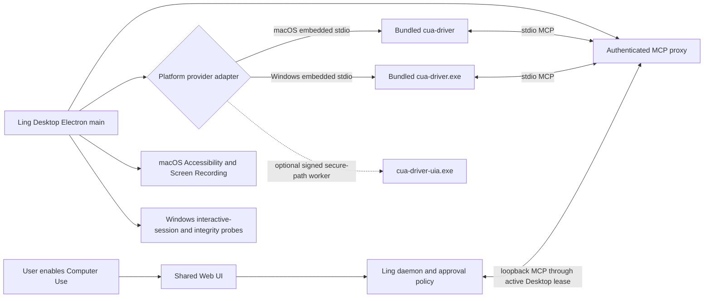

# Bundled Embedded Cua Driver

## Status

Approved cross-platform design direction for the internal Desktop alpha. Implementation
has not landed yet.

Decision date: 2026-07-17.

The first internal pin is upstream `cua-driver-rs-v0.8.3`. That release is a prerelease,
so it is allowed for internal alpha validation only. Public release remains blocked until
either a stable upstream release passes the same acceptance matrix or the release owner
records an explicit prerelease exception.

Related documents:

- [Bundled Embedded Cua Driver Detailed Design](cua-driver-bundled-embedded-detailed-design.md)
- [Bundled Embedded Cua Driver Implementation Plan](cua-driver-bundled-embedded-implementation-plan.md)
- [Cua Driver Guided Installation](cua-driver-guided-installation.md)
- [Desktop Shell](desktop-shell.md)
- [Desktop Computer Use Picture-in-Picture](desktop-computer-use-picture-in-picture.md)
- [Plugin Manager](plugin-manager.md)
- [Desktop Release Acceptance](../release/desktop.md)
- [Upstream v0.8.3 Embedding Contract](https://github.com/trycua/cua/blob/cua-driver-rs-v0.8.3/libs/cua-driver/rust/Skills/cua-driver/EMBEDDING.md)
- [Upstream v0.8.3 Release](https://github.com/trycua/cua/releases/tag/cua-driver-rs-v0.8.3)
- [Upstream MIT License](https://github.com/trycua/cua/blob/cua-driver-rs-v0.8.3/LICENSE.md)

## Summary

Packaged Ling Desktop on macOS and Windows should carry one reviewed Cua Driver build and
run it as a Desktop-owned provider. The initial package is upstream `0.8.3` plus one
locked Ling managed-embedding patch series, shown as `0.8.3 (Ling build 1)`. The Electron main
process owns the provider lifecycle, and the daemon reaches it through an authenticated
Desktop-owned MCP bridge.

On macOS, Desktop uses the upstream embedded stdio contract so Accessibility and Screen
Recording are attributed to `Ling Stack.app`. On Windows, Desktop uses the same embedded
stdio mode for the main `cua-driver.exe`, verifies that it is running in the same
interactive user session, and fails closed in Session 0 or on a non-interactive desktop.
The initial Windows user package contains only the main `cua-driver.exe`. The upstream
`cua-driver-uia.exe` output is retained as a source-build/audit artifact, not copied into
the per-user package. It becomes a separately signed secure-path capability only if the
future UIAccess slice defines its installer, launch, routing, and shutdown contract.

This replaces the packaged Desktop default of finding a separately installed
`CuaDriver.app`, `cua-driver.exe`, or `cua-driver` on `PATH`. Users should not have to
download, install, or upgrade a second provider before standard Computer Use works.

The existing external installation flow remains available for:

- source and development builds without packaged provider assets;
- standalone daemon, Web, and CLI use without Ling Desktop on either platform;
- an explicit developer override used to test another reviewed driver build.

## Problem

The current integration bundles only a Ling plugin shell. At runtime it resolves an
external executable from an explicit path, `PATH`, Homebrew locations, or
`/Applications/CuaDriver.app`.

That boundary has three product failures:

1. **Version drift:** the plugin shell version does not prove which native provider will
   execute. Two users on the same Ling build can run different driver behavior.
2. **Installation friction:** a normal user must download another component, understand
   its install location, and distinguish installation state from platform readiness.
3. **Platform fragmentation:** macOS can show two TCC identities, while Windows can run a
   provider from the wrong interactive session or an incompatible integrity level.

The 2026-07-17 integration audit demonstrated the first failure: a previously installed
Swift `CuaDriver.app` remained at `0.2.0` while the reviewed Rust provider had advanced
to `0.8.3`.

## Decision

Use the official Cua Driver embedded contract introduced in the Rust provider:

```text
CUA_DRIVER_EMBEDDED=1
CUA_DRIVER_HOST_BUNDLE_ID=com.lingstack.desktop
cua-driver mcp --embedded --host-bundle-id com.lingstack.desktop
```

The exact argv is locked on both platforms. The matching environment values are also set
explicitly and must agree with the flags; changing either form requires a provider-lock
update and compatibility rerun.

The provider must be spawned directly by the Electron main process. It must not be
launched through `open`, `NSWorkspace`, a separately installed `CuaDriver.app`, or the
reusable Ling daemon.



The split is intentional:

- Desktop owns the native artifacts, platform process/session boundary, readiness UX,
  and process cleanup.
- The daemon continues to own plugin enablement, tool discovery, teammate bindings,
  approval policy, calls, audit records, and run snapshots.
- Cua Driver continues to own native AX, capture, input, and agent-cursor behavior.

The bridge does not grant authority. It only transports MCP messages between the daemon
and the Desktop-owned child. Every tool call still passes through the existing daemon
policy and approval path.

## Scope And Platform Matrix

| Runtime shape | Default provider source | User installation | Permission identity |
| --- | --- | --- | --- |
| Packaged macOS Desktop | Bundled embedded `0.8.3 (Ling build 1)` | None | `Ling Stack.app` |
| macOS source/dev Desktop | Bundled dev asset when present; explicit external fallback otherwise | Sometimes | Host app for embedded; external identity for fallback |
| Standalone daemon/Web/CLI on macOS | Explicit external provider | Required | External provider or caller |
| Packaged Windows Desktop | Bundled embedded `0.8.3 (Ling build 1)` x64 main provider | None for standard Medium-IL targets | Same interactive user session as Ling Desktop |
| Windows source/dev Desktop | Bundled dev asset when present; explicit external fallback otherwise | Sometimes | Host session for embedded; external provider for fallback |
| Standalone daemon/Web/CLI on Windows | Explicit external provider | Required | External provider session/integrity model |
| Linux | Out of scope | Out of scope | Out of scope |

Packaged Desktop must never silently fall back from a missing, corrupt, incompatible, or
wrong-session bundled provider to an arbitrary executable on `PATH`. Silent fallback
would reintroduce the compatibility and supply-chain problem this design closes.

The initial Windows per-user package remains `asInvoker` and therefore supports the
ordinary interactive Medium-IL desktop lane. Elevated windows and UWP pixel/SendInput
automation require a valid UIAccess helper launched through ShellExecute from a secure
location. Current LocalAppData installation does not satisfy that contract, so V1 exposes
an explicit `standard` integrity-coverage state instead of claiming full UIAccess parity.

## User Experience

### First use

1. Ling Desktop already contains the reviewed provider.
2. The user explicitly enables Computer Use or starts a flow that requires it.
3. On macOS, Ling explains why Accessibility and Screen Recording are required.
4. macOS permission prompts name Ling Stack, not Cua Driver.
5. On Windows, Ling verifies an interactive session, unlocked input desktop, WGC/UIA
   readiness, and the active integrity-coverage level; it does not show a permission
   prompt that Windows does not have.
6. After a macOS grant changes, Desktop restarts the embedded child and rechecks live
   capture plus Accessibility state.
7. The daemon exposes the synchronized tools only after health and policy checks pass.

On macOS, Ling must not request these permissions on every application start. A bundled
binary is availability, not consent.

The product records requested enablement separately from effective readiness. If the user
chooses Enable but macOS permissions are still missing, Ling remembers that intent while
keeping provider tools unavailable. After the user grants access and Desktop restarts the
child, activation resumes without a second Enable click.

### Plugin Manager states

Packaged Desktop uses provider states rather than installation states:

| State | User-facing meaning | Primary action |
| --- | --- | --- |
| `included` | Cua Driver is included with this Ling version | Enable |
| `permission_required` | Ling needs macOS privacy grants | Review permissions |
| `interactive_session_required` | Windows provider is not attached to an unlocked interactive desktop | Return to the user desktop / restart Ling |
| `platform_unavailable` | Windows standard UIA or WGC/D3D readiness probe failed | Restart/update Ling or Windows; inspect support bundle |
| `ready` | Provider and platform readiness checks pass | Disable |
| `incompatible` | Packaged version or protocol is not accepted | Update or reinstall Ling |
| `corrupt` | Packaged artifact failed integrity/signature checks | Reinstall Ling |
| `desktop_unavailable` | The current surface is not connected to a capable Desktop host | Open Ling Desktop |
| `external override` badge | A developer explicitly selected another executable | Review override / restore bundled |

Windows standard-tier readiness still reports `providerState=ready`. The setup detail
adds `integrityCoverage="standard"` and structured limitations
`["elevated_pixel_input", "uwp_send_input"]`; these are capability details/badges, not a
second non-ready provider state.

The external installation drawer remains valid only for standalone/dev fallback. It must
not be the default repair action for a damaged packaged Desktop provider on either OS.

## Distribution And Version Policy

The initial internal alpha provider is fixed to:

| Field | Value |
| --- | --- |
| Version | `0.8.3` |
| Ling distribution | `ling.1`, displayed as `0.8.3 (Ling build 1)` |
| Upstream tag | `cua-driver-rs-v0.8.3` |
| Tag commit | `0612c26b2c7b8556f6de7f6b4f3927ecac914e4f` |
| Upstream Git tree | `831819eaf2b79c4d81c2b68773cd5920772e91e9` |
| Cargo.lock SHA-256 | `098b0527c35def4fdd1d08e5dd3d1b0d5f5dda9a04b1888ec1bf15b52311c51b` |
| macOS reference asset | `cua-driver-rs-0.8.3-darwin-universal-binary.tar.gz` |
| macOS reference SHA-256 | `a2a29f3ccbd45989819df639d60fa68ac6f28b844f74d7d2b0a1495e4359c6a1` |
| Windows reference asset | `cua-driver-rs-0.8.3-windows-x86_64.zip` |
| Windows reference size / SHA-256 | `10,585,087` / `6acdc84b98629fcd0be2368cc16565c18d5f21d9dedd4e10fdb6f58547fce9d0` |
| Windows reference binaries | `cua-driver.exe` `3cc33572…8cee`; `cua-driver-uia.exe` `1b35a27d…ca1c` |
| Ling patch series | `ling-managed-embedded-v1`, including isolated state, managed readiness, and structured Windows capability errors; exact digest required by the provider lock |
| License | MIT, Copyright Cua AI, Inc. |
| Release channel | Internal alpha prerelease |

The upstream binary assets are reference evidence, not the packaged executables. Upstream
`0.8.3` reads user-global Cua configuration, so Ling builds both platforms from the exact
tag and `Cargo.lock` with the reviewed `ling-managed-embedded-v1` patch series. The release
pipeline must lock that patch series and each platform toolchain, then verify
platform-specific post-sign seals. macOS evidence uses Mach-O slices, entitlements,
Developer ID and notary;
Windows standard-tier evidence uses the final main PE hash/manifest/Authenticode identity
and a Ling-signed resource catalog outside the covered payload. The catalog covers the
main PE plus `provider-seal.json`; that covered seal anchors the provider-lock digest.
Installed path and the signed app/NSIS tuple remain release evidence. The UIAccess PE
remains audit-only until its conditional secure-helper release slice lands.

Rules:

- Acquire source and reference evidence, apply the locked patch series, and build the provider
  during the controlled build/release workflow, never on a user's machine at runtime.
- Package the platform executables outside `app.asar` in a versioned provider directory.
- Include the upstream MIT license in the shipped third-party notices.
- Do not invoke or expose Cua Driver's independent updater in the Ling-managed path.
- Advance the provider only through a dedicated reviewed Ling change that updates the
  lock and reruns the provider acceptance matrix.
- Treat the Ling Desktop release as the V1 rollback unit. Rolling back the driver means
  reinstalling the previous accepted Ling build, not switching an unreviewed runtime
  symlink.

## Embedded State Isolation

The bundled provider must not inherit or mutate a separately installed Cua Driver's
`$HOME/.cua-driver/config.json` or `%USERPROFILE%\.cua-driver\config.json`. Values such as
`capture_scope=desktop` and
`max_image_dimension` change privacy and screenshot behavior, so they are part of the
compatibility unit.

Ling build `1` introduces an embedded-only `CUA_DRIVER_STATE_HOME` source patch. Desktop
points it at a versioned directory under Electron `userData` on both platforms; upgrades
and rollbacks keep separate state roots. The real home/profile remains available because
Cua Driver still needs the user's actual applications, browser data, and explicitly
selected files. External mode keeps upstream standalone path semantics, and Ling does not
import existing external configuration automatically.

## Permission Model

Embedded mode keeps the provider inside the host application's macOS responsibility
chain. The expected Privacy & Security entries therefore belong to
`com.lingstack.desktop`.

The Electron main process must:

- request or surface Accessibility access as the host;
- trigger and inspect Screen Recording access as the host;
- spawn `cua-driver` directly with embedded mode enabled;
- restart the child after a grant is added, removed, or changed because TCC answers are
  cached per process;
- require `check_permissions.source.attribution` to report `host` as a runtime sanity
  check.

The reported `host_bundle_id` is advisory metadata, not proof. Signed clean-host
acceptance must still verify the real TCC attribution chain and confirm that only Ling
needs the two grants.

Keeping the same Ling bundle identifier and Developer ID across updates is part of the
compatibility contract. A signing identity change can orphan existing TCC rows and force
the user to grant access again.

### Windows session and integrity model

Windows has no equivalent per-app TCC grant. Readiness is instead bound to the logged-in
interactive session, input desktop, WGC/D3D availability, target integrity and optional
UIAccess worker.

The Electron main process must:

- spawn `cua-driver.exe` directly in the same interactive user session;
- reject Session 0, a locked/non-default input desktop, or a provider whose session id
  differs from the Desktop host;
- after MCP initialize, request locked no-content managed readiness from that same active
  embedded child over its current stdio session; require exact host/child PID, memory-only
  child nonce, session, Medium integrity, Job Object, input-desktop, UIA runtime and
  D3D11/WGC identity because a one-shot probe and upstream `session_active` cannot prove
  the long-lived provider is safe;
- treat lock, disconnect, logoff, fast-user-switch, session mismatch, non-default input
  desktop or readiness-heartbeat expiry as an immediate lease/call-gate revocation;
  unlock is only a recovery hint and must create a fresh child/generation before tools
  return;
- report `standard` integrity coverage for the current per-user/asInvoker package;
- report structured limitations for UIAccess-only actions instead of projecting a failed
  provider state;
- treat `cua-driver-uia.exe` as unavailable unless a future helper artifact's final seal,
  Authenticode identity, secure installed path, ShellExecute launch, exact PID and live
  UIAccess probe all pass.

The standard package does not contain `cua-driver-uia.exe`. A CI audit output does not
imply that elevated/UWP pixel input is supported. No environment policy override such as
`EnableSecureUIAPaths=0` may be required on customer machines.

## Lifecycle

The embedded provider follows the Desktop application process, not the visibility of the
main window:

- hiding or closing a window does not stop an enabled provider while Ling remains
  running;
- the first authenticated daemon MCP connection lazily starts the provider process group;
- disabling the plugin drains active calls, closes the bridge session, and stops that
  process group;
- quitting Desktop terminates the process group and expires the daemon lease;
- on Windows, the Rust child owns a non-inheritable `KILL_ON_JOB_CLOSE` Job Object and
  Desktop terminates only through the retained child-process handle; managed production
  mode never reconstructs a process tree from a numeric PID or calls `taskkill /T`;
- Windows lock/session/input-desktop invalidation closes the call gate, revokes the lease,
  atomically hides tools, stops the old generation and retains requested enablement for a
  fresh post-unlock probe;
- a Desktop or provider-process crash makes the capability unavailable and never triggers automatic
  external fallback;
- a daemon restart or unexpected MCP session loss stops the old provider generation, rotates the lease
  generation, and publishes one fresh session before tools return;
- a new Desktop instance receives a daemon-issued instance epoch, starts its local
  generation at `1`, and fences the prior instance before tools become ready.

## Compatibility And Migration

The product-visible plugin id remains `trusted-local:cua-driver` for the first migration
slice even though packaged Desktop now prefers an embedded distribution. Renaming the id
would create unnecessary SQLite, API, saved-binding, and UI migration risk.

The fixed logical MCP server id remains `mcp_cua_driver`. Its runtime source is selected
by an explicit distribution mode:

```text
bundled_embedded
external_local
```

Migration rules:

- packaged macOS and Windows Desktop select `bundled_embedded` by default;
- an existing saved external command is retained for audit but is not silently preferred
  over the bundled provider;
- external selection requires an explicit developer override and is visibly labeled;
- disabling or removing the override returns to the packaged provider;
- historical `bundled:cua-driver` shell records remain hidden compatibility data and do
  not create a second product row.

## Security And Privacy Boundaries

- The provider bridge binds only to loopback and requires a per-Desktop-instance secret.
- Endpoint, token, screenshots, AX trees, typed text, and window titles must not be stored
  in ordinary plugin health or product logs.
- The bridge accepts protocol traffic only. Renderers cannot call it directly.
- The daemon remains the only path from agent tool selection to provider execution.
- Read-only Cua Driver tools may retain existing allow defaults; capture, application
  launch, input, configuration mutation, recording, and replay remain approval-gated.
- A bundled provider is not automatically enabled, assigned to teammates, or granted
  macOS permissions.
- The Ling-managed embedded path never invokes or exposes updater/install operations,
  performs background provider downloads, or falls back to unreviewed `PATH` entries.
  Upstream `0.8.3` still contains a standalone CLI updater; direct generic-shell execution
  is outside this provider-integration boundary.

## Alternatives Considered

### Keep the external-only model

Rejected as the packaged Desktop default because it preserves version drift, second-app
installation, fragmented permissions, and Windows session drift. It remains the fallback
for non-Desktop and development use.

### Bundle and launch `CuaDriver.app`

Rejected. LaunchServices would make Cua Driver its own responsible process, preserving a
second permission identity and defeating the one-grant embedded flow.

### Let the daemon spawn `cua-driver --embedded`

Rejected. Ling may reuse a daemon that was started outside Desktop. The upstream
embedding contract explicitly requires the GUI host that owns the grants to spawn the
child, or to bridge to a child spawned by that host.

On Windows the same ownership rule prevents a reused service/Session-0 daemon from
silently becoming the native provider host.

### Make the whole Windows app per-machine only

Deferred for V1. Installing all of Ling under `Program Files` would satisfy the UIAccess
secure-path requirement but would add UAC, updater, uninstall and enterprise policy cost
for every Windows user. The initial bundled lane keeps the existing per-user/asInvoker
Desktop contract and reports standard integrity coverage. A separately signed per-machine
Computer Use helper artifact is the preferred future path if full elevated/UWP pixel-input
parity becomes a release requirement.

### Link the Rust implementation directly into Electron

Deferred. A library integration could remove the process bridge, but it creates a larger
Rust/Node ABI, build, crash-isolation, and upstream-sync surface. The official stdio MCP
embedding path is already sufficient.

### Independently update the embedded component

Deferred. It would need its own signed component manifest, download policy, atomic
activation, rollback, and release evidence. V1 keeps one compatibility unit: Ling
Desktop plus its reviewed provider.

## Non-Goals

- No claim that the current per-user Windows package can drive elevated/UWP targets that
  require UIAccess pixel or SendInput injection.
- No Windows ARM64 provider in the first bundled release.
- No Ling-managed runtime download or execution of the public Cua installer.
- No generic native component marketplace or updater.
- No separately launched or separately permissioned `CuaDriver.app` in the packaged
  embedded path.
- No direct renderer-to-provider IPC.
- No bypass around daemon approvals, teammate bindings, run snapshots, or audit.
- No automatic plugin enablement or automatic TCC grant.
- No public-release approval for prerelease `0.8.3` from this design alone.

## Acceptance Criteria

- Packaged macOS and Windows builds work on clean machines for their declared capability
  tier without a separately installed Cua Driver.
- A wrong version earlier on `PATH` does not affect packaged Desktop behavior.
- The packaged main provider reports upstream `0.8.3`, Ling distribution `ling.1` and
  embedded mode. macOS additionally proves host attribution; Windows proves exact
  interactive session and PID/path identity.
- The macOS post-sign seal matches helper bytes, both architecture CDHashes, Ling Team ID,
  designated requirement, hardened runtime and exact entitlements. The Windows standard
  seal matches the final main PE hash, manifest, Publisher, certificate digest and
  timestamp. A signed catalog binds the main PE and seal without self-reference, and the
  covered seal binds the provider lock.
- Bundled config read/write and restart touch only the versioned Ling state root; existing
  external macOS home and Windows profile Cua state remain byte-identical.
- macOS prompts and Settings rows identify Ling Stack only.
- Missing, denied, granted, revoked, and post-grant restart states are visible and
  recoverable without reinstalling Cua Driver.
- The daemon can be Desktop-owned or compatibly reused and still reaches the same
  Desktop-owned provider generation.
- Restarting the daemon while Desktop remains alive rotates the provider generation and
  completes one new initialize without reusing the old stdio session.
- Disabling the plugin or quitting Desktop stops the provider process group and invalidates its bridge
  lease without stopping unrelated daemon work.
- All Cua Driver tool calls retain the existing approval and audit semantics.
- macOS arm64/x64 and Windows x64 Desktop artifacts contain the locked provider, MIT
  notice and platform release-identity evidence; each passes its applicable signing and
  packaging checks.
- Every claimed macOS 13, 14, 15, and 26 architecture cell passes signed installed-app
  AX, capture, background input, cursor, restart, and cleanup acceptance. The provider's
  SkyLight SPI dependency is disclosed and no support is inferred from `minos` alone.
- The external installation flow remains usable for standalone/dev mode and is never
  shown as the normal packaged Desktop path.
- Windows x64 standard packages contain the locked source-built `cua-driver.exe`, signed
  resource catalog, license/notices, and no runtime downloader, public installer, or
  UIAccess helper. CI retains the UIAccess build only as audit evidence.
- Windows activation rejects Session 0, a non-interactive/locked input desktop, wrong
  active-child PID/nonce/session/integrity, invalid PE/signature/seal/catalog, missing
  Job Object lifetime isolation, or failed no-content UIA-runtime/WGC-D3D capability
  probes.
- A ready Windows generation becomes unavailable immediately on lock, disconnect,
  fast-user-switch or input-desktop change. Unlock never reuses the old child, readiness
  result or lease; only a fresh initialized generation can restore tools.
- Graceful-stop timeout terminates the retained child handle; closing the provider-owned
  Job Object removes every descendant. Main-child, grandchild, Desktop-crash and repeated
  restart tests prove zero process/pipe residue without a PID-only kill.
- The current per-user candidate reports `standard` integrity coverage and returns a
  structured `cua_windows_uiaccess_required` capability error for elevated/UWP
  pixel/SendInput cases instead of silently claiming success or parsing error copy.
- Ling-owned automated Windows CI must cover native readiness fixtures before handoff,
  test-certificate PE/catalog signing, Electron Builder hook order, embedded stdio/global
  pipe conflicts, Job Object cleanup, PowerShell verifier failures, package allowlists,
  silent install/uninstall and test-owned Win32/MSIX targets.
- The Windows handoff bundle gives the acceptance owner one manifest-driven command per
  required build/display/DPI cell plus an immutable matrix finalizer for signed
  installed-app/NSIS, SmartScreen, WGC, Narrator/NVDA, lifecycle, upgrade/rollback and
  residue validation. Ling implementation ownership ends at producing and automating
  that bundle; Windows colleagues own real-machine PASS evidence.

## Unresolved Decisions

There is no unresolved architecture decision for the internal standard-capability alpha.
The selected pin is `0.8.3`, both platform providers are Desktop-owned, updates are tied
to Ling releases, and external resolution is an explicit fallback.

Public distribution remains a release decision: require a stable upstream provider or a
recorded prerelease exception backed by the signed clean-host acceptance matrix.

One Windows capability decision remains deliberately separate: whether a future release
must support UIAccess-only elevated/UWP pixel input. If yes, the release owner must approve
a signed secure-path installation strategy, preferably a separate per-machine Computer Use
helper artifact. Deferring it does not block standard Windows bundled support, but it blocks
any claim of full integrity-level parity.
