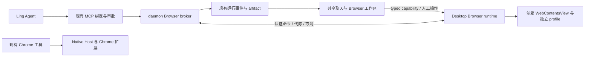

# Desktop 内置浏览器实施计划

Status: M0–M5 source implementation and macOS arm64 source acceptance verified; packaged/cross-platform release gates remain open
Owner: Desktop、daemon、Web、approval 与 release maintainers
Last verified: 2026-11-17
Baseline: `origin/main` at `27a9ccb23`; branch `codex/desktop-browser-inapp`; no release claim
Verification scope: Ling source, installed Electron declarations, and a pinned static reference archive
Canonical replacement: none; the external Chrome contract remains independently authoritative
Code and test anchors: implemented paths below; remaining module proposals in section 5

## 1. 目标与交付边界

让用户在 Ling Desktop 内打开网站和本地开发页面，与聊天并排查看，并让 Agent 在现有
MCP 审批、取消和运行记录体系内读取、导航、点击、输入和截图。后续接入页面批注、
浏览数据管理、开发调试及网站工具。

本文件记录实施范围和验收出口；未通过的能力不表示已可用。
第一交付目标是“打开开发页面 → Agent 操作 → 查看结果 → 留下可追溯证据”；完整浏览器
配套功能按后续里程碑交付，不以设置页外观相似作为完成标准。

产品区分两个入口：

- **Ling 内置浏览器**：Desktop 托管网页及独立 profile，无需 Chrome 扩展。
- **Chrome**：现有插件控制外部 Chrome，复用用户已有标签页及登录状态。

两个入口保留明确的目标选择、能力探测和授权。不可因一个入口不可用而自动切换到另一个
入口的账号、标签页或登录态。纯 Web 客户端保留搜索与浏览证据查看；交互入口由真实
Desktop capability 决定，不渲染无法工作的地址栏。

## 2. 当前交付与缺口

首个闭环使用标准 Electron `WebContentsView`，没有引入定制 Electron 接口。主要入口是
会话右侧 Browser 抽屉；地址栏、多标签页、导航、人工/Agent 接管和展开视图由共享 Web
组件实现。同一抽屉可切换查看已有搜索与浏览证据；进入证据视图时卸载原生网页，返回后
保留标签页。普通会话、频道会话和私聊使用相同组件，标签页按真实 thread scope 隔离。

已实现并由受控本地站点或包级测试覆盖：

- `built-in:browser` / `mcp_browser` 及十二个 `browser_*` 工具（标签页、导航、快照、点击、输入、截图、历史、下载、调试、CDP、WebMCP 工具发现和调用），默认 `ask`，复用现有
  MCP 绑定、审批、取消、Host operation 和运行结果通道。启用内置插件可绑定 Ling Agent；
  自定义队友仍需单独配置。手动浏览不要求启用 Agent 工具。
- Desktop 按本地 workspace 独立持久化 profile、沙箱网页、认证 runtime 的
  availability/claim/start/result/cancelled 协议、实例/代际/页面 revision 校验和单次派发。
  人工接管或连接失败暂停自动操作；已开始动作在取消/超时后保留 `unknown`，不自动重放。
- 显式 HTTP(S)/loopback 导航、私网与 daemon origin 阻断、Agent 跨 origin 跳转拦截、
  网站设备权限默认拒绝、弹窗和下载拦截、有界 isolated-world snapshot/ref 与截图。
  下载拦截不表示网络请求尚未发生。密码、文件、支付及验证码输入不交给 Agent。
- 原生网页在 Dialog、Menu、Tooltip 打开期间 detach；窗口变化重新报告实际几何，
  renderer 不再上报时有超时隐藏。无 Desktop capability 的 Web 客户端保留证据视图。
- 会话链接按网站/localhost 偏好路由，标签页恢复只保存 scope、URL 和 active 标记；
  workspace 切换暂停旧 runtime 并提升 generation。
- 页面元素和矩形区域批注、锚点重定位、用户评论与独立不可信页面附件已接入三类会话
  Composer；页面变化、滚动、缩放和导航会使不再可靠的引用标记为 stale。
- 内置 profile 的历史、下载、站点设备权限、清理、Chromium 书签预览/选择导入和
  unpacked MV3 扩展管理已实现；不导入密码、Cookie 数据库或联系人。
- 调试输出有界并去除 URL query/hash，tab-scoped CDP 逐次 native 确认；WebMCP 使用
  Chromium 公开的 `document.modelContext`，真实注册/发现/调用/toolchange 失效及
  动态 schema 参数校验已覆盖。

macOS arm64 源码验收采用真实 Electron 与受控本地站点，覆盖共享抽屉和原生 view 的
挂载/遮挡、会话切换、resize/zoom、快捷键、读取/点击/输入/截图、profile 隔离、接管、
跨 origin 跳转与取消。daemon 集成另行验证真实 MCP 审批前不派发、拒绝无动作、认证与
旧结果拒收。验收入口为 `apps/desktop/tests/desktop-browser-runtime.test.ts`、
`apps/web/e2e/desktop-browser.spec.ts` 和 `packages/daemon/test/desktop-browser-*.test.ts`。
这不等同于付费模型执行、Windows 或签名安装包验收。

当前源实现支持最多 16 个绝对、规范且存在的本地 workspace；每个 workspace 使用独立
 profile、daemon controller、runtime identity 和 generation。Cookie/站点存储持久化，
标签页恢复只恢复允许的 URL 元数据，操作队列、ref 和 Agent 租约不恢复。默认政策仍是
 browse/download/history `ask`，CDP/WebMCP 需要独立 origin 规则和审批。

| 能力 | 当前 Ling 证据 | 待补内容 | 阶段 |
| --- | --- | --- | --- |
| 浏览器工具 | [内置浏览器十二个工具](../../packages/daemon/src/features/plugins/desktop-browser-generation-broker.ts)与既有 Chrome 工具独立 | Windows 与安装包验收 | M1、M5 |
| 审批与运行记录 | [MCP broker](../../packages/daemon/src/features/mcp/broker.ts)、[控制器](../../packages/daemon/src/features/desktop-browser/controller.ts)已接入审批、取消、网站策略和结果过滤 | 付费模型、Windows 与签名包运行场景 | M1、M4 |
| 桌面网页容器 | [Browser manager](../../apps/desktop/main/browser/manager.ts)与专用 IPC、session、runtime 模块 | Windows、安装包与完整故障验收 | M0–M1 |
| Browser 侧栏 | [共享 BrowserWorkspace](../../apps/web/src/features/browser/BrowserWorkspace.tsx)提供原生网页、标签页、地址栏、导航和展开；Web 保留 evidence | Windows、安装包与主题现场验收 | M2 |
| 本地页面 | 显式 loopback preview、会话链接集中路由、独立 workspace profile | 现场平台验收 | M2 |
| 页面批注 | 元素/区域锚点、截图、评论、附件和 stale 定位已接入 Composer | 真实模型依据批注修改代码后的现场复验 | M3 |
| 浏览数据与下载 | 历史、清理、下载位置/任务、书签预览导入；不管理密码或 Cookie 数据库 | Windows/签名包现场验收 | M4 |
| 网站与设备权限 | origin 规则、浏览/下载/历史 deny 过滤、设备人工确认和接管撤销 | 真实 daemon 派发撤销场景与跨平台现场验收 | M4 |
| 开发模式 | 有界诊断、tab-scoped CDP、逐次 native Allow once 和敏感域拒绝 | 真实错误站点诊断与安装包验收 | M5 |
| WebMCP | 公开 `document.modelContext` 的发现、调用、toolchange 失效、审批和有界 schema/result | 不支持该公开 API 的 Chromium 显示 unavailable；签名包现场验收 | M5 |
| 浏览器配套管理 | Chromium bookmarks JSON 预览/选择导入、当前 profile unpacked MV3 加载/卸载 | Chrome API 兼容矩阵、Windows/签名包验收；密码/联系人管理仍不支持 | M5 |

可复用的是审批、工具绑定、Run/WorkUnit、取消、artifact、控制面事件、共享 UI 和本机
Desktop bridge 的模式。Chrome Native Messaging Host 只承担 Chrome 通信，不承担内置
网页渲染；不把它扩成另一个浏览器执行内核。

## 3. 逆向工程参考与证据边界

### 3.1 固定参考版本

本次只读分析使用用户提供的 `codex-desktop-reverse-20261028.zip`：

- ZIP SHA-256：`e6d58d9e73a7143d14626a2b4a8a2f871cfb7354ffee7f80c5d488bd97055201`。
- 包内 `checksums.sha256` 的 97 个文件全部匹配，无缺失、无不匹配。
- `rea-workspace/cgdesk/package.json` 声明版本 `26.1021.31345`。
- 这是特定版本的静态产物，不证明当前 Codex 的功能开放状态或运行验收结果。
- 原始 bundle、真实会话样本和本机路径不进入 Ling 仓库；实现采用 Ling 自身的类型、
  模块边界和公开平台接口。

### 3.2 代码参考地图

以下路径相对于 ZIP 根目录 `codex-desktop-reverse-20261028/`。原始产物少行且很长，
定位使用“文件 + 原始行号 + 符号”，行号仅适用于此校验版本。

| 参考文件 | 已核实位置 | 可借鉴内容 |
| --- | --- | --- |
| `rea-workspace/cgdesk/main-0FVbxCQU.js` | L99，`persist:codex-browser-`；L1123，`session.fromPartition` | 独立持久化 session，浏览数据与应用自身数据分离 |
| 同上 | L14，`codex-browser-use`、`sendCdpEvent`；L1125，`setBrowserUseNativePipeEnabled`、`recordGuestAttached` | 本机控制通道、会话注册、页面挂载和 Agent 控制目标的关联 |
| 同上 | L624–625，`history_approval_mode`、`full_cdp_access_enabled`、`rules` | 浏览、历史、下载、上传、CDP、WebMCP 是不同权限资源 |
| 同上 | L1123，`configure()`、`onPermissionPrompt`、`will-download` | session 集中的网站权限、导航和下载管理 |
| 同上 | L1145，`browser-sidebar-manager`、`browserPersistence`、`tabBudget` | 窗口/会话/标签页生命周期、恢复和后台页面预算分开负责 |
| 同上 | L1123，`elementPath`、`framePath`、`captureScreenshot` | 批注的页面/元素/区域信息与截图一起保存 |
| `rea-workspace/cgdesk/browser-page-preload.js` | L58、L118，`elementPath`、`framePath`、`codex:open-annotation` | 页面侧命中检测、元素与区域锚点、批注运行时 |
| 同上 | L204，`get-browser-webmcp-policy`、`document.modelContext`、`toolchange` | 网站工具接入先检查政策与运行时，再监听变化 |
| `rea-workspace/cgdesk/mcp-annotation-runtime.js` | `shadowRoot`、annotation 相关运行时 | 批注能力作为页面运行时，而非散落在聊天消息组件中 |
| `rea-workspace/cgdesk/app-initial-feb30b196d11.js` | L2552，`browser-sidebar-webview-attached`、`mountGeneration` | UI/主进程挂载回执和代际校验 |
| `rea-workspace/cgdesk/early-bootstrap.js` | `DevToolsWebMCPSupport`、`WebMCP` | 网站工具涉及运行时能力，不只是增加设置开关 |

### 3.3 不能直接移植的部分

源码出现 `permissionHandling: "browser"`、`enableBrowserPolicies`、
`setPermissionPromptHandler`、`setOpenURLHandler`、`webContents.setAgentActive` 等接口。
这些接口未见于本次安装的 Ling 标准 Electron 声明；不能因逆向文档把运行时概括为
Electron，就假设它们能直接调用。

参考版本的主窗口启用了 `webviewTag`，并存在 guest webview 的 attach/adoption 流程。
其中可见的 `new WebContentsView` 用例负责链接下载，不能据此断言其主要网页容器就是
`WebContentsView`。Ling 的容器选择由 M0 对标准 API 的验证决定。

本计划优先选择标准 `WebContentsView`，不依赖定制 Electron fork；权限提示、历史索引、
下载管理及控制状态由 Ling 在公开接口上实现。WebMCP 开关和扩展/导入相关私有 API
不能直接复刻。缺失的外部依赖及动态分包不在此 ZIP 中，静态符号不代表完整代码已具备。

## 4. 建议架构与约束

### 4.1 数据与控制路径

- **Desktop main** 拥有 Chromium session、实际页面/标签页、布局与焦点、导航拦截、
  下载和网站设备权限的执行；它报告真实状态，不决定 Agent 的业务审批。
- **daemon** 拥有 workspace/conversation/run 归属、工具可用性、网站政策、MCP 审批、
  操作租约、命令状态、artifact 和审计。持久化的标签页恢复信息是快照，不能替代存活
  Desktop 上报的页面状态。
- **共享 Web UI** 拥有地址栏、标签页、分屏、批注编辑和设置交互，使用现有
  `@ling-stack/ui-react`。现有 Browser evidence 页面继续负责证据展示，交互网页通过
  Desktop capability 接入同一工作区，不另做一套会话页。
- **页面 preload/isolated world** 只暴露有界的快照、元素引用和批注协议；网页不能得到
  `lingDesktop`、bridge token、通用 IPC、任意脚本执行或文件系统能力。

Desktop 与 daemon 优先沿用 [Office runtime](../../apps/desktop/main/office-driver/runtime.ts)
和 [driver routes](../../packages/daemon/src/features/office-documents/driver-routes.ts)的
availability/claim/result 形态，复用现有 bridge 认证；浏览器单独维护命令类型、实例代际
和目标验证。具体协议在 M0 固定，不把 Office 业务类型复制成浏览器协议。

### 4.2 profile 与作用域

- 建议每个本机 workspace 使用稳定的独立持久化 profile，与 Ling 主 UI session、
  系统 Chrome 和其他 workspace 分离；代价是不同 workspace 需要分别登录。
- 同一 workspace 的会话可使用该 profile 的网站登录态，但标签页、快照和证据按所属
  conversation/run 筛选。列出标签页不等于获准读取整个 profile 历史。
- 初期一个标签页同一时间只允许一个 Agent 操作租约。人工接管先停止自动输入并使
  待执行命令失效；重新交还时必须重新获取页面快照和授权上下文。
- workspace 切换、Desktop 重启、页面重建与 renderer crash 都提升 generation。
  关闭窗口、隐藏面板和取消运行分别处理，不能互相冒充执行已停止。

### 4.3 工具与兼容性

- 已固定 `built-in:browser` / `mcp_browser`，提供 `browser_tabs`、`browser_snapshot`、
  `browser_navigate`、`browser_click`、`browser_type`、`browser_screenshot`。
  合同定义在 `packages/contracts/src/desktop-browser.ts`，外部 Chrome 标识保持独立。
- 保持 `built-in:chrome`、`chrome_*`、`ling.chrome.v1` 及其现有绑定不变。
  只在已有行为确实相同处提取共享校验，不强制重写 Chrome 的已运行链路。
- 命令携带 workspace、conversation/run、Desktop instance/generation、tab、
  navigation revision、deadline 和 request id；ref 额外绑定 snapshot revision。
  校验分别在审批、派发和执行前进行，拒绝重建后复用的 id、旧结果及跨 scope 调用。
- 首版支持 HTTP(S)、主文档的可见语义内容和可见视口截图；密码/文件输入交给用户。
  跨源 frame、Shadow DOM、Canvas 的覆盖逐项报告，不能把简单 selector 遍历宣称为
  完整 DOM/无障碍树支持。
- 固定页面 runtime 可在 isolated world 运行；Agent 不获得任意 `evaluate`。
  最小 CDP 内部实现权限与对 Agent 开放完整 CDP 分开，后者由 M5 独立交付。

### 4.4 权限、网络和失败处理

1. 网站策略是现有 MCP 审批的附加约束，不另建一套 allow/deny 审批引擎。默认 Agent
   浏览/下载/历史访问为 `ask`，完整 CDP 和网站工具关闭；匹配 origin 规则可以收紧
   或允许对应能力，但不能绕过更高层 deny、工具绑定和危险操作审批。网站与工具均
   需询问时合并为同一条审批请求，展示目标、动作和本次授予范围。
2. 人工地址栏、人工登录与 Agent 行为有不同来源。人工使用浏览器不自动授权 Agent；
   浏览允许也不自动授权发送、购买、删除、权限修改或凭据操作。
3. origin 使用标准 URL 解析并包含 scheme/host/port；跳转、新窗口、下载和 frame 导航
   分别复核。loopback 开发站点限于显式目标；其他内网/链路本地地址需单独策略。
   不放宽现有公共 `open_url`/`read_url` 的 SSRF 边界。
4. 页面加载必要子资源按受控 session 网络规则执行；不为每张图片弹审批，也不允许
   子资源或弹窗把 Agent 的主文档操作权限扩展到另一个 origin。
5. 网页文字、截图及网站工具描述属于不可信资料。用户评论与页面引用分字段保存；
   页面内容不产生执行授权。截图前提示交接登录等敏感场景，证据执行有界采集和脱敏。
6. 取消只阻止后续动作和旧结果提交。点击、输入、提交等若已发出却未收到可靠结果，
   记录 `effect_unknown`，不因连接恢复或超时自动重放。
7. 网页自行触发的下载到 `will-download` 时，网络请求可能已发生。M1–M3 拦截这类
   下载；M4 先审批 Agent 发起的下载，再允许执行，不把事后取消描述为请求前审批。

## 5. 模块落点

以下为拟议文件范围，实现时按职责细分，避免继续把逻辑堆入 `main.ts` 或公共 IPC 文件。

| 层 | 文件范围 | 职责 |
| --- | --- | --- |
| Contracts | `packages/contracts/src/desktop-browser.ts` 及导出 | 命令、结果、状态、归属、revision 和解析 |
| Core/storage | `packages/core/src/storage/sqlite/` 中 browser owning slice | 网站政策、批注、历史/恢复元数据；migration 编号在实现时分配 |
| daemon | `packages/daemon/src/features/desktop-browser/` | runtime availability、命令队列、租约、取消、snapshot 与状态投影 |
| MCP | `packages/daemon/src/features/plugins/` 中 browser broker/catalog 接入 | 工具、绑定、审批、结果归属与审计 |
| Desktop | `apps/desktop/main/browser/` | profile、tab registry、WebContentsView、导航、权限、下载和 runtime client |
| Bridge | `apps/desktop/shared/desktop-capabilities.ts`、专属 browser IPC/preload 模块 | 受信主 UI 的 typed capability、sender/frame 验证和订阅清理 |
| 页面 runtime | `apps/desktop/preload/` 中 browser page runtime | 有界 DOM snapshot/ref、批注命中和消息校验 |
| API client | `packages/api-client/src/` | 政策、批注、历史等 daemon API；不传递 Chromium 凭据 |
| Web | `apps/web/src/features/browser/`、现有 right dock 与 Composer 接入 | Browser 工作区、批注和设置，遵循现有三类会话入口 |
| 证据 | 现有 RunArtifact、附件、证据投影与 transcript | URL/revision/归属、截图和评论引用；不另建第二条消息时间线 |

Chromium 管理 Cookie、站点存储和缓存；Ling 的元数据存储不复制 Cookie 或密码。
profile 的文件属于 Desktop。UI 布局偏好与 workspace 级业务政策分开持久化。

## 6. 分阶段计划

本轮目标覆盖所有剩余阶段及 PR 审查、CI 和合并。执行顺序为链接路由/恢复、批注、
历史/下载/站点权限、调试与网站工具，随后进行集成和安装包验收。每阶段以行为证据
更新交付状态，不能用可运行的开关或静态类型替代功能实现。

原生标签页恢复记录和链接打开偏好随 Desktop profile 管理；仅记录 URL、scope、
选中页及用户偏好，不保存表单、快照 ref、命令队列或 Agent 控制租约。恢复采用新 tab id、
新 generation 和人工控制；读取恢复页时仍执行当前网络规则。

### 主题适配

浏览器工具栏及管理面板使用现有 Button、IconButton、Input、SelectControl、Dialog、
Menu、Checkbox、InlineFeedback 和共享会话 Composer/附件组件。组件消费现有 control、
overlay、row 与语义状态参数，浏览器 feature CSS 只管理布局、尺寸和滚动。网页画布及
权限/清理确认使用保护表面，聊天继续遵循环境背景策略。验收包含官方主题切换、明暗、
空/加载/错误/禁用/聚焦状态，以及 1440×960、1280×800 的布局和原生遮挡行为。

### M0 — 标准运行时验证与合同固定

交付：验证标准 Electron 的 `WebContentsView`、独立 partition、权限回调、截图、
重定向、新窗口和销毁行为；固定上节作用域、桥接协议、schema、默认政策和工具命名。
M1 的目标环境为 macOS arm64 与 Windows x64，平台结果分别记录。

重点验证 native view 的层级和裁剪：Dialog、Menu、审批弹层、分屏 resize、缩放及
PiP 的显示必须可控。若主 renderer 中的弹层无法覆盖 native view，优先在受信 UI
弹层打开期间隐藏网页 view；只有真实验证不满足目标后才重新选择容器。

出口：同一个开发站点可显示、截图和正确销毁；网页无法读取应用 bridge；两个
workspace 的站点存储隔离；确认不依赖逆向包中的私有接口。若出现平台阻断，记录
具体缺失能力，调整该平台交付范围，不能用另一平台通过代替。

### M1 — 内置浏览器 runtime、工具与审批闭环

依赖 M0。实现 profile/tab registry、认证 availability/claim/result、工具注册及现有
MCP 流程接入。提供主 UI 内可见的最小单页容器供真实操作验收；导航和工具状态先于
完整标签页 UI 交付。loopback 预览、设备权限默认拒绝、下载拦截和人工接管同时落实。

出口：Agent 在受控本地站点完成“读取 → 点击 → 填入普通字段 → 截图”，全过程有
归属及审批证据；deny 后不发生动作；审批期间导航、取消、断线、重启和旧 ref 均不能
执行过期命令。无 Desktop 时工具明确 unavailable。现有 Chrome 行为回归通过。

### M2 — 共享 Browser 工作区与链接路由（源实现已完成）

依赖 M1。增加多标签页、地址栏、前进/后退/刷新/停止、加载/错误状态、聊天分屏、
全屏切换和必要快捷键；导航条呈现页面真实 URL、标题和 HTTPS 状态。
三类会话入口共享组件及 scope 模型，不复制 Desktop 专属会话树。

网页 URL、本地开发 URL 的打开位置分别设置；保留显式“在系统浏览器中打开”。
通过集中的链接意图路由处理 HTTP(S)，不直接把主 UI 的导航限制改成允许任意页面。
恢复只还原获准的 tab 元数据与页面，不恢复待执行动作或操作租约。

出口：已由共享 Web E2E 和 Electron 验收覆盖。用户从三类会话链接进入对应页面，可分屏、
切换、返回和恢复；workspace 切换不串页且旧代际命令失效；登录态仅在对应 profile
持久化；Dialog、审批和菜单不会被网页遮挡或穿透。`1440x960` 与 `1280x800`、中英、
亮暗主题、焦点、缩放和溢出已有截图/交互证据。Windows 和安装包仍是发布门。

### M3 — 页面批注与代码修改反馈（源实现已完成）

依赖 M2。先实现单元素及矩形区域批注，保存用户文字、origin/URL、tab/document
revision、frame/element 锚点、viewport/缩放、选区截图及来源归属；主 UI 编辑评论，
页面侧只负责命中与受限高亮。借鉴逆向包的页面 runtime 与评论模型拆分。

提交批注进入现有 Composer/消息附件和 artifact 路径。页面片段显式标为不可信引用，
用户文字保留为独立用户意图。页面变化后定位失败显示失效状态，不按旧坐标自动点击。
截图支持包含/不包含及区域裁剪；批注编辑过程中暂停 Agent 输入。

出口：元素和区域圈选、评论与 JPEG 附件进入三类会话现有草稿，页面侧引用显式标为
不可信。原生 input 在网页事件前被拦截，选择不会触发页面点击；元素移除、滚动、缩放、
导航和文档变化会返回 available/stale。真实模型依据批注修改代码后的复验仍需现场模型
与目标仓库证据；多选及 Canvas 深度锚点不在当前支持范围。

### M4 — 历史、下载、浏览数据与权限设置（源实现已完成）

依赖 M1 的权限模型与 M2 的 profile/workspace 模型；可独立于 M3 的高级锚点推进。

- 内置 profile 的历史检索、重开、按条/时间范围清理；用户浏览历史与 Agent 获准读取
  历史分开处理，默认不把全历史塞入模型上下文。
- 下载位置、保存前询问、任务进度、取消、失败、完成记录和系统文件夹打开；文件名
  校验、路径归属、覆盖确认和执行文件处理单独定义。下载文件不自动执行。
- 按 origin 的浏览/下载例外和网站摄像头、麦克风等设备授权；未知权限默认拒绝。
  “使用网站设备”和“Agent 读取设备数据”不共用一个允许开关。
- 清理 Cookie、缓存、站点存储和历史时，先显示 profile、范围和可能退出登录的结果，
  用户确认后执行。清理期间阻止冲突操作，完成后使相关 ref/租约失效。

出口：默认政策、网站例外、撤销、重启恢复、下载完成/取消、书签预览导入、扩展加载/卸载
和清理已有 native/daemon 测试；清理当前 profile 不影响 Ling 主 UI，独立 profile 代码和
Electron 测试覆盖其他 workspace。真实 daemon 站点 deny/revoke 中途派发、Windows 和
签名包现场证据仍需补齐。

### M5 — 调试、网站工具与浏览器配套功能（标准运行时源实现已完成）

依赖 M1–M4 对应边界，按下表分别交付；任一项未通过不能显示成已支持的开关。

| 工作包 | 交付与边界 | 退出条件 |
| --- | --- | --- |
| CDP 调试 | 有界 console/error/network/performance 读取；tab-scoped CDP 每次 native Allow once，拒绝敏感域和 cookie 方法；不把结果承诺为完整脱敏 | macOS 真实错误站点、Performance、拒绝 cookie 和 detach 已通过；Windows/签名包仍需验收 |
| WebMCP | 通过公开 `enableBlinkFeatures: "WebMCP"` 使用 `document.modelContext`；工具数量、schema、参数、结果有界，toolchange/导航/接管/取消失效，复用 MCP 审批 | Electron 45.3.1 / Chromium 156 真实测试站点发现、调用、schema 拒绝和注销已通过；其他 Chromium 显示 unavailable，不把 flag 当普遍能力 |
| profile 导入 | Chromium bookmarks JSON 预览、HTTP(S) 选择导入和有界失败处理 | 不读取未授权来源，不把浏览器机密送入模型；不承诺普通 Electron 支持 Codex 私有 importer |
| 密码与联系信息 | 独立设计 OS 密钥库/用户解锁及人工自动填充；先支持人工登录和现有登录态 | 原始密码不进入模型、通用 IPC、日志或证据；各 OS 实测后才开放管理 UI |
| 扩展管理 | 当前 profile 的用户选择 unpacked MV3 目录、manifest 预览、native 确认、加载/卸载 | 基于实际兼容矩阵宣称支持，不假定具备完整 Chrome Web Store 兼容性；重启不自动加载可变目录 |
| 验证码与登录交接 | 停止自动操作、用户接管、完成后重新 snapshot 和恢复 | 不因失败循环输入或提交；自动验证码选项需另有可用执行后端才进入实现 |

## 7. 验证与交付门

每阶段只运行相关测试和 owning package 验证；失败或新增风险再扩大范围。新增模块测试
优先 TypeScript，同时落实 runner discovery 和测试代码 typecheck，遵循
[Testing Policy](../../CONTRIBUTING.md#testing-policy)。

| 验证层 | 核心场景 |
| --- | --- |
| Contracts/Core | 精确解析、大小限制、scope/revision、政策优先级、migration reopen、元数据脱敏 |
| daemon | 未认证请求、假冒 runtime、实例替换、审批前后页面变化、deny/revoke、timeout/cancel、旧结果与未知副作用不重放 |
| Desktop runtime | profile 隔离、窗口关闭、renderer crash、订阅释放、view detach/attach、焦点和人工接管 |
| 网页行为 | HTTP(S)/loopback、跨 origin redirect/popup、SPA、frame 边界、动态 DOM、密码/文件输入、下载 |
| UI | Channel/普通会话/私聊、Browser evidence 与交互页面职责、中英/亮暗、分屏 resize、弹层层级和键盘操作 |
| 端到端 | 真实本地站点操作和截图；批注到代码修改再复验；登录态保持、下载清理、daemon/Desktop 分别重启 |
| 平台与发布 | macOS arm64、Windows x64 分别运行桌面流程；资源打包、签名/升级及干净机器检查按现有 release 合同执行 |

Electron GUI 验收使用本地可控站点，避免对真实第三方账号发送或删除数据。
记录实际平台、版本和结果；mock、类型检查或构建通过不代替桌面交互、双平台或发布验收。

每阶段同步更新 [Desktop Shell](desktop-shell.md)、
[Chrome Browser](chrome-browser-built-in-plugin.md)中相关边界、
[Ling Web Tools](ling-web-tools.md)及 [Implementation Status](implementation-status.md)，
分别标注实现、测试、平台验收和发布状态。已完成计划按设计目录保留规则收口。

## 8. 建议执行顺序与待证事项

关键路径：`M0 → M1 → M2 → M3`；`M2 → M4 → M5`。M0–M5 的源代码、合同和 macOS
arm64 受控站点证据已在本分支完成；工具命名、独立 workspace profile、策略和 runtime
协议已固定。剩余工作属于真实模型、Windows、签名/安装包、CI 审查和合并门，不再新增
未验收的产品开关。

后续交付仍需要补齐以下证据：

1. Windows native view 的弹层、焦点和布局，以及双平台安装包行为。
2. 签名 Desktop 与真实模型场景下认证、代际、取消和未知副作用的完整验收。
3. 真实 daemon 派发前后的网站 deny/revoke、跨 scope 下载和取消异常证据。
4. M5 能力在目标安装包和其他 Chromium 版本中的兼容矩阵；当前 macOS Electron 45.3.1
   的 WebMCP 正向证据不代表所有平台都提供该实验性 API。

排期以阶段出口和 owner 容量确定，不把静态参考源码当作可以直接复用的开发完成量，
也不据此承诺日历工期。实施从隔离工作区开始，保留现有未提交工作；本计划本身
不授权线上部署、外部发布、账号操作或数据清理。
