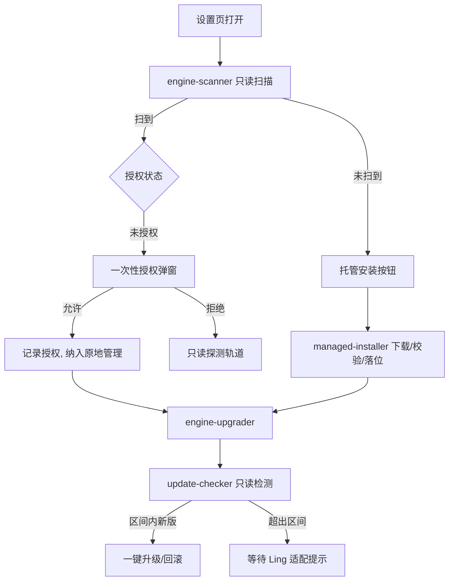

# 执行引擎托管生命周期方案与实施计划

日期：2026-10-27。状态：**方案已定稿，待实施**。

来源：用户评审对话（DeepSeek 桌面端插件 `@deepseek-ai/dsh-subagent-codex` / `-claude-code` 与 OpenClaw `extensions/codex` 托管二进制的对照分析）。本文落定后，引擎安装/升级的实施与验收以本文为准；之前的口头方案如有出入以本文为准。

## 1. 背景与现状问题

当前添加外部执行引擎（Codex / Claude Code / Kimi / OpenClaw）要求用户先自行安装对应 CLI，再在设置里手动填写 `executablePath`。门槛落在"用户会不会用命令行"上，与产品定位不符。

对照证据：

- OpenClaw 的 codex 插件把 `@openai/codex@0.133.0` 直接打进插件（`managed-binary.ts` 从插件自身 node_modules 解析可执行文件，兼容下限 `0.125.0`），用户安装插件即获得引擎，升级随宿主发版。
- DeepSeek 的子代理插件只安装通讯胶水层，运行时从 PATH 解析用户已有的 CLI（`Production resolves codex from PATH`），引擎本体仍需用户预装。

我们采用 OpenClaw 式托管为主线，同时吸收"自动识别已有安装"和"授权后原地管理"两条路径。

## 2. 目标与原则

目标体验：打开引擎设置 → 已装的自动识别并提示启用 → 没装的一键托管安装 → 之后官方出新版时提示并一键升级（可回滚）。全程不需要用户碰命令行。

原则：

1. 现有 fail-closed 探测（realpath、可执行、版本、sha256、摘要指纹）不因来源改变而放松。
2. Ling 只对自有目录（`~/.ling-stack/engines/`）里的副本有写权限；用户全局环境只有在一次性明确授权后才可被原地管理。
3. 一切下载走 https、钉死版本、sha256 校验通过才落盘，失败不留半成品。
4. 引擎与 Ling 之间有协议契约（如 codex app-server 协议版本），升级受兼容区间卡口约束，超出已验证区间不提示升级。
5. 授权与升级全程留证、可撤销、可回滚。

## 3. 方案设计

### 3.1 引擎来源三档

| 来源 | 档案 executablePath | 升级控制 | 说明 |
|---|---|---|---|
| 托管安装 | 托管目录内 | Ling 全权 | 默认路径，新手零门槛 |
| 扫描识别 + 一次性授权 | 用户原路径 | Ling 原地管理（授权范围内） | 已装用户一键接管 |
| 手动指定 / 拒绝授权 | 用户指定路径 | 不管理，只读探测 | 完全保留现状 |

默认行为：扫描到已安装引擎时给出一次性授权弹窗（见 3.4），用户允许后即纳入 Ling 原地管理；拒绝则保持只读，不再打扰。

### 3.2 自动扫描识别

打开引擎设置页或新建档案时，daemon 执行只读扫描：

- PATH 解析（`which`/`where` 等价物）
- 常见安装位置：npm 全局前缀、Homebrew（`/opt/homebrew/bin`、`/usr/local/bin`）、`~/.local/bin`、Windows 常见位置
- 各引擎默认命令名表：codex / claude / kimi / openclaw

扫到后立即跑现有安装探测；结果显示在引擎卡片上（"检测到 Codex 0.147.0（/opt/homebrew/bin/codex）"）。版本低于兼容下限的显示"版本过旧"而不是"启用"。扫描结果不构成启用，启用需要用户点击确认。

### 3.3 托管安装

目录约定：`~/.ling-stack/engines/<engineId>/<version>/`（遵循 `resolveUserConfigPaths` 的用户根目录）。

流程：下载钉死版本的 npm 包（https）→ sha256 校验 → 解压到临时目录 → 原子改名落位 → 探测 → 写/更新引擎档案指向托管可执行文件 → 登录流程照旧（复用现有 native-login 浏览器/设备码）。

状态机：`not_installed → downloading → verifying → installed`，失败进 `failed`（可重试），升级时旧版本目录保留作回滚。

各引擎安装源（实施前逐一复核）：

| 引擎 | 安装源 | 备注 |
|---|---|---|
| Codex | npm `@openai/codex`（当前 0.164.0） | 平台二进制随 optionalDependencies 自动选择 |
| Claude Code | npm `@anthropic-ai/claude-code`（当前 2.1.311） | 同上 |
| OpenClaw | npm `openclaw`（当前 2026.10.7） | 网关形态，需既有 openclaw-acp 配置项 |
| Kimi | **非 npm 分发，安装源待验证** | 现有实现复制原生可执行文件；P1 先不支持托管安装，卡片显示手动指引 |

### 3.4 一次性授权接管（原地管理）

授权弹窗文案要点：检测到 `<引擎> <版本>`（`<路径>`）；允许 Ling 管理此安装？授权范围：自动检测并执行升级。授权记录落盘（授权时间、引擎、路径、当时版本、范围、授权人），设置中可见、可撤销。

授权后 Ling 可原地升级：识别安装来源（Homebrew / npm 全局 / 其他）→ 执行对应升级命令（`brew upgrade <formula>` / `npm i -g <pkg>@<version>`）→ 升级前后各探测一次留证 → 失败如实报告并尝试回滚（npm 可装回钉住旧版；brew 回滚能力弱则如实告知）。

未授权或已撤销的扫描来源一律只读。

### 3.5 升级检测与提示

- daemon 每日一次 + 打开引擎设置页时，只读查询 npm registry 最新版本，与当前版本比对。
- 兼容区间：每引擎记录 `minSupported` / `maxVerified`（对照协议版本，如 `ling-codex-app-server/0.1` 对应区间）。区间内有新版 → 卡片提示"可升级"，用户点击执行；超出区间 → 显示"等待 Ling 适配"，不提供升级按钮。
- 手动只读来源：探测到版本变化只更新显示，不提示升级动作，低于下限时提示并附对应包管理器命令。

### 3.6 认证与隔离

托管副本与用户原生 CLI 默认共享宿主认证目录（如 `~/.codex`），用户登录一次两边通用；需要隔离时托管进程可用独立 `CODEX_HOME`。两种来源不冲突，可同时存在。

### 3.7 复用既有资产

profile/revision/指纹、安装与连接探测、owned spawn、登录挑战、并发信号量（每 runnerId 4 槽）、设置页管理界面全部复用。本方案不新增执行路径，只新增"安装与生命周期"管理面。

## 4. 架构与改动面

改动面：

| 层 | 新增模块 | 说明 |
|---|---|---|
| contracts | 引擎来源/授权/升级状态类型，引擎目录契约 | 版本化 schema |
| daemon | `engine-scanner`、`managed-engine-installer`、`engine-authorization-store`、`engine-update-checker`、`engine-upgrader` | 全部 fail-closed |
| daemon routes | `/execution-engines/scan`、`/install`、`/authorize`、`/upgrade` 等管理端点 | 管理会话沿用现有 token/CSRF |
| web | 引擎卡片状态机（检测中/已检测/安装中/可升级/等待适配）、授权弹窗 | 单一设置入口 |
| 证据 | 托管包进入 recover-notices 证据体系 | 复用现有生成器 |

## 5. 安全与证据边界

- 下载：https + 钉版本 + sha256 校验 + 临时目录 + 原子落位；校验失败删除临时目录。
- 原地升级：命令、输出、前后版本与摘要全部留证；失败不装死。
- 授权：一次性授予、书面留证、随时可撤销；撤销后立即回到只读。
- 供应链：托管安装的 npm 包走 `recover-notices` 生成来源证据，与 canvas/keyring 证据同一体系。
- 不做：静默自动升级、未授权写用户全局环境、放松探测。

## 6. 实施计划

### P0 自动扫描识别（先行，独立可用）

- daemon `engine-scanner`：PATH + 常见位置 + 命令名表，只读，产出候选清单
- 接入现有安装探测，产出"检测到/版本过旧/未找到"结果
- web 引擎卡片显示扫描结果与"启用"确认
- 测试：扫描器单元（假 PATH/假目录）、探测集成、卡片 e2e
- 验收：装了 codex 的机器打开设置页可见"检测到 Codex <版本>"，一键启用后可跑通现有连接探测

### P1 托管安装

- daemon `managed-engine-installer`：npm 包下载/校验/解压/原子落位/回滚清理
- 引擎包名与钉版本表（contracts 常量）+ 兼容区间表
- 状态机与路由：`/execution-engines/install` + 进度查询
- web 卡片"安装"按钮与状态展示
- 测试：安装成功/摘要失败/网络失败/回滚路径；安装后档案探测通过
- 验收：无 codex 的环境点安装后档案可用，登录流程照旧

### P2 一次性授权与原地升级

- 授权存储（user state，版本化 schema）+ 撤销
- 授权弹窗 UI
- `engine-upgrader`：包管理器识别（brew/npm -g）、原地升级执行、前后探测、失败报告与回滚尝试
- 测试：授权生命周期、升级成功/失败/回滚、撤销后拒绝写操作
- 验收：授权后 Ling 可把扫描到的引擎从旧版原地升到区间内新版并留证

### P3 升级检测与提示

- `engine-update-checker`：每日 + 设置页打开时只读查 npm 最新版
- 兼容区间判断与卡片提示（可升级/等待适配）
- 一键升级按钮接入 P1/P2 对应路径
- 测试：检测调度、区间判断、提示展示
- 验收：官方出区间内新版后，卡片出现提示，点击完成升级并可回滚

阶段依赖：P0 独立先行；P1 依赖 P0 的探测复用；P2 依赖 P0 的扫描与授权存储；P3 依赖 P1/P2 的升级执行面。

## 7. 验收标准汇总

- 全部新增路径有单元 + 集成测试；web 卡片状态机有 e2e
- 无任何路径放松现有 fail-closed 探测
- 用户全局环境在未授权状态下零写入（有测试证明）
- 文档：本计划、设置页文案、维护手册同步更新

## 8. 开放问题

- Kimi CLI 的分发渠道待验证（当前不走 npm）；P1 不覆盖其托管安装。
- Windows 原地升级的包管理器差异（winget）P2 首版可不覆盖，落到手动指引。
- OpenClaw 引擎的托管价值低（它自身就是网关），首版托管安装只覆盖 Codex / Claude Code。
