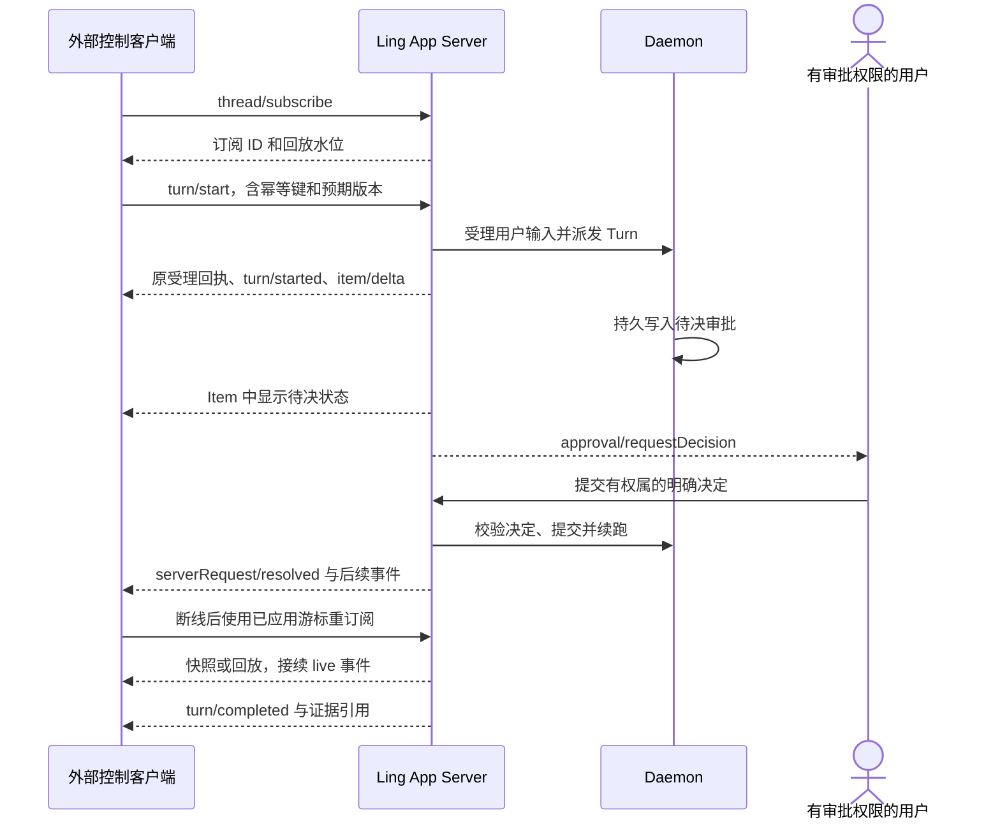

# Ling App Server 详细设计

- **状态** 目标态详细设计，待实施
- **维护者** Contracts、Daemon、API Client、Runner 与开发工具维护者
- **核对基线** 2026-11-20，`origin/main@b8e76d858`
- **类型** 协议、执行、存储与恢复合同
- **上位合同** [Ling App Server 与开发工作流](ling-app-server.md)
- **交付计划** [实施计划与验收](ling-app-server-implementation-plan.md)
- **跨域整合** [Ling Agent Operating Model](ling-agent-operating-model.md) · [整合详细设计](ling-agent-operating-model-detailed-design.md)
- **代码锚点** [RPC](../../packages/daemon/src/server/rpc.ts) · [事件 Hub](../../packages/daemon/src/features/control-plane/events.ts) · [回放存储](../../packages/core/src/storage/sqlite/control-plane-store.ts) · [Thread 路由](../../packages/daemon/src/features/runs/thread-routes.ts) · [普通会话输入](../../packages/daemon/src/features/conversations/normal-conversation-input.ts)

## 1. 运行结构和兼容性

App Server 作为 Daemon 的会话协议入口，以 `ling-app-server/1` 发布。协议解析与能力表由 `packages/contracts` 维护。有类型的客户端位于 `packages/api-client`，CLI 负责本机启动和诊断。Daemon 把 App Server 和既有 HTTP/SSE 的开发请求送到同一会话服务、运行时和持久化所有者。保留现有入口的调用语义。切分 HTTP handler 和会话服务时，用既有客户端路径验证行为一致。

| 目标能力 | 主线入口 | 本设计的接入 |
| --- | --- | --- |
| 发起正常对话 | `POST /conversations/stream` 和普通会话输入接收逻辑 | 提取共用的接收、收据和派发服务。普通消息产生正常 Thread、Turn、Run 和会话投影。 |
| 查看或分支会话 | Thread detail、Turn list 和 fork 路由 | 用现有 Thread ID 和状态做有权限过滤的分页、附件引用和分支投影。 |
| 重新连接 | 现有 `/threads/:id/resume` 会启动执行 | App Server `thread/resume` 只重新接入。显式 `turn/resume` 调用既有预览与执行恢复路径。 |
| 事件 | `/rpc/stream` 的 `controlPlane.subscribe`、Control Plane 事件和 Run 事件 | 复用工作区日志、回放窗口、Hub 和背压。把会话相关状态投影到有作用域的协议订阅。 |
| 工具、提问、审批 | Run、Attempt、Tool Broker、Approval 和 User Input | 原记录决定权限、结果、恢复顺序及已执行副作用。 |
| 检查和审查 | Terminal Report、Workspace changes、Code Assessment | 共享候选身份，投影现有记录，增加验证和验收所需的证据。 |

现有原生 Codex Runner 调用的是另一端的 Codex 协议。传输复用可借鉴其双向连接实现，Ling 自有协议及功能可用性以本合同的协商结果为准。 [Codex Live Client](../../packages/daemon/src/runtime/adapters/codex/live-client.ts) · [Codex App Server](https://learn.chatgpt.com/docs/app-server)

### 1.1 传输、身份和连接生命周期

| 传输 | 运行方式 | 信任边界 |
| --- | --- | --- |
| stdio JSONL | `ling-stack app-server` 用 stdin/stdout 收发帧，stderr 记诊断。以本机配置的受信服务地址接入已选 Daemon。 | CLI 配置由本机用户持有，使用授予该客户端的专用凭据。输入侧只接收完整、有限长度的 UTF-8 JSON 行。 |
| Unix socket | macOS/Linux 上本机连接，使用相同 JSONL framing。运行目录和 socket 限制给拥有者，重启时核对旧 socket 所有者和服务状态。 | 本机 OS 边界结合客户端授权。适用范围以平台报告为准。 |
| 回环 WS / WSS | 一条文本帧对应一个 JSON-RPC 消息。App Server 使用独立的升级路径 `/app-server/rpc`。Windows 也用 stdio 和回环 WS。 | 回环连接同样校验客户端凭据。远程 WSS 显式开启，TLS 和客户端认证在握手前完成。Daemon 通用 HTTP/WS 保持在有权限的管理网络。 |

用户通过本机受信管理入口创建连接配置，选定允许的工作区、操作范围、过期时间及可选 Thread 范围。配置名标记操作者与用途。服务端颁发独立、可撤销的凭据，仅返回授权摘要。存放凭据用现有本机秘密管理，运行日志和 URL 只记录公开配置 ID。WSS 客户端在 Upgrade 使用认证头。需要浏览器集成的宿主通过自己的受信后端或 Desktop 桥接保持认证。监听器校验配置的 Host/Origin，认证与 TLS 终止的位置随部署明确。现有移动端配对凭据按其自身用途管理。

[Ling Device Fabric](ling-device-fabric.md#5-cross-device-task-graph) 的项目节点继续引用其执行主机的 WorkUnit 与证据。App Server 的游标与权限绑定本 Daemon 的工作区。远端设备动作及其状态由对应主机的日志、授权与配对投影管理。

绑定以 Daemon 解析的规范化仓库、worktree 和当前授权版本为准。请求 ID 及客户端展示名用于关联与审计，可信 Actor 来自连接凭据。授权范围取连接、工作区、Thread 和运行政策的交集。在受理、执行和提交决策前分别核对当前权属。撤销关闭对应订阅和新动作入口，已受理工作交由 Daemon 按其取消和恢复策略处置。

对每个连接限制帧大小、未完成请求数、订阅数和总出站字节。基线复用现有 RPC 的 1 MiB 入站、128 KiB 出站帧、1 MiB 或 500 帧积压、5 秒写入期限，实际支持值在握手中返回。较大内容用已授权的分页或分段读取。限制覆盖启动回放、live 队列和 transport buffer。选择 `server_overloaded` 时请求尚未入队。慢客户端断开后以最后成功应用的游标追赶。断开释放本连接的订阅与请求句柄，执行状态仍由 Daemon 维护。健康探针只提供存活、就绪与协议信息。 [现有出站边界](control-plane-outbound-backpressure-2026-10-15.md)

## 2. 协议标识、方法与结果

客户端在 `initialize` 请求声明 `protocolVersions`、`clientInfo`、`requiredCapabilities`、`optionalCapabilities` 和请求的工作区范围。响应提供 `protocolVersion`、`serverInfo`、`connectionId`、有效授权、可用能力与限制。服务端根据配置与运行环境选择能力，客户端发送 `initialized` 后进入可用状态。版本不相容或必需能力缺失时，返回结构化原因并关闭该连接。现有客户端可以忽略附加输出字段，命令参数按选定版本严格解析。支持的消息为独立的 JSON-RPC request、response 和 notification。幂等请求回放返回同一结果内容和本次请求的 JSON-RPC ID。

```jsonl
{"jsonrpc":"2.0","id":1,"method":"initialize","params":{"protocolVersions":["ling-app-server/1"],"clientInfo":{"name":"dev-controller","version":"1.0.0"},"requiredCapabilities":["thread.events","turn.control"],"optionalCapabilities":["approval.respond","development.verify"]}}
{"jsonrpc":"2.0","id":1,"result":{"protocolVersion":"ling-app-server/1","serverInfo":{"name":"ling-stack","version":"0.6.1"},"connectionId":"conn_123","effectiveScopes":["thread.read","turn.control"],"capabilities":["thread.events","turn.control"],"limits":{"maxInboundFrameBytes":1048576,"maxOutboundFrameBytes":131072}}}
{"jsonrpc":"2.0","method":"initialized"}
{"jsonrpc":"2.0","id":2,"method":"turn/start","params":{"threadId":"thr_123","expectedThreadRevision":"rev_1","idempotencyKey":"req_123","input":[{"type":"text","text":"修复复现用例中的刷新问题"}]}}
{"jsonrpc":"2.0","id":2,"result":{"status":"accepted","threadId":"thr_123","turnId":"turn_123","submissionId":"sub_123"}}
```

每个修改方法带逻辑 `idempotencyKey`，状态敏感的操作还带目标 ID 和预期版本或快照。作用域、方法和规范化参数共同构成收据身份。优先复用会话输入收据、Run interventions 和各所有者的唯一性约束。需要补充收据时，与受理同事务写入，文件系统或外部动作使用各自的执行意图和归属记录。复用 key 且输入相同返回已受理结果，输入不同返回冲突。断线后优先查询收据，已过收据保存期限且结果不明时先查目标状态。传输请求 ID 仅用于匹配同一连接内的消息。

已建立订阅的客户端可能先看到状态通知，再收到命令回执。通知通过持久实体 ID 与版本合并，命令通过请求 ID 和受理收据确认。订阅建立的响应与回放有明确的顺序屏障。

| 方法组 | 方法 | 输入、输出与权限 |
| --- | --- | --- |
| 连接 | `initialize`、`initialized`、`server/capabilities` | 返回已协商版本、可用功能与限制。各方法仍检查所在工作区的有效能力。 |
| 工作区 | `workspace/list`、`workspace/read`、`worktree/list`、`worktree/create`、`worktree/refresh`、`worktree/cleanup/preview`、`worktree/cleanup` | 使用 opaque workspace/worktree ID 和预期版本。清理路线沿用当前确认、归属和恢复校验。 |
| Thread | `thread/start`、`thread/resume`、`thread/read`、`thread/list`、`thread/name/set`、`thread/archive`、`thread/unarchive`、`thread/delete/preview`、`thread/delete` | 返回标识、状态、版本、绑定、最新可见 Turn、有效规则来源和历史游标。永久删除使用现有管理权限与用户确认。 |
| 历史和订阅 | `thread/turns/list`、`thread/items/list`、`item/read`、`thread/subscribe`、`thread/unsubscribe`、`thread/snapshot`、`submission/read` | 游标持久化，订阅 ID 只在连接有效。重连与历史读取没有执行副作用。 |
| 计划和目标 | `thread/mode/get`、`thread/mode/set`、`plan/read`、`plan/accept`、`thread/goal/get`、`thread/goal/set`、`thread/goal/pause`、`thread/goal/resume`、`thread/goal/clear`、`thread/goal/complete` | 复用现有模式、计划、Goal 版本和完成证据。工作内容发生实质变化时生成新的接受版本。 |
| Turn | `turn/start`、`turn/steer`、`turn/queue`、`turn/interrupt`、`turn/retry`、`turn/resume` | 返回持久受理回执与状态。实际 Run、Attempt 和证据通过订阅或快照查询。 |
| 分支和上下文 | `thread/fork`、`thread/compact/start`、`thread/revert`、`context/inspect`、`handoff/create`、`handoff/read`、`handoff/resume` | 从指定可恢复边界分支、压缩或交接。历史变更与实际文件回退各用自己的权限、预览和预期版本。 |
| 改动和产物 | `changes/capture`、`changes/read`、`changes/apply/preview`、`changes/apply`、`artifact/read` | 以候选、选中 hunk、工作树版本和审批为边界。应用、回退、重放沿用现有 patch 所有者。产物可分页，内容读取限范围和大小。 |
| 开发验证与审查 | `verify/plan`、`verify/start`、`verify/status`、`verify/cancel`、`review/start`、`review/status`、`review/finding/update`、`simplify/start`、`doctor/run`、`instructions/init` | 指定候选和已配置的规则或配方。运行类返回操作 ID，草案类返回可审阅差异，读取类返回有限证据投影。 |
| 可用能力 | `provider/list`、`model/list`、`skill/list`、`skill/read`、`permissionProfile/list` | 返回可选能力、限制及缺失原因。Provider 凭据绑定在 Daemon 的配置上。 |

服务器声明每个方法的必需范围。基本范围为会话读取、发送/控制、管理 worktree、运行验证、发起审查、应答输入、决策审批。授予读取时只可见授权范围内的历史、产物与事件。审查只读范围可以细化到当前候选。方法发现额外标注副作用和是否要求本机用户确认。

### 2.1 Thread、Turn 和干预语义

- `thread/start` 接受 `workspaceId`、可用的已存执行配置、可选目标工作目录和 `worktreeMode`。创建空会话后可立即读取。写入会话用受管 worktree，创建和环境初始化状态可观察。已有本地 checkout 可以作为显式授权的读取来源。收据与分配记录绑定会话 ID，重试返回同一分配结果。
- `thread/resume` 返回 `ThreadView`、待处理请求与历史游标。`turn/resume` 接受源 Turn/Run 和有效预览，校验 checkpoint、候选、工作树、执行配置和权限后请求恢复。已确认完成的外部动作从回执恢复。遇到执行结果未知时返回具体的恢复阻塞原因。
- `turn/start` 接受有界结构化输入、附件引用、可选 Skill、Goal 的接受版本和 `expectedThreadRevision`。Daemon 选择已保存的 Pi Provider 或原生执行配置，记录生效的初始化规则、工具、权限和候选版本，再派发。外部提交以授权 Actor 进入普通会话。并发写入用当前版本和执行租约裁决。
- `turn/steer`、`turn/queue` 和 `turn/interrupt` 都带 `expectedTurnId` 和输入来源。只有声明并验证通过同 Turn 干预能力的 Runner 才在下一安全模型边界接收追加输入。其他情形返回 `steer_unsupported` 或 `turn_busy`，客户端可以显式选择排队或中断后继续。Pi 保留原始任务锚点，使用已有队列和 interrupt redirect 语义。
- 排队产生持久待执行指令，绑定源 Turn。中断返回请求回执，最终状态以原 Attempt 的停止与已执行动作证据为准。换方向的后继 Run 继承明确的来源，在已确认的写入边界之后开始。`turn/retry` 创建新尝试并核对已发生的副作用。外部结果不确定时显示待核对。
- `thread/fork` 使用明确的已完成 Turn 与历史快照。写入型 Fork 绑定新 worktree 和已确认要包含的提交或补丁来源，读取型 Fork 可以引用父候选。Fork 保存历史来源与任务版本，后继执行通过正常准入。`thread/revert` 使用现有历史替换/清理语义和墓碑，实际文件恢复由 changes 方法显式发起。

Turn 状态沿用 `LingTurnStatus`。前端可另外投影等待报告、停止请求已受理、停止待确认和候选验证未完成。Run、Goal 和候选交付各显示自身状态。断线、认证失效与流程失败使用不同的协议结果。

### 2.2 通知与 Item

```ts
type EventCursor = string // Opaque, scoped to workspace incarnation and subscription filter
type DurableNotice = {
  subscriptionId: string
  cursor: EventCursor
  eventId: string
  threadId: string
  turnId?: string
  runId?: string
  itemId?: string
  revision: string
  payload: unknown // Versioned by the JSON-RPC notification method
}
```

| 事实 | 通知 | 数据来源 |
| --- | --- | --- |
| Thread 与目标 | `thread/started`、`thread/updated`、`thread/archived`、`thread/removed`、`thread/goal/updated` | Thread、Goal 和历史墓碑。 |
| Turn 与执行 | `turn/started`、`turn/status/changed`、`turn/completed`、`turn/plan/updated`、`turn/diff/updated` | Turn 状态、Run 事实、计划与候选引用。 |
| 可见内容 | `item/started`、`item/delta`、`item/completed` | 现有公开会话 Item 与 Run 动作的有界投影。 |
| 请求与证据 | `serverRequest/resolved`、`verification/updated`、`review/updated`、`handoff/created` | 审批、提问、Check、Code Assessment 和交接记录。 |
| 订阅 | `thread/replay/ready`、`thread/resync/required`、`server/warning` | 订阅可用水位、重建原因和此连接状态。 |

Item 具有稳定 ID、类型、状态、版本和来源引用。包括用户输入、助手文本、公开摘要、计划、命令、工具调用、变更、待审批、用户提问、产物、验证、审查发现、交接、压缩和诊断。命令和工具结果的完整内容按权限与长度读取。最终 Item 携带可渲染摘要及完整结果引用，客户端用较新完整版本替换预览。

### 2.3 快照、回放和活跃推送

工作区 Control Plane 维护持久 `seq` 与回放水位。`seq` 用于同一 store 内的顺序。公开游标绑定 store 身份、工作区、授权、订阅过滤范围和水位。同一工作区内的过滤产生数值间隙，由服务端回放窗口确认覆盖。store 更换、授权变化、超出保留窗口时返回 `snapshot_required`。

- **持久通知**从 Canonical 记录派生。Turn、计划、Goal、审批、最终 Item 与终态缺少索引事件时，在既有所有者提交状态的事务中追加内容最小化的 Control Plane 事件，保留 ID、版本和投影引用。应用层复用同一日志和保留策略。旧 clients 的默认 domain、消息格式与过滤保留原定义。
- **实时增量**有 `itemId`、`streamEpoch` 和 `offset`，属于当前 live 连接。文本和输出片段可以合并，游标只记录持久进度。断线后，服务端回放持久通知并提供可用的当前 Item 投影。客户端在同一个 Item 上核对版本和 epoch，最终 Item 到达即覆盖增量。
- **订阅切换**沿用现有 live-first 屏障。先挂暂存订阅，原子读取快照/回放水位 H，响应返回订阅 ID，再发送 H 以内的回放和 `thread/replay/ready`，依序释放 H 之后的队列。无可用快照时调用 `thread/snapshot`，用返回的游标重订阅。快照包括线程摘要、当前 Turn、活跃 Run 引用、未决请求和受影响 Item 版本。
- **投影一致性**以提交后的范围和数据版本为准。回放事件可要求重读最终实体，已归档/替换的实体返回带版本的墓碑。客户端在成功应用通知或刷新状态后才持久化游标。重传通过 `eventId` 和 `revision` 幂等应用。高频输出使用流式缓冲，不承担已完成检查或审批状态的存储职责。

基线行为参考 [Control Plane 回放窗口](runtime-control-plane-detailed-design.md#replay-and-subscription-recovery) 和 [保留水位存储](../../packages/core/src/storage/sqlite/control-plane-store.ts)。

发布给外部客户端的通知使用现有公开投影和脱敏函数。日志、事件重放与诊断只使用当前调用方可见的路径和引用。命令完整输出、diff 和二进制产物以对象 ID 及受限 range 取得，服务端逐次核对对象归属和读取权限。公开产物描述包含可读范围、完整性及截断标记。模型可见的文件、日志和工具输出仅作为数据读入。私有推理、提供方凭据、原始模型上下文和未授权路径留在原所有者。

### 2.4 服务端请求

`approval/requestDecision` 和 `input/requestAnswer` 是 server → client 的 JSON-RPC 请求。所有获准的观察者收到该请求的公开状态，只有拥有对应决策权的客户端可以应答。请求包含 `pendingId`、目标 Thread/Turn/Run、Item、显示预览、允许的决策、有效期和当前决策版本。JSON-RPC request ID 随连接重新分配，审批 ID 或提问 ID 是持久身份。

客户端通过受信用户操作提交结构化决定，Daemon 以待决记录、权限、修订号、冻结的操作和 Attempt fence 做提交。审批决策沿用 `approve_once`、`approve_command_rule`、`approve_permission_scope` 和 `deny` 的适用集合。高权限决定复用本机确认。自然语言、模型输出或普通控制权限只提供建议。并发应答从同一记录返回已提交结果或版本冲突，过期决定返回当前原因。提交、撤销、过期或终止后由所有者产生 `serverRequest/resolved`、必要的 Item 变更及可核对的续跑状态。

断线时待决记录留在原会话。重新授权的客户端可根据快照接收新传输请求。Codex 的 MCP 授权范围只允许观察待决及引导用户打开 Ling 审批，专用富客户端可提交已验证的用户决定。 [审批类型](../../packages/contracts/src/approvals.ts) · [审批策略](approval-policy.md)



### 2.5 错误与恢复提示

| 错误类型 | JSON-RPC code | 处理 |
| --- | --- | --- |
| 非 JSON、非法请求、未知方法、参数校验失败 | 标准 `-32700` 至 `-32602` 对应项 | 客户端修正请求和类型。 |
| `server_overloaded` | `-32001` | 带原幂等键并退避。 |
| `protocol_version_unsupported` / `required_capability_unavailable` | `-32010` / `-32011` | 按实际支持的协议或执行配置接入。 |
| `authorization_required` / `capability_denied` | `-32020` / `-32021` | 重新授权或选用允许的操作。 |
| `stale_revision` / `idempotency_conflict` | `-32030` / `-32031` | 读取现态与收据，确定新的逻辑操作。 |
| `steer_unsupported` / `turn_busy` | `-32032` / `-32033` | 等待、排队或明确中断。 |
| `workspace_binding_invalid` / `worktree_conflict` | `-32040` / `-32041` | 检查当前工作区、候选或写入所有者。 |
| `request_expired` / `request_already_resolved` | `-32050` / `-32051` | 刷新审批或提问事实。 |
| `unknown_outcome` / `resume_blocked` | `-32060` / `-32061` | 查看行动归属和阻塞原因再继续。 |
| `snapshot_required` | `-32070` | 重取有效快照及游标。 |
| `goal_acceptance_incomplete` / `candidate_stale` | `-32080` / `-32081` | 返回缺失验收项或改动漂移以及可重跑检查。 |

错误携带类型、可安全重试标记和允许公开的目标引用。资源存在性、路径和内部异常只在已授权范围内显示。消费通知和恢复事件游标只更新观察进度。实际执行由明确的写方法和 Daemon 归属决定。

## 3. 开发任务的所有权与证据

### 3.1 项目指令、技能与上下文

1. 项目指令解析器从授权 Git 根到任务路径逐级检查，每级优先选择 `AGENTS.override.md`，否则取 `AGENTS.md`。本机用户约定先应用，项目指令按根到叶的顺序叠加，以更具体的适用范围解释局部做法。任务的显式约束与 Daemon 的授权政策保有各自的来源。工作区可显式选择仓库的 `CLAUDE.md` 或按路径采用 `.claude/rules/`。重复来源以规范化路径和哈希去重，冲突在 Doctor 和会话上下文展示。
2. 对路径、符号链接、文件类型、数量和字节应用现有 Host 与上下文预算，按有效作用域载入。已知工作目录的规则随任务输入封存。进入新路径发现规则时，先在安全模型边界附加来源及修订再允许该范围内的模型文件写入。通用 shell 仍按自身已批准范围执行。可执行边界由工具、审批和验证规则实现。
3. 每次实际 dispatch 记录 `instructionManifest` 的版本、来源、作用域及 digest，扩展的目录规则有独立来源事件。在 Turn 恢复及新阶段开始时核对实际版本。影响既有接受条件或安全边界的漂移给出重建或重新确认。预算不足显示来源与受限范围，保留原始任务和未解决条件。Context Inspect 只提供可见来源、估算/实际 token、压缩和截断信息。
4. Skill 显式调用或建议调用都经过现有有效绑定检查。记录定义 revision、来源 checksum、工具和能力要求以及配方引用。带副作用的动作走对应工具或工作流授权。可信 Hook 使用现有 workspace digest pin 和规划策略，记录失败、阻塞和执行时序。
5. `instructions/init` 使用当前仓库资料提案，含来源和可预览补丁。只读 Doctor 报规则优先级、配置冲突、受信配方、工具缺失和状态。初始化补丁经现有改动应用服务处理。独立模型审查从基线 SHA 取适用 `Code Review Rules` 或选定的 `REVIEW.md`，记录版本并覆盖变更位置。

### 3.2 候选、验证计划和结果

候选引用包括 `workspaceId`、`worktreeId`、`baseCommit`、`headCommit`、`candidateDigest`、相关文件范围与覆盖状态。Daemon 从 Git 事实及授权范围内的工作树内容计算候选，包括声明要交付的未暂存和未跟踪改动，复用 Code Assessment 的双次采集和范围保护。文件移动、截断、敏感或不可读内容有明确的覆盖原因。发布证据绑定当前候选和实际输入，审查的脱敏视图另带其自身 digest。

```ts
type CheckStatus = "pending" | "running" | "passed" | "failed" |
  "not_run" | "blocked" | "cancelled" | "unknown"
type CheckEvidence = {
  checkId: string
  candidateDigest: string
  planRevision: string
  recipeDigest: string
  environmentDigest: string
  attemptId: string
  status: CheckStatus
  evidenceRefs: readonly string[]
}
```

- `verify/plan` 使用已登记的路径、包依赖与仓库验证策略选择最小安全范围，返回理由、必要检查、审批、执行目录和环境要求。Ling 仓库可以用已有 [CI 范围分类](../../scripts/ci/classify-scope.mjs) 和 [验证政策](../../CONTRIBUTING.md#validation) 提供建议。未知范围走仓库已有保守规则或显示待确认。
- 配方声明工具/命令或浏览器断言、目录、工作树版本、服务端口和进程所有权、输入数据、超时、清理和预期证据。自动运行使用用户信任记录或仓库已受信的清单。修改配方的候选需要按受信版本与变更影响重新确认。启动、依赖、网络与平台操作走当前 Tool Broker 和审批。外部环境和用户的数据目录使用明确的隔离绑定。
- `verify/start` 使用计划版本和候选。检查读取冻结快照，或持有对应 worktree 租约并核对执行前后的候选 digest。准备、服务启动、真实断言和清理各记录状态。命令的退出码、输出摘要、超时和取消来自 Host 动作。浏览器证据来自真实断言/导航回执和关联的截图。服务退出未知时可报告清理待确认。
- 校验候选、计划、配方、环境和篡改/截断状态后再重用绿色结果。候选变化保留旧结果和旧日志，当前候选需要自己的证据。重跑创建新的检查 Attempt。验证报告尽量链接已有 Terminal Report 与 Run 事件。模型文字可解释结果，可信的运行回执与断言决定状态。
- Bug 修复记录复现或明确的直接行为证据、现象与根因。适用时保留回归用例，并核对修复前失败和修复后通过。已有等价覆盖可直接引用。环境无法复现时显示缺失条件，能完成的代码定位和诊断仍可保存。

### 3.3 Review、交付和 CI

`review/start` 消费候选引用、原始任务、基线指令和可信检查记录，启动独立的只读运行。现有 Code Assessment 保留其 Diff-only 和 findings contract。新增的上下文也采用有边界的只读输入引用，按配置提供对应调用路径。作者上下文的推理和自评保留在原会话。审查发现含候选、捕获位置、触发条件和可见证据。修正走正常 Turn，再计算新候选和保留结果的适用性。`simplify/start` 产出当前 diff 的可行动建议，可委托普通编辑 Turn 应用。 [代码审查工作台](code-review-and-security-workbench.md)

Goal 使用已接受的验收项。代码工作可以指定候选检查、检查具体断言、审查处置或外部 CI 证据。完成事务同时核对候选、记录归属、执行状态、证据类型和覆盖范围。改动包含测试、CI 或验证配方时，独立审查核对其行为覆盖及基线验收要求。已授权的 PR 流程用自己的接收回执。CI 按实际 PR head 和对应 workflow run 核对，Draft preview 仅表示预览验证。提交、推送、合并和部署由各自的适用权限和门槛控制。 [现有 Goal 验收](../../packages/core/src/storage/sqlite/goal-acceptance.ts) · [CI 范围与档位](../maintenance/ci.md)

### 3.4 Handoff、多 Agent 与自研运行环境

- Handoff 保存源 Thread/Turn/Goal、接受的目标与设计决定、候选和 worktree、已验证证据、待决请求/副作用、变更范围、阻塞及下一步。持久记录通过现有 artifact 与 Goal/Turn 归属。摘要引用原始任务及验收项。
- `handoff/resume` 在新会话检查源是否可交接、worktree 版本与写入租约、候选、证据修订和当前授权。兼容则带版本接手，漂移则显示差异和需要重新验证的项。Runner 重启走已有 checkpoint 恢复，交接走普通 Turn 的新派发。多 Agent 使用现有 Workflow 归属、独立授权和可核对的产物合并。
- 每个开发任务记录 Provider、Runner、工作树和构建输入。调试长任务可看模型调用预算、失速原因和最近一个有证据的阶段。正常开发从稳定 Ling 使用独立 worktree 和 Agent 环境。候选 Daemon 和 UI 用独立数据、端口和测试配置启动。代码或配置需要换模型或 Runner 时，交接优先从明确的候选快照进入普通新任务。
- Codex 持续连接通过有类型的客户端或本机 CLI。MCP 桥接使用配好的工作区及受限凭据转发结构化操作，工具结果只返回有限事件页、进度和下一游标。它由同一 App Server 权限裁定。对桥接派发的 Turn 冻结调用链，拒绝把相同任务重新递归派发给来源控制器。客户端后台重连与工具调用超时只恢复观察，派发通过原逻辑凭据和收据。

## 4. 兼容性、迁移与故障边界

优先复用 SQLite 既有状态、控制面日志、收据、运行证据和产物。需要补充客户端授权、候选/配方/验证记录、回放作用域或结构化交接时，在对应所有者中扩展可选字段或新增关联表。旧记录用缺证据、旧策略或快照重建状态展示。迁移覆盖旧库、升级重启、过期游标和跨客户端同时读写。存储版本升级按仓库迁移合同测试。正式降级策略使用独立候选数据和备份。

| 故障 | 显示与恢复 |
| --- | --- |
| 已受理，响应未收到 | 以逻辑请求收据查询，返回原目标与现态。 |
| App Server 或客户端重启 | 同一 Daemon 继续管理 Run。由快照/游标恢复客户端投影和待决通知。 |
| Daemon 或执行主机重启 | 由当前 Attempt 和封存恢复点决策。恢复阻塞或外部结果未知会保留证据及责任方。 |
| 权限撤销、worktree 被换或目标版本改变 | 本次授权重新核对。请求返回当前冲突，对已受理工作应用对应所有者的停止或处置规则。 |
| 审批与中断同时到达 | 已持久提交的有效决策和停止归属有明确顺序。迟到结果通过来源 fence 判断可见性。 |
| 验证与编辑相撞 | 候选发生漂移，记录原结果及变更，当前候选重新安排受影响检查。 |

协议实现从 Contracts 生成 TypeScript 和 JSON Schema。每个方法记录 input、output、通知、权限、幂等键及错误类型。端到端验收需覆盖双向请求、竞态、落盘后断线重传、旧客户端、真实 Provider 和目标传输，见[实施矩阵](ling-app-server-implementation-plan.md#验收矩阵)。
