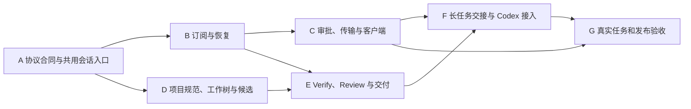

# Ling App Server 与开发工作流实施计划

- **状态** 设计与实施计划，生产实现待开始
- **维护者** Contracts、Daemon、Runtime、API Client、CLI 与开发工具维护者
- **核对基线** 2026-11-20，`origin/main@b8e76d858`
- **类型** 开发准备、依赖顺序和验收计划
- **合同** [产品与架构设计](ling-app-server.md) · [详细设计](ling-app-server-detailed-design.md)
- **代码与测试锚点** [Daemon RPC](../../packages/daemon/src/server/rpc.ts) · [控制面往返测试](../../packages/daemon/test/control-plane-api.test.mjs) · [会话受理收据](../../packages/daemon/test/conversation-submission-receipts.test.mjs) · [框架验收](ling-framework-complementary-implementation-plan.md)

## 目标与开工顺序

交付目标覆盖持久会话、双向推送、审批与用户提问、断线恢复、客户端接入及完整开发工作流。下表按技术依赖安排可独立审查的变更。每个工作包交付对应代码、回归和文档。最后以真实任务证明 Ling 可以在稳定工作区条件下用来迭代自己的代码。



| 工作包 | 依赖 | 交付 | 合并前验收 |
| --- | --- | --- | --- |
| A1 协议合同 | 主线基线 | 在 `packages/contracts` 定义方法、事件、Item、版本、能力、错误、权限和示例。生成 JSON Schema 与 TS 类型。 | 带版本的精确 params/result 验证。正反样例覆盖边界、可选输出字段、未知类型和能力。消费者可独立使用生成合同。 |
| A2 会话接收 | A1 | 在 daemon conversations/threads 提取共用接收、派发与回执。接入 Thread/Turn/Goal 生命周期及附件。以 `thread/resume` 附着、`turn/resume` 执行恢复。 | HTTP/SSE 及协议端同一语义。并发提交、一条请求重发、过期版本、接收后断线、暂不可用配置有可重建结果。 |
| B1 持久事件与回放 | A2 | 复用事件 Hub、Control Plane 工作区水位、Run 和会话投影。填补会话、计划、Goal、待决请求和 Item 终态提交的事件索引。 | 从游标和快照恢复同一 Thread。高水位竞态、保留窗溢出、重复、跨工作区、条件过滤、旧订阅兼容均有测试。 |
| B2 实时 Turn 控制 | A2、B1 | 连接状态、订阅及有界 live Delta。接入排队、停止并重定向、Runner 支持的在途指导、退避和取消事件。 | 同一连接收事件并发指令。跟踪 expected Turn、停机归属、未知副作用、模型请求边界与连续推送。 |
| C1 客户端身份与服务端请求 | A2、B1 | 使用工作区注册、凭据和按操作授权，桥接 Approval/User Input 的持久待决记录与传输请求。 | 观察者、控制者和审批者权限按配置。跨会话陈旧决定、过期与撤销、并发决定及多客户端重连通过。 |
| C2 传输、SDK 与 CLI | B2、C1 | 同一 Daemon 入口提供 stdio、Unix socket、回环 WS 和认证 WSS。实现有类型客户端、live 接口、自动重订阅、诊断探针和 schema 命令。 | 相同协议样例覆测全部声明传输。验证过载、认证、事件/回复顺序、客户端重启、保留 Run 与健康边界。 |
| D1 仓库指令与技能 | A2 | 在 Daemon 的输入准备接入项目规则解析、来源显示、`instructions/init`、Doctor 项目诊断及内置技能入口。扩展 Context Inspect。 | 根与子目录优先级、多工作树、安全路径、文件更新、导入冲突和预算可见。旧 Run 使用实际封存版本。 |
| D2 开发环境与候选 | A2 | 扩展现有受管 worktree 所有者，纳入环境就绪、写入租约、补丁冲突和恢复。共享候选捕获及文件覆盖信息。 | 并行写入各自工作树。主 checkout 的脏文件、用户外部编辑和候选变动有可复核保护证据。 |
| E1 Verify 与运行配方 | B1、D1、D2 | 确定性检查计划、信任和配方版本、Host 执行、Web/平台运行证据、结果与快照绑定。将实际状态纳入既有 Run/Terminal Report。 | 按 diff 选定向检查。命令失败、UI 断言失败、取消、输入漂移、日志截断和清理不确定均有准确结果。 |
| E2 Review 与交付 | D1、D2、E1 | 复用 Code Assessment，加载基线审查规则，接入 `simplify` 与修正 Turn。扩展 Goal 验收与 PR/CI 证据关联。 | 审查输入、独立上下文、旧发现版本和候选身份可见。测试未跑、其他 head 的 CI、旧候选或不匹配的结果均无法满足当前条件。 |
| F1 长任务交接 | B2、D2、E2 | 将阶段、候选、决策、证据、阻塞和未决动作封存为 Handoff，接入 Goal 失速、压缩恢复、跨会话与工作流委派。 | 重启与换客户端得到可核对的进度。已完成动作只发生一次，未知动作保持阻塞，偏离目标的输入和重复工作可定位。 |
| F2 Codex 接入与会话界面 | C2、E2、F1 | 给现成 Codex 提供本机 MCP 桥接和 CLI/skill 入口，并给富客户端提供直接订阅。用现有会话组件显示调用者、进度、审批、验证和交接。 | 从真实 Codex 发起和追踪任务，Ling 打开同一 Thread。审批可由用户操作，断线续订阅，跨客户端看到一致状态，递归委派拦截。 |
| G 自研和发布验收 | C2、E2、F1、F2 | 执行下文矩阵，形成带候选版本的发布和自研准入证据。 | 真实 Provider 与代码任务、协议恢复、平台、安装和远程声明均有对应证据。 |

接口变更的代码所有权以现有目录为准。Contracts 管公共类型和解析，Core 管事务和证据索引，Daemon feature 管领域行为，`server` 管协议及传输，API Client/CLI 管连接及消费。前端控制与证据视图沿用共享会话组件和本地化目录。新文件按实际职责拆分。

## 跟着代码开工

### A1 与 A2 的实施入口

1. 从 [Turn 类型](../../packages/contracts/src/turns.ts)、[会话输入与输出](../../packages/contracts/src/conversations.ts)、[审批类型](../../packages/contracts/src/approvals.ts) 和 [Control Plane DTO](../../packages/contracts/src/control-plane.ts) 定义兼容的公开投影。先补 `initialize`、`thread/start`、`thread/resume`、`turn/start` 和带 Thread/Turn 事件的行为样例，为完整方法表建立相同的验证模式。
2. 从 [普通对话路由](../../packages/daemon/src/features/conversations/routes.ts) 追踪输入、保存与真正的 Run 派发。让 HTTP 和 App Server 使用同一个接收入口，在同一正常会话生命周期落下收据。用现有会话详情核对线程、Turn、提交 Item 及 Run 归属。
3. 先用临时 SQLite、临时 Git worktree 和可重复的本地 scripted Provider 实现往返、延迟回复、待决审批和终态案例。所选测试用例继续作为回归。以真实 API 和正常 tool authority 走完链路。
4. 从现有 RPC [回放 API 测试](../../packages/daemon/test/control-plane-api.test.mjs)、[出站背压测试](../../packages/daemon/test/rpc-stream-backpressure.test.mjs) 和 [断连 Run 测试](../../packages/daemon/test/rpc-run-detach-backpressure.test.mjs) 接力。设置 commit 之后、回执返回之前的断线检查，并核对解析后的终态和已写入的效果计数。

源代码实现和测试可从这里开始。发布跟踪按 [贡献流程](../../CONTRIBUTING.md#before-you-start) 建立，关联设计和工作包。开放 Issue 和 PR 以仓库搜索及外部发布授权为准。

### 开发起步命令

按仓库安装闭包准备本地依赖。Web 依赖 Desktop 共享源码的类型解析，完整锁文件安装可覆盖这条构建边。CI 的 Node、Rust 以及平台选择见 [CI 维护手册](../maintenance/ci.md)。

```bash
corepack pnpm install --frozen-lockfile --ignore-scripts --prefer-offline
corepack pnpm --workspace-concurrency=1 --filter '@ling-stack/cli...' -r build:ci
corepack pnpm --filter @ling-stack/contracts typecheck:ci
corepack pnpm --filter @ling-stack/api-client typecheck:ci
```

新增用例遵循 [测试政策](../../CONTRIBUTING.md#testing-policy)，以可观察行为、原有数据、失败恢复和授权范围为断言。测试默认 TypeScript，使用 owning runner 发现并纳入测试 typecheck。源码校验优先跑受影响包与消费者。原生依赖、安装包和真实调用使用其对应工具链和批准范围。文档随实际交付补状态、命令与证据链接。

### 本地准备记录

| 项目 | 状态 |
| --- | --- |
| 隔离开发分支 | `codex/ling-app-server-design` 基于远端 `main@b8e76d858`。 |
| 目标态、协议、验收与索引 | 本组设计文档，按上表的真实代码入口接入。 |
| 重叠工作搜索 | 核对主线的 Ling Server Connectivity、Ling Device Fabric、原生执行引擎和现有 RPC，GitHub 开放 Issue/PR 的 “app server” 搜索均为空。 |
| 依赖及源码基线 | macOS arm64，Node 24.22.1、pnpm 10.0.0、Rust 1.97.1。过滤安装时 Web 构建缺少 Desktop 共享代码的依赖链接。以完整锁文件安装重试后，CLI 依赖图的 `build:ci` 通过。主线由 `2d51c23d4` 到 `b8e76d858` 的差异限于设计文档。 |
| 包与现有协议回归 | Contracts、API Client、Daemon、CLI 的 `typecheck:ci` 通过。Contracts 和 API Client 的 `test:ci` 通过。Daemon 五个相关文件通过，覆盖 RPC 认证、Control Plane、RPC 背压与断线后 Run、会话受理收据。CLI 返回产品版本 0.6.1 与既有 Daemon 协议版本 1。 |
| 端到端目标验收 | 随工作包实施，见下方矩阵。当前 Framework Assurance 的 F3-B 真实试点为 BLOCKED，试点准入以其所有者公布的状态为准。 |

## 验收矩阵

| 验收 | 环境与入口 | 必须观察到的行为 |
| --- | --- | --- |
| 协议合同 | 生成 schemas、Node SDK、CLI 与 scripted client | 握手、能力选择、完整命令/通知表、合法和非法请求、版本、分页、稳定错误。旧 HTTP/SSE 与 `/rpc/stream` 用例继续通过。 |
| 双向控制 | 真实 Daemon，脚本 Provider/Runner，两个客户端 | 事件连续到达，客户端同时下指令并读取同一 Thread。批准提问明确送达，解答后正常续跑。取消等待真实停止事实。 |
| 回放与阻塞 | 临时 SQLite，有限缓冲，故意断开父客户端或 Daemon | 滞后/过期游标后有快照。待决审批、活跃/终态 Run 和未知外部结果均可重新查看。已执行动作凭 Host 回执保持单次。 |
| 权限与隐私 | 本地和认证远程配置，受限/撤销调用方 | 工作区和 worktree 越权、错误凭据、过期会话、跨线程审批、敏感内容投影、重放旧决定被正确处理。 |
| 项目规则和验证 | 多包 Git 仓库与受控环境 | 按路径载入有效规则，能查实际执行版本。识别 docs-only、测试变更、Web 行为和运行时变化。检查超时、少跑、失败或候选变化保持可见。 |
| 交付与审查 | 同一候选 + 独立审查 + CI 回执 | 旧检查、非当前候选和未处置必需发现无法补足 Goal。修复可追溯到发现和实际回归。CI 证据与候选 PR head 对应。 |
| 真实 Codex | 现成客户端 + 本机 MCP，另测 Typed Client 双向流 | 从 Codex 提交和控制授权任务，Ling 能打开同一会话。卡审批时提示用户，桥接重连保持游标，Typed Client 验证实时推送。 |
| 平台与安装 | macOS/Linux 的 stdio/Unix socket/WS，Windows 的 stdio/WS。覆盖声明的远程 WSS 与实际发布客户端 | 记录目标 OS、架构、安装包、传输和认证方式、退出和资源清理结果。安装、签名、命令沙箱和真实远程路由结果各有证据。 |
| 项目自研 | 以下三个真实任务，稳定工具链与候选实例隔离 | 代码行为和运行状态都能复核。记录任务完成、约束遗漏、人工纠正、使用的模型和验证结果。 |

### 三个实际开发任务

与 [Framework Assurance](ling-framework-complementary-implementation-plan.md) 复用基线、证据来源绑定和真实试点准入。开始真实 Provider 验收之前，从仓库历史固定任务的起始提交、环境、验证策略和验收断言。保存红测或前置行为作为输入，运行方只收到任务和授权的仓库上下文。

| 样本 | 任务原型 | 验收重点 |
| --- | --- | --- |
| 可复现 Bug | 从已有回归中选一个受理收据、重连或视图状态 Bug，在修复前提交复现。 | 定向行为断言在修复后通过，相关既有测试保留，独立审查能定位改动和受影响行为。 |
| Web 交互 | 选择已有会话工作台、审查详情或验证视图的一个真实交互需求。通过实际启动的 Web 和测试数据验收。 | 看见预期 UI 行为、错误状态和截图/断言，刷新后状态准确，报告能解释环境覆盖。 |
| 跨模块长任务 | 选择同时涉及 Contracts 和 Daemon 或 Web 的真实交付项，中间在已验证阶段断开客户端，主动交接给新会话。 | 原始范围和验收项都可找回，Git 与证据一致，受理和已发生效果有回执，后续测试和审查覆盖同一候选。 |

每次记录起始提交、最终候选、版本、验证范围、耗时和人工返工次数。需要比较 Codex 时使用同一起始提交、任务与验证器，在相同模型可用时固定模型，并记录 Runner、权限和环境差异。真实 Provider 的预算和请求上限在实际试点前登记。定向离线和 scripted Provider 回归可以先独立完成。

正式用 Ling 迭代 Ling 时，由稳定版控制端操作开发 worktree，候选实例使用独立 `LING_STACK_HOME`、端口和测试数据目录。合并前取得已启用的 CI 与项目验收证据。部署和升级通过发布流程，稳定端保留可接手候选的路径。
