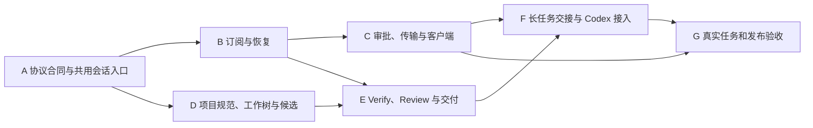

# Ling App Server 与开发工作流实施计划

- **状态** App Server 本机传输、Turn 控制与恢复、Verify 和 Federation 已通过定向验收。Agent Operating Model 已接入工作项接单、控制和协作记录。下文列出完整实施与发行仍需完成的工作包。
- **维护者** Contracts、Daemon、Runtime、API Client、CLI 与开发工具维护者
- **核对基线** 2026-11-22，`origin/main@4eb8798b0`
- **类型** 开发准备、依赖顺序和验收计划
- **合同** [产品与架构设计](ling-app-server.md) · [详细设计](ling-app-server-detailed-design.md)
- **代码与测试锚点** [Daemon RPC](../../packages/daemon/src/server/rpc.ts) · [控制面往返测试](../../packages/daemon/test/control-plane-api.test.mjs) · [会话受理收据](../../packages/daemon/test/conversation-submission-receipts.test.mjs) · [框架验收](ling-framework-complementary-implementation-plan.md)

## 当前实现证据

当前支持回环 WebSocket、stdio JSONL、私有 Unix socket 和 TypeScript 客户端。CLI 的 `app-server probe|stdio|listen|mcp` 复用同一连接，使用 `server/capabilities` 确认当前连接的方法，支持范围随 Daemon 认证和已有能力变化。CLI 还提供 `app-server instructions-init`、`app-server verify` 和 `app-server verify-status`，用于预览项目约定、按当前候选创建验证计划和读取持久验证结果。上一版的 HTTP/SSE 与 `/rpc/stream` 沿用原入口。只有持 Daemon bearer 的客户端可提交 Run 审批和提问答案、启动 Verify 或 Review，以及触发满足 conformance 的只读外部 Runner 派发。连接按工作区绑定。未登记的检查显示 `blocked`。`thread/snapshot` 返回当前 Turn、Run、Goal、待决审批/提问和持久游标，`context/inspect` 返回已封存的上下文与项目规则清单。

实现分支已经把协议合同、WebSocket 协商、Thread/Turn 生命周期、Work Item 控制与证据、开发工作流入口、协作记录、审议触发策略、外部 Agent 注册与任务受理接入同一个 App Server RPC。协作记录复用 Work Item 证据板的持久 CAS 与幂等边界，外部 Agent 任务在派发前核对 Work Item 当前 revision 和 control state。

已验证的关键回归包括 App Server WebSocket、stdio/Unix socket、MCP bridge、Work Item 控制与证据、协作记录回放、开发工作流服务、外部 Agent federation、配置的 Pi Runner 和 API Client。Verify plan/operation 和 Federation ledger 已接入工作区 SQLite 的 app_server_state，按来源工作区恢复，Daemon 重启后会把无法确认的 queued/running Verify 和外部 running task 标记为 unknown，要求原所有者重新核对。Verify 只接受默认或 Host 登记的配方，执行前后核对候选 digest。Host 登记的配方还绑定路径选择、独立 verifier source、coverage digest 和 producer refs，命令输出以有限大小保存并脱敏。重复 start/cancel 使用同一收据，取消会传递给实际检查进程。Work Item acceptance 通过同一 SQLite 事务写入 receipt、状态和 revision。外部任务在 Work Item revision/control、Runner external boundary、工具 conformance、只读工具范围和 admission fence 通过后调用已配置的真实 Adapter。注册、能力读取、任务接入、重连和取消均以请求工作区选择 federation ledger，重复提交不重复派发，Adapter 失败、取消未确认和断线重启均保留 unknown。普通 `turn/start` 通过同一会话受理、准备快照和 Run 入口，`submission/read` 与 `turn/resume` 可在重连后读取原收据，已准备但尚未派发的 Turn 通过原请求恢复同一 Turn。停止的 Turn 在实际执行和效果收敛后，可用明确的恢复键受理后继 Turn。用户提问由 Host 事务产生 `pending` 事件，认证客户端从线程快照取得短期 authority，通过 `input/respond` 复用公共解析、权限和版本 CAS，答复事件在重启后按原身份回放，已结束的问题不会再次要求应答。项目规则在准备快照时按路径读取并封存 digest，`instructions/init` 只在预览版本仍匹配且目标未被占用时原子写入。Review 先捕获候选两次，再读取基线的 `Code Review Rules` 和显式 `REVIEW.md`，规则与发现项处置由同一候选和幂等收据约束。App Server 的 operator 写操作要求认证凭据，能力与方法表只公布当前连接可用的实现。已用本机安装的 Codex App Server 通过 MCP bridge 创建 Ling Thread、提交配置 Pi Runner Turn，并从 Ling 游标恢复 Turn 事件。平台和兼容证据随 PR 检查及发行矩阵记录。

### 项目约定与验证

- 内置 `init-project-instructions` 和 `verify-current-changes` 技能通过 CLI 预览项目约定、捕获候选、生成计划、启动检查并读取状态。应用初始化草稿需要当前预览 revision 和 operator 授权。
- Host 登记的 Verify 配方可以选择受影响路径，并把独立 verifier source 的摘要、coverage 和 producer refs 封存到每个检查结果。
- Goal 的 `verification_passed` 条件要求同一 Thread 的已完成 Verify operation、当前候选摘要、匹配的 verifier basis、coverage 和 producer refs。候选漂移、检查来源漂移、缺少独立证据和过期的接受版本都会阻止完成。
- App Server 可以为已绑定的频道或队友会话创建、刷新和归档托管工作树。归档按检视过的候选和目录身份校验，恢复日志保留同一预览请求的归档快照。
- 普通会话可从最新已收敛的 Turn 封存 Handoff。记录包含候选、原 Goal 进度、接受的计划和产物引用。接手通过正常会话分支和提交受理复用原回执。候选、Goal 或计划变化时需要更新 Handoff。
- App Server operator grant 支持 workspace、Thread 和 Work Item 范围，按 scope 分开观察、控制、审批和答复权限。grant 的 revision、过期和撤销参与握手、请求和推送路径。
- CLI 和 TypeScript client 可以直接进入上述流程。Daemon 重启、重复请求、取消未确认和未知配方仍保持已有的持久回执语义。

| 工作包 | 已验证场景与证据边界 |
| --- | --- |
| A2/B1 会话恢复和事件 | `thread/resume` 从读快照取得当前 Turn 和事件游标。两个连接同时恢复已准备的 Turn 只启动一个 Run，并使用原来封存的项目规则。停止的 Turn 以原 Run 效果收敛和请求键为前提续接。订阅者可以接收普通 Pi Turn 的实时增量、结束通知和最终 Item 引用。App Server 的 Thread/Work Item 游标由持久存储代次、授权代次和目标签名，跨重启可复用，主体、工作区、目标或凭据变化返回 `snapshot_required`。SDK 在订阅确认时登记连接内的订阅 ID，紧接确认到达的回放也会推进下次重连的游标。 |
| C1 工作区绑定 | App Server 握手校验 Daemon 已授权的工作区，并固定解析后的路径。端到端回归验证越界握手返回 403，目录别名变化后连接继续使用原绑定。 |
| C2 认证 WSS | Host 可配置独立 TLS 监听器，只接受 App Server 上的 scoped grant。实际 TLS 回归覆盖证书校验、Host/Origin 范围、控制和推送、旧 RPC 路径隔离、另一个监听器撤销现有连接。公网部署与多平台安装仍需实测。 |
| O2 外部 Runner | 真实 Daemon 使用配置的 Codex Runner Adapter 调用回环模拟后端，核对协商、任务身份、工作区和只读工具范围。完成状态与 Adapter 事件在重启后可重放。未确认的取消保留 `unknown`，存储写入失败时从最后提交状态恢复。 |
| B2 在途输入 | `turn/queue` 将输入交给持久 Run intervention。前驱已记录执行结束及副作用收敛时，Daemon 可在重启后用同一收据启动后继 Turn。用配置 Pi Runner 核对实际投递一次、重连事件及新旧 Turn 的关联。`turn/interrupt` 可携带明确的重定向输入。`turn/steer` 在当前 Runner 无同 Turn 安全注入能力时返回 `steer_unsupported`。已安装的 Codex 通过 MCP 验证了快照、追加消息、Turn 恢复入口和事件读取。 |
| C2/F2 版本兼容 | 用 `v0.6.1@3fe77440e` 源码构建在 macOS 上创建 Thread、Turn、待决审批和游标，候选 Daemon 接手原 SQLite，旧 SDK 可读取 Thread 和处置后的审批。候选 SDK 向旧 `/rpc/stream` 尝试提交时，在协商阶段返回 `protocol_version_unsupported`。候选 Daemon 的 `/rpc/stream` 仅提供原有方法。测试覆盖 App Server 专属方法拒绝、旧客户端的 Run 启动和取消。候选 CLI probe 和本机 Codex MCP 已通过。v0.6.1 未提供 App Server 协议。发布安装包、远程连接及回退对账另行验收。 |
| E1 Verify 与用户输入恢复 | Verify 按幂等键在 SQLite 写事务内受理。两个连接同时提交复用原操作及其事件。取消受理与停止意图一起写入，重启后可按原键读取回执。`verify/status` 记录确认退出后的 `cancelled`。执行器无法确认停止时，返回 `unknown` 并附 `verification_cancellation_unconfirmed`。已绑定工作项的 Verify 状态和 Control Plane 事件同事务提交。用户提问的 authority、答案 CAS、投递收据和 `pending/answered/cancelled` 事件也在重启后保持同一请求身份。 |
| E2 交付前验收 | App Server 与 HTTP 使用同一套 Goal 验收解析和证据检查。实际 Pi Run 通过后，可用同 Thread 证据完成 Goal。Verify 结果用绑定当前候选的 `verification_passed` 条件完成 Goal，独立 verifier basis、coverage 和 producer refs 不匹配时会被拒绝。Review 已验证候选绑定、发现项处置和 freshness 持久化。`simplify/start` 与 `simplify/status` 支持只读简化审查及重启重放。`github_delivered` 要求当前已提交候选、同 Thread 与 Work Item、已接受的检查政策和 Host 重新核对的实际合并结果。 |
| O4 GitHub 证据核对 | 配置注册仓库、不可变仓库 ID 与分支政策。对已受理工作项重读 PR、实时 base ref、集成提交父链、检查 App、冻结的 workflow 文件、实际测试对象和最新 attempt。夹具覆盖同名异源检查、工作流改动、保持 head 更新 base、迟到尝试和合并后重新核对。工作项保留以前的观察和稳定交付 ID。GitHub merge queue 与实际仓库合并保护仍需验收。 |
| O1/O8/O9 接单、控制和协作 | 工作项创建、控制、接单、证据和协作写入各自与对应事件同事务提交。两个客户端验证了幂等、冲突、写入失败回滚和游标回放。阶段运行、交接、裁决与恢复的联合验收仍待下方矩阵。 |
| O7 定时协调轮次 | 已配置的 Automation 在同一事务中写入终态回执、轮次和事件。实际调度器从重启前的时段恢复。故障注入验证提交失败不会留下回执或轮次。回执重放复用原轮次。截止后生成简报和关闭事件，暂停的工作项产生跳过回执。该用例启动的 Runner 数量为零。 |
| O1 首次会话派发 | `workItem/accept` 可选定主执行会话，接单和首发意图同事务保存。正常会话 Run 创建核对该意图并原子更新 Work Item。脚本化 Pi Provider 验证了重启、两个并发受理、暂停恢复、实际派发一次，以及当前绑定阻止删除会话。Codex MCP 已提供同一创建和受理入口。 |

源码兼容用例由 `LING_APP_SERVER_PREVIOUS_BUILD` 指向已构建的上一版源码目录。`LING_APP_SERVER_CODEX_EXECUTABLE` 指向已安装的 Codex。两项均使用隔离状态和回环服务，配置 Pi Runner 使用脚本化 Provider。 [发行验收测试](../../packages/daemon/test/app-server-release-acceptance.test.ts)

## 尚待完成的发布条件

| 工作包 | 代码或验收差距 |
| --- | --- |
| A1、B1、C1、C2 | 全方法的 Schema 校验和更多宿主兼容组合。workspace、Thread、Work Item 的 grant 和 WSS 已接入，审批和用户答复仍需按不同真实宿主与远程部署做验收。App Server 目标游标已绑定存储代次、授权代次和目标，现有兼容用例覆盖本机的上一版源码与候选组合。 |
| D1、D2、E1、E2 | 开工时的项目规则加载、两个开发 Skill、工作区 Verify、独立 verifier basis、托管工作树管理和外部 GitHub 合并结果验收已接入。仍需运行中进入新目录的局部规则、候选补丁的应用预览和提交、浏览器/平台配方，以及 UI 运行报告。 |
| F1、F2 | 普通会话已接入 Handoff 的候选封存和接手。仍需跨 Agent Workflow 的执行归属和预算承接。已有 Codex MCP 联调，双端宿主界面和授权变更后重订阅需要实测。 |
| O1、O3–O9 | GitHub webhook/poll 归并与派发、自治接单、合并队列、经验和设备反馈、阶段简报、在途改计划、交接、审议裁决和跨 Run 预算。现有工作项状态、会话首发、定时轮次和 GitHub 实际合并核对已有对应回归。仍需接入原 Workflow 并完成联合 UI 验收。 |
| G | 自研切换和回退日志对账、签名安装产物、远程 WSS 和三个真实 Provider 自研试点。macOS 打包预检仍缺当前打包输入的 Office 审查、对应 Electron/OS 的受限运行时审查和 gstack 平台资源。T01 离线预检达到评审条件，真实试点仍需按 Framework Assurance 准入。 |

## 目标与开工顺序

交付目标覆盖持久会话、中途输入、双向推送、审批与用户提问、断线恢复、客户端接入及完整开发工作流。Agent Operating Model 还覆盖同一工作项内的共享证据、运行中改计划、阶段交接、跨 Run 进展判断、Agent 问答与按条件开启的审议。下表按技术依赖安排可独立审查的变更。每个工作包交付对应代码、回归和文档。最后以真实任务证明 Ling 可以在稳定工作区条件下用来迭代自己的代码。



| 工作包 | 依赖 | 交付 | 合并前验收 |
| --- | --- | --- | --- |
| A1 协议合同 | 主线基线 | 在 `packages/contracts` 定义方法、事件、Item、版本、能力、错误、权限和示例。生成 JSON Schema 与 TS 类型。 | 带版本的精确 params/result 验证。正反样例覆盖边界、可选输出字段、未知类型和能力。消费者可独立使用生成合同。 |
| A2 会话接收 | A1 | 在 daemon conversations/threads 提取共用接收、派发与回执。接入 Thread/Turn/Goal 生命周期及附件。以 `thread/resume` 附着、`turn/resume` 执行恢复。 | HTTP/SSE 及协议端同一语义。并发提交、一条请求重发、过期版本、接收后断线、暂不可用配置有可重建结果。 |
| B1 持久事件与回放 | A2 | 复用事件 Hub、Control Plane 工作区水位、Run 和会话投影。填补计划、Goal、待决请求和 Item 终态索引，定义与 Thread 无关的 Work Item 事件寻址及游标规则。O1 提供工作项归属和授权投影。 | 从游标和快照恢复同一订阅目标。验证水位竞态、保留窗溢出、重复、权限变化、跨工作区及旧订阅兼容。工作项接通后验证会话关联前后的持续回放。 |
| B2 实时 Turn 控制 | A2、B1 | 接入运行中普通消息、显式指导、排队和停止并重定向。按 Runner 能力、`expectedTurnId`、`expectedTurnRevision`、输入归属和适用的计划版本核对受理与实际投递。 | 在同一连接收事件并发指令。普通消息可查来源和排队状态。延迟的指导遇到停止或换计划时按旧绑定处置。并发操作、已准入的效果和停止回执分别有证据。 |
| C1 客户端身份与服务端请求 | A2、B1 | 使用工作区注册、凭据和按操作授权，桥接 Approval/User Input 的持久待决记录与传输请求。 | 观察者、控制者和审批者权限按配置。跨会话陈旧决定、过期与撤销、并发决定及多客户端重连通过。 |
| C2 传输、SDK 与 CLI | B2、C1 | 同一 Daemon 入口提供 stdio、Unix socket、回环 WS 和认证 WSS。实现有类型客户端、live 接口、自动重订阅、诊断探针和 schema 命令。Unix socket 重启前探测 stale hard link，只清理确认无监听者的路径。 | 相同协议样例覆测全部声明传输。验证过载、认证、事件/回复顺序、客户端重启、stale socket 恢复、保留 Run 与健康边界。 |
| D1 仓库指令与技能 | A2 | 在 Daemon 的输入准备接入项目规则解析、来源显示、`instructions/init`、Doctor 项目诊断及内置技能入口。扩展 Context Inspect。 | 根与子目录优先级、多工作树、安全路径、文件更新、导入冲突和预算可见。旧 Run 使用实际封存版本。 |
| D2 开发环境与候选 | A2 | 扩展现有受管 worktree 所有者，纳入环境就绪、写入租约、补丁冲突和恢复。共享候选捕获及文件覆盖信息。 | 并行写入各自工作树。主 checkout 的脏文件、用户外部编辑和候选变动有可复核保护证据。 |
| E1 Verify 与运行配方 | B1、D1、D2 | 确定性检查计划、信任和配方版本、Host 执行、Web/平台运行证据、结果与快照绑定。将实际状态纳入既有 Run/Terminal Report。 | 按 diff 选定向检查。命令失败、UI 断言失败、取消、输入漂移、日志截断和清理不确定均有准确结果。 |
| E2 Review 与交付 | D1、D2、E1 | 复用 Code Assessment，加载基线审查规则，接入 `simplify` 与修正 Turn。扩展 Goal 验收，提供校验候选与 CI 证据适用范围的入口。 | 审查输入、独立上下文、旧发现版本和候选身份可见。只有适用当前候选和验收依据的证据可以满足对应条件。 |
| F1 长任务交接 | B2、D2、E2 | 将阶段、候选、决策、证据、阻塞和未决动作封存为 Handoff。沿用 Goal 监督和执行循环，在压缩、换会话或换执行人后重建原目标和已兑现的进展。 | 恢复后核对最新已接受的目标和候选。同一缺项、负责人和重试消耗可查。受理、派发、开工状态可区分，已执行的动作和结果未知的动作由原所有者核对。 |
| F2 Codex 接入与会话界面 | C2、E2、F1 | 给现成 Codex 提供本机 MCP 桥接和 CLI/skill 入口。可编程宿主分别连接 Codex App Server 和 Ling App Server，使用 Ling SDK 处理持续推送、在途干预和重连，并在宿主自己的会话视图呈现进度。 | 实际 Codex 经 MCP 提交、读取和控制同一 Ling Thread。可编程宿主经两端真实连接显示实时状态、提交干预、处理审批提醒和丢线重订阅。递归委派和重复消费有端到端结果。 |
| G 自研和发布验收 | C2、E2、F1、F2、O4、O9 | 执行下文矩阵，形成带候选版本的发布和自研准入证据。 | 真实 Provider 与代码任务、协议恢复、平台、安装和远程声明均有对应证据。联合交付纳入跨入口受理、CI 依据、调度恢复和团队协作的验收结果。 |

## 补充整合工作包

App Server 之外的团队、任务、外部 Agent 和 GitHub 设计不能各自形成第二套状态机。它们作为整合层接入已有合同，交付顺序如下。

| 工作包 | 依赖 | 交付 | 合并前验收 |
| --- | --- | --- | --- |
| O1 Agent Work Item 与团队运营 | A2、D1、现有 Channel Team Operating System、外部来源身份合同 | `AgentWorkItem`、来源与 Goal 绑定、现有分配与派发回执、speaker/observer 投影和收件箱事件。按授权的结构化 Work Item 或 GitHub 对象标识归并入口，在工作区内原子确认来源绑定、默认 Work Item 及首次派发意图。现有所有者负责派发。计划阶段映射到 Workflow 步骤。 | 同一任务由 GitHub、会话和 Codex 同时提出时取得一个默认主执行。重复受理可追溯至同一派发回执，另行执行需显式授权，相关 PR 使用受信关联。过期、重指派与取消由原运行所有者恢复。 |
| O2 External Agent Federation | C2、现有 External Agent Runner Adapters | 外部 Agent 注册、能力握手、Work Item 提交、双向事件、审批/提问、重连、递归防止和 unknown outcome。 | Codex、Claude Code、LobeHub 或 ACP adapter 的 capability mismatch、断线、审批、取消、事件回放和重复 dispatch 均有结果。 |
| O3 Task Inbox 与自治策略 | O1、Automations、Channel Team Operating System | 按版本化的 `AutonomousIntakePolicyV1` 配置人工、建议或自动送入主 Agent，应用筛选、优先级、安静时段、预算和暂停策略，并为每次评估保存 receipt。 | 默认人工接入。符合规则的建议可手动接受，显式启用的来源可以自动提交。暂停和预算限制产生可回查的 suppressed/paused 结果，重复来源关联已有执行。 |
| O4 GitHub Delivery Loop | O1、E2、GitHub Automation 与 GitHub 合并策略 | 关联 Issue、PR 和 CI，记录实际验证对象、检查来源及运行尝试。精确集成证据依赖合并队列或等效的执行时校验。严格保护适用于允许 up-to-date head 证据且执行身份受必需检查约束的策略。外部合并按实际结果对账。 | head 固定且 base 推进时，旧集成证据只能用于历史对象，适用的 head 检查按政策保留。覆盖同名检查的来源差异、迟到结果及读取证据后发生的 base 变化。以实际合并结果和适用证据完成 Goal。 |
| O5 Memory/Skill Feedback | O1、E2、Memory/Skill review owners | Work Item provenance、Experience candidate、Memory/Skill/Channel review 和失效策略。 | 候选能追溯源 Run 与证据，拒绝/过期可见，推广不能扩大工具、审批、Provider 或工作区范围。 |
| O6 Device Work Item Bridge | O1、Ling Device Fabric | 项目 Work Item 与设备图节点、owner host、WorkUnit、receipt 和跨设备反馈的映射。 | 项目协调者可显示设备节点进度，实际设备动作仍由 owner host 记录和恢复。设备断线不伪造项目成功。 |
| O7 共享证据板与阶段协作 | O1、B1、D2、现有 Automations | 按来源、候选和权限投影共享证据。复用 Workflow 结果包与交接意图，接入角色简报、轮次、直接消息和同级问答。日/周协调动作原子提交终态 Automation 回执和轮次事件，或提交带类型化原因的跳过结果。接入新计划、交接和跨 Run 进展。 | 日/周轮次在提交边界崩溃后可用原调度身份核对，恢复已提交轮次的截止时间。验证并发贡献、关闭、跨轮次问答、旧证据、计划修订、定向投递及接手恢复。重试和换 Run 时累计进展与预算可核对。 |
| O8 审议与投票 | O7、E2、现有 Workflow 和团队参与合同 | 实现 `DeliberationTriggerPolicyV1` 和角色判定。在计划形成、已声明决策点和运行中临时决策使用各自的准入路径。复用 Workflow 编排提案、质疑、条件投票和汇总，向原依赖提交有版本的决策回执。 | 同一争议从多个来源到达时关联同一决策。同一决定修订只受理一轮。验证父工作流图保持原接受版本、只有当前有权裁决能解除相应依赖，以及改范围走新计划接受。保留平票、预算、缺证据、取消和换候选回归。 |
| O9 协作界面、协议与联调 | O8、F2 | 通过 App Server 方法、事件、SDK、CLI 与客户端视图交付阶段、简报、消息、问答、交接、审议和当前阻塞。接入无 Thread 工作项的预接单订阅和有权限的轮次配置。 | 在同一工作项验证接单前订阅、P01 到 P02 与 QA 的交付、在途消息和改计划、接手重建、审议回接和空转停止。重连后核对原回执、当前候选及实际派发次数。 |

这些工作包对应 [Ling Agent Operating Model](ling-agent-operating-model.md) 和 [详细设计](ling-agent-operating-model-detailed-design.md)。它们补充 App Server 的协议方法，但不新增替代 Thread、Goal、Workflow、Run、Approval 或 Device Fabric 的独立执行系统。

O7 在工作项、候选和事件合同可用后可与 E1、E2 并行。O4 使用 E2 的证据适用性接口，把 GitHub 的来源、验证对象和合并回执交回同一验收所有者。O8 使用 E2 的审查证据和验收规则。O9 复用 F2 的会话组件和传输。O4 和 O9 的结果进入 G 的发布验收。 [阶段协作](ling-agent-operating-model-detailed-design.md#57-plan-stages-and-stage-briefs) · [审议触发](ling-agent-operating-model-detailed-design.md#54-deliberation-workflow) · [O9 联合验收](#o9-联合验收)

接口变更的代码所有权以现有目录为准。Contracts 管公共类型和解析，Core 管事务和证据索引，Daemon feature 管领域行为，`server` 管协议及传输，API Client/CLI 管连接及消费。前端控制与证据视图沿用共享会话组件和本地化目录。新文件按实际职责拆分。

## 补充可靠性准入工作包

这四项不是新的执行系统。它们把现有验证、控制、迁移和协议所有者接到自研准入条件。

| 工作包 | 交付 | 合并前验收 |
| --- | --- | --- |
| E1/E2 Trusted Verification Basis | Plan/Goal 冻结可信验证器来源、覆盖和 producerRefs。候选修改测试、脚本、发现配置或 CI 规则时，重新计算适用性。 | 用同一 pnpm test 命令制造断言被删除或选择器被改写的绿测，Goal 不能完成。独立可信检查或新接受版本替代后才可继续。人工结案保留单独例外。 |
| O1/O9 Work Item Control | `workItem.control`、pause/resume/cancel、控制代次、跨 Workflow/Automation/Delivery admission latch，Thread hard-delete 依赖检查。 | linked Workflow、审议、静默 Automation、待投递 Delivery 同时存在时暂停只挡新准入。重启、未知外部效果、恢复、删除预览竞态都不能重开或重复派发。 |
| G1 Cutover and Rollback | 稳定版/候选版切换清单、迁移快照、effect/receipt/revocation journal、store/auth epoch 和回退后 reconciliation。 | 候选版写入外部回执后崩溃，旧版从切换前快照启动。旧游标和撤销凭据失效，原回执被核对前不允许新派发，外部效果只归属一次。 |
| C2/F2 Compatibility Matrix | 按发布版本声明 Daemon、SDK、CLI、MCP bridge、Codex host 支持组合。 | 实际上一版/候选版产物双向连接，覆盖待决控制、审批、cursor、unknown outcome 和撤权。未支持组合拒绝新副作用而保留原收据恢复。 |

## 跟着代码开工

### A1 与 A2 的实施入口

1. 从 [Turn 类型](../../packages/contracts/src/turns.ts)、[会话输入与输出](../../packages/contracts/src/conversations.ts)、[审批类型](../../packages/contracts/src/approvals.ts) 和 [Control Plane DTO](../../packages/contracts/src/control-plane.ts) 定义兼容的公开投影。先补 `initialize`、`thread/start`、`thread/resume`、`turn/start` 和带 Thread/Turn 事件的行为样例，为完整方法表建立相同的验证模式。
2. 从 [普通对话路由](../../packages/daemon/src/features/conversations/routes.ts) 追踪输入、保存与真正的 Run 派发。让 HTTP 和 App Server 使用同一个接收入口，在同一正常会话生命周期落下收据。用现有会话详情核对线程、Turn、提交 Item 及 Run 归属。
3. 先用临时 SQLite、临时 Git worktree 和可重复的本地 scripted Provider 实现往返、延迟回复、待决审批和终态案例。所选测试用例继续作为回归。以真实 API 和正常 tool authority 走完链路。
4. 从现有回放、出站背压和断连 Run 测试接力。设置 commit 之后、回执返回之前的断线检查，并核对解析后的终态和已写入的效果计数。追加 Work Item 关联 Thread 前后、订阅重叠及授权修订导致游标失效的夹具。 [回放 API](../../packages/daemon/test/control-plane-api.test.mjs) · [出站背压](../../packages/daemon/test/rpc-stream-backpressure.test.mjs) · [断线 Run](../../packages/daemon/test/rpc-run-detach-backpressure.test.mjs)

### O1 与 O4 的实施入口

1. 复用外部来源规范化和现有分派入口。通过结构化引用解析同一工作区内有权访问的 Work Item 或规范 GitHub 对象。受理在同一事务内绑定来源，确定默认 Work Item，复用已有派发身份或记录唯一的首次派发意图。该意图由现有所有者消费。按获准的显式引用和受信 PR 关联匹配，覆盖并发首次接单、失去响应后的重试、授权隔离、相似文字和显式另起执行。 [目标身份](ling-agent-operating-model-detailed-design.md#32-work-item-target-identity) · [Work Item 存储](../../packages/core/src/storage/sqlite/work-item-store.ts) · [外部来源](../../packages/core/src/external-work.ts) · [会话派发](../../packages/daemon/src/features/channels/channel-turn-dispatch-lifecycle.ts)
2. 在 GitHub 证据入口保留仓库、PR、head、base、验证基准（`head`、`integration` 或 `merge_group`）、实际被测对象、检查来源和 run attempt。需要精确集成证据时，由仓库强制的合并队列或等效机制在合并时核对已验证的集成基准。允许 up-to-date head 证据时，由启用严格保护的仓库在合并时为该调用身份校验当前性和必需检查。外部完成的合并通过读取实际被合并对象及适用证据对账。保持 head 固定，分别演练 base 推进后旧检查到达和合并操作竞态。 [CI 证据与合并合同](ling-agent-operating-model-detailed-design.md#74-ci-evidence-and-merge-guard) · [CI 来源](../../packages/core/src/external-work-ci-triage.ts) · [外部动作](../../packages/core/src/external-work-actions.ts)

### O7–O9 的实施入口

1. 从团队证据存储、步骤结果包和交接接入证据、阶段简报、角色投影、轮次和消息。复用 Workflow 启动归属和恢复入口恢复已接受的交接。覆盖接受后尚未受理派发，以及派发已受理而客户端尚未看到状态两个断点。 [证据存储](../../packages/core/src/storage/sqlite/channel-team-evidence-store.ts) · [步骤结果包](../../packages/daemon/src/features/channels/workflow-step-packets.ts) · [Workflow 交接](../../packages/daemon/src/features/channels/workflow-handoffs.ts) · [步骤派发](../../packages/daemon/src/features/runs/workflow-step-start-admission.ts)
2. 接入 Automation 调度和工作区 SQLite 存储。配置和 `AutomationRun` 账本使用既有 Automation Thread。`coordination_round` 以显式绑定的同工作区 `workItemId` 为目标，接单前的无 Thread 工作项也可受理。按 `automationId + scheduledFor` 在同一事务内核对定义、目标和授权，提交终态 `succeeded`、`CoordinationRound` 和事件，或提交终态 `skipped` 和稳定原因。轮次创建本身是存储动作。`skip` 和 `run_one` 只处理未受理时段。已提交时段重放原回执，由轮次所有者恢复原截止时间。测试事务提交前后退出，核对回执、轮次、事件和 Runner 实际启动计数。 [定时受理合同](ling-agent-operating-model-detailed-design.md#511-scheduled-coordination-admission) · [调度入口](../../packages/daemon/src/features/automations/scheduler.ts) · [Automation 存储](../../packages/core/src/storage/sqlite/automation-store.ts) · [计时器回归](../../packages/daemon/test/automation-scheduler-timers.test.mjs)
3. 接入 `DeliberationTriggerPolicyV1`、独立准入的只读审议和原依赖的决策消费。用 scripted Provider 验证三种入口、意见被证据解决、开票、平票、迟到裁决和改范围。以现有 Goal 和执行循环为基础验证跨 Run 的进展归并、阻塞与预算。 [Workflow 调度](../../packages/daemon/src/features/channels/orchestrator.ts) · [汇合证据](../../packages/daemon/src/features/channels/workflow-fanin.ts) · [Goal 监督](../../packages/core/src/goal-supervision.ts) · [执行循环](../../packages/daemon/src/features/runs/execution-loop-detector.ts)
4. 用 Web 和有类型客户端打开同一 Work Item，在关联 Thread 前建立订阅。关联后从两端提交普通消息与显式干预，并核对两种订阅的实体投影。以同一工作项运行下方验收，重开后恢复最新已接受版本和当前可执行的步骤。

源代码实现和测试可从这里开始。发布跟踪按 [贡献流程](../../CONTRIBUTING.md#before-you-start) 建立，关联设计和工作包。开放 Issue 和 PR 以仓库搜索及外部发布授权为准。

### 开发起步命令

按仓库安装闭包准备本地依赖。Web 依赖 Desktop 共享源码的类型解析，完整锁文件安装可覆盖这条构建边。CI 的 Node、Rust 以及平台选择见 [CI 维护手册](../maintenance/ci.md)。

```bash
corepack pnpm install --frozen-lockfile --ignore-scripts --prefer-offline
corepack pnpm --workspace-concurrency=1 --filter '@ling-stack/cli...' -r build:ci
corepack pnpm --filter @ling-stack/contracts typecheck:ci
corepack pnpm --filter @ling-stack/api-client typecheck:ci
```

新增用例遵循 [测试政策](../../CONTRIBUTING.md#testing-policy)，以可观察行为、原有数据、失败恢复和授权范围为断言。测试默认 TypeScript，使用 owning runner 发现并纳入测试 typecheck。源码校验优先跑受影响包与消费者。原生依赖、安装包和真实调用使用其对应工具链和批准范围。文档随实际交付补状态、命令与证据链接。

### 本地准备记录

| 项目 | 状态 |
| --- | --- |
| 隔离开发分支 | `codex/ling-app-server-implementation` 已合入 `origin/main@4eb8798b0`。 |
| 目标态、协议、验收与索引 | 本组设计文档，按上表的真实代码入口接入。 |
| 重叠工作搜索 | 核对主线的 Ling Server Connectivity、Ling Device Fabric、原生执行引擎和现有 RPC，GitHub 开放 Issue/PR 的 “app server” 搜索均为空。 |
| 依赖及源码基线 | macOS arm64，Node 24.22.1、pnpm 10.0.0、Rust 1.97.1。完整锁文件安装后，Contracts、API Client、Daemon 和 CLI 的 `build:ci`/`typecheck:ci` 通过。 |
| 包与现有协议回归 | 定向 App Server、重启、持久化、federation、dispatcher、客户端重连、MCP、stdio/Unix socket 和配置 Pi Runner 验收通过。CLI 返回产品版本 0.6.1 与既有 Daemon 协议版本 1。 |
| 端到端目标验收 | 随工作包实施，见下方矩阵。当前 Framework Assurance 的 F3-B 真实试点为 BLOCKED，试点准入以其所有者公布的状态为准。 |

## 验收矩阵

| 验收 | 环境与入口 | 必须观察到的行为 |
| --- | --- | --- |
| 协议合同 | 生成 schemas、Node SDK、CLI 与 scripted client | 握手、能力选择、完整命令/通知表、合法和非法请求、版本、分页、稳定错误。旧 HTTP/SSE 与 `/rpc/stream` 用例继续通过。 |
| 连接生命周期 | 真实 Daemon，stdio、Unix socket 或回环 WS，故障注入客户端 | `server/ping` 保活、`server/draining` 优雅停机、`server/restarted` 重连提示和 `$/cancelRequest` 均有可回查结果。请求级取消不撤销已提交副作用，停机期间不接受新的副作用派发。 |
| 双向控制与在途输入 | 真实 Daemon，支持与不支持在途输入的 Runner，两个客户端 | 运行中普通输入有持久回执。指导在支持的模型边界投递，否则按已选择的排队或停止路径处理。用户改需求时受影响步骤按接受版本暂停及接回。延迟输入和重复投递的处理可核对。 |
| 回放与阻塞 | 临时 SQLite，有限缓冲，故意断开父客户端或 Daemon | 滞后/过期游标后有快照。待决审批、活跃/终态 Run 和未知外部结果均可重新查看。已执行动作凭 Host 回执保持单次。 |
| 权限与隐私 | 本地和认证远程配置，受限/撤销调用方 | 工作区和 worktree 越权、错误凭据、过期会话、跨线程审批、敏感内容投影、重放旧决定被正确处理。 |
| 项目规则和验证 | 多包 Git 仓库与受控环境 | 按路径载入有效规则，能查实际执行版本。识别 docs-only、测试变更、Web 行为和运行时变化。检查超时、少跑、失败或候选变化保持可见。 |
| Trusted Verification Basis | 同一候选、候选修改测试/脚本/发现配置的受控夹具 | 同一命令返回成功但可信断言或选择器发生变化时，旧证据不满足 Goal。验证器来源、覆盖 digest 和 producer refs 可回查，独立替代或新接受版本才能解除阻塞。 |
| 交付与审查 | 同一候选、独立审查和 CI 回执 | 修复可追溯到发现和实际回归。Goal 逐项核对候选和必需发现处置，通过当前适用的检查结果确认 CI 条件。 |
| 真实 Codex | 现成客户端 + 本机 MCP，以及连接两端服务的可编程宿主 | 现成 Codex 可提交、按游标读取和控制任务。宿主视图在真实 Codex 与 Ling 同时连接时持续显示 Ling 事件，可提交明确干预并在重连后补齐。记下实际宿主、入口、可观察界面和版本。 |
| 平台与安装 | macOS/Linux 的 stdio/Unix socket/WS，Windows 的 stdio/WS。覆盖声明的远程 WSS 与实际发布客户端 | 记录目标 OS、架构、安装包、传输和认证方式、退出和资源清理结果。安装、签名、命令沙箱和真实远程路由结果各有证据。 |
| App Server operator 边界 | 认证及未认证的回环连接，两个工作区，受理中的 Run、Approval、Verify 与 External Agent | Turn 执行、恢复派发、排队和中断、Run 启动和取消、Thread 删除、Goal 变更和计划接受需要已授权的连接。Verify 启动和取消、Review 写入、Approval/Input 决策以及外部 Adapter 派发各自核对授权。能力发现按当前连接公布执行与控制范围。 |
| 项目自研 | 以下三个真实任务，稳定工具链与候选实例隔离 | 代码行为和运行状态都能复核。记录任务完成、约束遗漏、人工纠正、使用的模型和验证结果。 |
| Agent Work Item | 频道、GitHub、Automation、外部 Agent 和设备节点的统一收件箱 | 来源版本、现有派发回执、Goal、Run、Delivery 和反馈可追溯。重复源与并发提交返回同一回执。Workflow 内的授权并行步骤各自持有执行记录。 |
| 跨入口归并与首次受理 | 临时 SQLite、GitHub webhook、两个分别从对话和 Codex 提交结构化引用的获准调用方，以及一个受限调用方 | 打乱 webhook、对话和 Codex 的到达及重试顺序，工作区内只有一个默认主执行及初始派发，各入口回执可追溯。另测受信 PR 关联、相似文字、越权引用、先受理后断线，以及获准另行执行后默认归属的读取。 |
| Work Item 接单前订阅 | 无初始 Thread 的 GitHub 或 Automation 工作项，两个不同范围的客户端 | 获授权的客户端能查询、订阅及恢复游标。关联 Thread 前后 Work Item 身份一致。重叠订阅的事件只应用一次，作用域变化重新取授权快照。 |
| External Agent Federation | Typed Client、Codex bridge、受控 external runner | 能力、权限、Worktree、审批和事件回放保持一致。断线和 unknown outcome 不触发隐式重试。 |
| GitHub Delivery | 受控 GitHub 夹具和获准测试仓库，固定 PR head 并推进 base，构造仅验证 head 及验证集成对象的检查 | 能检查来源 App、工作流、运行尝试和实际被测对象。base 推进使旧集成证据失去适用性，仍适用的 head 证据按政策保留。比较同名异源结果、迟到尝试、合并预检后 base 推进及队列集成对象的变化。用真实 GitHub 测试仓库确认声明的合并保护在执行时约束当前调用身份。外部合并按实际回执及适用证据对账。 |
| 共享证据板 | 临时 SQLite，两个写入者，一个受限读者 | 并行提交、重复请求、冲突更正、来源权限变化、快照与跨客户端回放均可复核。无权读取的原始材料和派生摘要不进入投影。 |
| 阶段简报与 Agent 交接 | 已接受的多阶段 Workflow，工程和 QA，实际 Daemon | P01 验收后向 P02 和 QA 提供各自所需的材料。同级问答只等待受影响的依赖。旧候选交接可退回，补齐后按当前证据接手。重连后不会重复派发。 |
| 跨 Run 停滞与恢复 | 同一工作项、多个 Agent、可重复的失败与新证据 | 多来源报告归并，临时审议、重连或重试保有该工作项的已消耗预算。达到停滞阈值后记录阻塞，取得相关新证据或接受后续计划才重新判断。 |
| Work Item 控制与删除 | linked Workflow、Deliberation、Automation、Delivery、External Agent、Device WorkUnit、Thread hard-delete 和真实 Daemon | pause/cancel 阻止新的执行、副作用、轮次和交接派发，但允许授权读取、对账、已有轮次的状态/阻塞收尾和必要证据追加。resume 不清除其他 holds。unknown effect、重启、删除 preview→commit 竞态和独立 effort 均有正确结果。 |
| Agent 协作节奏与消息 | 临时 SQLite，`CoordinationRound`，两个 Agent 和一个协调者 | 覆盖五种轮次、原子关闭、取消、失效、父子投递、跨轮次问答、超时、互等和重放。所有后续执行使用原派发回执。 |
| 定时轮次原子受理 | 临时 SQLite、受控时钟、真实 scheduler，配置 Thread 与无自身 Thread 的 Work Item，注入提交前及提交后应答前退出 | 提交前退出由未受理时段策略处理。提交后核对一次终态 `succeeded` 及同事务的轮次和事件，或一次终态 `skipped` 及稳定原因。重复调度复用原回执，轮次恢复原截止时间。覆盖工作项目标不可用和权限撤销，轮次创建的 Runner 启动计数为零。 |
| 自研切换与回退 | 候选 Daemon、稳定 Daemon、SQLite 一致性快照和故障注入 | 候选操作回执、撤权、store/auth epoch、旧 cursor、unknown outcome 在回退后可对账。未完成对账前不重派发，外部效果无重复。 |
| 发行版本组合 | 冻结的上一版/候选版 Daemon、SDK、CLI、MCP bridge 和 Codex host | 双向升级顺序、待决请求、审批、cursor 和撤权均有证据。未支持组合拒绝新副作用并保留原收据恢复。 |
| 审议与执行边界 | 固定候选、scripted Provider、真实 Daemon 和两个客户端 | 按配置开启审议后能查触发依据，事实解决则直接汇总。开票时封存候选与证据，平票后保留结果和裁决依据。覆盖票不足、必需检查失败、重启、取消和候选变化。审批、Verify、Review 和交付保持各自的证据要求。 |

### 三个实际开发任务

发行验收还需取得签名安装包、受支持的多平台传输、双端宿主和回退后 journal 对账的实测证据。本地的 WebSocket、SQLite、配置 Pi Runner、受控 External Adapter 和已安装 Codex MCP 用例覆盖下表的子场景。三个实际开发任务需按试点准入流程使用真实 Provider 验收。

与 [Framework Assurance](ling-framework-complementary-implementation-plan.md) 复用基线、证据来源绑定和真实试点准入。开始真实 Provider 验收之前，从仓库历史固定任务的起始提交、环境、验证策略和验收断言。保存红测或前置行为作为输入，运行方只收到任务和授权的仓库上下文。

| 样本 | 任务原型 | 验收重点 |
| --- | --- | --- |
| 可复现 Bug | 从已有回归中选一个受理收据、重连或视图状态 Bug，在修复前提交复现。 | 定向行为断言在修复后通过，相关既有测试保留，独立审查能定位改动和受影响行为。 |
| Web 交互 | 选择已有会话工作台、审查详情或验证视图的一个真实交互需求。通过实际启动的 Web 和测试数据验收。 | 看见预期 UI 行为、错误状态和截图/断言，刷新后状态准确，报告能解释环境覆盖。 |
| 跨模块长任务 | 选择同时涉及 Contracts 和 Daemon 或 Web 的真实交付项，中间在已验证阶段断开客户端，主动交接给新会话。 | 原始范围和验收项都可找回，Git 与证据一致，受理和已发生效果有回执，后续测试和审查覆盖同一候选。 |

每次记录起始提交、最终候选、版本、验证范围、耗时和人工返工次数。需要比较 Codex 时使用同一起始提交、任务与验证器，在相同模型可用时固定模型，并记录 Runner、权限和环境差异。真实 Provider 的预算和请求上限在实际试点前登记。定向离线和 scripted Provider 回归可以先独立完成。

正式用 Ling 迭代 Ling 时，由稳定版控制端操作开发 worktree，候选实例使用独立 `LING_STACK_HOME`、端口和测试数据目录。合并前取得已启用的 CI 与项目验收证据。部署和升级通过发布流程，稳定端保留可接手候选的路径。

### O9 联合验收

用实际 Daemon、临时 SQLite 和一个从授权来源进入的跨模块工作项接通 Web 和有类型的 App Server 客户端。计划内设 P01 合同阶段、P02 实施和与其部分并行的 QA。用 scripted Provider 固定故障和并发次序。故障分支从该工作项的相关阶段恢复测试环境。真实任务样本检验正常接手和当前候选验收。

| 顺序 | 操作 | 必须观察到的结果 |
| --- | --- | --- |
| 1 | 在 GitHub 工作项尚未关联 Thread 时读取并订阅。同一 GitHub 对象从会话和 Codex 并发明确提出，接单后关联 Thread。引入另一授权范围及重叠订阅。 | 两个获准入口归入同一个默认主执行和初始派发，Work Item ID 贯穿关联前后。客户端依范围接收事件，只应用一次重叠事件。作用域变化时从当前授权快照恢复。 |
| 2 | 在计划阶段评估接口方案，接受计划并完成 P01 的必要检查。 | 计划阶段的只读分析可回查，派发由接受后的原 Workflow 负责。开工和阶段评审各有简报。P02 获取被接受的接口和输入，QA 获取对应断言及候选引用。 |
| 3 | P02 执行期间，用户询问进度、发送普通补充并提交一次显式指导。主 Agent 与 P02 定向交换状态。QA 在检查轮次关闭前发问，并在轮次关闭后收到答复。 | 进度问题从当前授权快照答复。普通消息和当前 Turn 指导按各自入口受理，按回执核对入队、进入模型输入和答复。原验收版本仍适用。QA 只等待被该问题影响的依赖，独立准备继续。 |
| 4 | P02 修改实现但保留接口，随后用户明确要求改已接受的 P01 兼容合同。在计划接受竞态中提交一条绑定旧版本的外部控制指令。 | 首次改动只重验受候选影响的证据。明确改需求后，受影响的新动作等待，已受理的动作在原所有者下确认结果。新计划只替代受影响阶段的输入，保留独立成果及原工作树。旧指令和迟到输出可追溯，新的完成事实绑定当前版本。 |
| 5 | 交接时给 QA 提供引用上一候选的验证结果，退回并补齐证据。测试交接已接受、派发尚未受理时 Daemon 崩溃，以及派发已受理、开工状态尚未投影时重启。再模拟接手人不可用。 | 退回标明缺项和修复人。复用同一接受回执和步骤派发身份，恢复后只启动一个当前步骤。替换接手人使用受权分配，待答问题重新投递时核对版本和范围，旧接手人的迟到回信保留为历史。 |
| 6 | 在 Verify、Review 和交接报告中先产生对回放行为的不同判断。追加一次足以解决争议的 Verify。对另一个有实质取舍的决定先检查默认建议，再按授权开启临时审议并构造平票。 | 事实查证解决问题后直接汇总。默认建议等待接受，自动策略对同一决定修订只受理一轮。临时审议关联同一个工作项。封存票数、授权裁决和适用版本可查，原工作流按决策回执处理受影响依赖。过期裁决保留在原记录中。Verify、Review、Approval 和 Delivery 各核对自己的实际证据。 |
| 7 | 在不同 Run 重复报告同一个失败并尝试换 Agent 继续。随后提交一份相关新证据。 | 同一个阻塞和决策保持统一归属。重试、用量和停滞计数跨 Run 可查，达到限额后留下负责人与恢复条件。收到新证据时重新判断剩余预算和可继续的步骤。 |
| 8 | 日/周调度在事务提交前或提交后回复前崩溃，重启并重放同一个 `automationId + scheduledFor`。 | 错过时段策略仅作用于未受理时段。已提交时段返回同一回执和轮次或跳过理由，既有轮次按原截止时间恢复。以数据库记录和实际启动计数核对全部效果。 |
| 9 | 客户端在状态已持久化、回复尚未到达时断开，随后从原游标或当前快照接回。 | 两端可以核对简报、当前计划、消息、交接、票数和决定。重发复用原逻辑回执，实际派发计数以原 Workflow 受理记录为准。 |
| 10 | 一个 Work Item 同时有 P02、QA、临时审议、静默 Automation 和待投递 Delivery。用户提交 pause，随后 Daemon 重启，再提交 resume。 | pause 先挡住所有新准入，原所有者分别安全收尾。unknown effect 和旧 Plan hold 保留。resume 只恢复当前可准入步骤，不重复派发独立 effort。 |
| 11 | 候选修改测试选择器和断言但让同一 pnpm test 退出成功。另以冻结可信验证器运行当前候选。 | 旧验证不满足 Goal。验证器 basis、coverage 和 producer refs 可查，可信检查或新接受版本替代后才解除阻塞。人工结案单独标记。 |
| 12 | 候选版本写入 GitHub 操作回执后终止，恢复稳定版和切换前 SQLite 快照。用旧 cursor 和已撤销控制器连接。 | 恢复时旋转 store/auth epoch，旧 cursor 和撤销控制器失效。effect/receipt/revocation journal 先完成 reconciliation，同一外部效果只归属一次。 |
| 13 | 用上一版/候选版 Daemon、SDK、CLI、MCP bridge 双向连接，制造待决控制和审批后断线。 | 支持矩阵决定能否继续控制。未支持组合拒绝新副作用，原 Run、审批和收据仍能由受支持版本恢复。 |

同组回归覆盖问答互等、过期或越权、轮次关闭并发、候选漂移、必需检查仍失败、审批待处理和外部副作用结果未知。单独覆盖停止与在途指导在同一 Turn 的并发顺序、提议改动被撤回及后继计划已接受时旧输入的处理。跨 Thread 接手时，验证仅有旧 Thread 授权的客户端按原范围回放，新的执行引用和内容由相应授权决定。按授权记录工作项、阶段和接受版本、候选摘要、源证据、投递、交接、裁决、调度和派发回执，作为 G 的联合发布证据。O9 还必须完成第 10 至 13 项控制、验证、回退和兼容性回归。
