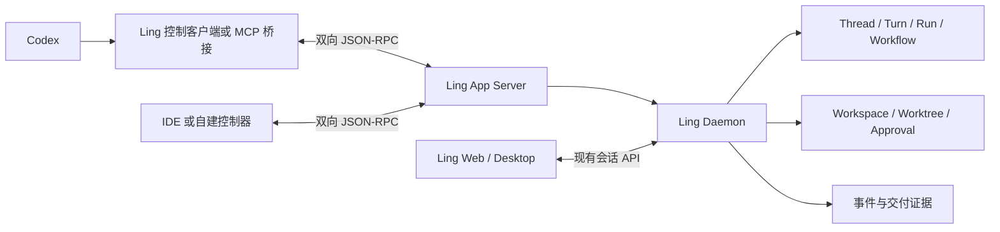

# Ling App Server 与开发工作流

- **状态** 目标态合同，运行时实现状态见实施计划
- **维护者** Daemon、Conversation、Workspace 与开发工具维护者
- **核对基线** 2026-11-22，`origin/main@a9dd29921`
- **类型** 产品与架构合同
- **代码锚点** [Daemon RPC](../../packages/daemon/src/server/rpc.ts) · [普通会话入口](../../packages/daemon/src/features/conversations/routes.ts) · [Goal 验收](../../packages/core/src/storage/sqlite/goal-acceptance.ts)

[协议与运行时详细设计](ling-app-server-detailed-design.md) · [实施计划与验收](ling-app-server-implementation-plan.md) · [Agent Operating Model](ling-agent-operating-model.md) · [整合详细设计](ling-agent-operating-model-detailed-design.md)

## 用户可以做什么

Ling App Server 给 IDE、自动化客户端与 Codex 控制器提供一个长连接。它们可以创建或接入同一个 Ling 会话，提交 Turn，实时查看计划、工具执行、文件变更和验证结果，处理需要用户参与的请求，并在断线后继续观察。工作区中的 Web 和 Desktop 可以用现有会话界面打开同一条 Thread。

来自 GitHub Issue、Automation 或外部请求的工作项，可能先入箱、后建立会话。授权客户端从入箱起即可按工作区和工作项查看及订阅。同一工作区内，明确指向同一授权目标的入口共用默认工作项和首次派发，各自保留来源回执。关联 Thread 后，会话引用和内容按 Thread 授权投影。 [来源合并规则](ling-agent-operating-model-detailed-design.md#32-work-item-target-identity) · [Work Item 订阅与回放](ling-app-server-detailed-design.md#231-work-item-的原生订阅范围)

开发任务从一个可验收的目标开始。Ling 读取仓库约定，在受管 worktree 内修改代码，用实际运行结果验证当前改动，再用独立上下文审查。任务可在验证过的阶段停下并交给新的会话。整条链在普通开发会话与外部客户端上使用相同的执行、权限和证据规则。

[Ling Server Connectivity](ling-server-connectivity.md) 提供设备配对、信令与中继。[Ling Device Fabric](ling-device-fabric.md) 的协调宿主维护跨设备任务图，各设备执行宿主管理自己的授权和证据。App Server 控制工作主机上的代理会话，由该主机的 Daemon 授权和执行项目 WorkUnit。跨设备任务图可通过已授权的项目 WorkUnit 引用消费项目证据。

## 架构与所有者

| 所有者 | 职责 |
| --- | --- |
| App Server 协议层 | 传输、版本握手、调用方识别、请求关联、订阅和回放。 |
| 会话入口 | 接收用户输入、选择正常 Turn 或干预路径、提交可观察的处理回执。 |
| Daemon 与 Runtime Supervisor | 管理执行、工作树绑定、工具权限、审批、取消与恢复。 |
| 工作区存储与证据投影 | 提供持久会话、控制面游标、Run 事件、审批和产物。客户端从这些所有者取得最终状态。 |
| 验证和审查服务 | 在同一候选改动上产出可归属的检查记录和发现，交给 Goal 验收和现有报告界面。 |

App Server 目标协议为标准 JSON-RPC 2.0，支持 stdio JSONL、本机 Unix socket、回环 WebSocket 和经认证的 WSS。Daemon 运行协议和会话服务。CLI 提供进程入口和传输适配。现有 HTTP/SSE 与 `/rpc/stream` 继续按其合同服务既有客户端。会话、权限和 SQLite 状态由同一个 Daemon 管理。

## 开发工作流

| 阶段 | 产品行为 | 可以核对的结果 |
| --- | --- | --- |
| 打开项目 | 确认工作区、worktree、依赖、权限和模型能力。在已知任务目录载入实际适用的项目说明。 | 来源、规则摘要、有效配置、基线和可用验证配方。 |
| 接受任务 | 用 Plan 和 Goal 定义范围、约束、预算和验收项。明确改动影响面和要跑的验证。 | 被接受的任务版本及计划，已确认决定与待解决问题。 |
| 实施 | 普通代码 Turn 在绑定的 worktree 内检索、编辑和测试。修 Bug 时保存复现及回归证据，前提缺失时显示原因与可验证的进展。 | 可审阅 diff、工具动作和审批记录。 |
| 运行中补充或变更 | 进度查询随时从已提交的结果回答。普通后续消息持久排队。用户可在 Runner 支持时指导当前 Turn，也可显式中断后换方向。明确的需求变更暂停受影响步骤的新准入，经 Plan 修订确认后继续。 | 显示当前进度、输入已排队或已接入当前 Turn、待确认变更和原执行回执。 |
| 验证 | 按仓库认领的路径和影响范围运行定向检查。UI/运行时变更使用项目认可的真实启动、浏览器或平台验证配方。 | 对应候选改动的检查结果、日志、断言与必要产物。 |
| 审查与修正 | 代码审查使用候选 diff、原始验收项和基线规则，在独立只读上下文中运行。修正后重新判断证据是否适用于新的改动。 | 带路径与行号的发现、处置和当前验证覆盖。 |
| 交付与交接 | Goal 审计逐项检查当前候选与证据。PR 检查绑定实际被测的 head、集成结果或合并队列分组。合并使用能够核对当时证据的仓库保护。任务也可保存进度交给新会话。 | 目标状态、适用检查、交付回执、阻塞原因或可接手的下一步。 |

**完成的三层事实。** Turn 结束说明执行流程已到达终点。验收通过说明当前候选满足已声明的证据条件。PR 合并、发布安装或部署分别由各自的接收系统确认。

### 项目默认能力

| 能力 | 设计 |
| --- | --- |
| 项目指令 | 以 `AGENTS.md` 为共享入口，按目录限定适用范围，提供显式的 Claude Code 规则采用方式。Thread 里显示来源，Turn/Run 记录实际使用的版本。 |
| 初始化和诊断 | 「初始化项目约定」从 README、脚本和 CI 草拟可审查的补丁。项目诊断复用 `ling-stack doctor`，说明指令冲突、配方缺项、索引范围、环境不可用及修复建议。 |
| Verify | 「验证本次改动」使用受信任的仓库检查和运行配方，按候选绑定结果。已跑通的验收可用现有技能录制机制形成团队草稿。 |
| Bug 修复和简化 | 复用 `investigate`、`implement` 和 `qa` 的执行入口。Bug 修复侧重行为复现、最小修复和回归。简化侧重当前改动的重复逻辑和多余抽象，修改走普通写入流程。 |
| 代码导航 | 复用 Host 管理的 TS/JS 代码智能和命令诊断。包边界、依赖与忽略范围在结果中明确。原生组件用对应平台的编译和运行工具提供验证。 |
| Review | 复用代码审查工作台和不可变 diff。由基线上的仓库审查规则确定重点，与项目的确定性检查配合。 |
| 协作审议 | 在开发工作项中按需发起提案、质疑和投票。共享证据板汇集与当前方案或候选改动对应的意见、检查结果和决策记录。可从会话中查看证据和未解分歧。 |
| Agent 协作节奏 | 按开工、阶段验收、阻塞和复盘事件给参与任务的 Agent 提供简报。支持父子消息、同级问答和交接回执。项目可为指定工作项配置每日或每周轮次。 |
| Handoff | 用持久化 Goal、已确认决定、worktree、当前候选和检查结果生成交接。新会话先查版本和状态，再决定可继续的工作。 |

项目文件与 skill 负责解释项目做法。执行动作由 Daemon 的工作区、工具、命令、沙箱和审批规则授权。Hook 复用现有受信任配置和执行边界，适合调用确定性检查。可查看的计划、实际工具回执和验证结果为长任务提供诊断依据。

主 Agent 可建议对仍有实质取舍的方案发起审议。项目或已接受的 Workflow 可以预先授权在指定检查点自动开启。Workflow 编排提案和质疑，需要投票时由 Daemon 按冻结规则计票，获授权的决策者记录取舍和理由。Verify、Review、Approval 与交付各自核对实际证据。共享证据板也供日常故障排查和跨会话交接使用。 [审议与共享证据](ling-agent-operating-model.md#61-deliberation-and-shared-evidence) · [协作轮次与消息](ling-agent-operating-model.md#63-coordination-cadence-and-agent-messages)

### 工作树、并行和恢复

开发写入使用独立 worktree。写入型 Fork 记录源 Turn 并创建独立 worktree，读者可以订阅同一候选。跨会话交接要核对候选身份和当前写入所有者。与用户或另一写入者的变更冲突时，界面给出当前差异和保留的产物。

长期目标按有独立验收条件的工作段推进。模型上下文压缩后由 Run 保留原始任务锚点，接手会话从持久条件、近期工作和证据重建上下文。重复失败且缺少新证据时，复用 Goal 和执行循环的预算、暂停与阻塞机制。并行任务走现有 Workflow 和受控委派配置，独立运行的产物都带各自的候选身份。汇合时通过现有合并或补丁应用路径做校验和授权。

用户中途补充的信息由同一会话入口记录来源和收据。需要改已接受的范围时，Ling 显示待确认的 Plan 修订、受影响步骤和可沿用的证据。原执行所有者核对在途动作，未受影响的工作可继续。 [运行中输入合同](ling-app-server-detailed-design.md#211-运行中新增消息与变更要求)

## Codex 控制 Ling

Ling 提供 App Server 与有类型的控制客户端。现成 Codex 通过 MCP 或配套 CLI 按游标查看进度并控制获准的 Ling 任务。需要同时向 Codex 和 Ling 发指令并持续观察两边进度时，由可编程控制宿主分别连接 Ling App Server 和 Codex App Server，在自己的任务视图呈现推送。支持在途指导的 Codex Turn 可以接收经授权的简短证据引用。Ling Web 或 Desktop 也可以直接显示同一条 Ling 会话的实时进度。 [控制宿主合同](ling-app-server-detailed-design.md#35-codex-控制宿主)

Codex 的角色可以是发起者、协作者或观察者。实际权限由用户授予的工作区和 Thread 范围决定，控制器提交的 Actor 名称只用于展示。会话中的审批由拥有决策权的用户界面处理，受信任客户端可把用户的明确决定提交回原审批。控制器能读取待审批状态，暂停获准管理的 Goal 或终止获准控制的 Turn。

主线已有两个需要区分的 Codex 调用入口。旧的 [HTTP 适配器](../../packages/daemon/src/runtime/adapters/codex-app-server.ts) 调用 `session/run`。原生 [Codex Live Client](../../packages/daemon/src/runtime/adapters/codex/live-client.ts) 负责 **Ling 调用 Codex** 的双向客户端。App Server 补充的是 **外部控制器调用 Ling** 的服务端。

## 正式用 Ling 开发 Ling 的验收条件

以下验收用同一候选版本记录对应的环境、命令和证据。

- 从外部客户端完成入箱工作项订阅、关联会话、持续收事件、运行期间提交明确干预、用户审批、断线补齐和终态核对。跨阶段任务验证用户中途改计划后，受影响步骤按新接受版本继续。
- 恢复和交接保留原始验收条件、工作树身份、已确认副作用和未决审批，已执行动作可以从记录中追溯。
- 当前候选的检查结果和独立审查贯穿交付。失效、未跑、缺环境和执行未知各有可操作的反馈。
- 用真实 Provider 完成可复现 Bug、Web 交互和包含中断或交接的跨模块任务，记录人工纠正、约束遗漏与行为验收结果。
- 发布使用记录过的系统和客户端组合。日常自研采用稳定控制端、候选 worktree 和独立运行目录，可以在稳定端打开或接手候选代码。

主线的 [Framework Assurance 计划](ling-framework-complementary-implementation-plan.md#1-交付结论) 记录了离线验证和 F3-B 真实试点的准入状态。新增协议和开发工作流的交付、使用真实模型的任务验收及安装包验证按实施计划分别记录。
