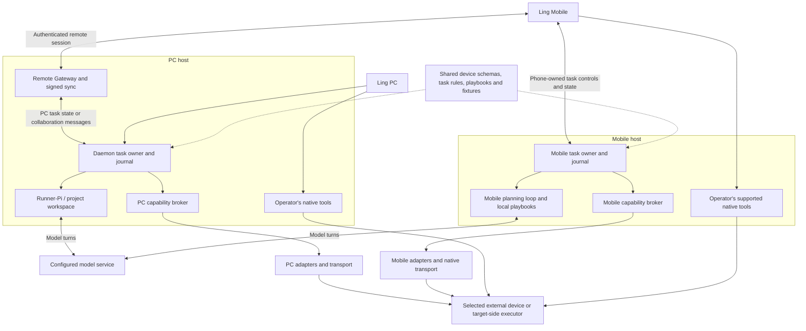
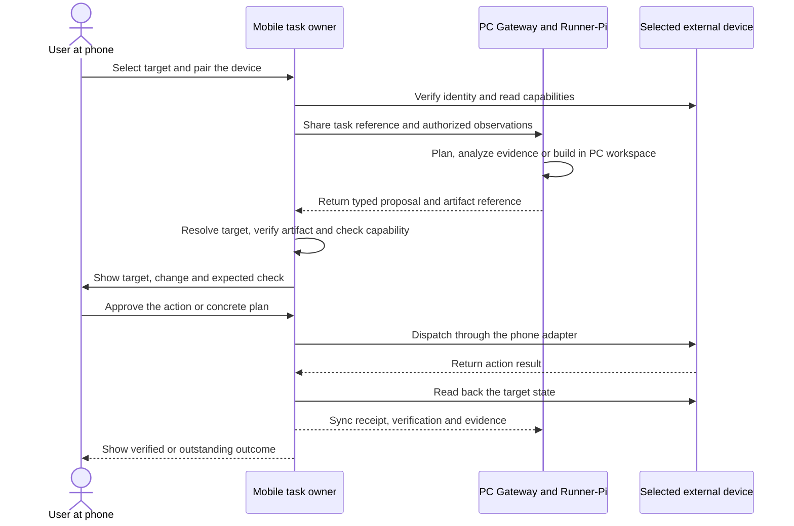
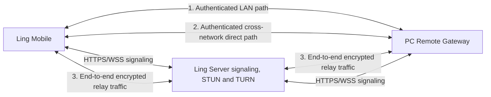
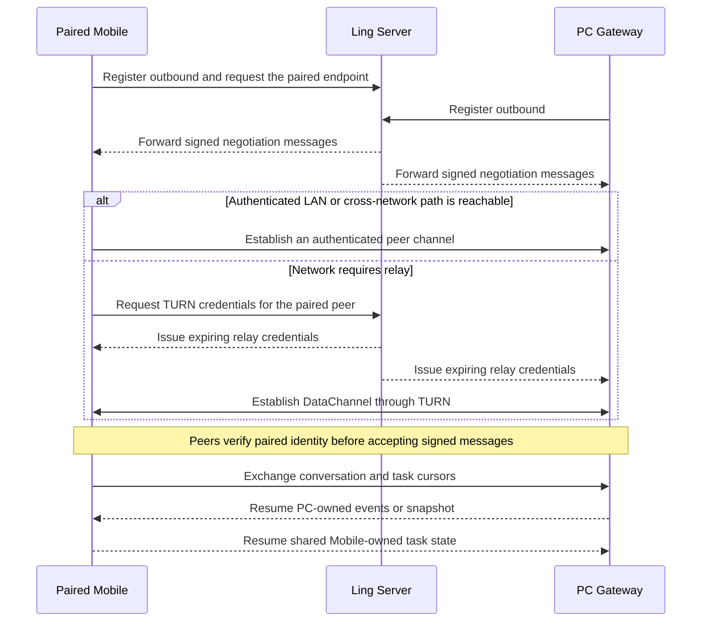
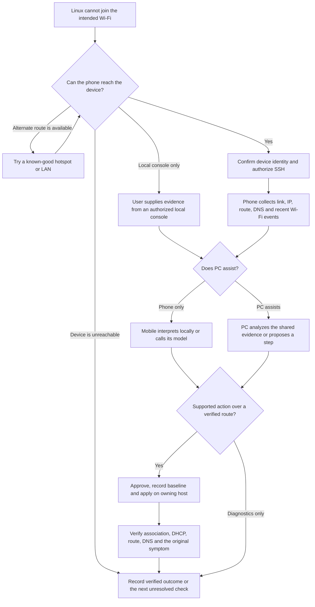
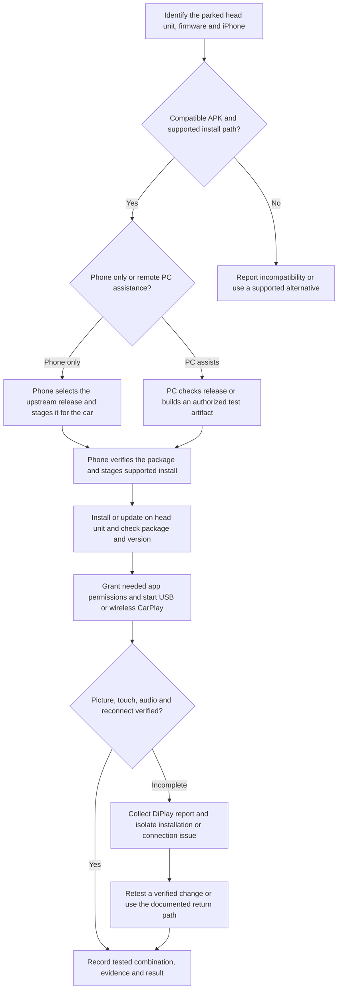

# Ling Device Developer Execution and Connectivity

Status: proposed design and acceptance criteria
Owner: Ling platform maintainers
Last verified: 2026-11-20 (D12 communication paths)
Document type: developer sessions, communication, and device workflows

Related documents:
[Device Support Platform](ling-device-support-platform.md) ·
[Runtime Contract](ling-device-support-platform-runtime-contract.md) ·
[Hardware Protocol Workbench](ling-hardware-protocol-workbench.md) ·
[Ling Server Connectivity](ling-server-connectivity.md) ·
[Ling Device Fabric](ling-device-fabric.md) ·
[Implementation Plan](ling-device-support-platform-implementation-plan.md)

## 1. Device sessions

Ling offers a standard device session and a developer device session on PC and Mobile.
Both show the current target, the host that owns the device connection, the available
operations, and the verified outcome. The user chooses a session mode independently of
whether the phone or PC owns the task.

| Session | Operations | What the user sees |
| --- | --- | --- |
| Standard | Discover, diagnose, configure, recover through a supported interface, and verify. Use a versioned playbook or model-assisted planning. | Device status, proposed change, confirmation when required, and the result of the retest. |
| Developer | Add a project workspace, build and test, transfer verified build artifacts, deploy and manage authorized test apps, inspect logs and profiles, and use native developer or vendor tools. | Project and build details, active device identity, effective privileges, a native workbench where supported, and attempt history. |

The developer session binds the operator, target, owning host, project or app if
applicable, and current platform authorization. Its lifecycle follows the selected
device and its authorization. Ling shows the connection and the actual developer or
service identity before opening a native tool. Device authorization comes from the
target and host OS. For example, an Android debugging connection reports the granted
shell or development-build privileges and the capabilities they enable.

### 1.1 Developer workflow and native tools

- **Project work.** Edit source, select the SDK and build variant, build, test, and
  package using a compatible execution environment. The phone can handle supported
  project work locally and use an existing build service or a paired PC for toolchains
  it cannot run. Record the source revision, toolchain, build variant, and output digest.
- **Device work.** The model can drive the typed deployment, app launch, test, scoped log
  capture, result collection, and retest loop on the authorized target. A developer
  session can approve a concrete plan for one build and target, covering the named
  actions and parameters. Each dispatch still checks the specific action and current
  capability. A changed device, payload, or authorized scope needs a new decision.
- **Native workbench.** The developer can open an authorized SSH or Android developer
  terminal and use the privileges the device grants. Supported native tools can
  manage app data and package state, restart the device, or maintain the OS. A
  firmware workflow connects the user to the supported vendor tool, verifies model
  and package compatibility and trusted signing, preserves a recovery route, and
  records the installed version and boot or app health afterward. Terminal input and
  vendor maintenance controls belong to the operator. The task owner coordinates
  tool access and refreshes the device state after maintenance. The model can analyze
  a user-selected, redacted transcript and use the newly available typed capabilities.
- **Long-running work.** Build and test jobs on a PC or authorized build host retain job
  IDs, logs, and status after a client disconnect. A connected target can continue a job
  it has already accepted if its supported executor provides status and cancellation.
  On reattach, Ling reads the original job and records its actual state. Mobile-owned
  dispatch follows OS execution lifecycle and the device runtime contract.

Project processes run in their project environment. The device broker and native
maintenance tools hold their own target credentials and connection handles. A build
job contributes artifacts and test results through declared interfaces. The build
environment receives project credentials and access specific to the build. The broker
and workbench keep target access within the owning host's device execution boundary.
An operator selects the device and authorizes installation of the specific artifact.

## 2. Execution architecture



| Placement | Planning and project work | Device execution and journal |
| --- | --- | --- |
| Phone alone | Mobile planning loop calls the configured model service. Supported local playbooks also work offline. | Phone broker and adapter, using the phone's connection. |
| PC owns the device connection | Daemon and Runner-Pi. Paired Mobile can initiate eligible actions and follow the task through the Gateway. | Daemon broker and adapter, using the PC's connection. |
| Remote PC helps the phone | PC can plan, build, or analyze evidence. The same task can also use the phone's configured model provider. | Phone broker and adapter. The PC receives a projection of the phone-owned task. |

Reuse the target, capability, plan, action, approval, journal, and evidence schemas.
Keep portable decision and state-transition logic in shared TypeScript where both
hosts can run it. Keep USB and BLE bridges, platform credential stores, system dialogs,
and process/toolchain launching native to the execution host. Runner-Pi is the current
PC project runtime. The Mobile loop consumes the shared tool and task contracts and
can run supported workflows with its own model connection and local adapter.

Bundle native transport modules in the platform build. Versioned playbooks, profiles,
and data-only manifests can be installed or updated against a declared contract range.
A shared logic fix must pass the same behavior fixtures on both hosts and ship in
their respective builds. Availability depends on the installed adapter version, the
OS, and the actual target interface. Publish compatibility and acceptance for each
phone OS, target firmware, and transport combination.

### 2.1 Explicit execution context

The target can be physically separate from both the planner and the host running the
adapter. Each proposal identifies its context by kind. A PC build action uses a
project workspace ID and PC host ID. A device action uses the external device ID and
the selected execution host ID. Observations carry their own subject, source, and
timestamp. The conversation UI displays them next to the corresponding result.

| Context shown in the UI | Example | Authority |
| --- | --- | --- |
| Project workspace | PC checkout of the head-unit app | PC project executor and project policy |
| Execution host | Phone connected to the head unit | Mobile broker and local device authorization |
| External target | The selected Android head unit | Target identity, transport session, and capability snapshot |
| Planner | PC Runner-Pi or configured Mobile model | Propose the next step and interpret eligible evidence |

An action also binds the task ID, capability/schema version, connection revision,
app or artifact when applicable, and current approval. If a model is moved to a
different host, the task owner and target stay attached to the existing journal.
When a target enters reboot or recovery, match the new connection to the verified
device and supported transition. If identity cannot be verified, resolve it with the
operator before a new action. A new owner starts a linked task after any uncertain
attempt is reconciled. See the [Runtime Contract](ling-device-support-platform-runtime-contract.md).

### 2.2 PC-assisted phone execution



PC assistance is an explicit, revocable collaboration binding for the phone-owned
task. It authorizes selected evidence, proposals, and build-asset transfer between
paired peers. The phone intersects a proposal with its local capabilities and
approval. It downloads a build artifact only for the selected task and checks its
digest, app identity, and signing metadata before deployment. A transport receipt
confirms message delivery. The task journal provides the device outcome.

If the PC drops offline, the phone can continue with locally available prerequisites
or mark the specific missing build or analysis step as pending. If the phone loses its
device link after dispatch, it rechecks the target on resume. The PC displays the last
confirmed state until the phone publishes a new receipt or observation.

## 3. Communication design

### 3.1 Phone and PC

Ling Server provides first-party enrollment, presence, signaling, and STUN/TURN.
Paired phones and PCs carry the Ling application protocol over an authenticated
WebRTC DataChannel. A direct ICE route carries data when available. The
installation's TURN relay is the fallback. D6 adds the PC-owned task facade.
D11 carries scoped proposals and evidence for phone-owned tasks.
[Mobile Remote Access design](mobile-remote-access-detailed-design.md) ·
[Ling Server design](ling-server-connectivity.md)



| Responsibility | Design |
| --- | --- |
| Pairing and endpoint authentication | Keep local PC confirmation and pinned Ling peer identity. Authenticate both peers before accepting application messages. Bind a relayed channel to the same peer keys as a direct channel. |
| Signaling and presence | Peers register outbound and exchange signed negotiation messages. Presence carries a last-seen time. The server issues expiring TURN credentials for an eligible relay attempt. |
| Path selection and fallback | Reuse a reachable authenticated LAN path. Try authenticated internet direct connectivity with bounded traversal attempts. Use the encrypted relay when the direct path is unavailable. Reauthenticate route changes and measure fallback and reconnect time. |
| Sync and resume | The owner publishes ordered events and durable receipts. A client resumes from its last observed revision or loads a current snapshot if history has expired. A duplicate action reference returns its recorded disposition. |
| Data and operations | Ling Server handles online and routing metadata, relay traffic and resource quotas. Private keys, target credentials and conversation, command and artifact plaintext stay at the participating endpoints. Track route choice, failures and capacity using redacted metadata. |



The Gateway checks the pairing and the authenticated peer channel before accepting
application messages. TURN/TLS supports relay transport when UDP from the client is
unavailable. Endpoints enforce peer revocation on the active path. Ling Server
controls new relay admission and bounds the lifetime of existing allocations.

Local execution and an already established direct peer route can work during a Ling
Server outage. Remote reachability across networks depends on an available direct or
relay path. Release acceptance includes pair/revoke, peer identity change, NAT and
relay fallback, reconnect on a network change, and route migration during a live task.
Conversation and device-task updates use the same reachability layer while retaining
their own permissions, event sequence, and owner.

### 3.2 Execution host to external device

Ling-to-Ling pairing and target authorization are distinct connections. A target
pairing QR can carry a connection hint, public fingerprint and account hint when
supported. The user checks the fingerprint against a trusted device display or record.
The adapter establishes the actual protocol session. Passwords and private keys are
entered or stored in the host's protected credential path.

| Target path | Phone-owned task | PC-owned task |
| --- | --- | --- |
| Linux over local network or phone hotspot | Native SSH on a reachable address with host key verification. Confirm that the hotspot permits the phone to reach its client. | SSH from the PC when it has its own route and credentials. |
| Android head unit over network | Device-supported, authorized ADB where the phone adapter and network allow it. APK installation via the head-unit installer is also available on supporting firmware. | PC uses authorized network ADB or shares a validated package with the phone. |
| USB to Android target | Android needs USB host support, a data-capable cable, user permission, and native adapter support. iOS support depends on an available and authorized accessory interface. | USB ADB or vendor tooling on a supported PC OS, drivers, and target. |
| BLE or vendor/household peripheral | Native transport plus a matching GATT, Matter, Home Assistant, or vendor adapter as appropriate. | A matching local protocol or bridge when reachable from the PC. |
| Vendor maintenance and recovery | Use the vendor's documented phone/target maintenance flow for supported equipment. | User operates the supported vendor tool with the device physically reachable from that PC. |

The model connection is a third path. When an internet connection changes during
hotspot, USB, or CarPlay setup, the phone retains the device task and can finish
supported local checks. Resume model and peer sync separately when their paths return.

## 4. Case flow: Linux device with Wi-Fi trouble

A local SSH check from a Mac reached the device and obtained wireless association,
DHCP, route and journal evidence. The journal showed a `WRONG_KEY` event and four
handshake failures followed by a successful association two seconds later. This is
evidence of an intermittent failure sequence. Its cause, phone-to-hotspot-client
SSH reachability, and real Mobile execution still require verification.



Compare known-good hotspot behavior with the intended network. Association failures,
failure to obtain an IP address, and DNS failures point to different observations.
For a configuration change affecting the active route, use the runtime contract's
alternate verified path or target-side restoration mechanism. After reconnect, read the
original target identity and retest access. In the remote assistance variant the phone
maintains the SSH session and applies the accepted action. If the PC has its own
verified connection to the Linux device, the user can select it as the owner at
task creation.

### PC-owned Linux SSH diagnosis

The Daemon loads a host-owned JSON file from `LING_STACK_DEVICE_SSH_TARGETS_FILE`
or the embedding option `deviceSupport.linuxSshTargetsFile`. The file belongs
in the installation's trusted configuration area. Each target includes an
operator-verified SSH server public key and an absolute path to a local client
identity. OpenSSH reads the client identity on the executing host.

```json
{
  "version": 1,
  "targets": [
    {
      "connectionId": "lab-board",
      "host": "board.lab.example",
      "port": 22,
      "user": "operator",
      "identityFile": "<absolute path to the local SSH identity>",
      "hostKey": "ssh-ed25519 <verified public key data>",
      "credentialRevision": "key-1"
    }
  ]
}
```

These routes use the direct-loopback Daemon listener and its configured bearer
authentication. [Daemon routes](../../packages/daemon/src/features/device-support/routes.ts)

| Operation | Route | Request |
| --- | --- | --- |
| List candidate and enrolled targets | `GET /v1/device-support/linux/targets` | No body |
| Verify the supplied host key and enroll the board | `POST /v1/device-support/linux/enroll` | `{"connectionId":"lab-board"}` |
| Run and persist a read-only diagnosis | `POST /v1/device-support/linux/diagnose` | `{"deviceId":"<enrolled device ID>"}` |
| Read the durable task journal | `GET /v1/device-support/tasks/<task ID>/events` | Optional `afterSequence`, `generation` and `limit` |

The device ID uses the verified host key fingerprint. A moved target with the
same key retains its device ID. Update its endpoint or move the client identity
to a new path in the host configuration and restart the Daemon. Bump
`credentialRevision` when rotating the client identity in place. The next diagnosis
revalidates the pin and refreshes the connection binding. A removed target goes
offline and keeps its journals. A new server key requires enrollment as a new identity.

Network evidence uses `iproute2` JSON output and `iw`. The report records IPv4
configuration, route selection and Wi-Fi association separately. An optional
`dnsProbeHostname` adds an IPv4 name-resolution observation through the target's
DNS service via `getent`. Missing tools and unmeasured reachability remain unknown.
Each report links its normalized facts to the owned task journal. Network changes
that could drop SSH access require a verified recovery route or target-side restoration.
[Linux SSH executor](../../packages/daemon/src/features/device-support/adapters/linux-ssh-executor.ts)

### Phone-owned Linux SSH diagnosis

An Android build with the `LingDeviceTransport` module exposes Linux SSH from
phone device diagnosis. Enter the board address, port, SSH account and verified
OpenSSH `SHA256:` host-key fingerprint. The fingerprint comes from the target's
console or trusted inventory. Submit the account password for this connection.
The transport checks the pin during the handshake before sending authentication.

The phone runs the same IPv4, route, Wi-Fi and optional DNS observations as the
PC adapter. It saves the enrolled device identity and endpoint metadata after a
successful diagnosis. The password is scoped to the submitted operation. The
local task journal retains typed facts and failure codes. When the app loses
foreground access it closes the live SSH session and preserves an interrupted
attempt for inspection after resume.
[Mobile runtime](../../apps/mobile/src/device/standalone-runtime.ts)
[Android native session](../../apps/mobile/modules/ling-device-transport/android/src/main/java/expo/modules/lingdevicetransport/PinnedSshSession.java)

The Android native client has passed JVM loopback tests, including host-key
rejection before authentication, fixed command execution and output bounds. The
generated Gradle project requires Android SDK 37 for compilation and targets SDK
36. The default build environment has no complete Android SDK/NDK installation,
so the native Gradle package has not been accepted yet. Physical Android LAN
and hotspot runs, native iOS SSH, and a recovery path for network changes remain
on the acceptance ledger.

### Phone-owned Home Assistant recovery

Open phone device diagnosis and enter the trusted Home Assistant HTTPS origin,
the entity ID, and the access token. For a disabled automation with a configured
ID, the phone accepts **Re-enable automation** for 30 seconds after diagnosis.
Confirmation binds the approved action to the origin, entity, configured ID
digest, capability snapshot, connection revision and policy revision. The phone
owns this workflow and its journal independently of PC pairing.

The Mobile adapter rechecks the automation and calls `automation.turn_on` for
the approved entity if it is still disabled. It reads the entity again and records
successful verification when the same automation is enabled. A changed identity,
expired baseline or denied authorization stops dispatch. A lost write response
or missing readback leaves the result unknown. Another confirmation of the same
diagnosis returns the saved attempt. The shared trace includes the attempt,
adapter revision and verification references. The token lives in memory until the
workflow ends.

For a recovery marked unknown, enter the same origin, entity ID and a current
access token and open **Verify this recovery** from the task history. The phone
rechecks the automation through a fresh HTTPS connection and attaches the
readback to the original attempt. A verified state settles the task. An
unavailable response, identity change, or disabled automation leaves it
unresolved. The original write receipt and connection revision remain in the
journal, with the readback recorded under its own revision.

## 5. Case flow: install DiPlay on an older head unit

DiPlay v0.2.22 is a public-preview Android APK for a compatible head unit, with
Android 7.0+ as the stated minimum. Installing and configuring the APK supplies the
CarPlay receiver. The normal wireless or USB connection uses the iPhone and DiPlay.
The head-unit package installer is the baseline installation route. Authorized ADB is
an option for package deployment and development diagnostics when supported. Model,
Android/DiLink firmware, and iOS compatibility must be established on the combination
being used. Upstream wired and wireless evidence differs by device.
[Install guide](https://github.com/shihabal3amri/DiPlay/blob/v0.2.22/docs/INSTALL.md) ·
[Compatibility](https://github.com/shihabal3amri/DiPlay/blob/v0.2.22/docs/COMPATIBILITY.md)



1. **Prepare.** Record head-unit model, Android and firmware version, supported
   package installer, iPhone/iOS version, and a matching wired or wireless path.
   Preserve relevant app settings or reports where export is supported. Obtain the
   release from the upstream source and record the package, artifact digest and
   signing information. Establish signing continuity for an in-place update.
2. **Install.** With only a phone, Ling can stage the APK through a supported local
   transfer or guide installation on the head-unit screen. A phone with a verified
   native ADB route can deploy via the adapter. With a remote PC, it can prepare
   the release or build a test APK, send it with its manifest, and inspect logs.
   The phone and the user at the car complete the installation if the phone owns
   the device connection. If the PC is physically connected to the head unit and
   owns the task, its authorized adapter can install the artifact.
3. **Configure and verify.** Finish the permissions and pairing on the head unit and
   iPhone. Verify that CarPlay starts, displays a picture, accepts touch, routes audio,
   and reconnects using the selected backend. Log the last verified stage if the
   phone switches networks or the control connection drops during setup.
4. **Diagnose and recover.** Read the exported DiPlay report or scoped app logs when
   authorized, matching evidence to the installed version. Distinguish package
   installation, Bluetooth/Wi-Fi or USB setup, projection, and media failures. Apply
   a supported adjustment and repeat the failing check, or use the documented
   uninstall/settings restore path and retest the original projection setup.
   Record what the user verified at the car.

The iPhone can serve as both Ling's control surface and the CarPlay endpoint.
An Android phone can host Ling's developer adapter, with an iPhone still needed to
test CarPlay. Vehicle acceptance records the exact OS, head unit, connection backend,
and release. DiPlay remains an independently installed project. Bundling or modifying
it requires dependency and license review.

### PC-owned Android ADB diagnosis

The Daemon uses an already authorized target on the PC's local Android Platform
Tools server. Configure an absolute JSON file with `LING_STACK_DEVICE_ADB_TARGETS_FILE`
or the Daemon embedding setting `deviceSupport.androidAdbTargetsFile`. Each entry
has a `connectionId`, the serial shown by `adb devices -l` as `adbSerial`, the
device's trusted `ro.serialno` as `hardwareSerial`, and a `kind` of `android` or
`head_unit`. For devices that supply only `ro.boot.serialno`, use that value. The
file sets `version` to `1`, lists entries under `targets`, and can specify an
absolute `adbPath` when Platform Tools are outside the Daemon's PATH.

| Operation | Route | Request |
| --- | --- | --- |
| List configured targets | `GET /v1/device-support/android/targets` | No body |
| Verify the authorized debugging transport and enroll | `POST /v1/device-support/android/enroll` | `{"connectionId":"bench"}` |
| Read Android version and package count | `POST /v1/device-support/android/diagnose` | `{"deviceId":"<enrolled device ID>"}` |

The Daemon checks the hardware serial inside the selected ADB transport and
stores a derived device ID. A change to the ADB transport or build fingerprint
creates a new connection revision. The package query verifies the same hardware
serial within its own shell process. The diagnosis uses the PC owner journal
and projects the OS version and package count. The snapshot advertises the
operations supported by the selected executor.
[Daemon ADB target binding](../../packages/daemon/src/features/device-support/android-adb-targets.ts)

### PC-owned Android developer logs

Set an enrolled target's optional `logTag` to the tag emitted by the app under
test. Create and authorize a developer session for that target through
`/v1/device-support/developer/sessions`. Submit a job of kind `logs` with its
authorization revision. The PC captures a bounded main and crash buffer dump
filtered to the tag. The capture checks the hardware serial and build fingerprint
on the selected ADB transport. Another submission of the same job ID returns the
retained job.

An authenticated local client can read the retained text using
`GET /v1/device-support/developer/sessions/{sessionId}/jobs/{jobId}/logcat`.
The trace and journal projections carry the attempt and device lineage. The log
text is sensitive evidence scoped to the local developer session.

## 6. Acceptance and delivery evidence

Record host OS and app build, target model and firmware, transport, adapter and contract
versions, initiating client, owner, action attempts, artifact digest where relevant,
before/after observations, and verification outcome. Record whether a case was run
against a fixture, simulator, or physical target. For assisted tasks include which
data and artifacts the user shared and the connected peer.

| Slice | Evidence |
| --- | --- |
| [D8](ling-device-support-platform-implementation-plan.md#d8-additional-ecosystems) | Linux SSH and Android adapters report actual support. Verify a Linux diagnosis and a parked-vehicle DiPlay installation and retest on recorded combinations. |
| [D9](ling-device-support-platform-implementation-plan.md#d9-standalone-mobile-execution) | Real phone and target complete the official BLE recovery case and resume after interruption. Linux and Android paths get their own physical-device runs. |
| [D10](ling-device-support-platform-implementation-plan.md#d10-developer-device-sessions) | Verify the install/test/log/retest loop for an authorized app, the user's native-tool session, job reattach, and the supported vendor maintenance receipt. Exercise injected device text, target mismatch, and loss of authorization. |
| [D11](ling-device-support-platform-implementation-plan.md#d11-pc-assisted-mobile-execution) | PC submits analysis or a build for a phone-owned task. Link loss, duplicate proposals, and a different attached target preserve the owner and recorded attempts. |
| [D12](ling-device-support-platform-implementation-plan.md#d12-ling-server-connectivity) | Paired peers sync over LAN, direct internet and encrypted relay. Test relay fallback, route switch, resync and revoke using the same task, sequence and authorization model. |
| [D13](ling-device-support-platform-implementation-plan.md#d13-hardware-protocol-development-and-debugging) | Capture and decode a documented Modbus RTU bench device on supported PC and Mobile paths. Replay traces, verify a live change, and register the verified adapter for standard sessions. |
| [D14–D22](ling-device-support-platform-implementation-plan.md#d14-semantic-device-graph-and-twin) | Connect semantic device state, cross-device task graphs, edge runtimes, event streams, signed resources, safety, fleet lifecycle, model context, and conformance evidence. |
