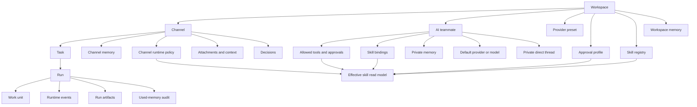
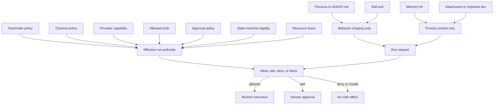
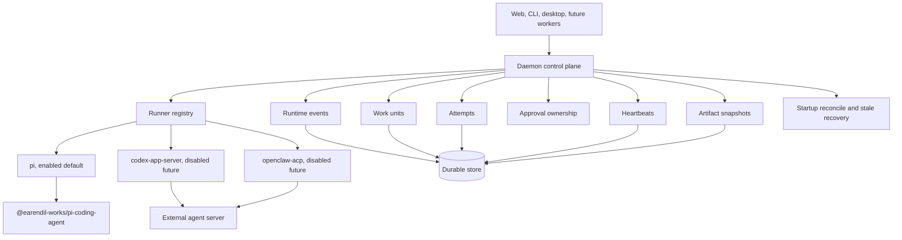
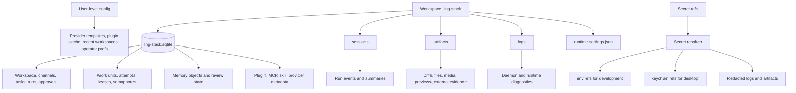
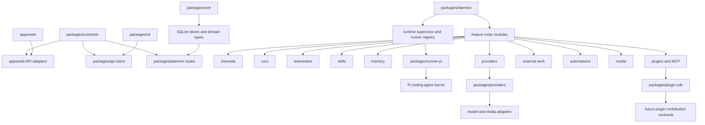

# Ling Framework

Status: Design direction
Date: 2026-06-04
Scope: Product architecture, multi-agent teammates, memory, skills, execution, and extension boundaries

## Summary

Ling Framework is the product and platform model behind Ling Stack. It defines Ling as a
local-first multi-agent workspace OS, not a chat client, not a provider settings app, and
not a thin wrapper around one coding agent runtime.

The framework connects:

- workspace channels,
- durable AI teammates,
- scoped tasks and runs,
- model and media providers,
- tools and approval policy,
- skill workflow templates,
- scoped memory and automatic recall,
- artifacts, audit logs, and recovery state.

The short version:

```text
Ling = workspace kernel
     + durable AI teammates
     + scoped memory
     + skill/workflow templates
     + provider and runner adapters
     + approvals, artifacts, and audit
```

## Source Documents

This document is the top-level map. The detailed contracts remain in the existing design
docs:

- [Product Design](../product-design.md)
- [Platform Architecture](platform-architecture.md)
- [AI Teammates and Skills](ai-teammates-and-skills.md)
- [Multi-Agent App Detailed Design](multi-agent-app-detailed-design.md)
- [AI Teammate Private Workspace](ai-teammate-private-workspace.md)
- [Ling Memory v1](ling-memory-v1.md)
- [Ling Skill Import v1](ling-skill-import-v1.md)
- [Skill Context Optimization](skill-context-optimization.md)
- [Runtime Supervisor](runtime-supervisor.md)
- [Runtime Control Plane Detailed Design](runtime-control-plane-detailed-design.md)
- [Conversation Plan And Goal Modes](conversation-plan-and-goal-modes.md)
- [Runner Registry](runner-registry.md)
- [Runner Adapters](runner-adapters.md)
- [Two-Layer Configuration](two-layer-configuration.md)
- [Provider Presets](provider-presets.md)
- [Approval Policy](approval-policy.md)
- [Plugin Manager](plugin-manager.md)
- [Internal Registry and Plugin SDK](internal-registry-plugin-sdk.md)
- [Core Tools, Runners, MCP Tools, and Plugin Boundary](core-tools-runtime-boundary.md)
- [Daemon Modularization](daemon-modularization.md)
- [Web Modularization](web-modularization.md)
- [State Machines and Recovery](state-machine-recovery.md)

## Visual Framework Map

This section is the complete visual map for the framework. The diagrams are Mermaid
source blocks so the Markdown stays editable and reviewable.

### 1. Whole System

```mermaid
flowchart TD
  Web["Web app"] --> ApiClient["Shared API client"]
  CLI["CLI"] --> ApiClient
  Desktop["Desktop shell"] --> ApiClient

  ApiClient --> Daemon["Local daemon gateway"]
  Daemon --> Kernel["Platform kernel"]
  Daemon --> Supervisor["Runtime supervisor"]
  Daemon --> ExtensionHost["Extension host"]

  Kernel --> Workspace["Workspace"]
  Kernel --> Channels["Channels"]
  Kernel --> Tasks["Tasks"]
  Kernel --> Teammates["AI teammates"]
  Kernel --> Runs["Runs"]
  Kernel --> Approvals["Approvals"]
  Kernel --> Artifacts["Artifacts and audit"]
  Kernel --> Memory["Scoped memory"]
  Kernel --> Policy["Policy and state machines"]

  Supervisor --> WorkUnits["Work units"]
  Supervisor --> Attempts["Attempts"]
  Supervisor --> Heartbeats["Heartbeats"]
  Supervisor --> Leases["Resource leases"]
  Supervisor --> Recovery["Cancel, retry, startup recovery"]

  ExtensionHost --> Providers["Provider adapters"]
  ExtensionHost --> Runners["Runner adapters"]
  ExtensionHost --> CoreTools["Core tools"]
  ExtensionHost --> McpTools["MCP tools"]
  ExtensionHost --> Skills["Skill packs"]
  ExtensionHost --> Automations["Automations"]
  ExtensionHost --> ChannelSources["Channel sources"]
  ExtensionHost --> MemoryProviders["Retrieval providers"]

  Runners --> Pi["pi runner, default"]
  Runners --> Codex["codex-app-server, future"]
  Runners --> Acp["openclaw-acp, future"]

  Providers --> ChatModels["GPT, Claude, domestic models, relays"]
  Providers --> MediaModels["Image and video providers"]

  Kernel --> Store[("SQLite metadata")]
  Kernel --> Files["Session files, logs, diffs, media"]
  Kernel --> UserConfig["User config"]
  Kernel --> WorkspaceConfig["Workspace config"]
```



### 2. Product Object Graph



### 3. Run Execution Path

```mermaid
flowchart LR
  Intent["User intent, channel reply, direct chat, automation"] --> Envelope["Task or run envelope"]
  Envelope --> Actor["Resolve actor: user, teammate, system"]
  Actor --> Skill["Resolve skill"]
  Skill --> Provider["Resolve provider and capability"]
  Provider --> Memory["Resolve memory scopes"]
  Memory --> Tools["Resolve core and MCP tools"]
  Tools --> Approval["Evaluate approval policy"]
  Approval -->|allow| WorkUnit["Create supervised work unit"]
  Approval -->|ask| Pending["Approval request"]
  Pending -->|approved| WorkUnit
  Pending -->|denied| Blocked["Blocked run"]
  Approval -->|deny| Blocked

  WorkUnit --> Registry["Runner registry"]
  Registry --> Runner["Effective runner"]
  Runner --> Events["Stream normalized events"]
  Events --> Store["Persist events and state"]
  Events --> Artifacts["Import artifacts"]
  Store --> Report["Final report and audit trail"]
  Artifacts --> Report
```



### 4. Permission And Trust Gates



Persona, skill, memory, and imported markdown can affect prompts and context. They cannot
grant execution authority. Authority comes from policy, capability, approval, leases,
and legal state transitions.

### 5. Runtime Control Plane



The default runner is `pi`. Future Codex or ACP runners are adapters behind the same
registry and conformance contract, not replacements for Ling's control plane.

### 6. Data And Evidence Ownership



Raw secrets must not be stored in JSON config, logs, artifacts, run snapshots, or renderer
state. Secret refs are resolved only by trusted daemon paths.

### 7. Current Repo Boundary



## Framework Contracts

| Contract | Owner | Rule |
| --- | --- | --- |
| Durable state | Platform kernel and core store | Clients and extensions never write durable state directly. |
| Execution control | Runtime supervisor and control plane | Work enters through work units, attempts, leases, and audited transitions. |
| Runner choice | Runner registry | `pi` is the current default; future runners pass readiness and conformance gates first. |
| Provider choice | Provider presets and capability checks | Providers are selected by capability, readiness, secret status, and run context. |
| Skill use | Effective skill read model | Skill text is a workflow template, not permission. |
| Tool use | Approval policy plus tool allowlists | Read-only tools can default allow; side-effect tools ask or deny by policy. |
| Memory use | Scoped recall policy | Memory can supply context with provenance; it cannot grant authority. |
| Plugin use | Plugin manager and extension host | Plugins expose resources for binding; enabling a plugin is not tool authorization. |
| Evidence | Artifacts, logs, snapshots, audit events | Every side effect should be attributable to actor, policy, approval, and state. |

## Product Positioning

Ling Stack should compete as a work surface:

```text
Channels hold context.
Tasks define executable work.
AI teammates run scoped sessions.
Humans approve risky actions.
Everything leaves an audit trail.
```

The user should experience Ling as one local workspace where AI teammates can be given
real work, use the right provider and tools, recall the right memory, produce artifacts,
and hand risky steps back for approval.

## System Shape

```text
Web / Desktop / CLI
  -> shared API client
  -> local daemon gateway
  -> platform kernel
  -> runtime supervisor
  -> extension host
  -> providers / runners / tools / skills / memory / channels / automation
```

The kernel owns correctness:

- durable state,
- permissions,
- resource leases,
- approvals,
- recovery,
- audit events,
- state-machine legality.

Extensions add capability. They do not mutate durable state directly.

## Modular-First Development

Ling should treat modularity as a framework rule, not as a cleanup phase after features
grow too large. Every new feature, plugin contribution, runtime tool, provider, runner,
memory surface, automation, and UI area should start from a small module boundary with
explicit inputs, outputs, authority, and tests.

The default development shape is:

```text
feature or plugin capability
  -> contract/types
  -> daemon feature module or registry contribution
  -> store/runtime integration through explicit APIs
  -> web feature module or settings panel
  -> focused tests and design doc update
```

Rules:

- Product capabilities live in feature modules, not in a monolithic application shell,
  daemon entrypoint, or plugin manager switchboard.
- Plugin contributions are modular packages of metadata and linked capabilities. A
  plugin can contribute MCP servers, tools, skill packs, runners, providers, memory,
  automations, or UI features, but each contribution must keep its own boundary.
- Shared helpers stay feature-agnostic. A helper that knows one product feature too well
  belongs in that feature module.
- Cross-feature coordination belongs in a small composition root: Web `AppShell`, daemon
  `server/router.ts`, runtime supervisor, or registry wiring. It should pass explicit
  callbacks and context objects instead of importing feature internals.
- New features must document their ownership boundary, side effects, approval posture,
  persistence model, and rollback/audit behavior before broad implementation.
- Modularity does not weaken enforcement. Permission, approval, resource leases, state
  machines, and secret resolution remain kernel/runtime responsibilities even when the
  capability is exposed through a plugin.

This keeps Ling from repeating the early "one giant AppShell" or "one giant daemon
router" shape as plugin and runtime-tool surface area grows.

## Core Objects

### Workspace

A local or team-scoped container for channels, tasks, teammates, providers, skills,
memory, approvals, artifacts, and policy.

### Channel

A context container for a project, domain, or workflow. A channel can bind a local path,
provider default, default teammate, allowed tools, tasks, discussions, attachments,
decisions, artifacts, and channel memory.

### AI Teammate

A durable workspace member with:

- role,
- provider/model preset,
- skills,
- allowed tools,
- memory policy,
- approval profile,
- channel memberships,
- private workspace,
- optional persona/profile source.

AI teammates are not decorative avatars. They are configured actors in the workspace
state model.

### Task

The smallest unit of executable AI work. A task can select a teammate, channel, skill,
provider, prompt, and acceptance criteria. Side effects should move through tasks and
runs, not through private chat.

### Run

A durable execution session. It records inputs, provider resolution, memory recall,
tool calls, runner events, approvals, artifacts, errors, and final reports.

### Skill

A workflow template. A skill can describe phase, prompt fragments, required tools,
required provider capabilities, approval profile, and state effects. A skill never grants
permission by itself.

### Memory

Scoped context attached to work. Memory can be shared across the workspace, bound to a
channel, private to a teammate, or temporary for a task/run. See [Ling Memory v1](ling-memory-v1.md).

### Provider

A capability adapter for chat, reasoning, tool calling, coding tasks, images, video, or
other media. Provider readiness is capability-specific, not a generic green check.

### Tool

An atomic capability such as read, grep, edit, shell, browser, GitHub read, external send,
or deploy. Tools carry side-effect level, scope, approval, and audit requirements.

## Multi-Agent Model

Ling should treat a multi-agent team as durable workspace state, not as a free-form group
chat.

```text
Workspace
  -> Teammates
       -> role and persona
       -> provider/model
       -> skill bindings
       -> allowed tools
       -> memory policy
       -> channel memberships
       -> approval profile
```

Each teammate can share the same workspace while preserving separate persona, private
memory, skills, and allowed tools.

The built-in `gstack-default` pack currently provides thin role templates:

- Product Strategist,
- Architect,
- Engineer,
- Designer,
- QA,
- Security,
- Release,
- Docs.

Those templates include role, summary, default skills, allowed tools, required provider
capabilities, approval profile, and system prompt. Future imported or custom teammates
should follow the same effective policy path.

## Persona And AGENT.md

Ling currently stores a teammate `systemPrompt` and allows editing it from the private
workspace settings. That is the first, thin persona layer.

The target model should support per-teammate profile sources such as `AGENT.md` or
`persona.md`:

```text
.ling-stack/
  teammates/
    engineer/
      AGENT.md
      MEMORY.md
    designer/
      AGENT.md
      MEMORY.md
    qa/
      AGENT.md
      MEMORY.md
```

The runtime shape should be:

```text
AGENT.md / persona source
  -> reviewed teammate profile
  -> durable teammate record
  -> prompt builder input
```

Important boundary:

```text
Persona text can shape behavior.
Persona text cannot grant execution permission.
```

Permission still comes from:

```text
teammate policy
+ channel policy
+ provider capability
+ allowed tools
+ approval policy
+ state-machine legality
```

This prevents imported markdown from bypassing tool and approval boundaries.

## Ling Memory v1

Ling Memory v1 adapts the earlier agent-context-memory-framework into a Ling-native,
multi-agent runtime memory system.

Required layers:

```text
workspace shared memory
+ channel memory
+ teammate private memory
+ task/run working memory
+ optional retrieval provider interface
+ provenance and audit
+ promotion workflow
```

Automatic recall should feel automatic to the user, but the recall pool must be selected
by policy:

```text
current teammate
+ current channel
+ current task/run
+ workspace policy
-> allowed memory scopes
-> retrieval candidates
-> optional retrieval provider hook
-> prompt context
-> used-memory audit
```

Example:

```text
Engineer in Engineering channel can recall:
  - Engineer private memory
  - Engineering channel memory
  - workspace shared memory
  - current task/run memory

Engineer cannot recall by default:
  - Designer private memory
  - unrelated channel memory
  - hidden/private attachments
  - secret-adjacent content
```

The first implementation should use lexical search, tags, source metadata, and scope
policy. Embeddings, vector search, and rerankers are customer-installed retrieval
providers, not default requirements. They do not replace source provenance, review state,
or live verification for volatile facts.

## Skill And Import Model

Skills are templates. They are not permission.

Ling uses one registry for built-in, workspace custom, imported directory, and
teammate-scoped skill definitions. A skill can exist in the registry without being bound
to any teammate. Bindings assign possible use; the Effective Skill read model decides
whether a bound skill can actually execute in the current teammate, channel, provider,
tool, approval, and state-machine context.

`AGENTS.md`, `AGENT.md`, `persona.md`, skill directory, and custom pack imports should
enter as reviewed drafts:

```text
import source
  -> parse
  -> draft skill definitions
  -> parse warnings
  -> required tool preview
  -> provider capability preview
  -> approval preview
  -> explicit bind to teammate
```

Imported skills must not execute immediately. A user or policy must bind them to a
teammate, and the effective skill read model must still validate tools, provider
capabilities, approvals, and state-machine legality.

The concrete next slice is defined in [Ling Skill Import v1](ling-skill-import-v1.md).

## Execution Model

Normal work should move through a task/run path:

```text
Task created
  -> choose channel
  -> choose teammate
  -> choose or infer skill
  -> resolve provider
  -> resolve memory scopes
  -> validate tools and approval policy
  -> start supervised run
  -> stream events
  -> request approvals
  -> persist artifacts and final report
```

Private chat can clarify, plan, and create tasks. It should not become a hidden side-effect
path.

## UI Model

Ling should feel like a client workspace:

```text
Left rail:
  workspace, inbox, channels, teammates, tasks, runs, config

Center:
  channel workspace, task detail, teammate private workspace, workbench pages

Right/context panel:
  readiness, approvals, artifacts, provider health, memory used, live events
```

Teammate private workspace should expose:

- chat,
- tasks,
- activity,
- channels,
- skills,
- memory,
- MCP/tools,
- settings.

Provider setup belongs in Model Workbench. MCP tool server setup belongs in workspace Settings.
Memory configuration should become its own trust surface as Ling Memory v1 lands.

## Trust Boundaries

The framework has hard boundaries:

- Do not hide what the AI did.
- Do not let private chat leak channel, file, or memory context by default.
- Do not let skill text, persona text, or imported markdown grant tool permission.
- Do not make every provider look equivalent when capabilities differ.
- Do not let extensions mutate durable state outside kernel APIs.
- Do not trust retrieval-provider hits as proof.
- Do not auto-execute destructive, external-send, deploy, credential, or broad filesystem
  changes without approval.

## Roadmap

### Current Mainline

- Model Workbench and provider readiness.
- Channels, tasks, runs, approvals, artifacts.
- Durable teammates and private workspace.
- Built-in `gstack-default` templates.
- Skill binding metadata.
- Memory scope metadata.
- Skill Import v1 registry for built-in and workspace custom skills.
- Skill import drafts, publish-to-registry, and archive for custom/imported skills.
- `AGENTS.md`, `AGENT.md`, and `persona.md` teammate profile draft import.
- Private Workspace Skills tab as import, bind, disable, and blocked-reason surface.
- Effective Skills read model for built-in and custom skills.
- Skill-aware run validation and run `selectedSkillId` audit.
- Teammate workspace task creation with `requestedSkillId`.
- Streaming private replies.
- Private attachments, avatar upload, and hard-delete tombstones.

### Framework v1

- Ling Memory v1 with scoped lexical recall.
- Used-memory UI.
- Memory retrieval provider interface only; no default vector model, embedding worker, or vector database.
- Broader skill editing beyond import draft, publish, archive, and binding.
- Skill-aware task controls outside the teammate private workspace.
- Blocked-run UI polish across task detail and run start surfaces.
- Run interruption and continuation.

### Framework v2

- Multi-agent workflow graph.
- Desktop and keychain-first distribution.
- External channel sources such as Slack, Feishu, email, and support queues.

## Acceptance Criteria

The framework direction is working when:

- a user can tell which teammate acted, with which model, tools, memory, and approvals,
- a teammate can recall relevant context without crossing private or channel boundaries,
- a task can run with a selected skill and produce auditable state transitions,
- imported persona or skill text cannot bypass policy,
- provider capability differences are visible before run start,
- side effects are tied to approvals and durable audit events,
- the UI shows useful workspace state rather than acting as a generic chat client.
