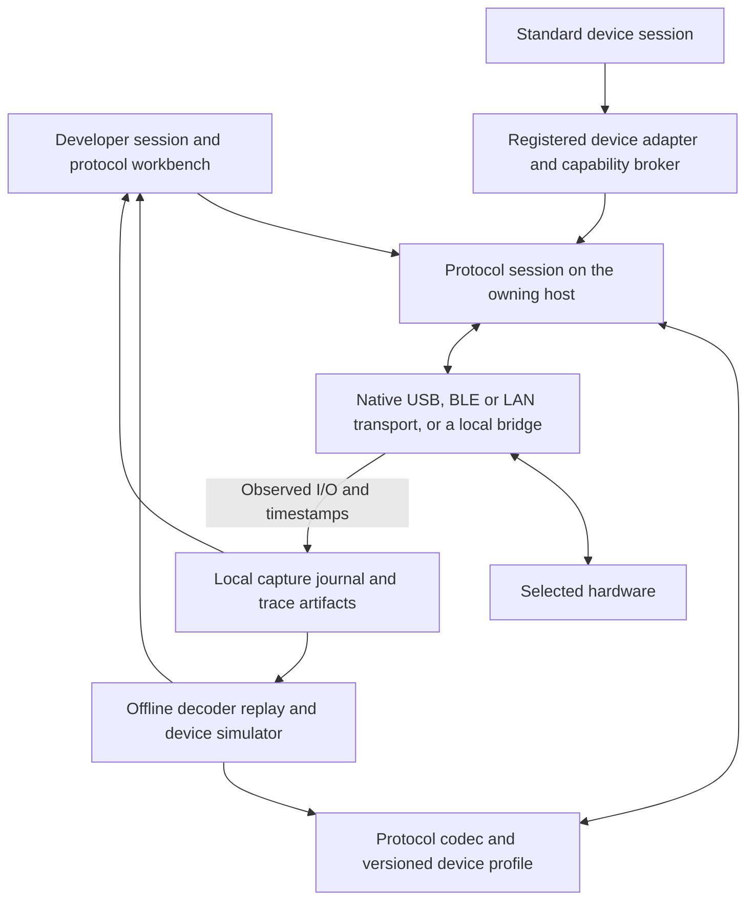
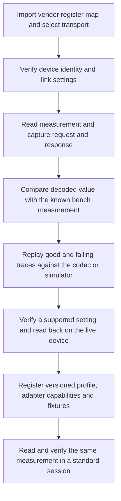

# Ling Hardware Protocol Workbench

Status: proposed design and research
Owner: Ling platform maintainers
Last verified: 2026-11-19
Document type: hardware diagnostics, protocol development, and adapter acceptance

Related designs:
[Device Support Platform](ling-device-support-platform.md) ·
[Runtime Contract](ling-device-support-platform-runtime-contract.md) ·
[Device Developer Execution and Connectivity](ling-device-developer-execution.md) ·
[D13 delivery and evidence](ling-device-support-platform-implementation-plan.md#d13-hardware-protocol-development-and-debugging)

## 1. Product workflow

A developer uses Ling to connect a bench device, inspect its communications, identify
the failing layer, and retest a protocol or device profile. A verified profile and
protocol implementation can then ship through the existing device adapter registry.
Standard sessions use the registered capabilities, such as reading a sensor value or
applying a documented device setting with verification.

Keep a protocol implementation reusable across models. For example, the RS-485
transceiver and UART settings establish the link, Modbus RTU defines the transaction
framing, and the manufacturer's register map identifies the values, units, and
approved operations for a particular device and firmware. The Modbus application and
serial line specifications and the vendor register map each supply different parts of
the adapter's contract. [Modbus Organization specifications](https://www.modbus.org/modbus-specifications)

## 2. Open-source references

The roles below come from the linked upstream documentation. Dependency selection
requires build and behavior checks on Ling's target runtimes and the repository's
dependency and license review. Each accepted adapter records its actual library,
driver, and firmware versions.

| Area | Project | Use in Ling | Upstream source |
| --- | --- | --- | --- |
| PC serial transport | Node SerialPort | Candidate for a daemon-side serial transport on Windows, macOS, and Linux. | [README and license](https://github.com/serialport/node-serialport) |
| Android USB serial | usb-serial-for-android | Candidate for the Android native module using USB Host and a supported USB-to-serial or USB-to-RS-485 adapter. The library exposes a serial stream for the protocol layer. | [Driver library](https://github.com/mik3y/usb-serial-for-android) · [Android USB Host](https://developer.android.com/develop/connectivity/usb/host) |
| Mobile BLE | react-native-ble-plx | Candidate for GATT discovery, reads, writes, and notifications. Verify native build compatibility with Ling's Expo and React Native versions and exercise the supported accessory on physical phones. | [Library and compatibility](https://github.com/dotintent/react-native-ble-plx#compatibility) · [Core Bluetooth](https://developer.apple.com/documentation/corebluetooth) |
| Modbus | PyModbus and libmodbus | PyModbus provides a PC simulator and a reference implementation for test cases. libmodbus is a C implementation for serial and Ethernet on its supported hosts, under LGPL v2.1 or later. | [PyModbus](https://github.com/pymodbus-dev/pymodbus) · [libmodbus](https://github.com/stephane/libmodbus) |
| Capture and decode | Wireshark and sigrok | Use Wireshark capture files and the packet/detail view as references for network traces. Use sigrok's acquisition and decoder split as a reference for logic analyzer traces and timing analysis. | [Wireshark capture formats](https://www.wireshark.org/docs/wsug_html_chunked/_files_and_folders.html) · [libsigrokdecode](https://github.com/sigrokproject/libsigrokdecode) |
| Workbench UI | Serial Studio | Reference for serial console, dashboard, and channel mapping. The GPL build covers serial, BLE, and network sockets. Upstream documents Modbus and CAN among the Pro features. | [Free and Pro features](https://github.com/Serial-Studio/Serial-Studio#free-or-pro) · [Licensing](https://github.com/Serial-Studio/Serial-Studio/blob/master/LICENSE.md) |
| CAN traces | SocketCAN with can-utils and cantools | On a supported Linux host or bridge, use SocketCAN tooling as a reference for recording bench traffic. cantools reads DBC and can decode captured signals from a provided, matching database. | [can-utils](https://github.com/linux-can/can-utils) · [cantools](https://github.com/cantools/cantools) |
| Binary format definitions | Kaitai Struct | Reference for describing a documented binary layout and generating and testing a parser. Connection state, access, timeouts, and device operations remain part of the adapter contract. | [Kaitai Struct](https://github.com/kaitai-io/kaitai_struct) |
| Embedded and industrial integration | ESPHome and Apache PLC4X | ESPHome illustrates a local controller for known Modbus registers. PLC4X illustrates a unified driver interface across industrial PLC protocols and is a candidate for a separately evaluated industrial integration. | [ESPHome Modbus Controller](https://esphome.io/components/modbus_controller/) · [Apache PLC4X](https://github.com/apache/plc4x) |

## 3. Architecture

| Component | Contract |
| --- | --- |
| Transport and bridge | Enumerate supported interfaces, open a device connection, and report actual connection settings and errors. Own link timing, receive buffers, and per-bus coordination where required. A bridge reports its hardware channel and firmware and provides acquisition timestamps when available. |
| Protocol codec | Frame, parse, and validate the declared protocol. Keep codecs deterministic and reuse them across hosts where the runtime permits. Use the same recorded frames and expected results on PC, Android, and iOS. |
| Device profile | Declare model and firmware scope, matching device identity and connection parameters, register or GATT field definitions, units, scaling, and capability mappings. Keep the source specification and profile version with the adapter. Treat profile imports as validated data. |
| Capture and replay | Store observed traffic and results with source and timing metadata. Replay capture data into an offline decoder or use a simulator as the attached test target. |
| Workbench and adapter registry | Show the link, request/response trace, decoded values, and diagnosis in developer sessions. Record the validated profile, fixtures, and field acceptance when publishing the adapter for standard use. |

The device task owner keeps the connection, capabilities, journal, and verification
authority. The developer workbench uses the owner's native tools and can start
supported typed diagnostics through the broker. The model receives bounded evidence,
can compare decoded fields with the device's documentation, and can help produce
parser changes and regression fixtures. The operator's native workbench actions and
the broker's typed actions follow the existing execution and verification contracts.
[Device Developer Execution](ling-device-developer-execution.md#11-developer-workflow-and-native-tools)

### 3.1 Capture provenance and offline replay

- Record target and protocol profile revision, interface or bus channel, acknowledged
  serial or GATT settings, capture source, direction, sequence, bytes or typed fields,
  timestamps, and errors. Mark the capture as host I/O, instrument observation, or
  simulated data. A serial driver can return partial or combined chunks and an OS
  receipt time. A physical capture can show wire-level timing with its own resolution.
- Track dropped samples, capture truncation, reconnect boundaries, and timestamp
  precision. Retain the reference from every decoded field to its capture event.
  High-rate collection and buffering run near the device. The model or paired PC
  consumes summaries and selected, authorized excerpts.
- Record the decoder and profile revisions alongside each replay. Check expected
  outputs for normal responses, malformed or partial input, error responses, timeouts,
  and reconnects. Results from simulators, imported captures, and live observations
  are labeled with their provenance. Support PCAP/PCAPNG import for applicable network
  traffic and selected native capture formats as adapter-specific work.
- Keep approved changes bound to the target, session revision, and action. Verify the
  new device state on the owning host after a live change. An interrupted write
  follows the runtime contract's observation and reconciliation rules.
  [Approval and recovery contract](ling-device-support-platform-runtime-contract.md#3-approval-and-dispatch)

### 3.2 Standalone Mobile and PC collaboration

| Placement | Device connection and capture | Workbench and verification |
| --- | --- | --- |
| Android phone alone | Supported USB Host and a data-capable cable to a verified USB-to-serial or RS-485 adapter, or a supported BLE/LAN device or bridge. | The phone owns the session, can capture and decode locally, and runs supported diagnosis and verification. |
| iPhone alone | Use an authorized BLE or LAN interface, including a local hardware bridge for a wired bus. Validate a vendor-supported wired accessory as its own path. | The phone owns the task and can use local evidence and playbooks. The bridge runs the link-specific acquisition and timing. |
| PC alone | A supported native serial, network, BLE, or instrument interface. | The daemon owns the task, runs the adapter, and hosts the developer workspace. |
| Remote PC assists Mobile | The phone keeps the selected direct link or local bridge. | PC can analyze selected traces and validate profile or parser changes. The phone verifies compatible artifact versions and applies the supported next step against its target. |

The bridge can be a local embedded device or a supported small Linux host. Design a
bridge control interface that reports its hardware port, supported framing and capture
features, and availability before dispatch. When accurate wire timing matters, sample
at the bridge or a logic analyzer. The PC link carries authorized evidence and
proposals through the existing collaboration route. A USB-C accessory path requires
evidence for the actual phone, interface, cable, power, and native API combination.
[PC-assisted execution](ling-device-developer-execution.md#22-pc-assisted-phone-execution) ·
[Android USB Host](https://developer.android.com/develop/connectivity/usb/host) ·
[Apple USB-C accessory support](https://support.apple.com/en-us/105099) ·
[Apple External Accessory](https://developer.apple.com/documentation/externalaccessory)

## 4. Reference device and acceptance

Use a documented RS-485 Modbus RTU temperature or humidity module on the bench.
Record the vendor model and register-map revision, device firmware, adapter or bridge
hardware, and the host's OS and Ling build.

- Verify one PC path, one Android USB path, and one iPhone path via a supported local
  bridge. Run the phone workflow with the PC unavailable. Exercise a paired PC
  assisting a phone-owned task and resume after the peer connection drops.
- Compare the measurement and its units with an independent reading or documented
  test value. Show an intentional link or decoder issue clearly in the trace. Replay the
  normal and failure captures and verify the expected results. Exercise one documented
  setting on the bench and verify it by reading back the same device.
- Track errors for a disconnected adapter, unavailable capability, stale profile,
  dropped capture data, and a changed target. Record the exact accepted host-device
  combinations. Use the same acceptance format for each added BLE, CAN, or vendor
  adapter, with the protocol and physical checks appropriate to its hardware.

The evidence ledger records the actual compatible devices, runtime versions, test
inputs, replay results, and physical acceptance for each combination.

The Daemon workbench can decode captured Modbus RTU holding and input register
reads. The capture keeps original frame digests and may record overrun, connection
loss, or capture-limit evidence. Replay validates the complete retained capture
before delivering any frame. The register map for the selected device determines
meaning, units and scaling.

[D13 delivery and evidence](ling-device-support-platform-implementation-plan.md#d13-hardware-protocol-development-and-debugging)
