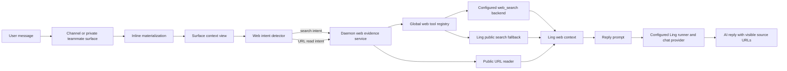
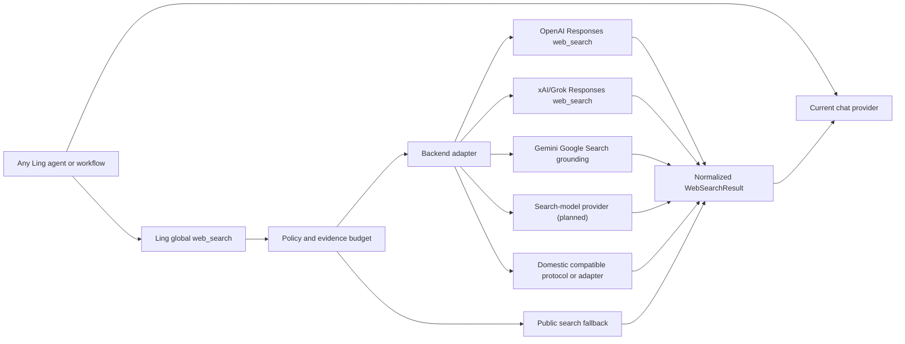

# Ling Web Tools

## Goal

Ling Agent should answer questions that require current public web evidence without pretending that Codex-only tools are part of the Ling runtime. Like Codex, Ling treats `web_search`, `open_url`, and future `browser` as host/global tools owned by the daemon. The selected chat model provider does not need to implement web access; Ling gathers web evidence first, then passes bounded evidence to the current model as context.

- `web_search`: a Ling global tool backed by a configured web-search backend provider when one can return citations, with a host-owned public search fallback when model-provider search cannot produce source URLs.
- `open_url` / `read_url`: public URL body extraction for explicit URL-reading requests.
- `browser`: deferred; interactive browser control requires a separate session, approval, and audit model.

## Current Slice

The daemon builds web evidence before calling no-tool reply runners. This keeps web access out of the local `RunTool` permission enum (`read`, `grep`, `find`, `ls`, `bash`, `edit`, `write`) and avoids treating internet lookup as a workspace filesystem or shell permission.



The shared implementation lives under `packages/daemon/src/features/web/`:

- `web-search-adapters.ts`: backend protocol adapters and normalized `WebSearchResult`.
- `web-search-service.ts`: global backend candidate resolution, local/env/keychain secret lookup, adapter dispatch, multi-backend failover, and sanitized failures.
- `web-evidence-service.ts`: global intent detection, URL reading, evidence prompt rendering, and normalized metadata for `search` and `readUrls`.

The evidence service keeps the search phase bounded. It can expand a freshness request into a small planned query set, but it must stay deterministic and capped. The planner is a helper, not a second search engine.

Channel code keeps a small compatibility wrapper in `features/channels/web-tools.ts`. Private teammate replies call the same evidence service directly.

## Tool Semantics

### web_search

`web_search` is a daemon-side evidence enrichment, not a runner tool. It triggers on explicit web/search language or freshness queries such as latest/current/today/news combined with search or verification intent.

Global result contract:

```ts
interface WebSearchResult {
  query: string;
  queries?: readonly string[];
  text: string;
  sources: Array<{ title?: string; url: string; snippet?: string }>;
  provider: {
    adapterId: string;
    providerPresetId: string;
    displayName: string;
  };
}
```

Global tool contract:

- Resolve a web-search backend from enabled workspace provider presets that have `capabilities` containing `web_search` and a matching Ling web-search adapter.
- If no global backend is configured, optionally fall back to the current chat provider only when that provider itself declares `web_search` and has an adapter. The chat provider is not required to support web search.
- Do not fall back to a standalone `env:OPENAI_API_KEY` unless there is an explicit provider preset using that ref. Real-time search must be explained as a Ling global tool backend in model settings, not as a hidden daemon key.
- Never log or render the plaintext key.
- If search fails, no backend exists, or the backend key is missing, continue the reply with a web-context blocked reason instead of fabricating current facts.
- If provider search returns a summary but no source URLs, try the host-owned public fallback before marking the turn `degraded`.
- If neither provider search nor public fallback returns source URLs, continue the reply as `degraded` and do not treat the summary as current evidence.

Current adapters:

- `ling-public-web-search`: no-key host fallback that asks DuckDuckGo HTML search through Jina Reader and normalizes Markdown result links into URL sources/snippets. It is not model-side browsing and does not use any provider secret.
- `openai-responses-web-search`: calls a Responses-compatible API with `tools: [{ "type": "web_search", "search_context_size": "low" }]` and requests `include: ["web_search_call.action.sources"]`. Official OpenAI Responses providers are recognized automatically; compatible providers such as xAI/Grok or private relays must set `compat.webSearch.protocol = "responses-web-search"`.
- `openai-chat-completions-web-search`: calls a Chat Completions-compatible API with `web_search_options`. Providers must explicitly set `compat.webSearch.protocol = "openai-chat-completions-search"` because normal chat compatibility does not guarantee hosted search or citation annotations.
- `google-interactions-web-search`: calls Gemini's Google Search grounding through the Gemini API Interactions endpoint. Providers must set `compat.webSearch.protocol = "google-interactions-search"`.

## Global Tool vs Provider Capability

Codex-style `web_search`, `open_url`, and `browser` are host/global tools: the host owns the tool contract, permissions, artifacts, and audit trail. Provider-native search, such as OpenAI hosted `web_search`, Google grounding, xAI live search, or a search-model provider, is only a backend implementation of Ling's global tool. The chat model provider stays separate.

This gives Ling one upper-layer tool surface while keeping vendor differences isolated:



## Provider Adapter Matrix

| Provider family | Ling adapter status | Why not implicit |
| --- | --- | --- |
| Ling public search fallback | Implemented: `ling-public-web-search` | No provider key. Host-side fallback obtains URL results when configured provider search returns no citations. |
| OpenAI Responses | Implemented: `openai-responses-web-search` | Uses Responses `web_search` tool and source include shape. |
| OpenAI-compatible Responses relay | Implemented when `compat.webSearch.protocol = "responses-web-search"` | The relay must expose `/responses` with OpenAI/xAI-style `web_search` and citations. |
| OpenAI-compatible chat/completions relay | Implemented when `compat.webSearch.protocol = "openai-chat-completions-search"` | Normal chat compatibility does not guarantee `web_search_options` or URL annotations. |
| xAI/Grok | Implemented through the Responses-compatible protocol template | Grok uses the configured xAI provider key, not a separate daemon key. |
| Google Gemini | Implemented: `google-interactions-web-search` | Search grounding uses Google-specific Interactions annotations or grounding metadata, not OpenAI tool calls. |
| Perplexity/search-model providers | Planned | Often returns citations as model/provider response metadata rather than a hosted tool call. |
| Anthropic | Planned | Web/search tool semantics and result blocks differ from OpenAI Responses. |
| Domestic providers: Doubao, DeepSeek, Qwen, GLM, MiniMax | Supported when configured to a known protocol; provider-specific extensions remain planned | Some expose search through platform extensions, some only expose chat. Ling must not mark them searchable without a protocol adapter and citation tests. |

Do not batch-enable every market provider by capability name alone. Add adapters incrementally behind tests that prove:

- request payload and auth shape;
- source/citation extraction;
- blocked/error behavior;
- no plaintext secret in prompts/logs;
- provider check or model metadata can safely advertise `web_search`.

### Codex Reference

OpenAI Codex does not depend on an arbitrary chat-completions relay to infer live search support. Its open-source implementation contributes a `web.run` tool from `codex-rs/ext/web-search`; that tool executor builds a `SearchClient`, executes search/open/find commands, emits started/completed web-search turn items, and returns search output as tool output. Separately, `codex-rs/core/src/tools/hosted_spec.rs` can expose a hosted web-search tool when `WebSearchMode` is cached/indexed/live instead of disabled.

Ling should keep the same product boundary: the conversation host owns the global web tool and evidence trail, while model/provider adapters are only interchangeable search backends. Custom OpenAI-compatible, Grok, Gemini, domestic, and private chat models can all consume the resulting evidence as ordinary prompt context. A provider that accepts `web_search_options` but returns no citation/source metadata is not equivalent to Codex-style live search; Ling first falls back to host public search, then marks the turn `degraded` only if no source-producing backend exists.

### Provider `compat.webSearch`

`capabilities` and `compat` carry different meanings:

- `capabilities: ["web_search"]` says the provider can be used as a Ling global web-search backend.
- `compat.webSearch.protocol` says which wire protocol Ling can call and how citations will be normalized.

Supported protocol declarations:

```json
{ "webSearch": { "protocol": "responses-web-search" } }
```

Use this for OpenAI/xAI-compatible Responses endpoints with hosted `web_search`.

```json
{ "webSearch": { "protocol": "openai-chat-completions-search" } }
```

Use this for compatible Chat Completions endpoints that accept `web_search_options` and return URL annotations.

```json
{ "webSearch": { "protocol": "google-interactions-search" } }
```

Use this for Gemini Google Search grounding.

Optional `endpointPath` can override the default relative path for relays that mount the same protocol somewhere else. Ling ignores absolute endpoint overrides so a provider key cannot be silently sent to a different host than the configured provider base URL.

Optional `timeoutMs` can extend provider-backed search for slow relays. The default remains 12 seconds; provider overrides are clamped to 12-120 seconds and affect only `web_search`, not `open_url` public URL reads.

Examples:

```bash
ling-stack provider update provider_... \
  --api openai-responses \
  --capability chat,tool_call,reasoning,web_search \
  --compat-json '{"webSearch":{"protocol":"responses-web-search","timeoutMs":60000}}'
```

```bash
ling-stack provider update provider_... \
  --api openai-completions \
  --capability chat,tool_call,reasoning,web_search \
  --compat-json '{"webSearch":{"protocol":"openai-chat-completions-search"}}'
```

### open_url / read_url

URL reading reuses the existing link-body materialization policy:

- Only `http` and `https` are allowed.
- Localhost, loopback, link-local, private IPv4, private IPv6, and local hostnames are blocked.
- Redirects are followed only after rechecking the target URL and resolved addresses.
- Body size, text size, redirect count, and timeout are bounded.
- Supported content types are HTML, plain text, and JSON.

When the turn envelope already contains an available materialized link body, the web context does not duplicate it. If the user explicitly asks to open/read a URL and no available link-body materialization exists, the daemon reads up to a small number of public URLs and injects the extracted text into the reply prompt.

### browser

Codex Browser Use is not directly portable into Ling Agent as a simple function call. It carries a live browser session, UI interaction targets, screenshots, event timing, and user-visible side effects. Ling needs its own contract before exposing this:

- user approval before navigation that changes account state or submits forms;
- session lifecycle and artifact capture;
- source/event rows for open page, click, type, screenshot, and find-in-page;
- network and origin policy;
- replayable audit evidence in the channel/work-unit timeline.

Until that exists, Ling supports current public lookup and public URL reading, not interactive browser automation.

## Conversation Evidence UI

Web evidence is part of the conversation, not a right-drawer-only artifact. When a channel reply or private teammate reply uses or blocks web context, the daemon records live `work_unit_progress` events with `toolSurface: "web"` while search/read work is happening, then records a final `web_evidence_recorded` runtime event linked to the pending AI reply message. Message list and stream responses derive a compact `webEvidence` field from the final event.

The pending AI message also shows the live web state in the conversation feed:

- `web_search_planned`: show that Ling prepared the bounded query set.
- `web_search_started`: show the current query and attempt count.
- `web_search_completed`: show available/degraded/blocked status, source count, and blocked reason when present.
- `open_url_started`: show the public URL being read and attempt count.
- `open_url_completed`: show available/blocked status, final URL host, and blocked reason when present.

The conversation page renders that field under the AI message in the existing message evidence disclosure:

- `web_search` shows call status, query, provider adapter, and blocked reason when present.
- `ling-public-web-search` means Ling host-side fallback found source URLs even though the selected model provider did not produce citations.
- `degraded` and `blocked` web evidence opens by default because those states are user-actionable and otherwise look like the search never ran.
- `degraded` reason names the backend/provider contract failure, such as a relay returning text without citation/source metadata.
- `Sources` shows bounded citation URLs and snippets returned by the provider adapter.
- `open_url` shows public URL read attempts, final URL, status, and blocked reason.

The right drawer can still provide deeper run/work-unit inspection, but it is not the primary place for web-search evidence. Runtime/work-unit timelines keep both the live `work_unit_progress` web events and the final `web_evidence_recorded` event so reviewers can correlate the visible reply evidence with the underlying work-unit audit trail.

## Prompt Boundary

The channel and private reply system prompts remain side-effect free:

- the runner still receives `tools: []`;
- web context is explicitly labeled as evidence;
- replies may use only included web-search/open-url results;
- replies must keep source URLs visible when using web evidence;
- replies must not claim page/body access beyond the included context.

## Provider And Key Boundary

The slice intentionally reuses the existing provider secret system:

- Global web-search backend provider with `web_search` and a matching Ling web-search adapter: use its configured `apiKeyRef`.
- Current chat provider does not need `web_search`; custom OpenAI-compatible, Grok, Gemini, domestic, and private models can all use global web evidence as ordinary prompt context.
- OpenAI-compatible chat/completions providers are not assumed to support hosted web search unless `compat.webSearch.protocol` names a supported search protocol.
- Ling does not read a separate daemon-level `OPENAI_API_KEY` as a hidden fallback.
- No new key is created.
- No secret is persisted by this feature.
- Shared channel replies may use the public fallback when no citation-producing backend is
  available. Private teammate direct replies disable this fallback and block without a
  network fetch unless a real Ling web-search backend is configured.
- The public fallback uses no provider key and does not send configured model secrets.
- Provider adapters may map Ling's generic `web_search` capability to vendor-specific search or grounding APIs, but each adapter must define its request and citation contract explicitly.

## Failure Modes

| Failure | Behavior |
| --- | --- |
| No global `web_search` backend is configured in a shared channel reply | Try `ling-public-web-search`; if it returns no URLs, inject blocked/degraded web-search status. |
| No global `web_search` backend is configured in a private teammate direct reply | Block `web_search` without fetching; inject a blocked status and reason into the private reply prompt. |
| Backend provider declares `web_search` but no Ling adapter supports its protocol in a shared channel reply | Try `ling-public-web-search`; if it returns no URLs, inject blocked/degraded web-search status. |
| Backend provider declares `web_search` but no Ling adapter supports its protocol in a private teammate direct reply | Block `web_search` without fetching; do not silently send the private query to public fallback. |
| Backend provider key is missing | Try `ling-public-web-search`; if it returns no URLs, report the configured backend key problem. |
| OpenAI request fails | Inject sanitized HTTP/network error; continue ordinary reply. |
| Backend returns text without citation/source metadata | Try `ling-public-web-search`; if it returns URLs, mark evidence `available` with public sources; otherwise include summary, mark the event `degraded`, show provider/reason inline, and do not treat it as current evidence. |
| Public fallback is blocked/rate-limited or returns no URLs | Mark the event `degraded`; do not claim realtime search success. |
| URL points to private/local network | Block before fetch or after DNS/redirect check. |
| URL body too large | Truncate to prompt budget. |
| Unsupported content type | Block URL body extraction. |

## Next Slice

1. Wire workflow steps, automations, and multi-agent orchestration into the same web evidence service where the surface can preserve source URLs and blocked reasons.
2. Add configurable search controls: allowed/blocked domains, live-access toggle, and context size.
3. Add provider adapters one at a time beyond the current OpenAI-compatible Responses, OpenAI-compatible Chat Completions search, and Gemini grounding adapters: Perplexity/search-model providers, Anthropic, then domestic provider-specific extensions where official protocols and citation evidence are available.
4. Add a browser-session design with approvals, artifacts, and replayable interaction events.
5. Consider promoting `web_search` to a first-class runner-visible tool only after the tool schema can represent non-workspace side effects and source evidence.
