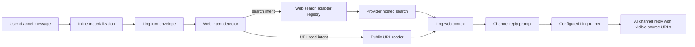
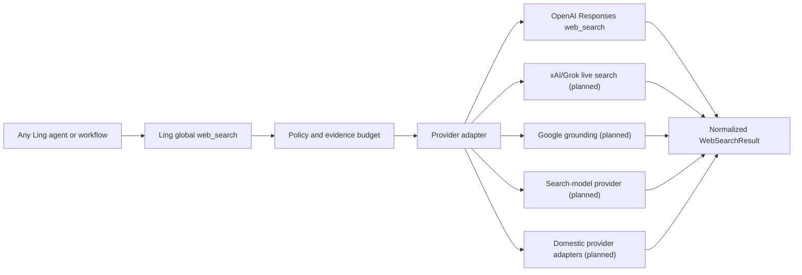

# Ling Web Tools

## Goal

Ling Agent should answer channel questions that require current public web evidence without pretending that Codex-only tools are part of the Ling runtime. Ling exposes one global web capability contract and lets provider adapters translate vendor-specific protocols into that contract. The first slice adds daemon-owned web context before channel reply generation:

- `web_search`: provider-backed hosted web search, currently implemented for a selected official OpenAI Responses provider that explicitly declares the `web_search` capability.
- `open_url` / `read_url`: public URL body extraction for explicit URL-reading requests.
- `browser`: deferred; interactive browser control requires a separate session, approval, and audit model.

## Current Slice

The daemon builds web context before calling the channel reply runner. This keeps web access out of the local `RunTool` permission enum (`read`, `grep`, `find`, `ls`, `bash`, `edit`, `write`) and avoids treating internet lookup as a workspace filesystem or shell permission.



## Tool Semantics

### web_search

`web_search` is a daemon-side context enrichment, not a runner tool. It triggers on explicit web/search language or freshness queries such as latest/current/today/news combined with search or verification intent.

Global result contract:

```ts
interface WebSearchResult {
  query: string;
  text: string;
  sources: Array<{ title?: string; url: string; snippet?: string }>;
  provider: {
    adapterId: string;
    providerPresetId: string;
    displayName: string;
  };
}
```

Provider adapter contract:

- Resolve the selected provider preset through the daemon web-search adapter registry.
- Use only providers that are enabled, have `capabilities` containing `web_search`, and have a matching Ling adapter for their protocol.
- Do not fall back to a standalone `env:OPENAI_API_KEY` outside the selected provider. Real-time search must be explained as a provider capability in model settings, not as a separate daemon key.
- Never log or render the plaintext key.
- If search fails, the provider lacks `web_search`, or the provider key is missing, continue the reply with a web-context blocked reason instead of fabricating current facts.

Current adapter:

- `openai-responses-web-search`: calls the OpenAI Responses API with `tools: [{ "type": "web_search", "search_context_size": "low" }]` and requests `include: ["web_search_call.action.sources"]`.

## Global Tool vs Provider Capability

Codex-style `web_search`, `open_url`, and `browser` are host/global tools: the host owns the tool contract, permissions, artifacts, and audit trail. Provider-native search, such as OpenAI hosted `web_search`, Google grounding, xAI live search, or a search-model provider, is not automatically a host tool. Ling makes it global only after an adapter maps the provider protocol into Ling's evidence contract.

This gives Ling one upper-layer tool surface while keeping vendor differences isolated:



## Provider Adapter Matrix

| Provider family | Ling adapter status | Why not implicit |
| --- | --- | --- |
| OpenAI Responses | Implemented: `openai-responses-web-search` | Uses Responses `web_search` tool and source include shape. |
| OpenAI-compatible chat/completions relay | Not implicit | Compatibility usually covers chat completions, not hosted search tools or citation shape. |
| xAI/Grok | Planned | Live search/DeepSearch is provider-specific and needs a dedicated request and citation mapper. |
| Google Gemini | Planned | Search grounding uses Google-specific grounding metadata, not OpenAI tool calls. |
| Perplexity/search-model providers | Planned | Often returns citations as model/provider response metadata rather than a hosted tool call. |
| Anthropic | Planned | Web/search tool semantics and result blocks differ from OpenAI Responses. |
| Domestic providers: Doubao, DeepSeek, Qwen, GLM, MiniMax | Planned per provider | Some expose search through platform extensions, some only expose chat. Ling must not mark them searchable without an adapter and live verification. |

Do not batch-enable every market provider by capability name alone. Add adapters incrementally behind tests that prove:

- request payload and auth shape;
- source/citation extraction;
- blocked/error behavior;
- no plaintext secret in prompts/logs;
- provider check or model metadata can safely advertise `web_search`.

### open_url / read_url

URL reading reuses the existing link-body materialization policy:

- Only `http` and `https` are allowed.
- Localhost, loopback, link-local, private IPv4, private IPv6, and local hostnames are blocked.
- Redirects are followed only after rechecking the target URL and resolved addresses.
- Body size, text size, redirect count, and timeout are bounded.
- Supported content types are HTML, plain text, and JSON.

When the turn envelope already contains an available materialized link body, the web context does not duplicate it. If the user explicitly asks to open/read a URL and no available link-body materialization exists, the daemon reads up to a small number of public URLs and injects the extracted text into the reply prompt.

### browser

Codex Browser Use is not directly portable into Ling Agent as a simple function call. It carries a live browser session, UI interaction targets, screenshots, event timing, and user-visible side effects. Ling needs its own contract before exposing this:

- user approval before navigation that changes account state or submits forms;
- session lifecycle and artifact capture;
- source/event rows for open page, click, type, screenshot, and find-in-page;
- network and origin policy;
- replayable audit evidence in the channel/work-unit timeline.

Until that exists, Ling supports current public lookup and public URL reading, not interactive browser automation.

## Prompt Boundary

The channel reply system prompt remains side-effect free:

- the runner still receives `tools: []`;
- web context is explicitly labeled as evidence;
- replies may use only included web-search/open-url results;
- replies must keep source URLs visible when using web evidence;
- replies must not claim page/body access beyond the included context.

## Provider And Key Boundary

The slice intentionally reuses the existing provider secret system:

- Selected provider with `web_search` and a matching Ling web-search adapter: use its configured `apiKeyRef`.
- OpenAI-compatible chat/completions providers are not assumed to support hosted web search.
- Ling does not read a separate daemon-level `OPENAI_API_KEY` as a hidden fallback.
- No new key is created.
- No secret is persisted by this feature.
- Provider adapters may map Ling's generic `web_search` capability to vendor-specific search or grounding APIs, but each adapter must define its request and citation contract explicitly.

## Failure Modes

| Failure | Behavior |
| --- | --- |
| Selected provider lacks `web_search` | Inject blocked web-search status; reply should say the current model configuration does not support real-time search. |
| Selected provider declares `web_search` but no Ling adapter supports its protocol | Inject blocked web-search status; reply should say Ling has no web-search adapter for that provider yet. |
| Selected web-search provider key is missing | Inject blocked web-search status; reply should say the configured provider key is missing. |
| OpenAI request fails | Inject sanitized HTTP/network error; continue ordinary reply. |
| Model returns no citations | Include summary and mark sources as none returned. |
| URL points to private/local network | Block before fetch or after DNS/redirect check. |
| URL body too large | Truncate to prompt budget. |
| Unsupported content type | Block URL body extraction. |

## Next Slice

1. Add UI evidence rows for web search calls, opened URLs, and cited sources.
2. Move channel-only context injection behind a daemon global evidence service so direct runs, workflow steps, automations, and multi-agent orchestration can call the same `web_search` surface.
3. Add configurable search controls: allowed/blocked domains, live-access toggle, and context size.
4. Add provider adapters one at a time: xAI/Grok, Google grounding, Perplexity/search-model providers, Anthropic, then domestic providers where official protocols and citation evidence are available.
5. Add a browser-session design with approvals, artifacts, and replayable interaction events.
6. Consider promoting `web_search` to a first-class runner-visible tool only after the tool schema can represent non-workspace side effects and source evidence.
