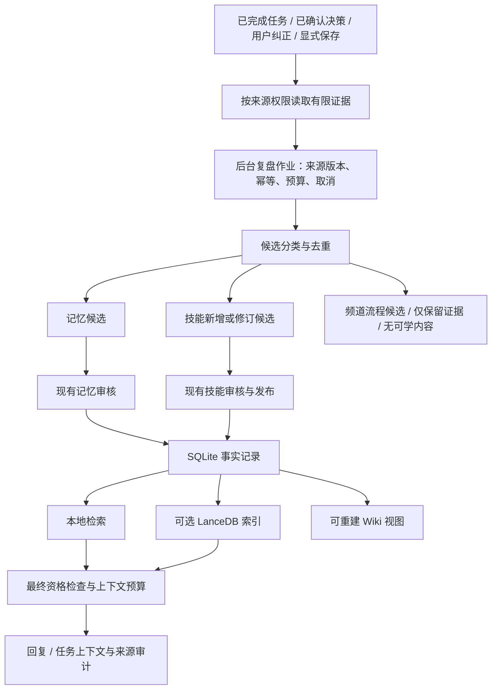

# Ling 记忆与技能学习实施计划

Status: implementing; isolated delivery branch; scoped recall, definition history, and bounded learning backend implemented; UI and optional derivatives in progress
Owner: memory, skill governance, and daemon runtime maintainers
Last verified: 2026-10-29
Document type: cross-feature implementation plan
Canonical replacement: none; existing memory, skill, and runtime contracts remain authoritative
Code and test anchors: listed in the baseline and verification sections below

## 1. 目标与实施结论

让 Ling 能找回过去已经确认的知识，把经过验证的方法整理为记忆或技能候选，并让用户看懂、审核和撤回学习结果。

建议分两批交付：

1. **第一批 S0–S3：修好本地召回，接通学习候选，提供修订、来源和撤销。** 不依赖向量模型即可验证主要闭环。
2. **第二批 S4–S5：增加可选语义召回和可重建 Wiki。** 在第一批正确性稳定后，提高模糊检索和知识浏览能力。

SQLite 中的记忆对象、审核记录和技能注册表继续拥有事实状态；LanceDB 和 Wiki 都是派生层。默认 runner、执行权限和审批仍由 Ling runtime control plane 管理。

本计划只定义实施范围和验收条件，不表示代码已实现、PR 已合并或应用已发布。实施基线已刷新为远端 `origin/main` 的 `0b25fc18`；代码位于独立的 `codex/memory-skill-learning` 工作树，未复制原工作区的会话／审批 WIP。packaged 应用尚未验收。

## 2. 借鉴来源与边界

参考 OpenClaw 提交 `d7349d9395e2bde0f42882a9f7ef8afab59e19c3`：

- [memory-lancedb](https://github.com/openclaw/openclaw/blob/d7349d9395e2bde0f42882a9f7ef8afab59e19c3/docs/plugins/memory-lancedb.md)：借鉴持久向量索引、自动召回、索引身份、故障状态和 Agent 隔离。
- [memory-wiki](https://github.com/openclaw/openclaw/blob/d7349d9395e2bde0f42882a9f7ef8afab59e19c3/extensions/memory-wiki/README.md)：借鉴主题页、结论与证据、关联链接、过期和矛盾报告，以及编译产物可重建的原则。
- [Skill Workshop](https://github.com/openclaw/openclaw/blob/d7349d9395e2bde0f42882a9f7ef8afab59e19c3/docs/tools/skill-workshop.md) 和 [Self-learning](https://github.com/openclaw/openclaw/blob/d7349d9395e2bde0f42882a9f7ef8afab59e19c3/docs/tools/self-learning.md)：借鉴有限证据的后台复盘、优先改进旧技能、版本差异和聊天内撤销。

具体适配：

| 外部模式 | Ling 的实施选择 |
| --- | --- |
| 自动学习后立即修改技能 | 后台先生成候选或修订草稿，沿用现有审核、发布和绑定流程 |
| Agent 私有学习目录 | 沿用 workspace/channel/teammate/task/run 所有权及技能来源边界 |
| learned skills 绕过技能可见列表 | 所有技能继续经过 Effective Skill、绑定和 executability 检查 |
| 固定轮数触发、固定闲置天数归档 | 先按成功验证、显式纠正和重复证据触发；长期未用先提示 |
| Wiki 页面作为可搜索知识 | 页面引用已审核来源，读取和召回重新校验作用域与当前资格 |

本轮不建设技能市场、通用知识图谱数据库、独立 Agent runtime 或新的全局审核中心。

## 3. 已核实的基线

| 能力 | 当前事实与代码锚点 | 需要补齐 |
| --- | --- | --- |
| 记忆对象与审核 | [memory-types.ts](../../packages/core/src/memory-types.ts)、[memory-review-policy.ts](../../packages/core/src/memory-review-policy.ts) 已定义作用域、来源、候选、审核和敏感性 | 生命周期元数据和召回资格需要统一；不能把 schema 存在当作完整执行链路 |
| 本地召回 | [memory-retrieval-store.ts](../../packages/core/src/storage/sqlite/memory-retrieval-store.ts) main 已先按作用域、审核和健康状态筛选，流式评估全部合格对象；中文二元组和旧记忆回归已存在 | 在此基础上增加 FTS5 派生候选索引、写入一致性、来源归属解析和安全审计 |
| 召回接入 | 私聊、频道回复、任务 run、workflow 和手动查询已调用 `recallMemory` | 可选异步检索必须覆盖这些入口，避免只改善其中一个表面 |
| 向量检索 | [memory/routes.ts](../../packages/daemon/src/features/memory/routes.ts) 返回 `not_installed`；[plugin-sdk/memory.ts](../../packages/plugin-sdk/src/memory.ts) 只有 provider metadata | 实际 provider 合约、索引生命周期和降级逻辑 |
| 记忆整理 | [memory/consolidation.ts](../../packages/daemon/src/features/memory/consolidation.ts) 接收调用方给出的候选并审核入库 | 从证据生成候选的提炼步骤、后台调度和重启恢复 |
| 技能录制 | [skill-recording.ts](../../apps/web/src/lib/skill-recording.ts) 从 run 元数据、工具标签和验证标签预填可编辑草稿 | 生成真正可复用的步骤，不能把工具标签列表当作已学会的方法 |
| 观察与治理 | [procedure-observation-job.ts](../../packages/core/src/procedure-observation-job.ts)、[skills/routes.ts](../../packages/daemon/src/features/skills/routes.ts) 已有观察、路由、重复检查、候选和纠错统计 | 自动完成事件接入、纠正到修订候选、数据库级幂等 |
| 技能修订 | [revision-routes.ts](../../packages/daemon/src/features/skills/revision-routes.ts) 与 [skill-registry-store.ts](../../packages/core/src/storage/sqlite/skill-registry-store.ts) 已有乐观锁、预览和定义更新 | 变更前后版本、用户可见差异和定义级撤销 |
| 源码快照回滚 | 现有 `source/rollback` 改变 published source snapshot | 不能等同于恢复 `skill_definitions.definition_json`，需要独立定义修订历史 |
| 回归评估 | [skill-regression-harness.ts](../../packages/core/src/skill-regression-harness.ts) 评价调用方提供的 observations | 不表示已经自动跑过真实模型或证明技能有效 |

现有约束继续由下列文档拥有：

- [Ling Memory v1](ling-memory-v1.md)、[Memory Review Policy](memory-review-policy-implementation.md)、[Memory Health](memory-health-and-fanin.md)。
- [Skill Candidates And Protocol Governance](skill-candidates-and-protocol-governance.md)、[Skill Recording](ling-native-skill-recording-p0-detailed-design.md)、[Skill Editing And Revision](skill-editing-and-revision.md)。
- [Skill Library And AI Evolution](skill-library-height-and-ai-evolution-lifecycle.md)、[Runtime Control Plane](runtime-control-plane-detailed-design.md)。
- [Conversation Memory Citations](conversation-memory-citations-and-sources.md)、[Conversation Surface Contract](conversation-surface-contract.md)。

## 4. 最终数据流与模块职责

职责分配：

- `packages/core`：资格判断、候选分类、去重、修订规则，以及各自的 SQLite store；不在同步 store 中执行模型或网络请求。
- `packages/daemon/src/features/memory`：召回服务、整理服务和派生索引协调。
- `packages/daemon/src/features/skills`：观察处理、修订草稿、历史和撤销；从现有大 routes 文件拆出所需 service，不继续堆叠模型调度逻辑。
- daemon 学习协调模块：只负责证据裁剪、复盘作业和结果分发，复用 WorkUnit/Attempt 的运行、取消和 fencing；不另建执行引擎。
- `packages/contracts`、`packages/api-client`：承载新增的请求和只读投影；现有 API 保持兼容，新版本字段可选或明确版本化。
- `apps/web`：在现有记忆、AI evolution 和会话来源位置展示结果，资格判断和权限不移到 UI。

## 5. 分阶段实施

### S0：固定行为基线，先封住资格与审计缺口

**交付：** 建立后续每次改动都能比较的检索与学习样例，核对来源权限和 MRP 剩余工作。

- 建立脱敏 fixture：中文自然问法、精确标识符、跨频道/跨 teammate、候选/禁用/归档、过期/被替代、无相关答案、超过 500 条的旧记忆。
- 固定 Recall@6、MRR、无关命中率、作用域违规数、索引延迟和额外耗时的计算方式。记录实测基线，不预写提升百分比。
- 将 `MemorySelfImprovingMetadata.validUntil/supersededBy` 与实际召回资格对齐；明确不存在元数据时的兼容行为。
- 为自动召回创建 daemon-owned scope resolver：从真实 teammate、频道成员关系和 task/run lineage 确定作用域，拒绝调用方伪造归属。
- 自动路径不接受 `includeDisabled/includeSecretAdjacent` 等管理开关；有权限的检查接口保留单独语义。
- 审计区分“检索候选、被排除、实际注入上下文”。现有 `UsedMemoryEvent` 表示上下文供给证据，不能证明模型实际采纳了某条结论。
- 全局审核入口沿用现有归属表面；本计划明确不新建全局中心，可据此关闭 MRP 的入口决策待项。

**验收：** 隔离用例违规为 0；禁用、被替代和过期对象不进入普通上下文；未知来源与无法核验的 lineage 安全跳过；审计不泄漏被拒绝来源的标题或正文。

### S1：修好无向量依赖的本地召回

**依赖：** S0。**交付：** 中文和历史记忆可以稳定检索，并保持离线可用。

- 在数据库内先约束 workspace、允许的 owner、active/enabled 和 sensitivity，再检索、排序、截断；去掉“最近 500 条再匹配”的入口。
- 首选 SQLite FTS5 检索索引，中文使用规范化字符二元组，英文单词与代码标识符保留；精确 id/tag 匹配单独加权，避免标识符被切碎。
- 参数化构造 MATCH 查询，覆盖引号、连接符、空查询和超长输入。每个正式桌面 runtime 验证 FTS5；不支持时使用按允许作用域分批查询的正确性回退，不恢复全局 500 条截断。
- 索引是派生数据，提供版本、重建和事务内增量更新；使用 `lastUsedAt` 不改变知识内容的新旧语义。
- 保留 maxResults 和 prompt-sized excerpt 预算，避免把改善检索变成扩大上下文注入。

**主要模块：** memory retrieval/object/review stores、SQLite migrations、core 检索策略；daemon 五类召回入口做一致性回归。

**验收：** 超过 500 条时仍能命中符合条件的旧记忆；中文固定样例全部命中预期集合；精确标识符集合不退化；S0 隔离和排除用例全部通过。记录 1,000/10,000 条 fixture 下的耗时与查询计划，只有实测瓶颈才扩大优化范围。

### S2：接通有限证据到记忆／技能候选的学习链路

**依赖：** S0、S1。**交付：** 首先通过显式“保存经验”跑通，再接可开启的后台复盘。

1. 将 `processProcedureObservationJob` 抽为可复用 service。现有 HTTP 录制、后台结果和手动保存调用同一套分类、去重与治理，不在 daemon 内绕 HTTP 调自己。
2. 增加最小的 `LearningReviewJob` 持久记录：唯一来源键、scope、source refs 和版本、状态、关联 WorkUnit/Attempt、策略版本、预算与输出候选。现有 memory consolidation job 仍负责记忆候选入库，不伪装成已经执行过的模型复盘。
3. 来源键包含 workspace、源 turn/run/correction、有效 Attempt 和证据版本；用 SQLite 唯一约束与事务保证幂等。替换当前部分路径通过 `list(limit: 500).find(...)` 判断重复的方式。
4. 首批来源限定为：显式选定任务、已验证的成功多步骤任务、已确认频道决策和与具体技能关联的用户纠正。失败或取消的任务只允许显式提炼有成功证据的局部步骤；不推断最终成功。
5. 证据按源权限裁剪，保留原始事件引用和缺失标记。提炼器无 shell、文件写入、浏览器、外发或任意工具，只输出结构化候选；缺少结果证据可输出“无可学内容”。每个方法候选包含适用与不适用场景、前置条件、可执行步骤、验证方式和逐步证据；不能仅返回 `Use bash` 一类工具名占位步骤。
6. 分流：事实/偏好/决策进入 memory；可复用方法进入 skill；单频道流程进入现有 protocol/playbook 候选路径；单次细节或无依据内容只保留证据。
7. 先查已有技能和候选：同方法补证据；明确改进旧步骤生成修订草稿；无覆盖才新增技能。后台只提议改动，不重写内置、gstack、workspace 或外部导入源码。
8. 初始执行预算设为最多 64 条事件、32 KiB 脱敏摘录、单次 2,048 输出 token、120 秒、每 workspace 单个后台复盘。包括重试在内每 job 最多两次模型请求，累计输入不超过 16,000 token、累计输出不超过 4,096 token；超限前裁剪或停止，不能靠单次输出限制冒充总预算。每 workspace 每天初始最多 10 个自动复盘 job，显式保存不占自动配额但仍受单 job 限制。以上均为可配置初值，不是已测性能指标。
9. 新自动调度随迁移默认关闭；用户启用后采用 `propose`，并继续受现有 skill generation/recording policy 约束。原来的 `semi_auto` 配置不自动视为新增模型调用授权。显式保存只作用于选定证据。
10. 前台运行时不启动新后台调用；已有复盘在下个安全边界取消，不阻塞回复。rate limit 退避、同来源合并，最多一次暂态重试；重启后的旧 Attempt 不能发布结果。

**取消／发布校验：** 关学习、权限收紧、来源删除、证据替换或 Attempt 失效后，未提交结果取消；最终入库事务再次验证来源和策略版本。已经审核应用的内容通过正常历史和撤销处理，不悄悄删除。

**验收：** 重复事件、进程重启和重复提交只形成一份逻辑结果；后台不能产生 active memory、发布技能或建立绑定；缺证据不编造步骤；用户纠正能形成针对旧技能的草稿；前台任务不等待学习完成。

### S3：技能定义版本、差异、撤销和学习结果展示

**依赖：** S2；修订历史服务可在 S1 后单独开展。**交付：** 用户能看懂并控制新增和修订。

- 新增不可变的技能定义修订记录，保存 before/after、基准 revision、候选与源 job、操作者、理由和校验结果；和现有 source snapshot 明确区分。
- 现有编辑器继续调用 revision preview/publish，保留 `expectedUpdatedAt`，并给新增流程使用单调 revision 或内容 hash；发布、历史记录、候选关联和通知采用同一事务或可恢复的 outbox。
- 历史迁移只把当前定义作为初始 revision，不从缺少 before-image 的旧 import draft 伪造完整历史。
- 撤销创建一个恢复旧内容的新 revision，并检查当前版本仍等于被撤销变更的结果；有后续修改时返回冲突和可审查差异，不覆盖。重复撤销幂等，新建技能以审核归档作为撤回。
- 首版后台修订只改说明和步骤，不修改工具、provider、approval profile、来源和绑定；支持文件也不自动变更。未来允许脚本/资源修订时，必须把完整 bundle 一起版本化与验证。
- 每个新技能／修订保存正向触发、反向触发和预期验证的例子。先用冻结证据包检查提炼是否忠于来源；适合安全重放的方法再在隔离 workspace 中比较旧／新定义的实际结果。只通过 schema 或 observation 评分时明确标记“尚未运行验证”，不能显示为效果已验证。
- 已启动 run 记录并固定其有效定义/source revision；更新用于后续 run，不注入活跃会话。复用现有 source runtime snapshot，缺少引用时补入 request snapshot。
- 草稿显示“发现可保存的经验”，审核应用后显示“已更新技能”；不能把 pending 候选展示为已经学会。提供查看依据、差异、审核和撤销入口。
- 记忆仍在现有管理位置审核；对回复展示由 UsedMemoryEvent 派生的轻量来源引用，无记忆时不显示空卡片。
- 会话投影只复用当前 Conversation Surface 的统一 owner。现有 transcript/UI 分支先合入或提供稳定插槽，再接学习结果，避免在三种会话中各造一份卡片。

**验收：** 预览无持久副作用；双窗口编辑冲突不丢用户输入；应用与撤销不改变 skill id、来源、绑定、persona 或权限；旧 run 保留旧版本；三类会话的来源、待审核状态和错误提示一致。技能原有 source rollback 用例保持通过。

### S4：增加可选 LanceDB 语义召回

**依赖：** S0、S1；可在 S2–S3 之后交付，不阻塞第一批。**交付：** 支持换种说法找回知识，失败时本地召回照常工作。

- 在 daemon 增加异步 `MemoryRecallService`，core 的同步 SQLite store 继续负责本地检索。逐一迁移私聊、频道回复、run、workflow、查询五类入口，避免在同步接口里偷偷加入网络 I/O。
- provider v1 支持批量 upsert/remove、scoped search、status 和重建；首个可选 adapter 使用 LanceDB，native 依赖加载失败不影响 daemon 启动。跨平台包验收前不进入默认安装路径。
- 只索引当前允许、active、非 secret-adjacent 的记忆内容；候选、原始全量聊天和未经审核的 skill/persona 不进入索引。云端 embedding 必须经过用户配置的 provider 和相应数据策略。
- 索引身份包含 provider、model、dimensions 和 schema version；每条 chunk 记录 memory id、scope、内容 hash、资格 revision。身份变化创建新索引并原子切换，不混用向量空间。
- 内容 hash 排除 `lastUsedAt` 和单纯使用造成的 `updatedAt` 变化；当前 `recordUsedMemoryEvent` 会更新该时间，不能因此触发反复 embedding。
- 变更用事务 outbox 驱动增量索引。禁用、归档、跨域移动、替代和过期及时失效；搜索命中后回查 SQLite，拒绝旧资格或旧内容版本，即使向量删除尚未完成。
- provider 在 top-k 之前应用作用域过滤；lexical/vector 以固定的 rank fusion 合并，不直接相加不可比的原始分数，之后执行最终资格和上下文预算检查。
- 初始额外语义检索预算为 1 秒且可配置，覆盖 embedding 和向量查询。超时、未配置、服务故障或索引重建均退回本地结果；后台重建不拖住回复。
- 状态分别报告未配置、重建中、ready、degraded 和 unavailable；状态读取不冒充实时 embedding 探活。

**验收：** S0 精确命中集合无退化；冻结的改写问法集合 Recall@6/MRR 高于 S1，且无关命中率不增加；作用域违规为 0；provider 故障与模型维度切换覆盖；关闭 provider 后本地功能完整可用。真实 provider 的成本、p50/p95 和索引磁盘占用另行实测，不用 fake embedding 结果宣称质量提升。

### S5：增加轻量、可重建的 Wiki 知识视图

**依赖：** S1–S3；不强依赖 S4。**交付：** 把已经审核的知识整理成可浏览、可关联的主题页。

- 首版输入仅为 active、来源可追溯的记忆和已审核决策；不递归扫描整个仓库，也不自动导入全部聊天或外部网页。
- 每个页面／结论保留 memory id、来源版本、scope、证据、置信度和更新时间；页面按作用域分区，private 不通过公共关联页、反向链接或报告泄漏。
- 首版生成主题、来源和关联索引，提供已标记矛盾、缺证据和过期条目的报告。编译器不声称能自动判断所有语义矛盾，模型建议仍进入候选。
- 使用 generation id、manifest、暂存目录和原子发布；并发旧编译不能覆盖新一代。重启、恢复备份或源内容变化后可以重建，陈旧页面先标记不可用于召回。
- 用户编辑内容保存在独立 human blocks 或来源笔记，重建时保留；修改生成块不自动写回 active memory，导回需要正常审核。
- 先提供只读浏览和 Markdown 导出，不依赖 Obsidian CLI。Wiki 检索命中需要回查当前来源资格；首版不向每个 prompt 默认注入 Wiki 摘要，避免重复占用上下文。

**验收：** 同一来源版本重复编译结果一致；删除派生产物可完整重建；保留 human blocks；跨 scope 的搜索、backlink、计数和报告均不泄漏；旧 generation 无法覆盖新发布；源被禁用后其旧页面不能进入上下文。

## 6. 建议的提交拆分与依赖

| Slice | 范围 | 对应阶段 | 发布条件 |
| --- | --- | --- | --- |
| A | 召回资格、scope resolver、样例和审计合约 | S0 | 合入前固定正确性基线 |
| B | 本地检索、中文处理和派生索引迁移 | S1 | 可独立发布；无模型依赖 |
| C | 观察处理 service、来源幂等和显式经验提炼 | S2 前半 | 先验证手动完整链路 |
| D | 后台调度、预算、恢复、取消和候选分流 | S2 后半 | 默认关闭，启用后仅提议 |
| E | 定义修订历史、差异、应用和撤销 API | S3 后端 | 不依赖会话 UI 重构完成 |
| F | 现有审核表面、会话学习结果与记忆来源 | S3 前端 | 统一会话插槽就绪后集成 |
| G | 异步召回服务、LanceDB adapter 和生命周期 | S4 | 本地包与配置的真实 provider 验证 |
| H | Wiki 编译、隔离浏览和导出 | S5 | 仅在第一批闭环稳定后推进 |

### 当前执行账本

| Slice | 实施状态 | 证据与剩余验收 |
| --- | --- | --- |
| A | 统一召回边界、真实 owner/membership/lineage 校验与资格／排除／选择审计已接入 | 核心资格排除计数、daemon 无结果／拒绝审计与现有 UsedMemoryEvent 分层测试通过；不将选择或供给当成模型实际采纳 |
| B | FTS5 Unicode 二元组候选索引、事务更新、dirty 回退、重建已实现 | 索引／召回／审核定向测试、1k/10k 合成样例；跨平台 packaged FTS5 仍待实测 |
| C | 观察治理 service、来源幂等、有限证据提炼和显式经验保存已接入；支持持久任务、三种会话 turn 和已确认决策 | 三种无 task turn 来源、决策确认／拒绝／替换、归属、候选原子提交、纠正到修订及 transport 测试通过 |
| D | 默认关闭的持久作业、WorkUnit/Attempt、可调低预算、取消、前台让行和重启 fencing 已接入 | 定向测试及 daemon HTTP 验收已通过；真实模型质量／费用仍待实测 |
| E | 定义 before/after 历史、CAS、幂等撤销、可恢复通知及运行定义快照已实现 | 前端历史、差异、确认撤销已接；真实浏览器纠正→审核→原技能修订→撤销及数据库内容恢复已通过 |
| F | 已接统一回复 footer、run 详情、频道决策和 AI evolution 的按需学习面板 | 本地受控模型完成浏览器纠正闭环；三种会话来源服务测试通过，更多真实界面来源验收仍待补 |
| G | 未开始 | LanceDB、真实 embedding 质量、故障降级 |
| H | 未开始 | Wiki 编译、隔离浏览和导出 |

推荐顺序为 A → B → C → D/E → F → G → H。D 与 E 可以在文件职责隔离后独立开发，主代理完成集成；本计划不要求启动多代理。

当前主工作区有会话与审批 UI 的大量 WIP。实施前另开合适的干净 worktree，并核对远端基线；不要从当前 dirty worktree 批量暂存或覆盖。每个 slice 在同一 PR 更新对应 owning contract，具体 API 名称和 schema 变更也在该 slice 固定。

## 7. 验证、迁移与发布

### 验证矩阵

| 层级 | 必须验证的行为 | 复用的测试入口 |
| --- | --- | --- |
| Core | 资格、中文检索、去重、分类、修订冲突、撤销、排序合并 | `packages/core/test/memory-*.test.mjs`、`procedure-observation-store.test.mjs`、`skill-candidate-store.test.mjs`、`skill-revision-store.test.mjs` |
| Daemon | 五类召回入口、重启恢复、Attempt fencing、权限收紧、outbox、候选与发布一致性 | `packages/daemon/test/channel-workspace.test.mjs`、`channel-context-processing.test.mjs`、`runtime-supervisor.test.mjs`、`skill-revision-api.test.mjs`；按新增模块补最小相关测试 |
| Web | 待审核与已应用区别、差异、撤销冲突、来源、空态、键盘操作 | `apps/web/e2e/ui2-teammate-management-memory.spec.ts`、`ui2-settings-skill-library.spec.ts`、`ui2-teammate-management-skills.spec.ts` |
| Runtime | LanceDB 原生加载、离线降级、取消和平台打包 | macOS/Windows 支持矩阵及 packaged smoke；真实模型质量和费用单列 |

单个 slice 先运行相关 package build 和定向测试，失败或跨模块影响再扩大。文档链接和 `git diff --check` 每次检查。单元测试、真实 provider、浏览器和 packaged 验收分别报告。

### 迁移和关闭路径

- 迁移只追加必要的索引／作业／修订记录，不改写原始历史证据。发布前验证当前备份机制或做针对性备份，再对代表性数据库副本执行升级与恢复演练。
- FTS、LanceDB、Wiki 均可重建。模型或索引身份变更使用新 namespace，不覆盖旧内容后再尝试修复。
- 学习功能关闭即停止入队和新模型调用，取消尚未提交任务；已有候选、审核、修订和审计保留。
- 新 UI 关闭后仍能从原有记忆／技能入口审核；不留下只有新卡片才能处理的状态。
- `off` 和权限收紧均优先于已有 job 配置，旧 job/旧索引不能自行恢复更宽松访问。

## 8. 完成标准与后续范围

第一批完成需要用真实流程证明：旧中文记忆被正确找回；一次有验证的任务生成可审核经验；一次技能步骤纠正形成旧技能修订；审核后后续 run 使用新版本；撤销后内容恢复；跨频道和私有记忆没有泄漏。只出现候选列表或只通过构建不算闭环完成。

第二批完成需要证明：语义检索在同一批标注问题上有质量收益，离线降级可用；Wiki 可浏览、可重建、保留证据且不扩大访问范围。

本计划不预设必须让每条记忆、每次学习都人工点击。第一批沿用现有 consolidation 的 candidate-only 行为；更低摩擦的同 scope 自动生效，需在质量、去重和撤销证据稳定后作为独立策略变更，不夹带到调度或索引实现中。

不在本计划承诺内：云端技能市场、自动改写 persona、自动外发知识、默认全量历史扫描、自动执行新技能，以及仅凭“30 天未用”自动归档技能。

本计划完成后，持久行为分别归入上述 owning contracts；测试次数、截图和发布证据进入 PR/CI/Release。删除本实施计划，并更新 [Implementation Status](implementation-status.md)，避免形成第二份长期事实来源。
