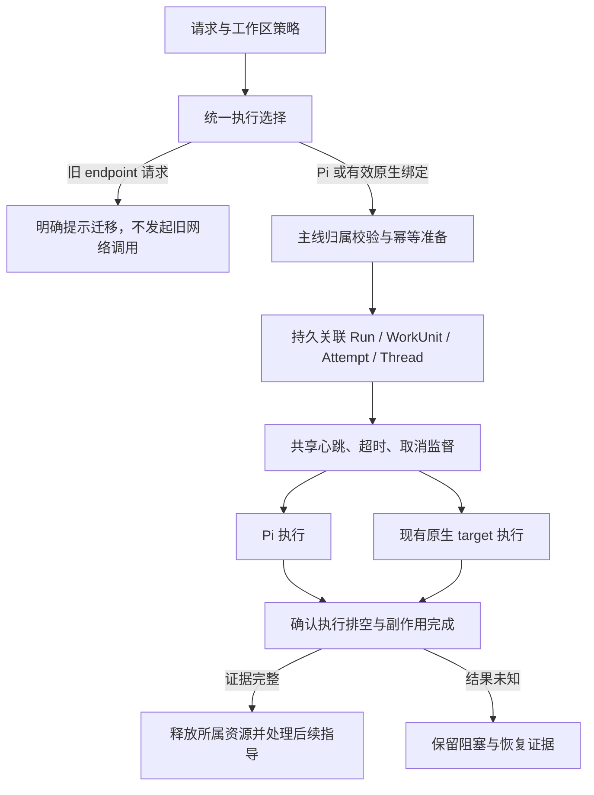

# 执行引擎适配最新主线与旧入口退役方案

日期：2026-10-19。状态：**T0–T6 源码已实现，本机回归归因已收齐；T7 正式发布验收未完成**。用户已授权落地文档、按方案改码并完成新增功能与原有功能回归。

实施追踪见文末；所有未有新证据的验收项保持未完成。

目标：保留现有原生引擎实现，把运行控制接入最新主线；本次同时规划旧 endpoint 入口退役和迁移。完成后，原生引擎与 Pi 遵守同一套启动归属、监督、取消、停止证据和指导续跑约定。

## 1. 基线、已有资产与决定

| 项目 | 本轮确认 |
|---|---|
| 分支 | `gansx/execution-engine-integration` |
| HEAD、origin/main、实时远端 main | `708931accf7bc7de4d67abf2939500e1369969a2` |
| 初始工作区 | 复审开始时 472 个未提交变更文件；原暂存内容持续保护 |
| 已跟踪差异 SHA-256 | `321b446ae999cc28e5ca7e7715193614296d60da48d0536835d15abf74e1f60c` |
| 适配依据 | 会话附件 `execution-engine-compatibility-review.md`及本轮源码核查 |
| 本轮新增产品决定 | 用户选择“本次一并规划退役并迁移到原生模式” |

2026-10-19 再次实时查询远端 main，仍与上述基线一致，目前无需为了对齐提交而再次 rebase。后续实施前仍需查询远端；若主线更新，先审查新增差异涉及的模块，再调整本计划，不用旧文件整份覆盖新主线。

**继续复用的资产：** profile/revision/auth generation、隔离认证目录、Keychain 和 secret worker、安装/连接探测、Codex stdio 与 Kimi/OpenClaw ACP 的 owned execution、原生 submission/approval/output/Host operation journal、Desktop IPC、Web 管理与工作区策略界面。它们已有实现和部分定向验证，尚不代表完整生产可用。

**本轮适配的执行目标：** Pi、Codex、Kimi、OpenClaw。Claude 的配置/连接探测可以保留；当前 run target 未实现 Claude 执行，不在此次适配中扩展该能力，界面必须明确说明。

## 2. 推荐结构与核心约定

采用“保留协议执行实现，复用主线控制模块”的做法。仅分别修补两套分流容易继续漂移；整体重写 3,572 行的 orchestrator 又会扩大 Pi 回归范围。本方案先抽取确实共用的运行逻辑，再让两条路径调用。

必须保持的约定：

1. `executionBinding` 是原生执行的明确选择；相同 runnerId 不代表旧远程请求获得原生执行授权。缺少必要绑定的旧请求返回稳定迁移错误，不暗中切换模式。
2. 可配置、已安装、已认证、已连接、已获准执行分别表示不同事实。profile 保存或连接成功不能直接把引擎设为生产可执行。
3. 原生请求失败不回落 Pi，也不回落旧 endpoint。未明确指定外部引擎的既有 Pi 请求保持现有解释。
4. workflow ready 必须完成 durable task/lease/authority CAS；`onRunReady` 仅作通知。执行前再次校验捕获 owner 和 attempt fence。
5. 重复请求先取得已有结果，不得把共享线程改为 failed、清除 activeRunId 或释放其他请求的资源。
6. Run terminal、进程退出、本地回调排空、外部副作用完成是独立事实。只有满足主线停止证据和资源条件后才允许续跑。
7. native `onEvent` 当前接收的是已落 journal 的事件，只转发和更新投影，不重复追加同一事件。
8. 原生权限、审批、日志脱敏、认证目录隔离和可执行文件摘要校验继续生效；迁移不增加权限。

### 2.1 模块职责与改动位置

以下新增文件名为建议落点，实施时按现有依赖整理；避免新增只转发参数的包装层。

| Module | Interface 与职责 | 主要落点 |
|---|---|---|
| 执行选择 | 输入请求、工作区策略与可信可用性事实；输出 Pi 或原生的不可变执行选择，或明确拒绝原因。管理页面读取同源可用性投影 | 建议新增 `runtime/execution-target-selection.ts`；调整 `runners.ts`、`runner-settings.ts`、`index.ts` |
| 工作流准入与准备 | 复用捕获 owner、ready CAS、执行前复核及现有并发准备；集中处理没有 Run 的失败清理 | 现有 `workflow-step-start-admission.ts`、`concurrency.ts`、`threads.ts` |
| 运行监督 | 以当前 attempt 为单位维护 heartbeat、租约续期、idle/hard 时钟、审批等待暂停和取消意图；不自行伪造完成证据 | 建议新增 `runtime/run-execution-supervision.ts`，从主线提取共用逻辑 |
| attempt 完成 | 跟踪本地执行/回调排空，向 Core 提交原始完成观察，等待持久证据后按精确 fence 释放资源、通知后继 | 建议新增 `runtime/run-attempt-completion.ts`；扩展现有 Core completion 与 native journal 校验 |
| 协议 Adapter | 继续负责原生进程、协议、认证、审批、submission 和输出归一化，向共享运行逻辑报告活动及审批等待 | `features/execution-engines/run-target-dispatcher.ts`、Codex/Kimi/OpenClaw owned execution |
| 续跑 | 保留 lineage 和 binding，重新验证 profile/权限/可用性，沿现有 FIFO 创建后继 | `run-intervention-continuation-request.ts`、`interventions.ts` |

Interface 应接收一个明确的 run/attempt 上下文，隐藏定时器、资源表和回调排空细节。真正变化的 Seam 放在 Pi 与原生协议执行处，不把两个调用者都必须遵守的控制逻辑留在 Adapter 内。

## 3. 旧 endpoint 入口退役与数据迁移

### 3.1 退役对象与保留对象

| 对象 | 处理方案 |
|---|---|
| 旧 `runners.codexAppServer.baseUrl`、`runners.openclawAcp.endpoint` 及其 enabled/readiness 激活链 | 退役为执行入口；新代码不再用它们注册可运行 Adapter、做 readiness fetch 或执行任务 |
| 旧配置解析 | 迁移期保留读取和诊断能力，提示 `legacy_runner_migration_required`；不因文件仍含旧字段就触发网络操作 |
| 仅带旧 runnerId 的外部执行请求 | 明确拒绝并提示选择 native profile；不推断账号、profile、模型或授权 |
| 历史 Run / Event / Artifact / Approval / runner 审计 | 保持可读，按原记录展示来源，不改写为 native，不重放历史任务 |
| 原生 OpenClaw 的 gatewayUrl / agentId / token 或 password | 属于当前原生连接必需配置，保留；不能当成旧私有 endpoint 一并删除 |
| native Codex `app-server --listen stdio://`、Kimi/OpenClaw ACP | 属于继续使用的协议执行方式，保留 |
| `runtime/external-agent` 等可能共享的代码 | 先查引用；只移除旧入口专用实现，不按目录名称整块删除 |

原生配置不自动从旧 endpoint 猜测：Codex 需要本机 executable、独立认证和 nativeModelId；OpenClaw 需要真实 gateway/agent 配置；旧服务凭证不能直接当作模型 API Key。可安全复用的仅限已经存在且校验有效的 native profile 引用，密钥不写入迁移报告。

### 3.2 工作区策略迁移

推荐在现有 `WorkspaceRuntimeSettings` 中增量引入 **v2 语义**，继续以 `allowedRunnerIds` 为允许范围，增加可选的 typed `defaultExecutionBinding`。不再建设另一份平行 allowlist。

- v1 的外部 runner 允许项仅代表旧模式权限，不能自动授权 native。迁移预览展示原允许项和默认项；用户在引擎策略界面重新确认并保存 v2 后才形成原生授权。
- v1 的 Pi 语义保持；缺省策略仍只允许 Pi。显式 `[]` 仍表示全部禁止，不能被归一化成默认允许。
- 旧外部默认项在重新选择前标记“需要迁移”，不默默改为 Pi。新的原生默认项必须包含 profileId、revision 和必要模型信息，不能仅保存 runnerId。
- 显式 Run binding 优先；同伴/工作流已有选择和工作区默认项按各自既有权威顺序解析，不用默认值覆盖明确请求。
- 原生 profile 更新、删除或换认证世代后，旧默认 binding 和旧验收证据失效，界面提示重新选择/验证，不自动指向新版本。
- 策略迁移保存继续使用 `expectedUpdatedAt`、原子文件发布和当前单 daemon 写入约定。先生成预览，不在读取设置时自动改写。

### 3.3 切换顺序

1. 清点旧配置来源及仍活动的旧 Run/lease；对活动执行保留原状态和恢复证据。
2. 在旧版本仍能正确管理其任务时完成既有停止/结束流程；外部结果未知的任务保持 blocked，不能为了迁移直接标为结束。
3. 保存可恢复的配置快照；SQLite 使用一致性备份机制，不能只复制活动数据库主文件而遗漏 WAL。
4. 新版本切换后禁止新旧 endpoint 调用，显示迁移清单；用户创建或确认 native profile，再显式保存工作区策略和默认 binding。
5. 已迁移的活动配置将旧入口保持禁用，历史值保存在受控备份/迁移记录；旧配置不会在失败时重新被激活。

若当时没有旧配置或旧活动任务，记录“无迁移对象”，不要额外生成空迁移或改动用户设置。

## 4. 实施任务与依赖

每个阶段形成可单独审查的变更。按公开接口逐项执行 red/green，再做回归；T1 随每个功能纵向推进，不批量堆积只验证实现形状的测试。

| 任务 | 依赖 | 工作内容 | 完成条件 |
|---|---|---|---|
| T0 契约与实施基线 | 无 | 落地原生运行契约、旧入口退役/迁移约定、平台/场景矩阵和任务计划；固定当前完整工作区快照 | 文档说明状态与权威，不把连接成功写成可执行；保留现有 472 文件工作 |
| T1 失败场景回归 | T0 | 把复审的 5 项控制面复现转为正式行为测试；补旧入口零网络调用、策略迁移和 profile 失效场景 | 测试能针对旧实现暴露问题；不以“缺陷存在”为通过断言 |
| T2 执行选择与退役 | T1 | 接入 native 描述与可信验收投影；补 Kimi；旧 endpoint 永久退出新任务执行；接入策略 v2 和 typed 默认 binding | 默认生产组合可解释所有引擎；旧配置不触发 fetch；没有验收或授权时明确 blocked |
| T3 启动归属与幂等 | T1、T2 | 捕获/提交/复核 workflow owner；复用并发准备；幂等重复先返回已有 Run；按精确归属清理 | 过期 owner 的 target 调用为 0；合法 Step 与 Run 原子关联；重复请求不改变线程与 lease |
| T4 共享运行监督 | T3 | 提取主线监督逻辑供 Pi/native 使用；接入原生 meaningful activity 和 approval wait；补取消传递及暂停语义 | 周期心跳与租约续期；idle/hard 到期正确停止；审批等待不误耗执行预算 |
| T5 原生完成证据 | T3、T4 | 把 native submission、进程/回调排空和副作用库存接入 Core 的独立完成校验；修正 finally 清理顺序 | 证据完整才 settled/释放资源；unknown 不可续跑；重开数据库后仍能核实原始完成事实 |
| T6 续跑与产品入口 | T2、T5 | 保存并重新验证 binding；接 FIFO 指导；检查请求创建入口与传输；统一管理页/策略页/运行页的状态与提示 | 正常结束、失败、取消后可按约定继续；profile 漂移明确提示；设置及 Run 使用同一可用性事实 |
| T7 整体验收与交付证据 | T0–T6 | 定向及受影响主线回归、Web/桌面构建、真实引擎和目标平台验收 | 每项宣称能力都有对应源快照、配置、平台和结果；未验收组合保持关闭 |

### T0 的文档落点

实施时先创建或更新仓库下这些文档，设计变更与本实施计划已在仓库落地：

- `docs/design/native-execution-engines.md`：binding、权限、准入、监督、停止证据、续跑和能力状态契约。
- `docs/design/native-execution-engines-implementation-plan.md`：本计划的任务、依赖、验收与当前完成状态。
- 更新 `runner-adapters.md`、旧适配器实施计划和 `implementation-status.md`：旧远程入口标记退役，历史说明保留，不再与当前执行约定矛盾。

### T2 的可信可用性接入

现有 `assessRunnerAcceptance` 已有 identity、host/release 检查，但尚未接入生产选择调用链。复用它并补可信证据读取/写入来源，不能只设置 `status=enabled`。

- identity 继续绑定 runtime/SDK/Adapter 版本、executable digest、平台/架构、profile/revision/fingerprint、workspace、policy 和 workflow surface。
- profile 保存、登录完成和连接探测只提供相应主机事实，不代替真实运行/打包等 release 验收。
- 证据缺失、过期、撤销或身份漂移时，选择接口返回具体 blocked 原因；运行前再次检查，避免 UI 查看后配置已变。
- 验收工具需要单独的、受控候选执行路径来生成真实证据，不能通过普通请求添加 `skipAcceptance` 或靠工作区布尔值自证。生产路径始终检查可信存储。
- 当前可信存储和 `verifyAndPublish` 原语已实现；仓库的隔离 Codex 候选工具已能生成固定场景报告，但尚无完整真实检查的可信发布调用。T7 仍须接入精确身份的完整 release/host 检查与发布后生产执行验证；不能把候选日志或连接成功当作已完成该环节。
- 旧激活测试保留“旧布尔配置不能启用私有协议”“不探测旧 endpoint”的行为断言；将过时的“native not implemented”文案断言改为真实迁移/可用性状态。

### T7 的受控 Codex 候选工具

本轮先交付 `scripts/native-execution-engines/verify-codex.mjs` 的独立临时区候选路径。
其 Interface 只接收严格校验的测试配置文件与全新私有输出目录；密钥通过配置指定的
环境变量读取，不接收任意检查结果、脚本、生产认证目录或发布开关。沿用此前确认的
CLI、真实 owned execution、SQLite 重开恢复及审批/取消这些 Seam 做纵向行为验证。

工具自行冻结源码、相关构建产物、可执行摘要与候选 profile/model/workspace，执行
固定的连接、对话、同 binding 恢复、取消及精确临时命令批准/拒绝场景，保存脱敏原始
journal、文件结果和子进程终态。配置或身份漂移、失败与清理不完整都不能形成通过。
未实际覆盖的 workspace 越界、文件变更、目标包及其他 surface 必须明确 `not_run`；
连接探测的 `configured_unverified` 不能升级为认证通过。

本增量仅生成候选报告，始终 `productionCertification=false`、`published=false`，
不调用 `verifyAndPublish`，不改现有生产准入或用户真实配置。缺少任何必需检查时
退出码为 2，场景或清理失败为 1；只有完整固定检查与资源齐备后，才能另行实现
identity-bound 可信发布和发布后的生产请求验收。候选工具交付不代表 T7 完成。

已补隔离嵌入启动下的生产 HTTP 普通对话准入拒绝候选检查：在同一私有临时根
内保存显式 v2 工作区授权与 native binding，经 HTTP 查询可用性并提交对话，
核对缺少可信验收时的明确拒绝、持久输入和零原生任务提交。沿用现有启动依赖关闭
浏览器 broker，使用不访问系统钥匙串的凭据解析器，并明确记录其降级状态；
完整默认启动仍未验收。此检查不注入 target、安装探测或 accepted evidence，
不发模型请求，也不新增一层重复 Store 的回调包装。
结果仅作为 `candidateObservations.productionRejection`；完整生产/资源准入与
release/host 成功验收仍保持 `not_run`。生产 target 当前固定使用 `openai`
modelProvider，已有 `cliproxyapi` owned 候选成功不能推导为该生产配置成功。
本机 Codex 0.158.0 的独立拒绝 receipt 已取得：可用性接口返回
`native_execution_verification_missing`，公开 SSE 返回明确错误文本；canonical
输入和 prepared request 关联一致，Thread 为 failed、Turn 仍为 open，未创建
Run/WorkUnit/Attempt/native submission。临时服务停止、listener 关闭和根目录
移除均已核对；只运行版本探测，不读取真实认证或发送模型请求。

### T3 / T4 的关键实现约束

- `captureWorkflowStartOwner` 在准备期捕获；`commitWorkflowStartReady` 必须成功后才发布 ready；`assertWorkflowRunAdmission` 紧邻执行能力调用，避免中间 await 使准入过期。
- 仍沿用 Run/WorkUnit/Attempt、canonical Thread/Turn 与当前并发/租约模型，不新增 session 系统。检查 native 分流有没有跳过普通对话持久输入与当前主线必要准备，不把 Pi provider preflight 强加给 native。
- 幂等键对应的已有 Run 必须先查明；准备失败清理不能覆盖另一请求的线程、后继 owner 或 attempt。
- 原生 target 通过 typed observer 报告有意义进度与审批等待；当前 owned execution 已有 approval-wait 回调可复用。心跳本身不能重置 idle。
- heartbeat 使用当前 attempt fence 续租；hard 时钟使用主线单调时钟与暂停规则。取消/超时原因通过 ActiveRun stop intent 传至 owned process，迟到成功不能覆盖取消。

### T5 的关键实现约束

本轮新增源码核查确认：`HostAttemptCompletionRecord.effectCoverage` 只接受 `pi_no_tools_v1` / `pi_tracked_tools_v1`。因此不能只补一个 fencingToken，也不能向现有 boolean verifier 返回 true 来把 native 假装成 Pi 无工具完成。

需要对现有 Core completion 机制做增量扩展：

1. 增加明确的 native 完成观察类型/版本，持久关联原始 run、workUnit、attempt、runtime、fencingToken、native submission 和执行选择；Core 自行复核 journal。
2. 本地执行主 lifetime、进程与协议 lifecycle、输出/审批回调及 Host executor 必须全部关闭并排空，才能声明 drained。
3. 原生 submission、审批回复和 Host action/operation 必须有完整库存与确定结局；仍 pending、unknown、stop_unconfirmed 的操作否决 settled。
4. Codex/Kimi 的本机进程退出不能单独证明所有副作用已完成；OpenClaw 的本机 ACP 进程退出尤其不能证明远端 agent 已停止，必须有适用的远端终态确认，否则保持 unknown。
5. 把新完成证据接入 stop-evidence 和资源释放 veto；不再在 native finally 无条件先释放 lease/semaphore。
6. 明确顺序：关闭回调入口 → 排空执行和写入 → 结束主 lifetime → 等待 Core 持久完成校验 → 按当前 fence 清理 → terminal 后继回调。避免 afterRunTerminal 等待 completion，而 completion 又等它返回的循环等待。
7. 数据结构升级只做增量迁移，兼容旧 Pi 记录；旧 native 历史记录没有原始证明时保持 unverified，不通过迁移补写“已验证”。

### T6 的入口覆盖

| 入口/场景 | 适配要求 |
|---|---|
| 普通对话 | 从受支持的选择入口创建完整 binding，并经 api-client / daemon 透传；Run 与 Thread/Turn 归属一致 |
| 排队指导 / interrupt redirect | 继承源 binding 和 lineage；屏障通过后启动下一 Run；权限或 profile 变化明确阻塞，不偷偷换账号/模型 |
| workflow | 启动、取消、重试及后继接管遵守最新 owner/CAS；未通过场景验收前不宣称该引擎可用于 workflow |
| 同伴、频道、自动化等其他创建入口 | 逐一核查 binding 与权威来源；既有 Pi 行为回归。未贯通的原生场景明确 blocked，不靠注册成功自动扩展支持范围 |
| 引擎设置 / 工作区策略 | 继续使用当前设置入口，展示迁移、连接和可执行状态；只允许选择具备相应能力的默认项，不增加第二套设置入口 |

## 5. 验收矩阵

| 验收组 | 必须证明的行为 | 现有测试基础/拟补范围 |
|---|---|---|
| 默认生产组合 | 不注入 enabled registry；3 种 native 有正确描述，缺 profile/验收/工作区授权时拒绝；有效可信输入时进入指定 target | `run-execution-binding`、`runner-acceptance`、`runner-settings-availability` |
| 旧入口退役 | enabled/endpoint/readiness 任意组合均不能触发旧 fetch/run；新 native 不使用旧服务；旧请求得到迁移提示 | `external-runner-activation`，补迁移 HTTP 路由行为 |
| 策略迁移 | v1 外部授权不自动升级；空 allowlist 全禁；旧默认需迁移；v2 CAS 冲突保留用户选择 | core/contracts + `runner-settings-availability` + Web workspace policy |
| workflow 归属 | 失效/取消/接管 owner 的 target 调用为 0；有效 ready 正确关联；旧回调不能释放新 owner 的 lease | `workflow-retry-ownership`、`workflow-start-lifecycle`、Core start ownership |
| 幂等与线程 | 相同请求只启动一次；原 Run、thread.activeRunId、状态和资源不变；并发重复也成立 | 在 binding 测试及真实 SQLite fixture 中补确定性并发测试 |
| 监督 | 心跳续租、事件/心跳时钟分离、idle/hard、审批等待暂停/恢复、取消迟到结果保护 | `runtime-supervisor` 与抽取模块行为测试，使用受控时钟避免实际等待几十分钟 |
| 原生完成证据 | 无副作用/已跟踪操作可证明结束；未知远端结果、未完成审批和迟到写入均不可 settled；重开数据库可独立复核 | Core completion/native journal + Codex/Kimi/OpenClaw owned execution |
| 指导续跑 | 真正调用生产 continuation 函数，正常/失败/取消后只生成一个后继；binding/revision/模型/lineage 正确 | `interventions` 对应测试、binding 集成测试；不能只断言请求重建 |
| Pi 主线回归 | 普通对话、审批/用户输入暂停、工作流、重启恢复、线程和 Host effect 保护维持原语义 | 受影响的现有 Core/daemon 完整测试组 |
| 产品与资源 | 保存、探测、迁移、默认选择、删除/失效、排队指导与停止在真实 UI 上可操作；错误状态不冒充成功 | 现有 Web/IPC 测试 + 真实浏览器/Electron 交互、截图、console 检查 |
| 实际平台与引擎 | 每个声明支持的 engine × platform/architecture × workflow surface 有真实结果 | 独立记录源码/配置/可执行摘要、账号认证事实、运行/取消/恢复及打包证据 |

实施中的构建与测试顺序：

1. 按依赖顺序编译受影响的 contracts/core/daemon/api-client/Web/Desktop；先运行对应任务的定向回归。
2. 控制面改动稳定后运行受影响包的完整测试组和 Pi 主线回归；不重复无变化的昂贵检查来代替遗漏场景。
3. 生成完整 Web bundle，再运行 Desktop packaged resource 测试，消除上一轮缺少 `apps/web/dist/index.html` 的前置条件问题。
4. 做实际 UI 和 native engine 候选验收；分别验证当前主机与 Windows/macOS 目标组合。平台资源不可用的组合保持未验收，不伪造 PASS。
5. 如需正式签名/发布、真实账号或外部服务操作，按实施时的实际授权范围执行；本次规划不触发这些动作。

上一轮定向结果为 557 项中 552 通过，4 项旧入口契约失败、1 项 Web 产物前置条件缺失。该结果属于原快照，**不能作为未来修复后通过的证据**。实现后的验证必须重新运行，结果记录在文末和独立验证文档。

## 6. 切分、回退与完成定义

建议按 T0 → T1 → T2 → T3 → T4 → T5 → T6 → T7 的顺序分批形成可审查变更；测试随对应修复提交。T1 的预期失败可先在隔离副本确认，不把红灯测试单独发布到主线。不能把仍依赖旧数据解释的中间状态作为可用发布。

实施前保存当前完整工作区，覆盖暂存、未暂存及未跟踪源码，验证清单/哈希；创建干净 worktree 不会带走现有 472 文件实现，不能把它误当成已迁移。不要清理旧分支或 worktree，不搬入 `native/engine-supervisor/target/` 等再生成产物。

| 风险/变更 | 回退方式与边界 |
|---|---|
| 监督提取引入 Pi 回归 | 可单独撤回对应代码批次；保留原生执行关闭状态，先恢复 Pi 原语义 |
| native profile 或验证不匹配 | 禁用该组合、保留配置/日志并重新验证，不切回旧 endpoint，不替换账号 |
| JSON 策略 v2 | 保留迁移前快照和预览；避免旧程序误解新原生授权，回退使用经过兼容校验且旧入口已禁用的配置 |
| SQLite 完成证据增量升级 | 优先向前修复或关闭 native admission；不能直接降级活动数据库、删新列/记录。需要恢复时使用一致性备份，另行处理备份后新增数据 |
| 运行或外部副作用结果未知 | 保留阻塞与精确归属，不自动重试、不提前释放资源；代码回退不能撤销已发生的外部操作 |
| 旧入口退役 | 默认不恢复旧入口；即使回退应用版本也不自动恢复旧 enabled/endpoint 激活配置 |

完成分两层：

- **源码适配完成：** 5 项复审功能缺陷有正向回归，旧入口退役与迁移约定一致，相关构建/测试无未解释失败，Pi 无行为回归，未验收原生组合明确关闭。
- **相应引擎正式可用：** 在上述基础上，目标平台与实际场景通过真实运行、取消、审批、产物、恢复及适用打包验收，并写入可追溯的可信证据。某个引擎或平台通过，不推及其他组合。

## 7. 主要源码核查入口

- [默认 daemon 组合](../../packages/daemon/src/index.ts#L490) 与 [旧远程注册](../../packages/daemon/src/runtime/external-runners.ts#L65)。
- [原生运行分流](../../packages/daemon/src/features/runs/native-run-dispatcher.ts#L123) 与 [原生协议 target](../../packages/daemon/src/features/execution-engines/run-target-dispatcher.ts#L46)。
- [工作流启动准入](../../packages/daemon/src/features/runs/workflow-step-start-admission.ts#L7) 与 [主线运行监督](../../packages/daemon/src/features/runs/orchestrator.ts#L1857)。
- [可信执行验收判定](../../packages/daemon/src/runtime/runner-acceptance.ts#L22) 与 [现有工作区策略保存](../../packages/daemon/src/runtime/runner-settings.ts#L133)。
- [当前 Pi 完成证据类型](../../packages/core/src/host-attempt-completion-types.ts#L4)、[Core 完成证据校验](../../packages/core/src/storage/sqlite/host-attempt-completion-store.ts#L30) 与 [停止证据投影](../../packages/daemon/src/runtime/work-unit-stop-evidence.ts#L6)。
- [指导续跑屏障](../../packages/daemon/src/runtime/continuation-source-barrier.ts#L6) 与 [续跑请求重建](../../packages/daemon/src/features/runs/run-intervention-continuation-request.ts#L76)。

## 8. 实施进度

- [x] T0：基线快照、设计变更和实施计划落地。
- [x] T1：失败行为先红后绿，覆盖归属、幂等、监督、完成证据、退役与迁移。
- [x] T2：原生目录、可信验收准入、旧 endpoint 执行/探测退役及策略 v2。
- [x] T3：workflow owner/ready CAS、精确失败清理、原生及普通 Pi 幂等重放。
- [x] T4：Pi/native 共享单调时钟监督、活动/心跳分离、审批暂停及取消。
- [x] T5：原生完成库存、journal 独立复核、175 增量迁移、排空与资源 veto。
- [x] T6：binding/权限/lineage 继承、普通对话与编辑、FIFO、设置迁移和可用性投影的源码实现；真实 UI 完整验收归 T7。
- [ ] T7：整体验收及逐需求完成审计。

最后增量发现并修复同毫秒入队时随机 ID 导致 FIFO 反序、历史回复遗漏的问题；列表、claim 与历史边界统一按 `created_at, rowid` 排序，不新增数据库迁移。最新补充回归 246/246 通过，包含原生/普通 Pi 对话、绑定及授权撤销、审批和频道/私聊 FIFO。完整 Web 572/572、Pi runner 407/407、contracts/api-client 197/197、Desktop IPC/资源 fixture 35/35 通过；这些均为范围内证据，不代表整个仓库和真实平台已验收。

后续补验：CLI 构建及 83/83 测试、55 种语言的 6,781-key 目录检查/编译及 15/15 测试、补译后的 Web 构建、公开扫描器 11/11 测试、5,396 文件公开检查及相关 daemon 113/113 回归均通过。53 个目录新增的 2,968 条译文来自仓库机器翻译脚本，保留原有译文；不等于逐语种人工审校。

此前快照的完整 Core `test:ci` 已通过 3,594/3,594（含嵌套测试，零失败/取消/跳过）。最终 daemon 四分片取得完整 TAP 终态，6,489 通过、15 失败、2 取消、7 跳过；这不是全量通过。17 个非通过项均已归因：11 项在 immutable main 上同样复现，另有 2 项旧精确 RGB 断言和 4 项时间敏感测试。图像断言按独立参考采用 RGB 容差1，alpha 保持逐值相同，不移除损坏图像、方向或安全断言。最终九文件复验 295 通过、0 失败、5 取消；这5项均在 Kimi terminal 文件，该完整文件随后在其他测试 worker 停止后以原断言/原截止时间通过28/28。保留原失败结果，不把重叠复跑合算为一次全绿；完整归因见验收记录。早先被中断的 daemon 日志只作历史部分记录。

真实 Codex 0.158.0 的新版 moderation 通知及受保留的 local 环境审批适配已完成，相关回归 217/217。最终源码上的真实对话、重开数据库同 binding 恢复、取消和一次精确临时命令审批均通过。该结果是 macOS arm64 候选执行证据，不自动形成生产认证，也不证明真实 fileChange 或其他引擎/平台。

随后两次独立临时工作区的真实 fileChange 补测均未产生工具事件、文件审批或目标文件，尽管 turn/submission 为 completed。助手回复可归类为工具不可用/无法执行，但不能据此证实 CLI 的工具暴露情况。该模型的该项继续未验证；未批准 shell、扩根或网络，两份临时 profile 与全部子进程均已清理，未修改生产代码来凑通过。

继续复审后，已将 11 项主线既有失败落实修复：测试使用真实的启动/停止与 store 归属；启动恢复逻辑适配“先取得 custody 并 fencing，再恢复 Run”的顺序。仅完整匹配 startup lost 链和原子终态审计的 Harness Run 可保留，取消中或证据不完整的执行不会重启。最终四文件 115/115、重启完整文件 41/41、其他四完整文件 26/26 均 exit0，合计 182 项范围内回归通过；不改写此前全量失败记录，也不宣称最新完整 Core/daemon 全绿。

只读诊断确认 Codex 0.158.0 的目录缺少 gpt-6.1-sol 元数据。随后仅将私有候选输入改为目录已声明 apply_patch 能力的 gpt-6-sol，同一 provider、同一 prompt/审批规则、同一 readOnly/network=false 边界下，唯一一次真实 turn 完成精确临时文件审批、写入和持久终态，exit0。生产认证仍为 false，不推广到其他模型或平台。

Claude Agent SDK 与 sharp/libvips 已替换并从声明/lockfile 移除；现行许可检查通过，未增加豁免。Claude 采用隔离的无 prompt 公开 CLI 探测，仍仅表明 configured_unverified。图像采用实际解码、方向、ICC→sRGB 与安全输出的自有 Rust helper，保留字节/像素/处理截止和取消；18 个 active Rust 依赖使用已审核 MIT/BSD3。仓库 Rust debug/release 各 17 项通过；CMS/4:2:0 数值差异及平台边界写入 [依赖替代记录](native-execution-engines-license-review.md)。

最终 Chrome 临时工作区已验证迁移确认保存、原生阻止/就绪、发送/回复及撤销后阻止；分发器只收到一次正确 binding，撤销后不增加调用。捕获的 console warning/error 为空，1920×958 设置与输入界面无外层溢出。这是生产 daemon/SQLite 配合模拟分发器的 UI 证据，不代表浏览器真实模型执行或 Electron 验收。新增依赖来源检查后，图像 helper 已重新构建成功；许可、公开安全与文档检查通过。

本机桌面补验：当前 Main、preload 和 Web 构建均 exit0；完整 Main 因会注册用户浏览器组件且没有现成跳过开关，保持未启动。最初两次隔离 harness 未得到窗口，保留失败记录；不能将其归因为产品或环境缺陷。随后仅将外部 harness 顶层等待 ready 改为 callback 调度，单次启动即得到 1440×920 真实窗口和隔离 daemon，生产源码与构建不变。

该 Electron 候选已实际通过引擎列表/配置保存 IPC、迁移确认并持久化、填入内容后禁用发送；模拟可用性开启后阻止提示消失。迁移截图仍处于 saving 过渡态，最终落库已核对，稳定保存后的视觉状态未验收。分发器调用仍为零，发送/回复和撤销尚未验证。Playwright 隐藏 checkbox 超时导致 driver kernel reset，随后观察到 EPIPE，归类为 harness/driver 管道生命周期问题，完整触发链未隔离；另有开发 CSP warning 和中断的 page-error 采集，不能声称 console 全零。原生输入随后明确返回 Mac 锁定/检测到人工输入，需要用户手动解锁，相关交互已停止。未自动解锁、改变安全设置或重启应用绕过限制。详细证据、归因与清理见验收记录。

随后在冻结的 v3 源码/构建上重新运行两包完整 `test:ci`：Core 3,602/3,602 通过，exit0、零失败/取消/跳过；daemon 共6,515项，6,508通过、零失败/取消、7跳过，exit0。6项 Windows 原生监督和1项条件 fixture-child 跳过保持明确未验证。源码692项、构建4,384项在前后逐项匹配；未改变断言、截止或筛选测试。最初被中断的 Core 部分日志保持原样；新后台 runner 保存实际终态和退出码。原测试保留的38个 A12 目录先保存证据并校验，再按精确路径清理。

随后交付 [受控 Codex 候选工具](../../scripts/native-execution-engines/README.md)：严格配置、直接原生二进制摘要、源码/实际 dist 冻结、逐事件认证配置复核、固定场景和精确私有目录清理。11 项工具/协议行为测试和145项 CI 公共测试通过。第一次真实运行将合法的“拒绝后原生中断”误判为失败；原记录保留，补回归先红后绿，只修正候选验证器，不改生产执行。第二次在 macOS arm64、Codex 0.158.0、gpt-6-sol 上通过连接、精确对话、重开库恢复、取消、命令批准/拒绝与单文件原生修改；进程/回调排空、临时区删除及用户配置/认证未改均已核对。报告 exit2、incomplete，productionCertification/published 均 false。完整 release、生产/资源准入、跨工作区及签名包检查没有被窄场景替代。

验证记录见 [验收记录](native-execution-engines-validation.md)。T7 仍须收齐 Electron 剩余交互与完整 Main、其他真实引擎、完整可信检查编排/发布及发布后生产请求、目标平台签名打包和多语言人工质量证据。两包完整自动回归已取得通过结果，真实 fileChange 已有当前 macOS/指定模型候选通过证据；不等于整个仓库、跨平台或正式发布验收完成。缺可信证据的原生生产组合继续阻塞。没有提交、推送、修改用户配置或迁移用户数据库，原暂存 patch/index entries 保持原样。未勾选项不得推定完成；模拟测试不替代真实引擎和平台验收。

### PR #564 收尾复审

上述提交前快照和验收结果保留原归属。用户随后授权提交并合并 PR #564；代码已推送到独立分支，合并仍须以最终提交的 CI 和审查结果为准。

远端复审发现请求级工具限制、systemPrompt/appendSystemPrompt 没有完整投影到原生分支。收尾适配遵循 [请求选项约定](native-execution-engines.md#request-option-projection)：Kimi 将请求工具作为原生配置和宿主策略的上限，并纳入恢复身份；Codex/OpenClaw 无法保证的工具子集在探测和启动前明确拒绝。Codex 使用原生 system/developer 字段；ACP 不支持的显式 system 字段明确拒绝。普通 ACP 对话保留语气/语言的类型化偏好，通过独立、明确标注的用户级内容传达，续跑继续继承，不冒充 system 层级，也不回写旧已接受输入。该修复不扩展 Gateway 能力或修改用户配置。完整回归结果与源快照另记于验收记录及 `pr-delivery/`，T7 仍未关闭。
