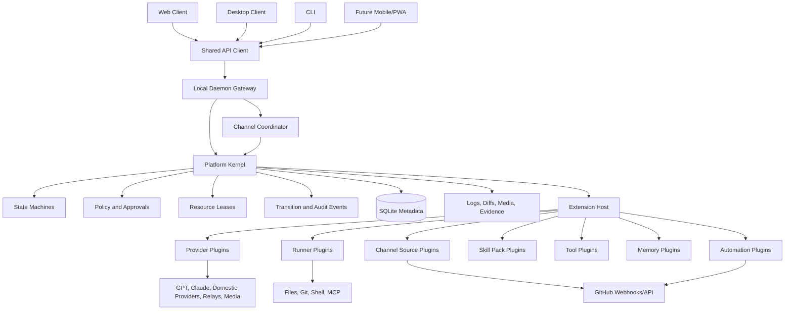

# Platform Architecture

## Purpose

This document defines the aggressive long-term architecture direction for Ling Stack.
The goal is to turn Ling Stack into a local-first AI workspace platform that can support:

- Web, desktop, CLI, and future mobile or PWA clients.
- Multiple channels and concurrent task execution.
- AI teammates, skill packs, workflow templates, and memory scopes.
- Provider, runner, channel, tool, GitHub automation, and UI feature extensions.
- Durable state machines, approval gates, resource leases, audit logs, and recovery.

Aggressive does not mean every feature becomes a dynamic plugin immediately. It means the
framework boundaries are designed early so future features do not couple directly to the
web app, SQLite schema, or one agent runtime.

## Core Positioning

Ling Stack should become a local AI workspace platform with a small hard kernel and many
replaceable extensions.

The top-level product and platform map lives in [Ling Framework](ling-framework.md). This
document focuses on the kernel, extension, and package boundaries that make that framework
safe to implement.

```text
clients
-> shared API client
-> local daemon gateway
-> platform kernel
-> extension host
-> providers, runners, channels, skills, tools, memory, automation
```

The kernel owns correctness. Extensions add capability.

The runtime supervisor is the kernel-facing execution owner for work units. Web,
desktop, CLI, and future clients can all control the same workspace at the same time,
but they must connect to one daemon runtime rather than starting client-specific
runtimes. The detailed design lives in [Runtime Supervisor](runtime-supervisor.md).
The phased plan for evolving this daemon into a Codex app-server-like local control
plane lives in [Runtime Control Plane Roadmap](runtime-control-plane-roadmap.md).
The mid-term control-plane implementation breakdown lives in
[Runtime Control Plane Mid-Term Implementation Plan](runtime-control-plane-mid-term-implementation-plan.md).
The long-term transport, processor, registry, subscription, and worker layering plan
lives in [Runtime Control Plane Long-Term Implementation Plan](runtime-control-plane-long-term-implementation-plan.md).

## Architecture Principles

- Kernel owns state, permissions, leases, recovery, and audit.
- Extensions request work; they do not mutate durable state directly.
- Skills are workflow templates, not execution permission.
- Tools are atomic capabilities; skills compose tools through policy.
- UI clients are replaceable shells over the same daemon API.
- API contracts and shared schemas come before client-specific implementation.
- Every side effect must be attributable to an actor, policy, approval, and state transition.
- Provider and runner behavior must be capability-driven, not hard-coded to one model API.
- GitHub, Slack, Feishu, email, and other sources are channel source adapters, not separate product cores.
- Local-first single-user SQLite remains the v0.1 default; distributed multi-node coordination is a later concern.

## Target Package Map

The current repo does not need to be reorganized in one large rewrite. This is the target
shape the codebase should move toward as modules harden.

```text
packages/
  kernel/
    State machines, resource leases, approvals, workflow execution contracts,
    policy evaluation, audit event rules, and recovery logic.

  contracts/
    Public TypeScript types, zod/json schemas, API DTOs, plugin manifests,
    event names, status enums, and compatibility rules.

  api-client/
    Shared daemon client used by web, desktop, mobile/PWA, and CLI.

  plugin-sdk/
    Stable interfaces for providers, runners, channel sources, tools, memory
    providers, skill packs, automations, and UI feature modules.

  extension-host/
    Plugin registration, lifecycle, health checks, capability validation,
    permission enforcement, and sandbox boundary.

  workflow-engine/
    Multi-agent workflow compilation and execution on top of kernel state
    machines, resource leases, approvals, and runner sessions.

  memory/
    Memory scopes, file bindings, retrieval provider interfaces, and redaction
    boundaries. This does not become a mandatory vector database.

  ui/
    Shared design tokens, primitives, layout components, and feature shell
    contracts for web and desktop.

  features/
    Workspace, channels, tasks, runs, approvals, providers, AI teammates,
    skills, settings, and GitHub automation feature modules.

  providers/
    Built-in model and media provider adapters.

  runners/
    Pi, Codex, OpenClaw, shell, and future runner adapters.

  channels/
    Local, GitHub, Slack, Feishu, email, and custom channel source adapters.
```

Current packages can map into this direction without immediate renames:

| Current path | Target responsibility |
| --- | --- |
| `packages/core` | Kernel plus early contracts |
| `packages/daemon` | Daemon gateway plus coordinator |
| `packages/providers` | Provider extension implementations |
| `packages/runner-pi` | First runner extension |
| `packages/cli` | CLI client over daemon API |
| `apps/web` | Reference client and feature host |
| `apps/desktop` | Future desktop shell over the same API |

## System Diagram



## Layer Responsibilities

### Platform Kernel

The kernel is the non-negotiable center of the system.

It owns:

- Workspace, channel, task, run, approval, media job, workflow, and workflow step state.
- State transition legality.
- Compare-and-set updates.
- Idempotency keys.
- Resource leases.
- Approval requirements.
- Audit and transition events.
- Recovery and reconciliation.
- Capability checks.
- Secrets access policy.

It must not own:

- Provider-specific HTTP request formatting.
- Runner-specific event loops.
- Web page component state.
- GitHub API details.
- Slack or Feishu message formatting.
- Third-party plugin runtime code.

### Daemon Gateway

The daemon is the local trusted process that exposes the kernel to clients.

It owns:

- HTTP APIs.
- SSE or future WebSocket streaming.
- Local auth token.
- Request idempotency.
- Coordinator calls.
- Extension host process lifecycle.
- Startup recovery.

It should not contain business rules that belong in the kernel. If a rule decides whether
a task can start, whether a run can complete, whether an approval is valid, or whether a
lease blocks execution, that rule belongs in the kernel.

### Channel Coordinator

The coordinator handles concurrency, queueing, and resource ownership.

It owns:

- Start-run orchestration.
- Channel runtime policy enforcement.
- Resource lease acquisition and release.
- Queue or conflict decisions.
- Runner session creation.
- Reconciliation after runner terminal events.

It does not directly set final statuses without calling kernel state transitions.

### Extension Host

The extension host loads and supervises trusted internal extensions first. Later it can
support externally installed plugins with stronger sandboxing.

It owns:

- Manifest validation.
- Capability registration.
- Health checks.
- Lifecycle calls.
- Permission enforcement.
- Plugin audit events.
- Version compatibility checks.

It must not allow plugins to access SQLite directly or bypass state machines.

### Clients

Clients are views and command surfaces over the daemon API.

The web app is the reference client. The desktop app should wrap the same API and shared
UI modules rather than implementing a separate product model. A future mobile or PWA
client should reuse the same contracts and API client.

## Extension Points

### Provider Extensions

Provider extensions convert Ling Stack provider presets into model or media calls.

Examples:

- OpenAI GPT.
- Anthropic Claude.
- DeepSeek or DPV4-compatible endpoints.
- Doubao, MiniMax, GLM.
- Jimeng, Seedream, Seedance.
- OpenAI-compatible local relays.

Provider extensions declare capabilities such as:

- `text-generation`
- `tool-calling`
- `vision-input`
- `image-generation`
- `video-generation`
- `json-output`
- `reasoning-effort`

The kernel and policy engine decide whether a teammate or skill can use a capability.

### Runner Extensions

Runner extensions execute work.

Examples:

- Pi coding-agent runtime.
- Codex runtime adapter.
- OpenClaw runtime adapter.
- Shell-only runner for simple scripted jobs.
- Browser or QA runner.

Runners stream events back to the daemon. Runner terminal events are facts to evaluate,
not authority to mutate state directly. A runner cannot turn a cancelled run into
`succeeded` after the cancel transition has already won.

### Channel Source Extensions

Channel source extensions normalize external events into Ling Stack channel events.

Examples:

- Local web and CLI.
- GitHub.
- Slack.
- Feishu.
- Email.
- Custom webhook.

Adapters submit normalized inputs. They do not update tasks, approvals, or runs directly.

### Skill Pack Extensions

Skill packs provide skills, teammate templates, and workflow templates.

Examples:

- Built-in `gstack-default`.
- User-imported `AGENTS.md` or `.agents` conventions.
- Team-specific review packs.
- Security or release packs.

Skill packs never grant execution rights. The effective permission is always:

```text
teammate policy
+ channel policy
+ provider capability
+ allowed tools
+ approval policy
+ state machine legality
```

### Tool Extensions

Tool extensions expose atomic actions such as reading files, searching code, opening a
browser, running tests, editing files, or posting comments.

Tools must declare:

- Capability id.
- Side effect level.
- Required approval level.
- Allowed resource scopes.
- Audit event shape.
- Redaction rules.

### Memory Extensions

Memory extensions attach context to work without becoming hidden authority.

The target memory product is [Ling Memory v1](ling-memory-v1.md): workspace shared memory,
channel memory, teammate private memory, task/run working memory, scoped automatic recall,
and used-memory audit.

Examples:

- Project files.
- User-selected memory files.
- Agent notes.
- GitHub issue context.
- Retrieval provider results.

Memory access must be scoped by channel, teammate, task, and approval policy. A memory
provider cannot silently inject secrets or unrelated workspace files.

### UI Feature Modules

UI feature modules package pages, panels, actions, and hooks around stable API contracts.

Examples:

- Channels.
- Tasks.
- Runs.
- Approvals.
- AI teammates.
- Skill packs.
- Provider presets.
- GitHub automation.
- Settings.

Feature modules may own client state and local component structure. They do not own the
daemon contract or durable state model.

### Automation Extensions

Automation extensions define event-driven workflows.

Examples:

- GitHub PR review.
- GitHub issue triage.
- CI failure investigation.
- Release readiness checks.
- Scheduled health checks.

Automation extensions compile into workflow runs governed by the kernel. They cannot
post to GitHub, merge code, close issues, or push commits without policy and approval.

## Plugin Manifest

The first manifest should be conservative and typed. It should support internal plugins
before external plugins.

```ts
export type LingPluginKind =
  | "provider"
  | "runner"
  | "channel-source"
  | "skill-pack"
  | "tool"
  | "memory"
  | "ui-feature"
  | "automation";

export interface LingPluginManifest {
  id: string;
  name: string;
  version: string;
  lingStackVersion: string;
  kind: LingPluginKind;
  entry: string;
  capabilities: readonly string[];
  requiredSecrets?: readonly string[];
  requiredApprovals?: readonly string[];
  sideEffects?: readonly ("read" | "write" | "network" | "external-send" | "deploy")[];
  resources?: readonly ("workspace" | "channel" | "bound_path" | "provider" | "task" | "workflow_step")[];
}
```

Lifecycle:

```text
discover
-> validate manifest
-> register capabilities
-> initialize
-> health check
-> handle request/event
-> shutdown
```

Plugin failures should degrade the specific capability, not corrupt kernel state.

## Plugin Runtime Contract

Plugins communicate with the daemon through a restricted host context.

```ts
export interface LingPluginContext {
  readonly pluginId: string;
  readonly workspaceId: string;
  getSecret(ref: string): Promise<string>;
  emitAudit(event: PluginAuditEvent): Promise<void>;
  requestApproval(input: PluginApprovalRequest): Promise<PluginApprovalResult>;
  readArtifact(ref: string): Promise<Uint8Array>;
  writeArtifact(input: WriteArtifactInput): Promise<ArtifactRef>;
}
```

No plugin context should expose:

- Raw SQLite handles.
- Direct `updateTaskStatus` helpers.
- Direct transition event insertion.
- Unscoped filesystem access.
- Global environment variables.
- Unredacted secret logs.

## Security Model

The aggressive plugin direction only works if the security model is strict.

Hard rules:

- Plugins do not get direct database access.
- Plugins do not call state transition internals directly.
- Plugins do not receive raw secrets except through scoped secret resolution.
- Plugins do not write files outside declared resource scope.
- Plugins do not post external messages without policy and approval.
- Plugins do not approve, merge, deploy, or close external work without explicit authority.
- Every plugin action emits an audit event.
- Every state change goes through kernel state machines.

Sandbox tiers:

| Tier | Use | Boundary |
| --- | --- | --- |
| Internal trusted | Built-in providers, Pi runner, local channel, gstack-default pack | Same process is acceptable while APIs stabilize |
| Internal isolated | Riskier runners, browser automation, GitHub automation | Worker process or child process with strict host context |
| External trusted | User-installed plugins from known repos | Manifest, version pinning, capability review, restricted host context |
| External untrusted | Marketplace-style plugins | Not a v0.1 goal; requires stronger sandboxing |

Approval classes:

| Action | Default policy |
| --- | --- |
| Read workspace metadata | Allowed |
| Read scoped files | Allowed if channel permits |
| Write files | Approval or configured trusted teammate |
| Run shell command | Approval by default |
| Post comment to GitHub/Slack/Feishu | Approval by default |
| Approve PR or request changes | Strict approval |
| Push commits | Strict approval |
| Merge/deploy/release | Strict approval |
| Access secret value | Scoped resolver only |

## GitHub Automation Architecture

GitHub should be implemented as a channel source adapter plus automation plugins. It
should not become a separate execution path.

This section records the platform-level boundary. The detailed workflow, approval, UI,
resource lease, and test plan lives in [GitHub Automation Design](github-automation.md).

### Event Sources

The GitHub channel source normalizes webhook or polled events. The Phase 4 CI triage
implementation plan is tracked in
[External Work Phase 4 Implementation](external-work-phase-4-implementation.md).

```text
pull_request.opened
pull_request.synchronize
pull_request.review_requested
issue.opened
issue.reopened
issue_comment.created
check_suite.completed
check_run.completed
workflow_run.completed
release.published
```

Normalized events enter the channel coordinator:

```text
GitHub event
-> GitHub channel source adapter
-> normalized channel event
-> coordinator
-> kernel state machines
-> workflow run
-> runner/provider/tool execution
-> approval
-> GitHub action
```

### Automation Workflows

Recommended built-in workflows:

| Workflow | Purpose | Typical teammate |
| --- | --- | --- |
| `github-pr-review` | Review PR diff, tests, risk, docs, security, and regression surface | Reviewer or Engineer |
| `github-bug-triage` | Reproduce issue, classify severity, search duplicates, propose next step | QA or Investigator |
| `github-ci-triage` | Read failing checks, identify failing command, propose or implement fix | Engineer |
| `github-release-readiness` | Check changelog, tests, approval gates, and deploy risk | Release |
| `github-security-review` | Scan sensitive diffs, dependency risk, auth/secrets surfaces | Security |

### GitHub Action Policy

GitHub actions should be split by risk:

| Action | Default requirement |
| --- | --- |
| Fetch issue/PR/check data | Allowed with GitHub token scope |
| Produce local review artifact | Allowed |
| Draft a PR comment | Allowed as artifact |
| Post a PR comment | Standard approval |
| Add labels | Standard approval or repo policy |
| Request changes | Strict approval |
| Approve PR | Strict approval |
| Push fix commit | Strict approval |
| Merge PR | Strict approval plus branch protection |
| Close issue | Strict approval |
| Release/deploy | Strict approval plus release policy |

Ling Stack must respect GitHub permissions, CODEOWNERS, required checks, and branch
protection. It cannot bypass repository policy. If GitHub rejects an action, Ling Stack
records the failed external action and keeps durable evidence.

### GitHub Evidence Artifacts

Every GitHub automation run should save:

- Event payload summary.
- Repo, branch, base SHA, head SHA, PR or issue id.
- Diff refs or patch summaries.
- Test and CI links.
- Findings with severity.
- Proposed comment body.
- Approval request and decision.
- External action result.

This evidence lets the UI show why Ling Stack recommended approval, requested changes,
or queued a follow-up run.

## Multi-Client Strategy

The web app is the reference client. The desktop app is a packaged local experience. The
future mobile/PWA client is a constrained remote surface over the same contracts.

Shared pieces:

- `contracts` for API types and status enums.
- `api-client` for HTTP/SSE/WebSocket calls.
- `ui` for design tokens and reusable primitives.
- `features` for channel/task/run/approval/provider/teammate modules.

Client-specific pieces:

| Client | Owns |
| --- | --- |
| Web | Browser routing, responsive layout, local development UI |
| Desktop | Daemon lifecycle, tray, notifications, keychain, updater |
| CLI | Scriptable commands and diagnostics |
| Mobile/PWA | Read-heavy workflows, approvals, notifications, lightweight comments |

Do not fork feature behavior per client. A paused channel, queued run, pending approval,
or blocked lease must mean the same thing everywhere.

## UI Architecture Direction

The current web page should evolve from one large app component into feature modules.

Recommended module shape:

```text
apps/web/src/
  app/
    AppShell.tsx
    routes.tsx
    providers.tsx
  features/
    channels/
      api.ts
      components/
      hooks/
      routes.tsx
    tasks/
    runs/
    approvals/
    teammates/
    skills/
    providers/
    github/
    settings/
  ui/
    tokens.ts
    components/
  lib/
    api-client.ts
    event-stream.ts
```

Rules:

- Page modules can compose API calls; they do not duplicate daemon state rules.
- Feature modules own local UI state only.
- Shared UI primitives should live below `ui`.
- Domain contracts come from shared packages, not hand-copied web types.
- Desktop should reuse feature modules where practical.

## State, Workflow, and Recovery Boundary

Workflow execution must be a layer above state machines, not a replacement for them.

```text
workflow template
-> workflow instance
-> workflow step
-> task run request
-> coordinator
-> leases
-> run state machine
-> approval state machine
-> terminal reconciliation
```

Rules:

- A workflow step cannot mark itself complete because a model says it is complete.
- A runner cannot overwrite terminal state.
- A browser disconnect cannot cancel work.
- A duplicate webhook cannot create duplicate runs if idempotency keys match.
- A stale approval cannot approve a cancelled or expired action.
- A queued run can start only after leases and channel status allow it.

## Maintenance Model

Aggressive architecture only stays maintainable if the repo enforces maintenance rituals.

### Architecture Decision Records

Use [Architecture Decision Records](../adr/README.md) for decisions that affect public
contracts, package boundaries, storage, permissions, workflow semantics, or plugin behavior.

ADR template:

```text
# ADR NNN: Title

## Status
Proposed | Accepted | Superseded

## Context
What problem forced the decision?

## Decision
What are we committing to?

## Consequences
What gets easier, harder, or blocked?

## Migration
How existing code moves to this decision.
```

### Contract Versioning

Contracts should be versioned before external plugins are supported.

Compatibility rules:

- Additive fields are minor-compatible.
- Removing fields requires a major version or compatibility adapter.
- Status enum changes require migration and state-machine tests.
- Plugin manifest changes require host compatibility checks.
- API response shape changes require client tests.

### Package Boundary Checks

Recommended import direction:

```text
apps/* -> packages/api-client -> packages/contracts
packages/daemon -> packages/kernel -> packages/contracts
packages/extension-host -> packages/plugin-sdk -> packages/contracts
packages/providers/runners/channels/tools -> packages/plugin-sdk
```

Disallowed:

- Web importing daemon internals.
- Plugins importing SQLite store internals.
- Provider adapters importing UI code.
- Runner adapters updating task status directly.
- Feature modules copying domain enums.

### Testing Matrix

| Area | Required tests |
| --- | --- |
| Kernel | State machine, idempotency, terminal states, stale transitions |
| Store | CAS updates, lease uniqueness, transition event persistence |
| Coordinator | Queue/conflict, paused channels, duplicate requests, lease release |
| Plugin SDK | Manifest validation, capability mismatch, denied secret access |
| Providers | Capability contract, error normalization, redaction |
| Runners | Event translation, cancellation race, terminal reconciliation |
| GitHub | Webhook fixtures, duplicate delivery, approval-gated actions |
| UI features | Policy display, disabled actions, timeline and conflict rendering |
| Desktop | Daemon lifecycle, keychain, notifications, update path |

### Adding a New Extension

Every new extension should ship with:

- Manifest.
- Capability list.
- Policy classification.
- Contract tests.
- Fixture events or API mocks.
- Audit event examples.
- Failure and retry behavior.
- Docs entry.
- UI surface if user-facing.

### Release Checklist

Before a release:

- `corepack pnpm typecheck`
- `corepack pnpm build`
- `corepack pnpm test`
- Web smoke or Playwright checks for touched UI flows.
- `git diff --check`
- Docs updated for changed contracts or behavior.
- Migration notes for status, schema, manifest, or API changes.

## Migration Plan

### Phase 0: Current v0.1 Stabilization

Keep shipping the existing local daemon, core types, web UI, provider presets, skills,
state machines, leases, and docs.

Do not reorganize packages while the current product loop is still moving quickly.

### Phase 1: Web Feature Modules

Split the web app into feature modules:

- Channels.
- Tasks.
- Runs.
- Approvals.
- Providers.
- AI teammates.
- Skill packs.
- Settings.

This reduces UI chaos quickly and creates reusable surfaces for desktop.
The detailed plan lives in [Web Modularization](web-modularization.md).

### Phase 2: Contracts and API Client

Extract shared API DTOs and client code:

- `packages/contracts`
- `packages/api-client`

The web app, CLI, and future desktop app should stop carrying separate copies of the same
types.
The detailed plan lives in [Contracts and API Client](contracts-api-client.md).

Status: the shared packages exist and Web is the first consumer through a compatibility
wrapper. CLI, daemon route handler typing, and desktop migration remain follow-up work.

### Phase 3: Internal Extension Registries

Before dynamic plugins, create internal registries:

- Provider registry.
- Runner registry.
- Channel source registry.
- Skill pack registry.
- Tool registry.
- Memory registry.

Registries validate capabilities and policy before execution.
The detailed plan lives in [Internal Registry and Plugin SDK](internal-registry-plugin-sdk.md).

Status: `packages/plugin-sdk` now exists as a pure interface and registry package.
Core, providers, and runner-pi expose built-in extension metadata, and daemon assembles
the default internal registry at startup. Execution still flows through the existing
daemon, approval policy, leases, state machines, providers, and runner paths.

### Phase 4: Internal/Bundled Plugin Manager

Add Codex-like plugin management for internal, bundled, and trusted local capabilities
before opening third-party APIs. The design lives in [Plugin Manager](plugin-manager.md);
the Stage 1-3 implementation plan lives in
[Plugin Manager Implementation Plan](plugin-manager-implementation-plan.md).

Initial scope:

- safe plugin catalog and Settings surface,
- built-in registry metadata visibility,
- bundled/trusted-local plugin descriptors,
- MCP preset apply flow,
- `cua-driver` as the first high-risk capability with an external preset and packaged
  macOS/Windows `bundled_embedded` distributions defined by
  [Bundled Embedded Cua Driver](cua-driver-bundled-embedded.md),
- health checks, approval defaults, and audit events.

Explicitly defer:

- third-party plugin API,
- marketplace installation,
- arbitrary external code loading,
- untrusted plugin sandboxing.

### Phase 5: Workflow Engine

Move multi-agent workflows into a workflow engine that compiles templates into explicit
workflow and step state machines.

This is the right time to connect `gstack-default`, custom AI teammates, and future
`AGENTS.md` imports to real execution.

### Phase 6: GitHub Automation

Add GitHub as:

- Channel source adapter.
- Automation workflows.
- Tool actions.
- Approval-gated external sender.
- Evidence artifacts.

Start with read-only PR review artifacts, then add approval-gated comments, then stricter
actions such as request-changes, approve, push, merge, and release.

### Phase 7: Desktop Shell

Build the desktop shell around the daemon and shared UI:

- Start/stop daemon.
- Tray/menu bar.
- OS keychain.
- Local notifications.
- Auto-update.
- File picker and workspace binding.

Desktop should not fork the product model.
The detailed plan lives in [Desktop Shell](desktop-shell.md).

### Phase 8: External Plugin SDK

Only after internal registries and internal/bundled plugin management are stable:

- Publish plugin manifest contract.
- Publish third-party plugin API and restricted host context.
- Add version compatibility checks.
- Add external plugin loading.
- Add stronger sandboxing.
- Add plugin installation and trust UX.

## Non-Goals for v0.1

- External plugin marketplace.
- Distributed multi-node locking.
- Cloud multi-user permissions.
- Unreviewed GitHub merge or deploy automation.
- Browser connection as source of truth for run state.
- Skills that bypass tools, approvals, leases, or state machines.
- Direct plugin database access.

## Recommended Immediate Next Steps

1. Keep `packages/core` as the temporary kernel while v0.1 stabilizes.
2. Start splitting `apps/web/src/App.tsx` into feature modules before adding more UI; see [Web Modularization](web-modularization.md).
3. Add `packages/contracts` when the same API shape appears in core, daemon, CLI, and web; see [Contracts and API Client](contracts-api-client.md).
4. Add internal registries before dynamic plugin loading; see [Internal Registry and Plugin SDK](internal-registry-plugin-sdk.md).
5. Build GitHub automation first as read-only review artifacts, then approval-gated external actions.
6. Create ADRs for any decision that changes state machines, plugin permissions, storage, or public API.
