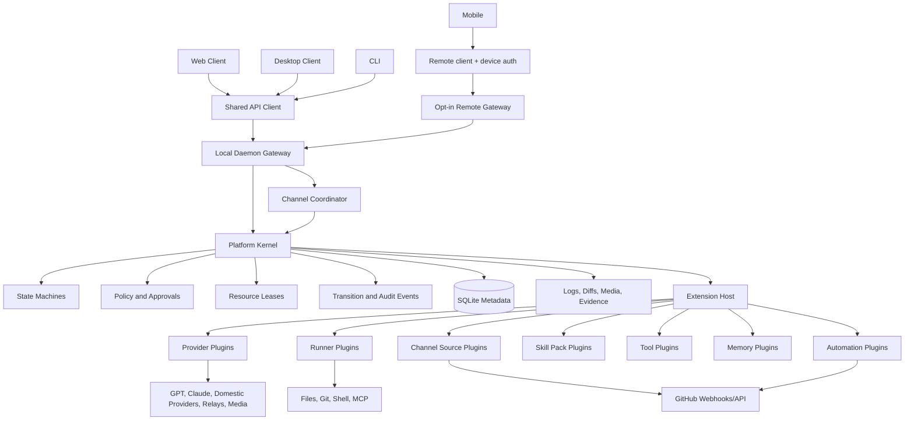

# Platform Architecture

Status: target architecture with current implementation mapping
Owner: repository maintainers
Last verified: 2026-11-02 (source review, not release or platform acceptance)

## Purpose

This document defines the aggressive long-term architecture direction for Ling Stack.
The goal is to turn Ling Stack into a local-first AI workspace platform that can support:

- Web, desktop, CLI, the constrained mobile source surface, and future PWA clients.
- Multiple channels and concurrent task execution.
- AI teammates, skill packs, workflow templates, and memory scopes.
- Provider, runner, channel, tool, GitHub automation, and UI feature extensions.
- Durable state machines, approval gates, resource leases, audit logs, and recovery.

Aggressive does not mean every feature becomes a dynamic plugin immediately. It means the
framework boundaries are designed early so future features do not couple directly to the
web app, SQLite schema, or one agent runtime.

## Core Positioning

Ling Stack should become a local AI workspace platform with a small hard kernel and many
replaceable extensions.

The top-level product and platform map lives in [Ling Framework](ling-framework.md). This
document focuses on the kernel, extension, and package boundaries that make that framework
safe to implement.

The diagrams below describe target boundaries, not a fully extracted current package
graph. Shared contracts/client, internal registries, workflows, and the Electron shell
already exist. Kernel and workflow responsibilities remain in core/daemon modules; CLI
still owns a separate request layer. Mobile source exists behind device authentication
and a separate Remote Gateway, but remains outside current product acceptance.

```text
Web / Desktop / CLI
  -> shared API client
  -> local daemon gateway

Mobile
  -> remote client + device-auth protocol
  -> opt-in Remote Gateway (separate listener)
  -> local daemon authority

daemon gateway
  -> platform kernel
  -> extension host
  -> providers, runners, channels, skills, tools, memory, automation
```

The kernel owns correctness. Extensions add capability.

The runtime supervisor is the kernel-facing execution owner for work units. Web,
desktop, CLI, and future clients can all control the same workspace at the same time,
but they must connect to one daemon runtime rather than starting client-specific
runtimes. Runtime-supervisor ownership, startup reconciliation, control-plane
snapshots/events, SSE, and configurable local WebSocket RPC are implemented. The detailed
boundary lives in [Runtime Supervisor](runtime-supervisor.md). Remaining control-plane
evolution lives in [Runtime Control Plane Roadmap](runtime-control-plane-roadmap.md).
The mid-term control-plane implementation breakdown lives in
[Runtime Control Plane Mid-Term Implementation Plan](./runtime-control-plane-detailed-design.md).
The long-term transport, processor, registry, subscription, and worker layering plan
lives in [Runtime Control Plane Long-Term Implementation Plan](./runtime-control-plane-roadmap.md).

## Architecture Principles

- Kernel owns state, permissions, leases, recovery, and audit.
- Extensions request work; they do not mutate durable state directly.
- Skills are workflow templates, not execution permission.
- Tools are atomic capabilities; skills compose tools through policy.
- UI clients are replaceable shells over the same daemon API.
- API contracts and shared schemas come before client-specific implementation.
- Every side effect must be attributable to an actor, policy, approval, and state transition.
- Provider and runner behavior must be capability-driven, not hard-coded to one model API.
- GitHub, Slack, Feishu, email, and other sources are channel source adapters, not separate product cores.
- Local-first single-user SQLite remains the v0.1 default; distributed multi-node coordination is a later concern.

## Target Package Map

The current repo does not need to be reorganized in one large rewrite. This is the target
shape the codebase should move toward as modules harden.

```text
packages/
  kernel/
    State machines, resource leases, approvals, workflow execution contracts,
    policy evaluation, audit event rules, and recovery logic.

  contracts/
    Public TypeScript types, zod/json schemas, API DTOs, plugin manifests,
    event names, status enums, and compatibility rules.

  api-client/
    Shared local daemon client used by web, desktop, and CLI.

  remote-protocol/
    Runtime validation and canonical signing input for the constrained mobile surface.

  remote-client/
    Device-authenticated Remote Gateway client used by the mobile app.

  plugin-sdk/
    Stable interfaces for providers, runners, channel sources, tools, memory
    providers, skill packs, automations, and UI feature modules.

  extension-host/
    Plugin registration, lifecycle, health checks, capability validation,
    permission enforcement, and sandbox boundary.

  workflow-engine/
    Multi-agent workflow compilation and execution on top of kernel state
    machines, resource leases, approvals, and runner sessions.

  memory/
    Memory scopes, file bindings, retrieval provider interfaces, and redaction
    boundaries. This does not become a mandatory vector database.

  ui/
    Shared design tokens, primitives, layout components, and feature shell
    contracts for web and desktop.

  features/
    Workspace, channels, tasks, runs, approvals, providers, AI teammates,
    skills, settings, and GitHub automation feature modules.

  providers/
    Built-in model and media provider adapters.

  runners/
    Pi, Codex, OpenClaw, shell, and future runner adapters.

  channels/
    Local, GitHub, Slack, Feishu, email, and custom channel source adapters.
```

Current source maps into this direction without immediate renames. In particular,
`kernel`, `extension-host`, `workflow-engine`, `ui`, and `features` above are target
packages, not existing packages with those names:

| Current path | Current responsibility |
| --- | --- |
| `packages/core` | Durable domain model, stores, state machines, and policy |
| `packages/daemon` | Gateway, coordinator, runtime supervisor, workflows, and managed plugin lifecycle |
| `packages/contracts` | Shared daemon wire types and selected runtime validators |
| `packages/api-client` | Typed local client used by Web and selected Desktop services; CLI migration remains |
| `packages/plugin-sdk` | Internal metadata registries and managed-package manifest contracts, not an open third-party SDK |
| `packages/ui-react` | Shared design tokens and React primitives |
| `packages/conversation-ui-core`, `packages/conversation-ui-react` | Shared conversation semantics and React components |
| `packages/remote-protocol`, `packages/remote-client` | Constrained device-authenticated remote protocol and client |
| `packages/providers` | Provider extension implementations |
| `packages/runner-pi` | First runner extension |
| `packages/cli` | CLI client over daemon API |
| `apps/web` | Reference client and feature host |
| `apps/desktop` | Electron shell over the shared Web build, daemon lifecycle, and Computer Use utility windows |
| `apps/mobile` | Constrained Remote Gateway source surface, outside current product acceptance |

## System Diagram



## Layer Responsibilities

These responsibilities define the target separation. The current package mapping above
identifies where implemented responsibilities live; it does not imply a generic
extension host or every target package has been extracted.

### Platform Kernel

The kernel is the non-negotiable center of the system.

It owns:

- Workspace, channel, task, run, approval, media job, workflow, and workflow step state.
- State transition legality.
- Compare-and-set updates.
- Idempotency keys.
- Resource leases.
- Approval requirements.
- Audit and transition events.
- Recovery and reconciliation.
- Capability checks.
- Secrets access policy.

It must not own:

- Provider-specific HTTP request formatting.
- Runner-specific event loops.
- Web page component state.
- GitHub API details.
- Slack or Feishu message formatting.
- Third-party plugin runtime code.

### Daemon Gateway

The daemon is the local trusted process that exposes the kernel to clients.

It owns:

- HTTP APIs.
- SSE and configurable local WebSocket RPC.
- Local auth token.
- Request idempotency.
- Coordinator calls.
- Extension host process lifecycle.
- Startup recovery.

It should not contain business rules that belong in the kernel. If a rule decides whether
a task can start, whether a run can complete, whether an approval is valid, or whether a
lease blocks execution, that rule belongs in the kernel.

### Channel Coordinator

The coordinator handles concurrency, queueing, and resource ownership.

It owns:

- Start-run orchestration.
- Channel runtime policy enforcement.
- Resource lease acquisition and release.
- Queue or conflict decisions.
- Runner session creation.
- Reconciliation after runner terminal events.

It does not directly set final statuses without calling kernel state transitions.

### Extension Host

The extension host loads and supervises trusted internal extensions first. Later it can
support externally installed plugins with stronger sandboxing.

It owns:

- Manifest validation.
- Capability registration.
- Health checks.
- Lifecycle calls.
- Permission enforcement.
- Plugin audit events.
- Version compatibility checks.

It must not allow plugins to access SQLite directly or bypass state machines.

### Clients

Clients are views and command surfaces over daemon-owned state. Trusted local clients use
the daemon API; remote clients use a constrained Gateway contract.

The web app is the reference client. The desktop app wraps the same local API and shared
UI modules rather than implementing a separate product model. Mobile is a constrained
remote surface: it reuses semantic contracts and headless policies, but it must enter
through the device-authenticated Remote Gateway rather than the broad local daemon API.

## Extension Points

### Provider Extensions

Provider extensions convert Ling Stack provider presets into model or media calls.

Examples:

- OpenAI GPT.
- Anthropic Claude.
- DeepSeek or DPV4-compatible endpoints.
- Doubao, MiniMax, GLM.
- Jimeng, Seedream, Seedance.
- OpenAI-compatible local relays.

Provider extensions declare capabilities such as:

- `text-generation`
- `tool-calling`
- `vision-input`
- `image-generation`
- `video-generation`
- `json-output`
- `reasoning-effort`

The kernel and policy engine decide whether a teammate or skill can use a capability.

### Runner Extensions

Runner extensions execute work.

Examples:

- Pi coding-agent runtime.
- Codex runtime adapter.
- OpenClaw runtime adapter.
- Shell-only runner for simple scripted jobs.
- Browser or QA runner.

Runners stream events back to the daemon. Runner terminal events are facts to evaluate,
not authority to mutate state directly. A runner cannot turn a cancelled run into
`succeeded` after the cancel transition has already won.

### Channel Source Extensions

Channel source extensions normalize external events into Ling Stack channel events.

Examples:

- Local web and CLI.
- GitHub.
- Slack.
- Feishu.
- Email.
- Custom webhook.

Adapters submit normalized inputs. They do not update tasks, approvals, or runs directly.

### Skill Pack Extensions

Skill packs provide skills, teammate templates, and workflow templates.

Examples:

- Built-in `gstack-default`.
- User-imported `AGENTS.md` or `.agents` conventions.
- Team-specific review packs.
- Security or release packs.

Skill packs never grant execution rights. The effective permission is always:

```text
teammate policy
+ channel policy
+ provider capability
+ allowed tools
+ approval policy
+ state machine legality
```

### Tool Extensions

Tool extensions expose atomic actions such as reading files, searching code, opening a
browser, running tests, editing files, or posting comments.

Tools must declare:

- Capability id.
- Side effect level.
- Required approval level.
- Allowed resource scopes.
- Audit event shape.
- Redaction rules.

### Memory Extensions

Memory extensions attach context to work without becoming hidden authority.

The target memory product is [Ling Memory v1](ling-memory-v1.md): workspace shared memory,
channel memory, teammate private memory, task/run working memory, scoped automatic recall,
and used-memory audit.

Examples:

- Project files.
- User-selected memory files.
- Agent notes.
- GitHub issue context.
- Retrieval provider results.

Memory access must be scoped by channel, teammate, task, and approval policy. A memory
provider cannot silently inject secrets or unrelated workspace files.

### UI Feature Modules

UI feature modules package pages, panels, actions, and hooks around stable API contracts.

Examples:

- Channels.
- Tasks.
- Runs.
- Approvals.
- AI teammates.
- Skill packs.
- Provider presets.
- GitHub automation.
- Settings.

Feature modules may own client state and local component structure. They do not own the
daemon contract or durable state model.

### Automation Extensions

Automation extensions define event-driven workflows.

Examples:

- GitHub PR review.
- GitHub issue triage.
- CI failure investigation.
- Release readiness checks.
- Scheduled health checks.

Automation extensions compile into workflow runs governed by the kernel. They cannot
post to GitHub, merge code, close issues, or push commits without policy and approval.

## Plugin Manifest

Current code uses `LingExtensionManifest` and `LingPluginPackageManifest` in
`packages/plugin-sdk/src/manifest.ts`, with interface-version validation. The generic
manifest below remains a target design, not the exported internal/package schema or a
published third-party SDK.

```ts
export type LingPluginKind =
  | "provider"
  | "runner"
  | "channel-source"
  | "skill-pack"
  | "tool"
  | "memory"
  | "ui-feature"
  | "automation";

export interface LingPluginManifest {
  id: string;
  name: string;
  version: string;
  lingStackVersion: string;
  kind: LingPluginKind;
  entry: string;
  capabilities: readonly string[];
  requiredSecrets?: readonly string[];
  requiredApprovals?: readonly string[];
  sideEffects?: readonly ("read" | "write" | "network" | "external-send" | "deploy")[];
  resources?: readonly ("workspace" | "channel" | "bound_path" | "provider" | "task" | "workflow_step")[];
}
```

Lifecycle:

```text
discover
-> validate manifest
-> register capabilities
-> initialize
-> health check
-> handle request/event
-> shutdown
```

Plugin failures should degrade the specific capability, not corrupt kernel state.

## Plugin Runtime Contract

The restricted host context below remains a target design, not an implemented generic
plugin runtime API. Managed internal/bundled capabilities currently execute through their
own daemon feature boundaries.

```ts
export interface LingPluginContext {
  readonly pluginId: string;
  readonly workspaceId: string;
  getSecret(ref: string): Promise<string>;
  emitAudit(event: PluginAuditEvent): Promise<void>;
  requestApproval(input: PluginApprovalRequest): Promise<PluginApprovalResult>;
  readArtifact(ref: string): Promise<Uint8Array>;
  writeArtifact(input: WriteArtifactInput): Promise<ArtifactRef>;
}
```

No plugin context should expose:

- Raw SQLite handles.
- Direct `updateTaskStatus` helpers.
- Direct transition event insertion.
- Unscoped filesystem access.
- Global environment variables.
- Unredacted secret logs.

## Security Model

The aggressive plugin direction only works if the security model is strict.

Hard rules:

- Plugins do not get direct database access.
- Plugins do not call state transition internals directly.
- Plugins do not receive raw secrets except through scoped secret resolution.
- Plugins do not write files outside declared resource scope.
- Plugins do not post external messages without policy and approval.
- Plugins do not approve, merge, deploy, or close external work without explicit authority.
- Every plugin action emits an audit event.
- Every state change goes through kernel state machines.

Sandbox tiers:

| Tier | Use | Boundary |
| --- | --- | --- |
| Internal trusted | Built-in providers, Pi runner, local channel, gstack-default pack | Same process is acceptable while APIs stabilize |
| Internal isolated | Riskier runners, browser automation, GitHub automation | Worker process or child process with strict host context |
| External trusted | User-installed plugins from known repos | Manifest, version pinning, capability review, restricted host context |
| External untrusted | Marketplace-style plugins | Not a v0.1 goal; requires stronger sandboxing |

Approval classes:

| Action | Default policy |
| --- | --- |
| Read workspace metadata | Allowed |
| Read scoped files | Allowed if channel permits |
| Write files | Approval or configured trusted teammate |
| Run shell command | Approval by default |
| Post comment to GitHub/Slack/Feishu | Approval by default |
| Approve PR or request changes | Strict approval |
| Push commits | Strict approval |
| Merge/deploy/release | Strict approval |
| Access secret value | Scoped resolver only |

## GitHub Automation Architecture

GitHub intake and approval-gated external actions are implemented on the shared external
work path, not a separate state model. Import/polling normalize PRs and issues, deduplicate
them, and create durable workflow/evidence records. Import alone does not start an agent;
CI triage and explicit fix-run execution are separate operations.

This section records the platform-level boundary. The detailed workflow, approval, UI,
resource lease, and test plan lives in [GitHub Automation Design](github-automation.md).

### Event Sources

The event list below describes the target source scope, not a claim that every webhook
and release event is implemented. Current import/polling and CI triage are tracked in
[External Work Orchestration](./external-work-orchestration.md).

```text
pull_request.opened
pull_request.synchronize
pull_request.review_requested
issue.opened
issue.reopened
issue_comment.created
check_suite.completed
check_run.completed
workflow_run.completed
release.published
```

Normalized events enter the channel coordinator:

```text
GitHub event
-> GitHub channel source adapter
-> normalized channel event
-> coordinator
-> kernel state machines
-> workflow run
-> runner/provider/tool execution
-> approval
-> GitHub action
```

### Automation Workflows

Recommended built-in workflows (target catalog, not a list of registered templates):

| Workflow | Purpose | Typical teammate |
| --- | --- | --- |
| `github-pr-review` | Review PR diff, tests, risk, docs, security, and regression surface | Reviewer or Engineer |
| `github-bug-triage` | Reproduce issue, classify severity, search duplicates, propose next step | QA or Investigator |
| `github-ci-triage` | Read failing checks, identify failing command, propose or implement fix | Engineer |
| `github-release-readiness` | Check changelog, tests, approval gates, and deploy risk | Release |
| `github-security-review` | Scan sensitive diffs, dependency risk, auth/secrets surfaces | Security |

### GitHub Action Policy

Implemented external actions include comments, labels, and PR reviews with `COMMENT`,
`APPROVE`, or `REQUEST_CHANGES`. Execution requires an approved action and revalidates
the target before mutation; PR reviews require strict approval. Approval alone does not
send an action. Push, merge, close, release, and deploy are outside the implemented
action set below.

The full target action policy is split by risk:

| Action | Default requirement |
| --- | --- |
| Fetch issue/PR/check data | Allowed with GitHub token scope |
| Produce local review artifact | Allowed |
| Draft a PR comment | Allowed as artifact |
| Post a PR comment | Standard approval |
| Add labels | Standard approval or repo policy |
| Request changes | Strict approval |
| Approve PR | Strict approval |
| Push fix commit | Strict approval |
| Merge PR | Strict approval plus branch protection |
| Close issue | Strict approval |
| Release/deploy | Strict approval plus release policy |

Ling Stack must respect GitHub permissions, CODEOWNERS, required checks, and branch
protection. It cannot bypass repository policy. If GitHub rejects an action, Ling Stack
records the failed external action and keeps durable evidence.

### GitHub Evidence Artifacts

Every GitHub automation run should save:

- Event payload summary.
- Repo, branch, base SHA, head SHA, PR or issue id.
- Diff refs or patch summaries.
- Test and CI links.
- Findings with severity.
- Proposed comment body.
- Approval request and decision.
- External action result.

This evidence lets the UI show why Ling Stack recommended approval, requested changes,
or queued a follow-up run.

## Multi-Client Strategy

The Web app is the reference client, and the Electron shell loads its built application.
Selected Desktop services also consume `LingDaemonClient` directly. Mobile source uses
the separate constrained Remote Gateway and is outside current product acceptance; PWA
remains a future client.

Shared pieces:

- `contracts` for API types and status enums.
- `api-client` for trusted-local HTTP APIs and response-returning stream requests. Web
  and CLI still own run transport/WebSocket RPC code; stream decoding is not all shared.
- `remote-protocol` and `remote-client` for mobile device authentication, snapshots, and
  bounded remote commands.
- `ui-react` and conversation UI packages for shared primitives and conversation
  semantics.
- `apps/web/src/features` for feature presentation and `apps/web/src/domains` for domain
  controllers. Independent `ui`/`features` packages remain target boundaries.

Client-specific pieces and remaining scope:

| Client | Owns |
| --- | --- |
| Web | Browser routing, responsive layout, local development UI |
| Desktop | Implemented daemon lifecycle and shared Web shell; tray, notifications, full keychain UX, and updater remain |
| CLI | Scriptable commands and diagnostics |
| Mobile | Device-authenticated constrained remote source surface, outside current acceptance |
| PWA | Future client; not an implemented Mobile distribution |

Do not fork durable feature behavior per client. A paused channel, queued run, pending
approval, or blocked lease must mean the same thing everywhere. A remote client may expose
fewer controls, but it may not invent a second authority or bypass daemon policy.

## UI Architecture Direction

Web modularization is implemented across app, domain, feature, shared UI, API, and style
modules. `App.tsx` delegates to `AppShell`; further shell decomposition remains.

The original target sketch below is not a current directory inventory. Actual shared UI
lives in shared packages and the Web shared facade; API modules live under `src/api/`.
See [Web Modularization](web-modularization.md) for current ownership.

```text
apps/web/src/
  app/
    AppShell.tsx
    routes.tsx
    providers.tsx
  features/
    channels/
      api.ts
      components/
      hooks/
      routes.tsx
    tasks/
    runs/
    approvals/
    teammates/
    skills/
    providers/
    github/
    settings/
  ui/
    tokens.ts
    components/
  lib/
    api-client.ts
    event-stream.ts
```

Rules:

- Page modules can compose API calls; they do not duplicate daemon state rules.
- Feature modules own local UI state only.
- Shared UI primitives stay below feature modules, in shared packages or the Web shared
  facade.
- Domain contracts come from shared packages, not hand-copied web types.
- Desktop reuses the built Web application rather than copying its feature modules.

## State, Workflow, and Recovery Boundary

Workflow execution must be a layer above state machines, not a replacement for them.

```text
workflow template
-> workflow instance
-> workflow step
-> task run request
-> coordinator
-> leases
-> run state machine
-> approval state machine
-> terminal reconciliation
```

Rules:

- A workflow step cannot mark itself complete because a model says it is complete.
- A runner cannot overwrite terminal state.
- A browser disconnect cannot cancel work.
- A duplicate webhook cannot create duplicate runs if idempotency keys match.
- A stale approval cannot approve a cancelled or expired action.
- A queued run can start only after leases and channel status allow it.

## Maintenance Model

Aggressive architecture only stays maintainable if the repo enforces maintenance rituals.

### Architecture Decision Records

Use [Architecture Decision Records](../adr/README.md) for decisions that affect public
contracts, package boundaries, storage, permissions, workflow semantics, or plugin behavior.

ADR template:

```text
# ADR NNN: Title

## Status
Proposed | Accepted | Superseded

## Context
What problem forced the decision?

## Decision
What are we committing to?

## Consequences
What gets easier, harder, or blocked?

## Migration
How existing code moves to this decision.
```

### Contract Versioning

Contracts should be versioned before external plugins are supported.

Compatibility rules:

- Additive fields are minor-compatible.
- Removing fields requires a major version or compatibility adapter.
- Status enum changes require migration and state-machine tests.
- Plugin manifest changes require host compatibility checks.
- API response shape changes require client tests.

### Package Boundary Checks

Recommended import direction:

```text
apps/* -> packages/api-client -> packages/contracts
packages/daemon -> packages/kernel -> packages/contracts
packages/extension-host -> packages/plugin-sdk -> packages/contracts
packages/providers/runners/channels/tools -> packages/plugin-sdk
```

Disallowed:

- Web importing daemon internals.
- Plugins importing SQLite store internals.
- Provider adapters importing UI code.
- Runner adapters updating task status directly.
- Feature modules copying domain enums.

### Testing Matrix

| Area | Required tests |
| --- | --- |
| Kernel | State machine, idempotency, terminal states, stale transitions |
| Store | CAS updates, lease uniqueness, transition event persistence |
| Coordinator | Queue/conflict, paused channels, duplicate requests, lease release |
| Plugin SDK | Manifest validation, capability mismatch, denied secret access |
| Providers | Capability contract, error normalization, redaction |
| Runners | Event translation, cancellation race, terminal reconciliation |
| GitHub | Webhook fixtures, duplicate delivery, approval-gated actions |
| UI features | Policy display, disabled actions, timeline and conflict rendering |
| Desktop | Daemon lifecycle, keychain, notifications, update path |

### Adding a New Extension

Every new extension should ship with:

- Manifest.
- Capability list.
- Policy classification.
- Contract tests.
- Fixture events or API mocks.
- Audit event examples.
- Failure and retry behavior.
- Docs entry.
- UI surface if user-facing.

### Release Checklist

Before a release:

- `corepack pnpm typecheck`
- `corepack pnpm build`
- `corepack pnpm test`
- Web smoke or Playwright checks for touched UI flows.
- `git diff --check`
- Docs updated for changed contracts or behavior.
- Migration notes for status, schema, manifest, or API changes.

## Migration Status and Remaining Work

These phases record the original migration order, not a queue of entirely unstarted
work. Status below describes source implementation; release and platform acceptance
remain tracked separately in [Implementation Status](implementation-status.md).

### Phase 0: Current v0.1 Stabilization

Keep shipping the existing local daemon, core types, web UI, provider presets, skills,
state machines, leases, and docs.

Status: these foundations are in place; stabilization remains ongoing.

Do not reorganize packages while the current product loop is still moving quickly.

### Phase 1: Web Feature Modules

Feature presentation, domain controllers, helpers, API modules, and styles have been
split out of the original app component. The original feature scope included:

- Channels.
- Tasks.
- Runs.
- Approvals.
- Providers.
- AI teammates.
- Skill packs.
- Settings.

Desktop now reuses the built Web client. Further `AppShell` decomposition and ownership
cleanup remain; the current boundary lives in [Web Modularization](web-modularization.md).

### Phase 2: Contracts and API Client

Shared API DTOs and client code have been extracted:

- `packages/contracts`
- `packages/api-client`

The detailed boundary lives in [Contracts and API Client](contracts-api-client.md).

Status: Web consumes shared contracts/client through compatibility facades; Desktop
reuses Web and selected native services use the client directly. Selected daemon response
builders return shared contract types. CLI transport consolidation and remaining daemon
route typing are still partial; the proposed block-level transcript protocol is not yet
an exported shared contract.

### Phase 3: Internal Extension Registries

Internal metadata registries are implemented before dynamic plugins, with typed
collections for:

- Provider registry.
- Runner registry.
- Channel source registry.
- Skill pack registry.
- Tool registry.
- Memory registry.
- Automation registry.

Registries validate metadata, manifests, and identifiers. Execution policy remains in
daemon, approval, lease, state-machine, and runner paths. The executable `RunnerRegistry`
is separate from this metadata registry. The detailed boundary lives in
[Internal Registry and Plugin SDK](internal-registry-plugin-sdk.md).

Status: `packages/plugin-sdk` contains interfaces, manifest validation, and registries.
Core, providers, and runner-pi expose built-in extension metadata, and daemon assembles
the default internal registry at startup. Memory/automation collections exist without
default implementations registered by that startup assembly. This is not a generic
dynamic extension host.

### Phase 4: Internal/Bundled Plugin Manager

Plugin management for internal, bundled, and trusted-local capabilities is implemented
before opening third-party APIs. The current lifecycle and remaining scope live in
[Plugin Manager](plugin-manager.md).

Implemented foundations include:

- safe plugin catalog and Settings surface,
- separate runtime diagnostics for built-in registry metadata (not every registry entry
  is a product-managed plugin),
- bundled/trusted-local plugin descriptors,
- package validation/install flows and runtime previews,
- MCP preset apply flow,
- `cua-driver` as the first high-risk capability with an external preset and packaged
  macOS/Windows `bundled_embedded` distributions defined by
  [Bundled Embedded Cua Driver](cua-driver-bundled-embedded.md),
- health checks, approval defaults, and audit events.

Runtime preview `apps` and `hooks` remain empty; this does not establish a generic app or
hook host, or platform release acceptance.

Explicitly defer:

- third-party plugin API,
- marketplace installation,
- arbitrary external code loading,
- untrusted plugin sandboxing.

### Phase 5: Workflow Engine

Template compilation and execution already live in core/daemon modules, with built-in
templates, inline custom templates, workflow graphs, durable workflow/step state,
resource leases, and approval-aware execution.

A separate `workflow-engine` package and persistent custom-template registry remain
unimplemented: `customTemplateId` lookup explicitly rejects requests. This phase does
not establish generic `AGENTS.md` imports or completion of multi-agent delivery and
resilience acceptance.

### Phase 6: GitHub Automation

GitHub external work already includes:

- PR/issue normalization, import, polling, and deduplication.
- Durable workflow/evidence creation and separate CI triage/fix-run operations.
- Approval-gated comments, labels, and PR reviews with target revalidation.
- Evidence artifacts.

Import does not start an agent, and approval does not itself send an external action.
Request-changes and approve review actions are implemented with strict approval; push,
merge, close, release, and deploy are not part of the implemented action set. Mock-backed
tests do not establish live repository permission or branch-protection acceptance.

### Phase 7: Desktop Shell

The Electron alpha already loads the shared Web application and implements:

- Daemon startup, reuse, restart, and owned-process shutdown without stopping compatible
  external daemons.
- Workspace binding and daemon-backed system directory selection.
- Theme persistence and Computer Use utility-window foundations.
- macOS/Windows packaging scripts.

The daemon has scoped system keychain write/delete support on macOS; this is not full
Desktop keychain UX. Tray/menu bar, OS notifications, auto-update, signed distribution,
and remaining platform acceptance are still open. Desktop does not fork the product
model; the detailed boundary lives in [Desktop Shell](desktop-shell.md).

### Phase 8: External Plugin SDK

Internal/package manifest contracts and interface-version checks already exist. The
published third-party API, restricted generic host, external loading, and sandboxing
below remain target work.

Only after internal registries and internal/bundled plugin management are stable:

- Publish plugin manifest contract.
- Publish third-party plugin API and restricted host context.
- Add version compatibility checks.
- Add external plugin loading.
- Add stronger sandboxing.
- Add plugin installation and trust UX.

## Non-Goals for v0.1

- External plugin marketplace.
- Distributed multi-node locking.
- Cloud multi-user permissions.
- Unreviewed GitHub merge or deploy automation.
- Browser connection as source of truth for run state.
- Skills that bypass tools, approvals, leases, or state machines.
- Direct plugin database access.

## Remaining Architecture Work

1. Keep `packages/core` as the temporary kernel while v0.1 stabilizes.
2. Continue decomposing `AppShell` and consolidating existing domain/feature ownership; see [Web Modularization](web-modularization.md).
3. Complete remaining CLI client consolidation and daemon contract typing; keep the block-level transcript proposal distinct from existing conversation contracts. See [Contracts and API Client](contracts-api-client.md).
4. Build further extension support on the existing internal registries and managed-plugin foundation; generic hosting and the external SDK remain target work. See [Internal Registry and Plugin SDK](internal-registry-plugin-sdk.md).
5. Extend GitHub automation from existing intake, evidence, and approval-gated actions, without treating unsupported push, merge, or release actions as implemented.
6. Create ADRs for any decision that changes state machines, plugin permissions, storage, or public API.
