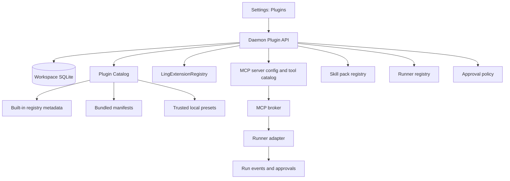

# Plugin Manager

## Status

Design proposal. Stage 1 slices 1-3 are implemented in the current codebase:
catalog/read-only UI, MCP preset apply, and plugin state/health.

This document records the next plugin-management slice after the implemented internal
registry work. It deliberately targets Codex-like internal and bundled plugin governance
first. Third-party plugin APIs, marketplace installation, and untrusted sandboxing remain
later work.

Related docs:

- [Plugin Manager Implementation Plan](plugin-manager-implementation-plan.md)
- [Internal Registry and Plugin SDK](internal-registry-plugin-sdk.md)
- [Platform Architecture](platform-architecture.md)
- [MCP Status Boundaries P2](mcp-status-boundaries-p2.md)
- [Runner Registry](runner-registry.md)
- [Runner Adapters](runner-adapters.md)
- [Secrets and Keychain](secrets-keychain.md)

## Problem

Ling Stack can already run MCP tools through teammate bindings and approval policy, and
`packages/plugin-sdk` already records internal extension metadata. That is enough for
manual capability wiring, but it is not enough for a Codex-like operator experience.

The missing product layer is a plugin manager that can answer:

- What built-in or bundled capabilities are available?
- What MCP servers, tools, skills, providers, runners, and UI modules does a capability
  contribute?
- Is the capability enabled, healthy, and assigned to any teammate?
- What approval defaults and secrets does it require?
- Can the user add a trusted local capability such as `cua-driver` without hand-writing
  every field?
- Can Ling show plugin status without granting execution authority?

Without this layer, every high-power tool looks like a raw MCP server. That is workable
for engineers, but it hides the trust model from normal operators.

## Decision

Build a plugin manager in three stages:

1. Internal and bundled plugin manager.
2. Isolated local plugin contract.
3. Third-party plugin API and marketplace.

Only stage 1 is in scope for the next slice.

Stage 1 should support built-in, bundled, and trusted local preset capabilities. It should
not support arbitrary third-party code loading, marketplace install, npm package install,
or external plugin SDK APIs.

## Goals

- Provide a Codex-like plugin management surface for internal and bundled capabilities.
- Turn common MCP integrations into safe presets instead of raw hand-written config.
- Make capability, secret, approval, and health metadata visible before execution.
- Keep all execution authority in the daemon, runner registry, MCP broker, approval
  policy, resource leases, and state machines.
- Preserve the existing internal registry and MCP server APIs.
- Add `cua-driver` as the first high-risk trusted local preset.

## Non-Goals

- No third-party plugin API.
- No marketplace or plugin store.
- No arbitrary npm/GitHub/plugin install.
- No untrusted plugin sandbox.
- No plugin direct database access.
- No plugin-owned state transitions.
- No bypass around MCP tool authorization, teammate bindings, approval policy, or audit.

## Trust Tiers

Stage 1 uses three product-facing tiers:

| Tier | Source | Code loading | Example | Default posture |
| --- | --- | --- | --- | --- |
| Built-in | Compiled into Ling packages | None | Pi runner, local channel source, built-in tools | Enabled by product defaults |
| Bundled | Shipped with Ling distribution | Static manifest and optional local assets | Browser MCP preset, GitHub MCP preset | Installable/enabled by user |
| Trusted local preset | User confirms an installed local binary or endpoint | No plugin code loaded by Ling | `cua-driver mcp` | Disabled until explicitly added |

External trusted and external untrusted tiers are intentionally excluded from stage 1.

## Architecture



The plugin manager is a control plane. It describes, enables, disables, configures, and
audits capabilities. It does not execute plugin code directly.

## Plugin Descriptor

Stage 1 should use a descriptor that is stricter than a future external plugin manifest.
It can be generated for built-ins, loaded from bundled assets, or defined as a trusted
local preset.

```ts
export type PluginSourceKind = "built-in" | "bundled" | "trusted-local-preset";

export type PluginContributionKind =
  | "mcp-server"
  | "tool"
  | "skill-pack"
  | "runner"
  | "provider"
  | "channel-source"
  | "memory"
  | "automation"
  | "ui-feature";

export interface LingManagedPluginDescriptor {
  readonly id: string;
  readonly displayName: string;
  readonly version: string;
  readonly sourceKind: PluginSourceKind;
  readonly description?: string;
  readonly homepageUrl?: string;
  readonly trustSummary: string;
  readonly contributions: readonly PluginContribution[];
  readonly requiredSecrets?: readonly ManagedPluginSecretRequirement[];
  readonly defaultApprovals?: readonly ManagedPluginApprovalDefault[];
  readonly healthChecks?: readonly ManagedPluginHealthCheck[];
}

export interface PluginContribution {
  readonly kind: PluginContributionKind;
  readonly id: string;
  readonly label: string;
  readonly capabilities: readonly string[];
  readonly sideEffectLevel?: "none" | "read" | "write" | "write-network" | "external" | "credential" | "deploy";
}
```

Descriptors are metadata. They do not grant tools to a teammate by themselves.

## Persistent Model

Add plugin state only after descriptors are stable. Suggested tables:

```text
managed_plugins
- id
- source_kind
- version
- enabled
- installed_at
- updated_at
- disabled_reason
- descriptor_json

managed_plugin_contributions
- plugin_id
- contribution_kind
- contribution_id
- linked_resource_id
- enabled
- created_at
- updated_at

managed_plugin_health_snapshots
- plugin_id
- checked_at
- expires_at
- status
- message
- details_json

managed_plugin_events
- id
- plugin_id
- type
- actor
- message
- data_json
- created_at
```

`linked_resource_id` points to existing Ling resources such as MCP server id, runner id,
provider id, or skill pack id. It must not store secret values.

## API Shape

Initial daemon API:

```http
GET /plugins
GET /plugins/:id
POST /plugins/:id/enable
POST /plugins/:id/disable
POST /plugins/:id/check
POST /plugins/:id/apply-preset
```

`apply-preset` should be explicit and idempotent. For an MCP-backed preset, it creates or
updates the corresponding MCP server config, runs a check, and optionally syncs tools.

Future diagnostic API from the internal registry should remain separate:

```http
GET /runtime/extensions
```

`/runtime/extensions` reports safe internal registry metadata. `/plugins` reports
product-managed plugin state and contributions.

## Cua Driver Preset

`cua-driver` should be the first trusted local preset:

```json
{
  "id": "trusted-local:cua-driver",
  "displayName": "Cua Driver",
  "sourceKind": "trusted-local-preset",
  "version": "local",
  "trustSummary": "Controls native macOS apps through Accessibility and Screen Recording permissions.",
  "contributions": [
    {
      "kind": "mcp-server",
      "id": "mcp:cua-driver",
      "label": "cua-driver MCP",
      "capabilities": ["macos-accessibility", "screen-capture", "gui-automation"],
      "sideEffectLevel": "external"
    }
  ]
}
```

Preset transport:

```json
{
  "type": "stdio",
  "command": "<resolved cua-driver binary>",
  "args": ["mcp"]
}
```

The daemon should resolve the binary from an explicit user-selected path, `PATH`, or a
known local install path during preset application. The resolved path should be stored in
the MCP server config so later runs do not depend on a different daemon environment.

Default policy:

- Add the MCP server disabled until the user enables the plugin.
- Sync tools only after an explicit check succeeds.
- Do not bind any tool to a teammate automatically.
- Prefer selected-tool bindings over `all_current_tools`.
- Default GUI mutation tools to `ask`.
- Keep read/status tools allowed only when the MCP annotations or local override mark them
  read-only.
- Surface Screen Recording and Accessibility readiness as health details.

Suggested initial tool posture:

| Tool family | Default |
| --- | --- |
| Permission/status/config reads | Allow when read-only |
| Window/app inspection | Allow when read-only |
| Screenshot/page extraction | Ask unless scoped and intentionally enabled |
| Click/type/key/drag/scroll/set value | Ask |
| Launch/quit/config mutation/recording/replay | Ask or deny by default |

## UI Shape

Add a `Plugins` settings surface separate from raw MCP settings.

Plugin list row:

- name, source tier, version,
- enabled/disabled state,
- health status,
- contribution count,
- assigned teammates count,
- required approvals summary.

Plugin detail:

- descriptor summary,
- contributions,
- linked MCP servers/tools,
- required secrets and status only,
- default approval posture,
- health snapshots,
- audit/event history,
- actions: enable, disable, check, apply preset, open linked MCP server, assign tools.

MCP settings remain the lower-level advanced page. The plugin page should link into it
instead of duplicating every MCP control.

## Approval And Audit Rules

Enabling a plugin is not approval to run its tools.

Rules:

- `enable` records a plugin management event.
- `apply-preset` records which resources were created or updated.
- tool assignment records teammate id, selected tools, and approval overrides.
- every MCP tool call still routes through existing runner approval hooks.
- every side-effecting plugin management action should be visible in workspace audit.
- disabling a plugin should disable or detach its contributions without deleting historical
  run evidence.

## Rollout Plan

### Slice 1: Catalog and Read-Only UI

- Add built-in descriptor generation from `LingExtensionRegistry`.
- Add bundled/trusted-local preset descriptor type.
- Add `/plugins` and `/plugins/:id` read-only endpoints.
- Add Settings `Plugins` page.
- No enable/apply behavior yet.

### Slice 2: MCP Preset Apply

- Add `apply-preset` for MCP-backed presets.
- Add `cua-driver` preset.
- Link plugin contribution to created MCP server.
- Check and sync tools through existing MCP broker.
- Keep teammate tool authorization explicit.

### Slice 3: Plugin State And Health

- Persist enabled/disabled state.
- Persist health snapshots.
- Add disable behavior that disables linked contributions.
- Add audit events for enable, disable, apply, check.

### Slice 4: Bundled Plugin Manifests

- Load manifests from a controlled bundled directory.
- Validate descriptors and Ling version compatibility.
- Support bundled MCP server, skill-pack, runner, and provider contributions.
- Still no arbitrary third-party install.

### Slice 5: Isolated Local Plugin Contract

- Add worker/child-process host context for internal-isolated plugins.
- Expose only scoped context methods.
- Use high-risk built-in automation to pressure-test the boundary.

### Slice 6: Third-Party Plugin API

- Publish a stable external manifest and host context.
- Add version pinning, source trust review, stronger sandboxing, uninstall cleanup, and
  compatibility checks.
- Consider marketplace only after the security model has production evidence.

## Test Plan

Required tests for stage 1:

- descriptors validate id, source kind, version, and contribution ids;
- duplicate plugin ids are rejected;
- built-in registry metadata appears in `/plugins`;
- `/plugins` never exposes secret values or raw dynamic code paths;
- `cua-driver` preset creates the expected stdio MCP server config;
- applying a preset is idempotent;
- plugin enable does not auto-authorize teammate tools;
- GUI mutation tools default to approval-required;
- disabling a plugin disables linked MCP contributions;
- health snapshots are short-lived and redacted;
- audit events are emitted for enable, disable, apply, and check.

Suggested validation commands:

```bash
corepack pnpm --filter @ling-stack/plugin-sdk test
corepack pnpm --filter @ling-stack/core test
corepack pnpm --filter @ling-stack/daemon test
corepack pnpm --filter @ling-stack/web typecheck
corepack pnpm typecheck
git diff --check
```

## Open Questions

- Should plugin state be workspace-local only, or should desktop builds also keep a global
  installed-plugin catalog?
- Should `cua-driver` be visible only on macOS, or visible everywhere with a platform
  blocker?
- Should screenshot/page extraction be classified as read, external, or sensitive-read in
  the approval model?
- Should plugin descriptors be generated at daemon startup only, or hot-reloaded for
  bundled development builds?
- Should plugin health checks run on demand only, or periodically while Settings is open?
