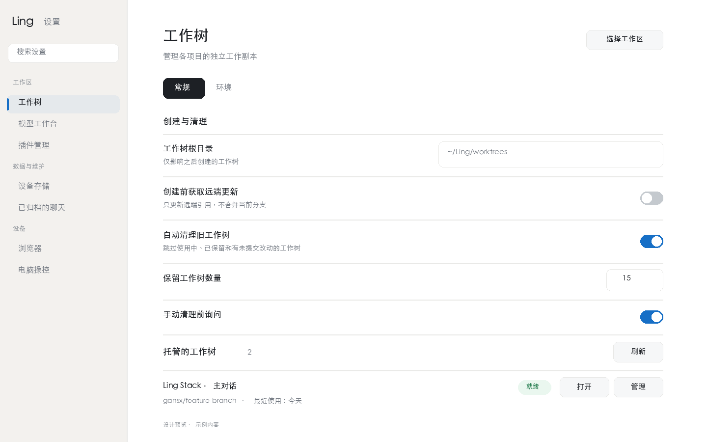
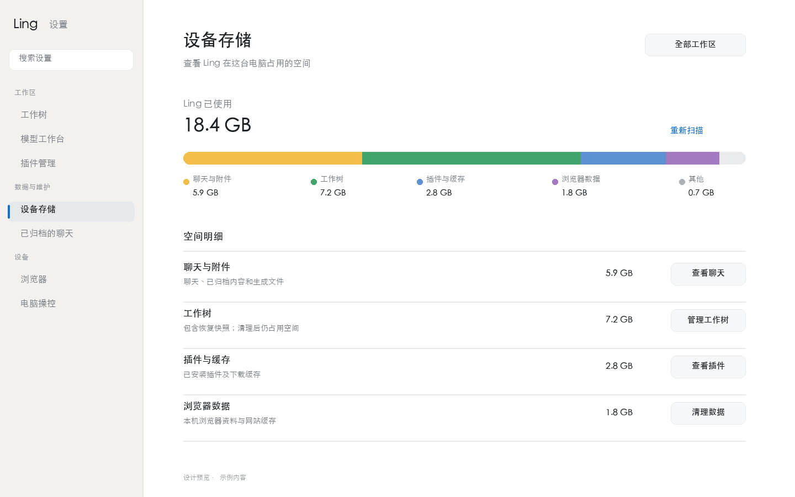
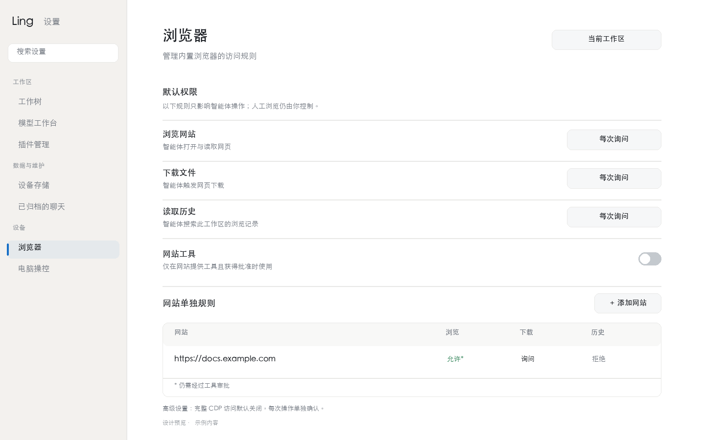

# Ling 设置页概念图

Status: static design reference; feature delivery tracked in the linked plans
Owner: Settings UI
Last verified: 2026-11-23
Canonical replacement: none; remove or update when the three Settings features are implemented
Code and test anchors: `apps/web/src/features/settings/SettingsPage.tsx`, `apps/web/e2e/ui2-settings-shell.spec.ts`

这些图片展示 Ling 现有全屏设置样式下的目标布局。容量、目录、网站和条目均为示例，
不能作为运行验收或真实用户数据。

| 概念图 | 实施合同 |
| --- | --- |
|  | [Managed Worktree Lifecycle](../../managed-worktree-lifecycle.md#settings-consolidation-plan) |
|  | [Device Storage Settings](../../device-storage-settings-implementation-plan.md) |
|  | [Desktop Browser M6](../../desktop-browser-implementation-plan.md#m6--独立浏览器设置页拟实施) |

布局中的工作树“就绪”标签、容量标题和刷新按钮只是视觉占位。实现时以对应合同的
异常状态展示、文件大小口径与刷新时机为准。
