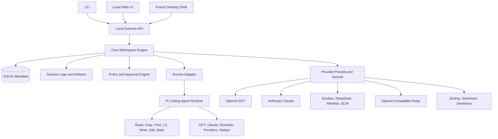
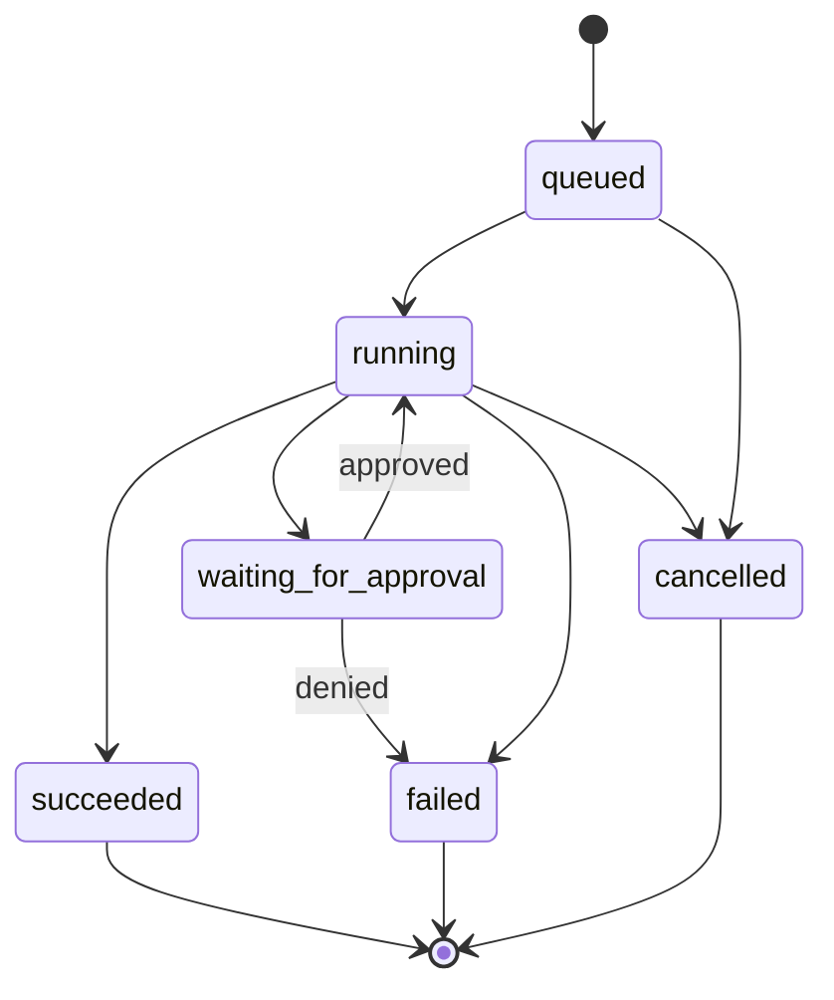

# Ling Stack v0.1 Detailed Design

## Status

Draft for v0.1 implementation.

This document turns the current scaffold into an implementation plan. It should be treated as the working contract for the next round of development, not as a description of a finished product.

Current implemented baseline:

- Monorepo scaffold.
- `@ling-stack/runner-pi` adapter around `@earendil-works/pi-coding-agent`.
- `@ling-stack/daemon` with `GET /health`.
- `POST /runs` streaming runner events over SSE.
- Initial product, architecture, provider, daemon, and Pi integration docs.

## v0.1 Goal

v0.1 should prove that Ling Stack is a useful local AI teammate workspace before desktop packaging or cloud sync exists.

The minimum useful loop:

```text
configure provider
-> bind local project as a channel
-> create a task
-> run the task through a scoped AI teammate
-> stream model and tool events
-> persist the session
-> review risky actions
-> inspect artifacts and final result
```

The first complete surface can be CLI + daemon + local web UI. Desktop packaging should wait until the daemon and web workflow are stable.

## Non-Goals

v0.1 does not include:

- Multi-user cloud sync.
- Organization permissions.
- Team billing.
- App Store distribution.
- Slack, Feishu, DingTalk, WeCom, email, or calendar automation.
- Autonomous production deployment.
- A custom coding-agent engine.
- A vector database or long-term semantic memory system.

## Core Product Contract

Ling Stack is not a generic chat client. The durable product surface is:

- Workspace.
- Channels.
- Tasks.
- AI teammates.
- Runtime sessions.
- Provider presets.
- Approval gates.
- Audit events.
- Artifacts.

The model is allowed to help with work. Ling Stack owns the evidence trail around that work.

## Architecture



### Ownership Boundary

| Area | Ling Stack owns | Pi owns |
| --- | --- | --- |
| Workspace | Channels, tasks, teammates, provider presets, policy | None |
| Run lifecycle | Run record, event persistence, approval state, artifacts | Agent turn execution |
| Tools | Allowed tool list, approval policy, audit event mapping | Tool implementation and execution loop |
| Providers | User-facing presets, secret lookup, capability routing | Coding-session model registry |
| UI | CLI, daemon API, web UI, future desktop shell | None |
| Evidence | Session event log, artifacts, summaries, redaction | Internal session messages |

Ling Stack should not fork Pi unless a required workflow cannot be solved through provider registration, resource loader configuration, event translation, or upstream contribution.

## Local Runtime Layout

Each bound project can contain a local runtime directory:

```text
.ling-stack/
  ling-stack.sqlite
  providers.json
  sessions/
    run_01hxy....jsonl
    run_01hxy....summary.json
  artifacts/
    run_01hxy.../
      files/
      diffs/
      media/
      logs/
  pi/
    # Pi agent runtime directory
```

For v0.1, this directory is local and single-user. Team sync and encrypted cloud state are out of scope.

## Domain Model

### Workspace

A local container for channels, tasks, providers, teammates, and policy.

Suggested fields:

```ts
interface Workspace {
  id: string;
  name: string;
  defaultProviderPresetId?: string;
  createdAt: string;
  updatedAt: string;
}
```

### Channel

A channel binds context to a workflow or project.

```ts
interface Channel {
  id: string;
  workspaceId: string;
  name: string;
  status: "active" | "paused" | "archived";
  boundPath?: string;
  defaultProviderPresetId?: string;
  defaultTeammateId?: string;
  allowedTools: ToolName[];
  runtimePolicy: {
    maxConcurrentRuns: number;
    executionMode: "serial" | "parallel";
    writeLockScope: "channel" | "boundPath" | "workspace";
    allowReadOnlyParallel: boolean;
    queueOnConflict: boolean;
  };
  createdAt: string;
  updatedAt: string;
}
```

v0.1 can support one workspace and many channels. Channels do not own independent business state machines. Web, CLI, and future external sources go through the daemon coordinator, resource leases, and core state machines.

Default runtime policy:

```ts
{
  maxConcurrentRuns: 1,
  executionMode: "serial",
  writeLockScope: "boundPath",
  allowReadOnlyParallel: true,
  queueOnConflict: true
}
```

`paused` channels can still be viewed and edited, but cannot start new runs. `archived` channels are read-only.

### Task

A task is the smallest executable unit of AI work.

```ts
type TaskStatus =
  | "todo"
  | "claimed"
  | "running"
  | "blocked"
  | "review"
  | "done"
  | "failed"
  | "cancelled";

interface Task {
  id: string;
  workspaceId: string;
  channelId: string;
  title: string;
  prompt: string;
  status: TaskStatus;
  assigneeTeammateId?: string;
  currentRunId?: string;
  createdAt: string;
  updatedAt: string;
}
```

Task status transitions are centralized for the runner path through core state machines and SQLite compare-and-set helpers. Direct status edits remain only for early CRUD operations; multi-teammate orchestration must use explicit transition events so two agents cannot claim or complete the same task inconsistently.

### AI Teammate

An AI teammate is a configured role with scoped tools and policy.

```ts
interface AiTeammate {
  id: string;
  workspaceId: string;
  name: string;
  role: "engineer" | "researcher" | "docs" | "ops" | "media" | "custom";
  providerPresetId: string;
  systemPrompt?: string;
  appendSystemPrompt: string[];
  allowedTools: ToolName[];
  approvalPolicyId: string;
  createdAt: string;
  updatedAt: string;
}
```

v0.1 should ship with at least one default teammate:

- `Engineer`: read, grep, find, ls by default; write, edit, bash behind approval policy.

### Skills

Skills are workflow templates assigned to AI teammates. They are not tools and do not grant execution authority by themselves.

The first implementation is a static built-in pack in `packages/core`:

- `SkillPack`: a versioned set of skill definitions, teammate templates, and workflow templates.
- `SkillDefinition`: role affinity, workflow phase, prompt fragments, required tools, provider capability requirements, approval profile, and state effects.
- `AiTeammateTemplate`: default role, system prompt, allowed tools, provider capability requirements, approval profile, and default skill bindings.
- `WorkflowTemplate`: ordered multi-teammate steps that will later compile into workflow state machines.

`gstack-default` is the first built-in pack. It is adapted from gstack's multi-role
engineering flow and current v1.58.3 skill taxonomy, but it does not vendor gstack
runtime `SKILL.md` files, generated hooks, browser extension code, iOS debug bridge code,
or machine-specific tools. It provides default templates for Product Strategist,
Architect, Engineer, Designer, QA, Security, Release, and Docs, plus Ling-native skill
definitions for planning, implementation, review, browser evidence, safety, release,
context handoff, documentation/artifact generation, gbrain setup/sync, and iOS workflows.
High-risk or host-specific workflows are registry-visible but still constrained by
teammate bindings, allowed tools, provider capabilities, channel policy, approval
profile, and run state machines. Full `SKILL.md` content enters through the import-draft
review flow rather than becoming an implicit permission grant.

Execution remains controlled by the existing Ling Stack layers: allowed tools, provider capabilities, approval policy, and state machines.

### ProviderPreset

Provider presets are user-facing model configurations.

```ts
type ProviderKind =
  | "openai"
  | "anthropic"
  | "google"
  | "doubao"
  | "deepseek"
  | "minimax"
  | "glm"
  | "openai-compatible"
  | "jimeng"
  | "seedream"
  | "seedance";

interface ProviderPreset {
  id: string;
  kind: ProviderKind;
  displayName: string;
  model: string;
  baseUrl?: string;
  api: "openai-completions" | "openai-responses" | "anthropic-messages" | "google-generative-ai" | "media-job";
  apiKeyRef?: string;
  headers?: Record<string, string>;
  capabilities: ProviderCapability[];
  createdAt: string;
  updatedAt: string;
}
```

For early development, `apiKeyRef` can resolve from `.env`. Desktop builds should move this to OS keychain.

### MediaJob

A media job records an async media request boundary without forcing media vendors into the coding-run path.

```ts
type MediaJobStatus = "queued" | "running" | "waiting_for_approval" | "succeeded" | "failed" | "cancelled";

type MediaOperation = "image_generate" | "image_edit" | "video_generate";

interface MediaJob {
  id: string;
  workspaceId: string;
  providerPresetId: string;
  operation: MediaOperation;
  prompt: string;
  input: Record<string, unknown>;
  artifactIds: string[];
  status: MediaJobStatus;
  errorMessage?: string;
  createdAt: string;
  updatedAt: string;
}
```

Implemented foundation behavior: `POST /media-jobs`, `GET /media-jobs`, and `GET /media-jobs/:id` persist and show media job metadata. `POST /media-jobs/:id/run` uses the media adapter contract, provider-kind registry, and Generation Runtime Resolver to decide whether the selected provider can run the requested operation. Live-ready providers execute directly without creating a `media_cost` approval; historical `media_cost` approvals remain readable for old workspaces. Seedream and OpenAI Images `image_generate` jobs proceed to their live image endpoints, record metadata artifacts, and download returned HTTP(S) image URLs into local image artifacts. Jimeng, unsupported Seedance/video paths, billing, and other media byte outputs remain deferred until matching adapters exist.

### RunSession

A run session records one attempt to execute a task.

```ts
type RunStatus = "queued" | "running" | "waiting_for_approval" | "succeeded" | "failed" | "cancelled";

interface RunSession {
  id: string;
  taskId: string;
  channelId: string;
  cwd: string;
  teammateId: string;
  providerPresetId: string;
  status: RunStatus;
  startedAt?: string;
  endedAt?: string;
  eventLogPath: string;
  summaryPath?: string;
  errorMessage?: string;
}
```

Run status transitions must become compare-and-set transitions before multi-agent workflows are enabled. A cancelled or failed run should never be moved back to `running` or `succeeded` by a stale runner event.

### RunEvent

The event log is the durable evidence trail.

```ts
interface RunEventEnvelope {
  id: string;
  runId: string;
  seq: number;
  ts: string;
  type: RunEventType;
  data: unknown;
}
```

Core event types:

```text
run_created
run_start
turn_start
assistant_text_delta
assistant_thinking_delta
message_end
tool_start
tool_update
tool_end
approval_requested
approval_approved
approval_denied
approval_expired
artifact_created
run_end
run_error
run_cancelled
```

### Approval

Approvals are explicit human decision points.

```ts
type ApprovalStatus = "pending" | "approved" | "denied" | "expired";

interface ApprovalRequest {
  id: string;
  runId?: string;
  taskId?: string;
  mediaJobId?: string;
  toolCallId?: string;
  risk: "low" | "medium" | "high" | "critical";
  actionType: "write" | "edit" | "bash" | "external_send" | "deploy" | "media_cost";
  title: string;
  description: string;
  payload: unknown;
  status: ApprovalStatus;
  createdAt: string;
  resolvedAt?: string;
  resolvedBy?: "local-user";
}
```

v0.1 can support local user approvals only.

Approval status transitions are terminal once resolved. Approval decisions must be idempotent so retries from CLI, Web, or a reconnecting daemon do not double-approve or double-deny the same request.

### Artifact

Artifacts are outputs that should be inspectable after a run.

```ts
interface Artifact {
  id: string;
  runId: string;
  type: "file" | "diff" | "log" | "image" | "video" | "json" | "markdown";
  path: string;
  title?: string;
  createdAt: string;
}
```

## SQLite Schema Draft

The event stream should be append-only. Large payloads can live in JSONL files while SQLite stores queryable metadata.

```sql
CREATE TABLE workspaces (
  id TEXT PRIMARY KEY,
  name TEXT NOT NULL,
  default_provider_preset_id TEXT,
  created_at TEXT NOT NULL,
  updated_at TEXT NOT NULL
);

CREATE TABLE channels (
  id TEXT PRIMARY KEY,
  workspace_id TEXT NOT NULL,
  name TEXT NOT NULL,
  status TEXT NOT NULL DEFAULT 'active',
  bound_path TEXT,
  default_provider_preset_id TEXT,
  default_teammate_id TEXT,
  allowed_tools_json TEXT NOT NULL,
  runtime_policy_json TEXT NOT NULL,
  created_at TEXT NOT NULL,
  updated_at TEXT NOT NULL
);

CREATE TABLE tasks (
  id TEXT PRIMARY KEY,
  workspace_id TEXT NOT NULL,
  channel_id TEXT NOT NULL,
  title TEXT NOT NULL,
  prompt TEXT NOT NULL,
  status TEXT NOT NULL,
  assignee_teammate_id TEXT,
  current_run_id TEXT,
  created_at TEXT NOT NULL,
  updated_at TEXT NOT NULL
);

CREATE TABLE ai_teammates (
  id TEXT PRIMARY KEY,
  workspace_id TEXT NOT NULL,
  name TEXT NOT NULL,
  role TEXT NOT NULL,
  provider_preset_id TEXT NOT NULL,
  system_prompt TEXT,
  append_system_prompt_json TEXT NOT NULL,
  allowed_tools_json TEXT NOT NULL,
  approval_policy_id TEXT NOT NULL,
  created_at TEXT NOT NULL,
  updated_at TEXT NOT NULL
);

CREATE TABLE provider_presets (
  id TEXT PRIMARY KEY,
  kind TEXT NOT NULL,
  display_name TEXT NOT NULL,
  model TEXT NOT NULL,
  base_url TEXT,
  api TEXT NOT NULL,
  api_key_ref TEXT,
  headers_json TEXT NOT NULL,
  capabilities_json TEXT NOT NULL,
  created_at TEXT NOT NULL,
  updated_at TEXT NOT NULL
);

CREATE TABLE run_sessions (
  id TEXT PRIMARY KEY,
  task_id TEXT NOT NULL,
  channel_id TEXT NOT NULL,
  cwd TEXT NOT NULL,
  teammate_id TEXT NOT NULL,
  provider_preset_id TEXT NOT NULL,
  status TEXT NOT NULL,
  started_at TEXT,
  ended_at TEXT,
  event_log_path TEXT NOT NULL,
  summary_path TEXT,
  error_message TEXT
);

CREATE TABLE run_events (
  id TEXT PRIMARY KEY,
  run_id TEXT NOT NULL,
  seq INTEGER NOT NULL,
  ts TEXT NOT NULL,
  type TEXT NOT NULL,
  data_json TEXT NOT NULL,
  UNIQUE(run_id, seq)
);

CREATE TABLE approval_requests (
  id TEXT PRIMARY KEY,
  run_id TEXT NOT NULL,
  task_id TEXT NOT NULL,
  tool_call_id TEXT,
  risk TEXT NOT NULL,
  action_type TEXT NOT NULL,
  title TEXT NOT NULL,
  description TEXT NOT NULL,
  payload_json TEXT NOT NULL,
  status TEXT NOT NULL,
  created_at TEXT NOT NULL,
  resolved_at TEXT,
  resolved_by TEXT
);

CREATE TABLE artifacts (
  id TEXT PRIMARY KEY,
  run_id TEXT,
  media_job_id TEXT,
  type TEXT NOT NULL,
  path TEXT NOT NULL,
  title TEXT,
  content_type TEXT,
  size_bytes INTEGER,
  created_at TEXT NOT NULL,
  CHECK ((run_id IS NOT NULL AND media_job_id IS NULL) OR (run_id IS NULL AND media_job_id IS NOT NULL))
);

CREATE TABLE media_jobs (
  id TEXT PRIMARY KEY,
  workspace_id TEXT NOT NULL,
  provider_preset_id TEXT NOT NULL,
  operation TEXT NOT NULL,
  prompt TEXT NOT NULL,
  input_json TEXT NOT NULL,
  artifact_ids_json TEXT NOT NULL,
  status TEXT NOT NULL,
  error_message TEXT,
  created_at TEXT NOT NULL,
  updated_at TEXT NOT NULL
);

CREATE TABLE state_transition_events (
  id TEXT PRIMARY KEY,
  workspace_id TEXT NOT NULL,
  entity_type TEXT NOT NULL,
  entity_id TEXT NOT NULL,
  from_status TEXT NOT NULL,
  to_status TEXT NOT NULL,
  event TEXT NOT NULL,
  actor TEXT NOT NULL,
  reason TEXT,
  idempotency_key TEXT,
  created_at TEXT NOT NULL
);

CREATE TABLE resource_leases (
  id TEXT PRIMARY KEY,
  workspace_id TEXT NOT NULL,
  resource_type TEXT NOT NULL,
  resource_key TEXT NOT NULL,
  owner_type TEXT NOT NULL,
  owner_id TEXT NOT NULL,
  status TEXT NOT NULL,
  acquired_at TEXT NOT NULL,
  expires_at TEXT NOT NULL,
  released_at TEXT
);
```

Indexes:

```sql
CREATE INDEX idx_tasks_channel_status ON tasks(channel_id, status);
CREATE INDEX idx_run_sessions_task ON run_sessions(task_id);
CREATE INDEX idx_run_events_run_seq ON run_events(run_id, seq);
CREATE INDEX idx_approval_requests_status ON approval_requests(status);
CREATE INDEX idx_artifacts_run ON artifacts(run_id);
CREATE INDEX idx_artifacts_media_job ON artifacts(media_job_id);
CREATE INDEX idx_media_jobs_provider ON media_jobs(provider_preset_id);
CREATE INDEX idx_media_jobs_status ON media_jobs(status);
CREATE INDEX idx_state_transition_entity ON state_transition_events(entity_type, entity_id, created_at);
CREATE UNIQUE INDEX idx_state_transition_idempotency
ON state_transition_events(entity_type, entity_id, idempotency_key)
WHERE idempotency_key IS NOT NULL;
CREATE UNIQUE INDEX idx_active_resource_lease
ON resource_leases(workspace_id, resource_type, resource_key)
WHERE status = 'active';
CREATE INDEX idx_resource_leases_owner ON resource_leases(owner_type, owner_id, status);
CREATE INDEX idx_resource_leases_expiry ON resource_leases(status, expires_at);
```

## Daemon API

v0.1 should keep the daemon API small and stable.

### Health

```http
GET /health
```

Implemented.

### Providers

```http
GET /providers
POST /providers
GET /providers/:id
PATCH /providers/:id
DELETE /providers/:id
POST /providers/:id/check
```

`POST /providers/:id/check` should verify:

- API key exists.
- Base URL is reachable when relevant.
- Model can be resolved or listed.
- Capability mismatch is reported.

### Channels

```http
GET /channels
POST /channels
GET /channels/:id
PATCH /channels/:id
DELETE /channels/:id
```

Channel payloads include `status` and `runtimePolicy`. The default policy is `serial`, one run, `boundPath` write lock, read-only parallel allowed, and queue-on-conflict intent enabled.

### Tasks

```http
GET /tasks?channelId=...
POST /tasks
GET /tasks/:id
PATCH /tasks/:id
DELETE /tasks/:id
POST /tasks/:id/run
```

`POST /tasks/:id/run` loads the persisted task and its channel, validates channel status and provider readiness, acquires resource leases, claims the task with compare-and-set, creates a run session, and streams runner events. Repeating the same `idempotencyKey` returns the original run id instead of starting a second run.

### Runs

```http
POST /runs
GET /runs/:id
GET /runs/:id/events
GET /runs/:id/artifacts
POST /runs/:id/cancel
```

`POST /runs` is implemented as direct runner invocation with the same task/run transition and lease preparation path when the request references a persisted channel task. It should continue to evolve into:

1. Create or load task.
2. Create `run_sessions` row.
3. Open JSONL event writer.
4. Invoke runner.
5. Stream translated events to the HTTP client.
6. Persist every translated event.
7. Update task and run status.
8. Emit final result or error.

### Runtime Diagnostics

```http
GET /state-transitions?entityType=task&entityId=...
GET /runtime/leases?status=active
```

These APIs are read-only and exist for UI timelines, CLI doctor checks, and debugging stuck work. Clients must not write state transitions directly.

### Approvals

```http
GET /approvals?status=pending
GET /approvals/:id
POST /approvals/:id/approve
POST /approvals/:id/deny
```

The approval API must return enough detail for the UI to show the exact command, file path, diff preview, provider job cost, or external destination.

### Artifacts

```http
GET /runs/:id/artifacts
GET /artifacts/:id
GET /artifacts/:id/content
```

Implemented path:

- artifact metadata is stored in SQLite,
- `GET /runs/:id/artifacts` lists artifact metadata for a run,
- `GET /artifacts/:id` returns one artifact record,
- `GET /artifacts/:id/content` serves local content only from `.ling-stack/artifacts`,
- paths outside `.ling-stack/artifacts` are rejected with `artifact_outside_root`,
- daemon run handling automatically extracts text/log/Markdown/diff artifacts from Pi tool outputs and stores generated file path metadata as root-scoped text artifacts.

Next work: media job artifact extraction for video outputs and non-Seedream providers.

### Media Jobs

```http
POST /media-jobs
GET /media-jobs
GET /media-jobs/:id
POST /media-jobs/:id/run
GET /media-jobs/:id/artifacts
```

Implemented foundation and execution-interface path:

- media jobs are persisted as local metadata with `queued` initial status,
- create validates that the provider preset is enabled, uses `api: "media-job"`, and includes the requested media operation capability,
- run re-validates the provider, moves jobs through `running`, and records `succeeded` or `failed`,
- the media adapter contract normalizes success/failure and artifact candidates before daemon persistence,
- the default media adapter registry maps `jimeng`, `seedream`, and `seedance` provider kinds to vendor adapter factory stubs,
- the static adapter writes Markdown artifacts under `.ling-stack/artifacts/media_jobs/:id/` and links them through existing artifact content serving,
- media providers still cannot run Pi coding tasks through `POST /runs`,
- provider checks for media presets remain static config checks,
- Jimeng, Seedance, Seedream operations beyond `image_generate`, cost estimation/billing, video artifact content, and non-Seedream media byte outputs stay in later Milestone 7 slices.

## Run Lifecycle



Task status mapping:

| Run status | Task status |
| --- | --- |
| `queued` | `claimed` |
| `running` | `running` |
| `waiting_for_approval` | `review` |
| `succeeded` | `done` |
| `failed` | `failed` |
| `cancelled` | `cancelled` |

## Event Stream Contract

SSE response format:

```text
event: <event_type>
data: <json envelope or event payload>
```

Recommended v0.1 envelope:

```json
{
  "id": "evt_01hxy...",
  "runId": "run_01hxy...",
  "seq": 12,
  "ts": "2026-05-20T10:00:00.000Z",
  "type": "tool_start",
  "data": {
    "toolCallId": "tool_123",
    "toolName": "read",
    "args": {
      "path": "README.md"
    }
  }
}
```

The current daemon streams raw translated runner event payloads. v0.1 should wrap them in a durable envelope before persistence and UI delivery.

## Approval Policy

The default policy should be conservative:

| Action | Default v0.1 behavior |
| --- | --- |
| `read`, `grep`, `find`, `ls` | Allowed inside channel `boundPath` |
| `write`, `edit` | Approval required unless path is explicitly allowed |
| `bash` | Approval required by default |
| `git commit`, `git push` | Approval required |
| External send | Approval required |
| Deployment or production changes | Approval required |
| Media generation with cost | No Ling approval gate; provider account billing applies |
| Credential changes | Critical approval required |

### Practical Pi Integration Constraint

Pi currently owns tool execution. Ling Stack therefore has two possible approval paths:

1. **Strict wrapper path:** expose controlled tools to Pi and intercept `write`, `edit`, `bash` before execution.
2. **Policy-first path:** start with read-only tools for v0.1 runs, then enable risky tools only after the approval wrapper exists.

Recommended path:

- P0: use read-only tools by default for Web UI runs.
- P0: persist tool events and show them in UI.
- P1: add controlled tool wrappers for `write`, `edit`, and `bash`.
- P1: unblock pending runs after approval.

Do not present approval as complete until Ling Stack can intercept side effects before they happen.

## Provider Capability Matrix

| Provider | v0.1 use | Capabilities | Route |
| --- | --- | --- | --- |
| OpenAI GPT | Coding and general tasks | chat, tool_call, reasoning, vision depending on model | Pi runner first |
| Anthropic Claude | Coding and general tasks | chat, tool_call, reasoning, vision depending on model | Pi runner first |
| Google Gemini | General multimodal tasks and Google Search grounding | chat, tool_call, vision, optional web_search | Pi custom provider plus Ling web-search adapter |
| Generic OpenAI-compatible relay | Local/proxy model entry | chat, optional tool_call | Pi custom provider |
| xAI/Grok | General tasks plus hosted search | chat, tool_call, reasoning, web_search through Responses-compatible protocol | Pi custom provider plus Ling web-search adapter |
| Doubao / Volcengine Ark | Domestic chat/coding entry | chat, optional tool_call, optional vision | Pi custom provider if compatible |
| DeepSeek / DPV4-compatible | Domestic reasoning/coding entry | chat, reasoning, optional tool_call | Pi custom provider if compatible |
| MiniMax | Domestic chat entry | chat, optional media/audio later | Pi custom provider if compatible |
| GLM / Zhipu | Domestic chat/coding entry | chat, tool_call, embedding depending on model | Pi custom provider if compatible |
| Jimeng / Seedream | Image generation/editing | image_generate, image_edit | Ling media adapter |
| Seedance | Video generation | video_generate | Ling media adapter |

Rules:

- Coding sessions should use Pi provider support first.
- OpenAI-compatible providers can be registered dynamically with `baseUrl`, `model`, and `api`.
- Media jobs should not be forced through Pi chat sessions.
- Capability mismatch must be visible in UI instead of hidden behind generic provider errors.

## Secret Handling

v0.1 development mode:

- Allow `.env` and runtime request keys.
- Never persist raw API keys in run events.
- Redact common secret patterns from logs.
- Store provider presets with `apiKeyRef`, not raw `apiKey`.

Future desktop mode:

- macOS Keychain.
- Windows Credential Manager.
- Linux Secret Service or encrypted local keyring.

## Web UI v0.1

The first web UI should be functional, not decorative.

Required views:

1. **Provider Settings**
   - List presets.
   - Add OpenAI, Claude, Gemini, Grok, OpenAI-compatible relay, Doubao, DeepSeek/DPV4, MiniMax, GLM.
   - Check provider health.

2. **Channel Setup**
   - Bind local path.
   - Pick default provider.
   - Configure allowed tools.

3. **Task Board**
   - Create task.
   - Show task status.
   - Start run.

4. **Run Viewer**
   - Live SSE event stream.
   - Assistant text.
   - Tool call list.
   - Error panel.
   - Final result.

5. **Approval Panel**
   - Pending approvals.
   - Command/file/diff preview.
   - Approve or deny.

6. **Artifacts**
   - List files, diffs, logs, JSON, images, videos.
   - Open local artifact content.

7. **Language Switcher**
   - Switch the Web UI between English and Chinese.
   - Persist the selected locale in local browser storage.
   - Keep daemon payloads, prompts, event types, ids, and artifact content as source data.

Do not build a marketing landing page for v0.1. The first screen should be the usable workspace.

## CLI v0.1

The CLI should support the same core loop as the Web UI.

Commands:

```text
ling-stack init
ling-stack daemon start
ling-stack daemon status
ling-stack provider add
ling-stack provider check
ling-stack channel create
ling-stack task create
ling-stack run
ling-stack runs list
ling-stack runs show
ling-stack approvals list
ling-stack approvals approve
ling-stack approvals deny
ling-stack ui
```

`ling-stack run` should support both direct prompt mode and task mode:

```bash
ling-stack run --cwd . --provider local-relay --model dpv4 "Inspect this repo"
ling-stack run --task task_123
```

## Error Model

Daemon and provider errors should normalize into stable codes:

```text
bad_request
auth_failed
model_not_found
rate_limited
quota_exceeded
network_error
timeout
unsupported_capability
approval_required
approval_denied
runner_failed
provider_internal_error
internal_error
```

Every error response should include:

```ts
interface LingStackError {
  error: string;
  message: string;
  details?: unknown;
  runId?: string;
}
```

## Cancellation

Implemented behavior: HTTP client disconnect does not cancel the Pi runner; explicit cancellation uses `POST /runs/:id/cancel`.

v0.1 includes:

- `POST /runs/:id/cancel`.
- Run status transition to `cancelled`.
- Best-effort runner cancellation.
- Event log entry `run_cancelled`.
- UI cancel button.

If upstream Pi does not expose cancellation cleanly, v0.1 should still mark the Ling run as cancelling/cancelled and stop streaming to the client, while the adapter work is handled separately.

## Security Requirements

Minimum v0.1 security rules:

- Daemon binds to `127.0.0.1` by default.
- Local auth token for mutating APIs.
- No raw API keys in logs, events, artifacts, or summaries.
- Read/write policy is path-scoped to channel `boundPath`.
- Approval required before external side effects.
- Approval required before destructive shell commands.
- CORS should be local-only once the Web UI origin is known.
- Session logs should store output summaries when full command output may contain secrets.

## Testing Strategy

P0 tests:

- `GET /health` returns OK.
- `POST /runs` validates required fields.
- `POST /runs` returns SSE headers.
- Runner emits `run_start` and terminal event.
- Event persistence appends valid JSONL envelopes.
- Secret redaction removes API key values from event payloads.

P1 tests:

- Provider preset CRUD.
- Provider health check success and failure cases.
- Channel and task CRUD.
- Run cancellation.
- Approval creation, approval, denial.
- Read-only tool policy.
- CLI commands call daemon correctly.

P2 tests:

- Web UI run flow with Playwright.
- Provider contract tests.
- Media job adapter tests.
- Desktop smoke tests after packaging starts.

## Implementation Milestones

### Milestone 1: Durable Runs

Goal: every run leaves a durable local trace.

Tasks:

- Add `.ling-stack` runtime path helper.
- Add SQLite dependency and migration runner.
- Add `run_sessions` and `run_events` persistence.
- Wrap SSE events in durable envelopes.
- Write JSONL event logs.
- Add `GET /runs/:id` and `GET /runs/:id/events`.

Exit criteria:

- A run can be started, refreshed in UI/CLI later, and inspected from disk.

### Milestone 2: Provider Presets

Goal: users do not paste provider config into every run.

Tasks:

- Add provider preset store.
- Add `.env` secret resolution.
- Add provider health check endpoint.
- Add initial presets for OpenAI, Claude, Gemini, Grok, OpenAI-compatible relay, DeepSeek/DPV4, MiniMax, GLM, Doubao.
- Keep Jimeng/Seedream/Seedance media execution in the later media-job milestone.

Status: implemented for shared provider templates, CLI/Web preset creation, env secret refs, and live chat health checks for OpenAI-compatible, OpenAI Responses, and Anthropic Messages protocols. Gemini and Grok templates are present; provider-backed web search is now adapter-gated for OpenAI Responses, Responses-compatible Grok/private relays, Chat Completions search models, and Gemini Google Search grounding. Media provider execution moved into Milestone 7; Seedream `image_generate` now has the first live media adapter behind an explicit provider `compat` gate.

Exit criteria:

- `POST /runs` can reference `providerPresetId`.

### Milestone 3: Channels and Tasks

Goal: runs are connected to a workspace workflow.

Status: implemented for core storage, daemon APIs, CLI commands, Web UI editing, and linked run status transitions.

Tasks:

- Add workspace bootstrap.
- Add channel CRUD.
- Add task CRUD.
- Add task status transitions from run lifecycle.
- Add CLI commands for channel/task creation.

Exit criteria:

- A user can create a channel, create a task, and run it without hand-writing JSON.

### Milestone 4: Approval Foundation

Goal: risky actions stop before they happen.

Status: implemented for workspace-level policy storage, daemon API, Web settings UI, tool decisions (`allow` / `ask` / `deny`), write path scopes, persisted approval requests, and Pi pre-tool interception for `bash`, `edit`, and `write`.

Tasks:

- Define approval policy model.
- Default Web UI runs to read-only tools.
- Persist approval requests.
- Add approval API.
- Add UI approval panel.
- Investigate Pi controlled tool wrapper boundary for `write`, `edit`, `bash`.

Exit criteria:

- Ling Stack does not claim write/bash approval is complete until side effects are intercepted before execution.

### Milestone 5: Web UI First Loop

Goal: users can see the product without curl.

Status: implemented for the local app shell, provider settings, approval list, run history with persisted run detail/rerun, channel creation/editing, task creation, task details/editing, task deletion, and task run entry. Richer task detail views remain follow-up work.

Tasks:

- Build local web app.
- Provider settings page.
- Channel/task creation.
- Run viewer with SSE stream.
- Tool call panel.
- Error and final result panel.

Exit criteria:

- A user can run a task from the browser and watch model/tool events live.

### Milestone 6: CLI First Loop

Goal: terminal users can complete the same workflow.

Tasks:

- Implement `ling-stack init`.
- Implement daemon start/status helpers.
- Implement provider add/check.
- Implement channel/task/run commands.
- Implement runs show/events.

Exit criteria:

- A user can complete the v0.1 loop from CLI only.

### Milestone 7: Media Adapter Foundation

Goal: model providers are capability adapters, not just chat endpoints.

Status: foundation plus execution interface started. Media providers are represented as `media-job` presets, coding runs reject them, provider checks use generation runtime readiness, the media adapter contract and provider-kind registry exist, vendor stubs emit redacted request plans through a disabled-by-default transport seam, Seedream and OpenAI Images `image_generate` have live HTTP adapters behind provider `compat.mediaVendorTransport.mode = "live"`, live execution no longer creates `media_cost` approvals, URL image bytes are stored as local artifacts, and daemon/Web expose media job create/list/show/run plus linked artifact surfaces. Jimeng, unsupported Seedance/video paths, cost estimation/billing, and media byte outputs without connected adapters remain follow-up work.

Tasks:

- Add media job model. **Implemented for local metadata persistence.**
- Add Jimeng/Seedream/Seedance adapter interfaces. **Contract boundary, vendor request planning, disabled/fake transport seam, generation runtime readiness, and Seedream/OpenAI Images `image_generate` HTTP adapters implemented with static and mock-HTTP tests; other live vendor adapters deferred.**
- Add provider capability UI. **Implemented for provider presets and Media Jobs panel.**
- Add approval before high-cost media jobs. **Superseded: media generation now runs directly after runtime readiness checks. `media_cost` remains only as a legacy approval type for old workspace records.**

Exit criteria:

- Image/video providers can be represented cleanly even before every provider is implemented.

## Open Questions

1. Should v0.1 use SQLite directly, or start with JSON files and move to SQLite before UI?
   - Recommendation: use SQLite now. The domain is already relational enough.

2. Should Web UI or CLI come first after persistence?
   - Recommendation: Web UI first for product clarity, CLI in parallel only for daemon/debug commands.

3. Should `POST /runs` accept full provider config forever?
   - Recommendation: keep it for development, but prefer `providerPresetId` after Milestone 2.

4. How strict should `bash` approval be?
   - Recommendation: approval required by default. Later add allowlists for harmless commands.

5. Should desktop start before approval hooks?
   - Recommendation: no. Desktop would mostly package incomplete product behavior.

## Immediate Next Design Breakdowns

After this document, split design into focused implementation docs:

1. [`docs/design/session-persistence.md`](design/session-persistence.md)
2. [`docs/design/provider-presets.md`](design/provider-presets.md)
3. [`docs/design/approval-policy.md`](design/approval-policy.md)
4. [`docs/design/web-ui-v0.1.md`](design/web-ui-v0.1.md)
5. [`docs/design/cli-v0.1.md`](design/cli-v0.1.md)

Each breakdown should include:

- Goal.
- Data model.
- API changes.
- File/module changes.
- Edge cases.
- Test plan.
- Implementation checklist.
